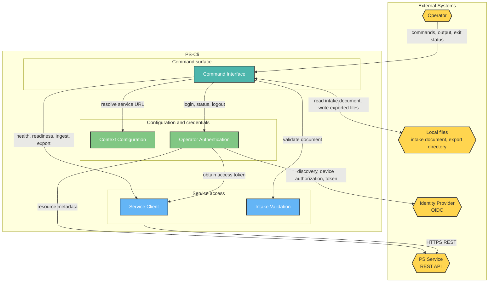

<!-- © 2026 Cartman ApS. All rights reserved. -->
# Policy System - Container - PS-Cli Architecture

**Status:** Draft
**Container:** PS-Cli

---

## Table of Contents

1. [Overview](#overview)
2. [C4 Component Level](#c4-component-level)
   - [C4 Component Diagram](#c4-component-diagram)
   - [C4 Component Overview](#c4-component-overview)
   - [Domain Concepts to Component Mapping](#domain-concepts-to-component-mapping)
3. [Components](#components)
   - [Command Interface](#command-interface)
   - [Context Configuration](#context-configuration)
   - [Operator Authentication](#operator-authentication)
   - [Service Client](#service-client)
   - [Intake Validation](#intake-validation)
4. [Use Case Coverage Mapping](#use-case-coverage-mapping)
5. [NFR Implementation](#nfr-implementation)
6. [Implementation Guide](#implementation-guide)

---

## Overview

PS-Cli is the Policy System's operator command-line client. It is installed independently of PS Service, in the manner of `gh` and `az`, and reaches PS Service only through its REST API and the OIDC endpoints of the identity provider that PS Service names. It has no access to the graph, the state database or the container runtime, and it never controls the lifecycle of a PS Service deployment.

### Container Purpose

- Report whether a PS Service instance is reachable, healthy and ready
- Submit an internal regulation intake document for ingestion and report the per-stage outcome
- Export an already-ingested instrument's artifact to local files
- Keep named PS Service targets (contexts) and select the one every command uses
- Authenticate the operator to a non-local PS Service through the OIDC device-authorization flow

### Container Architectural Pattern

Thin client with a single command surface:

- **Command surface**: one parser and dispatcher that maps each command to a handler and each failure to a process exit status
- **Configuration and credentials**: named contexts resolved from the environment, flags and files; per-context refresh tokens in an operating-system-protected store
- **Service access**: one REST client for PS Service and one OIDC client for the identity provider, both verifying server certificates against the operating system trust store

**Domain Path:** `ps.cli`

---

## C4 Component Level

### C4 Component Diagram

**Diagram Legend:**

- **Hexagon shapes (Yellow):** External systems and actors
- **Rectangle shapes (Teal):** Command surface
- **Rectangle shapes (Green):** Configuration and credentials components
- **Rectangle shapes (Blue):** Service access components
- **Arrows:** Component interactions and data flow

### C4 Component Overview

| Component name | Domain Path | Key responsibilities |
|---|---|---|
| Command Interface | ps.cli.commandinterface | Define the command surface (`get health`, `ingest document`, `export instrument`, `config set-context`/`use-context`/`get-contexts`, `auth login`/`status`/`logout`, `--context`, `--verbose`, `--version`); dispatch each command to its handler; print results and render tables; map every failure to a process exit status (0 success, 1 user-facing error, 130 operator interrupt, 2 unexpected error) |
| Context Configuration | ps.cli.contextconfiguration | Resolve the PS Service base URL for an invocation from, highest first, the `PS_CLI_SERVICE_URL` environment variable, the `--context` flag, the current context in `targets.toml`, a working-directory `ps-cli.toml` override and the packaged default; create, select and list named contexts with optional per-context OIDC overrides; reject an explicit but invalid value instead of falling back |
| Operator Authentication | ps.cli.operatorauthentication | Discover the authorization server and device-authorization endpoints, run the device-authorization flow, hold one refresh token per context in an operating-system-protected credential store, exchange it for an in-memory access token for the duration of an invocation, and report or clear the stored login. Access tokens are never persisted and there is no plaintext fallback store |
| Service Client | ps.cli.serviceclient | Call PS Service's REST API (`GET /health`, `GET /ready`, `POST /ingestions`, `POST /exports`), attach the bearer token to the authenticated calls, bound each call by a timeout, verify server certificates against the operating system trust store, and translate transport failures and structured error bodies into operator-facing errors |
| Intake Validation | ps.cli.intakevalidation | Validate an internal regulation intake document against the packaged intake schema before any request is sent, and report the best-matching schema violation |

### Domain Concepts to Component Mapping

| Domain Concept | Component Name | Domain Path | Implementation Notes |
|---|---|---|---|
| Regulatory instrument | Intake Validation, Service Client, Command Interface | `ps.cli.intakevalidation`, `ps.cli.serviceclient`, `ps.cli.commandinterface` | PS-Cli carries a regulatory instrument only as a document or an artifact. It validates an `internal` instrument's intake document and submits it for ingestion, and it saves an ingested instrument's exported artifact. It reads and writes no graph node and defines no property of the instrument |

---

## Components

### Command Interface

#### Domain Concepts

None — the component moves documents and artifacts between the operator and PS Service and holds no domain entity.

#### Kind

| Kind | Framework | Language | Project Pattern | Namespace Pattern |
|---|---|---|---|---|
| Internal component (Python package) | argparse, rich | Python 3.14 | `ps-cli/src/ps_cli/` | `ps_cli` |

**Implementation Guidance:**
- A successful command prints only what its contract requires; nothing is printed before a call that can still fail.
- Handlers raise user-facing errors and never catch them; one catch site maps them to an exit status.
- `--version` always exits 0 and reports the client version and the service version; when PS Service is unreachable it reports that instead of failing.
- `ingest document` runs local validation, then a readiness pre-flight that blocks only when the LLM Interface is reported unhealthy, then submits the already-parsed document.
- `export instrument` checks that the destination is an existing writable directory before requesting the export, then writes `baseline.json`, `native.json` and `manifest.json` there. An export of an `internal` instrument prints a notice that the files may hold the organisation's confidential policy content.

#### Implementation Registration

| Path | Purpose | Implements |
|---|---|---|
| `ps-cli/src/ps_cli/cli.py` | Entry point, dispatch and exit-status mapping | ParseAndDispatch |
| `ps-cli/src/ps_cli/modules/parser.py` | Command, flag and argument definitions | ParseAndDispatch |
| `ps-cli/src/ps_cli/modules/handlers.py` | `get health`, `ingest document`, `export instrument` handlers | ReportHealth, IngestDocument, ExportInstrument |
| `ps-cli/src/ps_cli/modules/config_handlers.py` | `config` handlers | ManageContexts |
| `ps-cli/src/ps_cli/modules/auth_handlers.py` | `auth` handlers | Login, ShowLoginStatus, Logout |
| `ps-cli/src/ps_cli/render.py` | Bordered table output | — |
| `ps-cli/src/ps_cli/errors.py` | Operator-facing error types | — |

#### Actions

| Action | Purpose | Authentication Required | Authorization Scope | Pre-conditions | Post-conditions | Side Effects | External Dependencies | Processing Time (SLA) | Idempotent | Error Handling Strategy |
|---|---|---|---|---|---|---|---|---|---|---|
| ParseAndDispatch | Turn the command line into one handler call and a process exit status | No | n/a | None | Exit status 0, 1, 130 or 2 | Output to stdout and stderr | None | < 100ms excluding the handler | Yes | A user-facing error exits 1 with its message and optional hint; `--verbose` adds the failure site; any other exception exits 2 |
| ReportHealth | Report reachability, liveness and readiness of the selected PS Service | No | n/a | A resolvable service URL | Prints `reachable`, `health` and `ready` | None | PS Service | < 40s | Yes | Reachable but not ready exits 1 and lists the unhealthy dependencies when named |
| IngestDocument | Submit an internal regulation intake document and report the run id, instrument id and per-stage outcome | Yes when the context has credentials | PS Service ingestion route authorisation | A readable `.json` file that passes Intake Validation; LLM Interface not reported unhealthy | Prints run id, instrument id and each stage's status, with the pending-review count on the merge stage when non-zero | Ingestion run on PS Service | PS Service | Up to 30 minutes | No | No request is sent when validation or the pre-flight fails; a read timeout is reported as PS Service not responding in time |
| ExportInstrument | Save an ingested instrument's baseline, native and manifest artifacts locally | Yes when the context has credentials | PS Service export route authorisation | An existing writable destination directory | Three files written, overwriting existing ones; paths printed | Local file writes | PS Service | Up to 30 minutes | Yes | The destination is checked before the request is made |
| ManageContexts | Create or update a context, select the current context, list contexts | No | n/a | A valid `http` or `https` URL for set-context | `targets.toml` updated, or the contexts listed with the current one marked | Writes `targets.toml` | Local file system | < 100ms | Yes | A malformed `targets.toml` fails with the file named |

---

### Context Configuration

#### Domain Concepts

None — configuration utility.

#### Kind

| Kind | Framework | Language | Project Pattern | Namespace Pattern |
|---|---|---|---|---|
| Internal component (Python modules) | None | Python 3.14 | `ps-cli/src/ps_cli/` | `ps_cli` |

**Implementation Guidance:**
- The configuration directory is `PS_CLI_CONFIG_DIR` when set, otherwise `~/.config/ps-cli/`.
- A context holds a required URL and optional OIDC overrides: issuer, client id, audience and scopes.
- `--context` applies to one invocation and is never persisted.
- A context stored in the older flat format is rejected with a message that names the file and points at `config set-context`.

#### Implementation Registration

| Path | Purpose | Implements |
|---|---|---|
| `ps-cli/src/ps_cli/config.py` | Service URL resolution and precedence | ResolveServiceUrl |
| `ps-cli/src/ps_cli/default_config.toml` | Packaged default service URL | ResolveServiceUrl |
| `ps-cli/src/ps_cli/targets.py` | `targets.toml` parse and write | ResolveServiceUrl, WriteTargets |
| `ps-cli/src/ps_cli/toml_writer.py` | TOML string and array serialisation | — |

#### Actions

| Action | Purpose | Authentication Required | Authorization Scope | Pre-conditions | Post-conditions | Side Effects | External Dependencies | Processing Time (SLA) | Idempotent | Error Handling Strategy |
|---|---|---|---|---|---|---|---|---|---|---|
| ResolveServiceUrl | Produce the validated service URL and the name of the context that supplied it | No | n/a | None | A `http` or `https` URL | None | Local file system | < 50ms | Yes | An explicit invalid value or an unknown `--context` fails closed with a user-facing error |
| WriteTargets | Persist contexts and the current-context pointer | No | n/a | A valid context entry | `targets.toml` rewritten | Creates the configuration directory when missing | Local file system | < 50ms | Yes | A write failure is reported to the operator |

---

### Operator Authentication

#### Domain Concepts

None — client-side credential handling.

#### Kind

| Kind | Framework | Language | Project Pattern | Namespace Pattern |
|---|---|---|---|---|
| Internal component (Python modules) | httpx, msal-extensions, truststore | Python 3.14 | `ps-cli/src/ps_cli/` | `ps_cli` |

**Implementation Guidance:**
- Discovery reads PS Service's protected-resource metadata at `/.well-known/oauth-protected-resource` to find the authorization server, then that server's `/.well-known/openid-configuration` for the device-authorization and token endpoints. A per-context override wins over a discovered value, and a missing value with no override fails closed.
- The device flow follows RFC 8628: the verification URI and user code are printed as soon as they are issued, before polling starts; polling honours `authorization_pending` and `slow_down` and fails with an actionable message on `expired_token`, `access_denied` or any unrecognised code.
- A rotated refresh token is written back to the store. A transport failure or a 5xx answer during verification is reported as "could not verify", distinct from a rejected credential.
- Errors name the exception type and a numeric backend status, never stored content or token values.
- PS-Cli accepts only an `https` issuer or a loopback issuer.

#### Implementation Registration

| Path | Purpose | Implements |
|---|---|---|
| `ps-cli/src/ps_cli/oidc_discovery.py` | Resource-metadata and OpenID discovery | DiscoverAuthParameters |
| `ps-cli/src/ps_cli/device_flow.py` | Device authorization, polling, access-token cache | Login, ObtainAccessToken |
| `ps-cli/src/ps_cli/credentials.py` | Per-context credential store | StoreCredential, ClearCredential |
| `ps-cli/src/ps_cli/tls.py` | Operating-system trust-store TLS context | — |

#### Actions

| Action | Purpose | Authentication Required | Authorization Scope | Pre-conditions | Post-conditions | Side Effects | External Dependencies | Processing Time (SLA) | Idempotent | Error Handling Strategy |
|---|---|---|---|---|---|---|---|---|---|---|
| DiscoverAuthParameters | Resolve issuer, client id, audience, scopes and endpoints for a context | No | n/a | A resolvable service URL | Resolved parameters | None | PS Service, Identity Provider | < 10s | Yes | Fails closed with an actionable error when nothing is discovered and no override exists |
| Login | Authenticate the operator through the device flow and store the refresh token | Interactive, at the identity provider | Identity provider policy | A selected context | Refresh token stored for the context; `logged in to <context> (<issuer>)` printed | Credential store write; blocking poll | Identity Provider, credential store | Bounded by the device-code lifetime | Yes | Expired or denied login ends with an actionable error; a store failure is reported as such |
| ObtainAccessToken | Convert the stored refresh token into an in-memory access token for one invocation | Stored credential | Identity provider policy | A stored credential for the context | Access token cached in memory only | May rotate the stored refresh token | Identity Provider | < 10s | Yes | A rejected credential tells the operator to log in again |
| ShowLoginStatus | Verify the stored credential end to end and print context, issuer and `logged in` | Stored credential | n/a | A selected context | Status printed; no token value is printed | May rotate the stored refresh token | Identity Provider | < 10s | Yes | "Could not verify" is reported separately from "not logged in" |
| Logout | Remove the context's stored credential | No | n/a | A selected context | No credential remains for the context | Credential store write | Credential store | < 1s | Yes | A store failure is reported as such |

---

### Service Client

#### Domain Concepts

None — transport component.

#### Kind

| Kind | Framework | Language | Project Pattern | Namespace Pattern |
|---|---|---|---|---|
| Internal component (Python module) | httpx | Python 3.14 | `ps-cli/src/ps_cli/http_client.py` | `ps_cli.http_client` |

**Implementation Guidance:**
- `GET /health` and `GET /ready` are unauthenticated. `POST /ingestions` and `POST /exports` carry the bearer token when the context has credentials.
- Default call bounds are connect 5s, read 30s, write 5s, pool 5s; ingestion and export raise the read bound to 30 minutes because they run the full server-side pipeline.
- A plain-`http` non-loopback service URL produces a warning; certificate verification is never disabled.
- A structured error body from PS Service is surfaced as the operator-facing message; a 401 directs the operator to `auth login`.
- The client never imports PS Service code; the response shapes it reads are mirrored field for field.

#### Implementation Registration

| Path | Purpose | Implements |
|---|---|---|
| `ps-cli/src/ps_cli/http_client.py` | REST client and response parsing | CheckHealth, CheckReadiness, SubmitIngestion, RequestExport |
| `ps-cli/src/ps_cli/models.py` | Typed results of the REST calls | — |

#### Actions

| Action | Purpose | Authentication Required | Authorization Scope | Pre-conditions | Post-conditions | Side Effects | External Dependencies | Processing Time (SLA) | Idempotent | Error Handling Strategy |
|---|---|---|---|---|---|---|---|---|---|---|
| CheckHealth | Read PS Service liveness status and version | No | n/a | None | Status string and version | None | PS Service | < 40s | Yes | Connection, timeout and TLS failures become operator-facing errors with a hint |
| CheckReadiness | Read PS Service readiness and the unhealthy dependencies | No | n/a | None | Readiness status and dependency names | None | PS Service | < 40s | Yes | As above |
| SubmitIngestion | Send an intake document to `POST /ingestions` | Yes when credentials exist | As enforced by PS Service | A validated document | Run id, instrument id and stage outcomes | Ingestion run on PS Service | PS Service | Up to 30 minutes | No | A structured error body (including 403 when the caller lacks `ComplianceOfficer`) or 401 becomes an operator-facing error |
| RequestExport | Request an instrument's artifact from `POST /exports` | Yes when credentials exist | As enforced by PS Service | An ingested instrument id | Manifest and base64 blobs | None on PS Service | PS Service | Up to 30 minutes | Yes | As above |

---

### Intake Validation

#### Domain Concepts

Regulatory instrument, as the intake document of an `internal` instrument; defined in `ps-domain-concepts.md`.

#### Kind

| Kind | Framework | Language | Project Pattern | Namespace Pattern |
|---|---|---|---|---|
| Internal component (Python module) | jsonschema | Python 3.14 | `ps-cli/src/ps_cli/intake_validation.py` | `ps_cli.intake_validation` |

**Implementation Guidance:**
- The schema is the packaged copy of the internal regulation intake schema; it matches the one PS Service validates against.
- Only a non-empty path ending in `.json` is accepted.
- Validation runs before any network call so that an invalid document never reaches PS Service.

#### Implementation Registration

| Path | Purpose | Implements |
|---|---|---|
| `ps-cli/src/ps_cli/intake_validation.py` | Local validation | ValidateIntakeDocument |
| `ps-cli/src/ps_cli/schemas/internal_regulation_intake_v1.schema.json` | Packaged intake schema | ValidateIntakeDocument |

#### Actions

| Action | Purpose | Authentication Required | Authorization Scope | Pre-conditions | Post-conditions | Side Effects | External Dependencies | Processing Time (SLA) | Idempotent | Error Handling Strategy |
|---|---|---|---|---|---|---|---|---|---|---|
| ValidateIntakeDocument | Reject a malformed intake document before submission | No | n/a | A readable file | The parsed document, or a user-facing error naming the best-matching violation | None | Local file system | < 1s | Yes | Unreadable file, invalid JSON and schema violations are reported as user-facing errors |

---

## Use Case Coverage Mapping

| Use Case | Components | Coverage Notes |
|---|---|---|
| UC-1: Select and add a regulation to the system | Command Interface, Service Client | PS-Cli reports PS Service health and readiness and exports an ingested instrument. Selecting an EU regulation for Cellar/ELI-sourced ingestion is done through the Policy System Plugin's skills over MCP; PS-Cli offers no command for it |
| UC-2: Govern internal regulations | Command Interface, Intake Validation, Service Client, Operator Authentication, Context Configuration | `ingest document` validates and submits an internal intake document; authentication and context selection make a remote PS Service reachable |

---

## NFR Implementation

The Solution Architecture's NFR Realization table holds no NFR for this container. This section is populated when an NFR names PS-Cli.

---

## Implementation Guide

Implementation details (packages, error handling, testing infrastructure) live in the project's L2 coding standards — [`docs/coding-standards/level2-python-instructions.md`](../coding-standards/level2-python-instructions.md) — not here. This document records WHAT components exist and HOW they interact; the L2 document records HOW to build them.

---

*End of Document*
