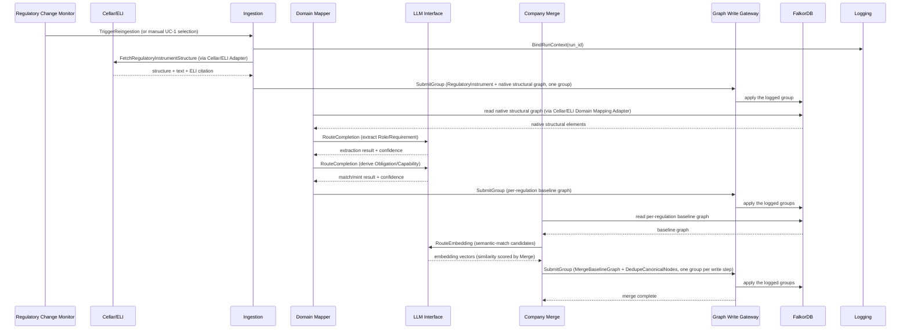
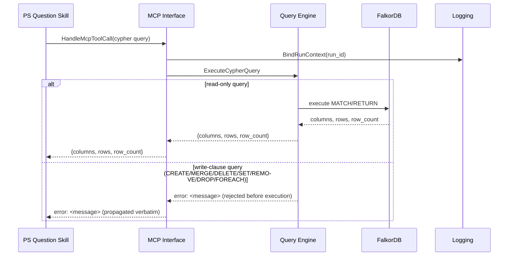
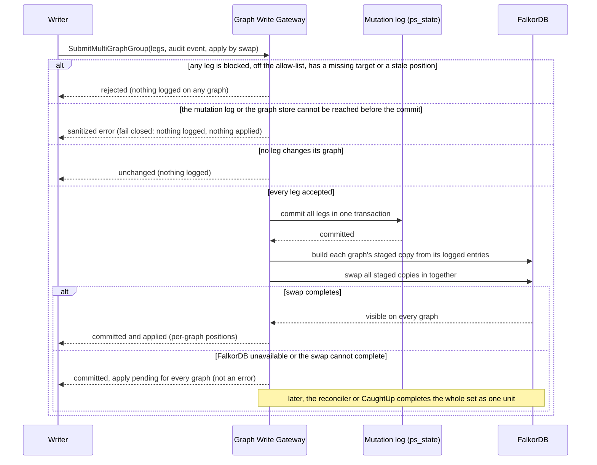

<!-- © 2026 Cartman ApS. All rights reserved. -->
# Policy System - Container - PS Service Architecture

**Status:** Draft
**Container:** PS Service

<!--
  Prerequisite note: this document was written without an approved IUD or
  Domain Terms artifact (neither exists in this repo yet), and against
  Draft-status Solution Architecture, Domain Concepts, and URS. Reconcile
  against those artifacts if/when they're created or approved.
-->

---

## Table of Contents

1. [Overview](#overview)
2. [C4 Component Level](#c4-component-level)
   - [C4 Component Diagram](#c4-component-diagram)
   - [C4 Component Overview](#c4-component-overview)
   - [Domain Concepts to Component Mapping](#domain-concepts-to-component-mapping)
3. [Components](#components)
   - [Ingestion](#ingestion)
   - [Domain Mapper](#domain-mapper)
   - [Company Merge](#company-merge)
   - [Export](#export)
   - [Restore](#restore)
   - [Curated Source](#curated-source)
   - [Invitations](#invitations)
   - [Query Engine](#query-engine)
   - [MCP Interface](#mcp-interface)
   - [Authentication](#authentication)
   - [Authorization](#authorization)
   - [Policy Lifecycle](#policy-lifecycle)
   - [Graph Cleanup](#graph-cleanup)
   - [Regulatory Change Monitor](#regulatory-change-monitor)
   - [LLM Interface](#llm-interface)
   - [Logging](#logging)
   - [Dependency Health](#dependency-health)
   - [Metrics](#metrics)
   - [Passkey Signing](#passkey-signing)
   - [Audit](#audit)
   - [Graph Write Gateway](#graph-write-gateway)
   - [Persistence](#persistence)
   - [Runtime Config](#runtime-config)
   - [Ingestion Runs](#ingestion-runs)
   - [Process Harness](#process-harness)
   - [Domain Schema](#domain-schema)
4. [Use Case Coverage Mapping](#use-case-coverage-mapping)
5. [NFR Implementation](#nfr-implementation)
6. [Implementation Guide](#implementation-guide)

---

## Overview

PS Service is the Policy System's backend container: it ingests EU regulations, maps them into the PS Conceptual Model (`ps-domain-concepts.md`) compliance graph, merges them into a company's single-tenant graph, and serves read-only queries back to consuming clients.

### Container Purpose

- Ingest EU regulation structure/text from Cellar/ELI (replacing PDF extraction as the source of truth)
- Map ingested regulatory content into the PS Conceptual Model — external regulations through Role/Requirement/Obligation/Capability; internal regulations (Business SoPs) continuing through Policy/Standard/Control via their own paired adapter
- Merge per-regulation baselines into a single-tenant compliance graph, with cross-regulation canonical convergence at Capability only; Requirement/Obligation are source-scoped and passed through, and Roles are not converged or merged automatically but are compared per instrument for near misses (review-only, AC-BI-015), and an internal instrument's Policy/Standard/Control tree is imported as `draft`, owned by the ingesting caller, and never converged
- Serve read-only Cypher queries to consuming clients via MCP (MCP Interface), with guarded execution owned by Query Engine — MCP Interface is currently the only access path; no direct/REST query path exists yet
- Detect regulatory amendments and re-trigger ingestion for the affected regulation

### Container Architectural Pattern

Pipeline + query-surface split, not a layered web-app architecture:

- **Ingestion pipeline** (sequential, per-regulation): Ingestion → Domain Mapper → Company Merge
- **Query surface** (parallel, stateless, read-only): Query Engine, fronted by MCP Interface for the PS Question Skill client
- **Support**: Regulatory Change Monitor (triggers the pipeline), LLM Interface (shared infra used by Domain Mapper and Company Merge today), Logging (shared infra used by every component for structured/semantic debug logging)

A thin REST entry-point layer routes external requests to these components but is not itself a named component in the Solution Architecture's Component Breakdown, so it isn't documented as one here — see [Implementation Guide](#implementation-guide).

**Domain Path:** `ps.service`

---

## C4 Component Level

### C4 Component Diagram

```mermaid
graph TB
    subgraph External["External"]
        Cellar{{Cellar/ELI}}
        LLMProvider{{LLM Provider}}
        PSSkill{{PS Question Skill}}
        CuratedContentSource{{Curated Content Source}}
        Authentik{{Authentik}}
    end

    subgraph PSService["PS Service"]
        subgraph Pipeline["Ingestion Pipeline"]
            Ingestion[Ingestion]
            DomainMapper[Domain Mapper]
            CompanyMerge[Company Merge]
        end

        subgraph Curation["Curation"]
            Export[Export]
            Restore[Restore]
            CuratedSource[Curated Source]
        end

        subgraph QuerySurface["Query Surface"]
            QueryEngine[Query Engine]
            MCPInterface[MCP Interface]
        end

        subgraph AccessControl["Access Control"]
            Authentication[Authentication]
            Authorization[Authorization]
            PasskeySigning[Passkey Signing]
            Invitations[Invitations]
        end

        subgraph Governance["Governance"]
            PolicyLifecycle[Policy Lifecycle]
            GraphCleanup[Graph Cleanup]
            Audit[Audit]
            GraphWriteGateway[Graph Write Gateway]
            Persistence[Persistence]
            RuntimeConfig[Runtime Config]
            IngestionRuns[Ingestion Runs]
        end

        ChangeMonitor[Regulatory Change Monitor]
        LLMInterface[LLM Interface]
        Logging[Logging]
        LogFiles[(logs/)]
        DependencyHealth[Dependency Health]
        Metrics[Metrics]
        ProcessHarness[Process Harness]
    end

    FalkorDB[(FalkorDB)]
    PSPostgres[(PS Postgres: ps_state, ps_signing)]

    Cellar -->|"regulation text, structure, ELI citations"| Ingestion
    ChangeMonitor -->|"poll for amendments"| Cellar
    ChangeMonitor -->|"trigger re-ingestion"| Ingestion
    ChangeMonitor -->|"submit succession and re-ingest marker groups (native graph, policy_system)"| GraphWriteGateway

    %% Graph Write Gateway and its edges (a module outside the gateway package reaches FalkorDB only through the read-only handle or the gateway itself): the edges of Ingestion, the Domain Mapper, Company Merge, Policy Lifecycle, Graph Cleanup, the Regulatory Change Monitor, Export and Restore all go through the gateway. No module outside the gateway package reaches FalkorDB except through the gateway's read-only handle and the gateway itself
    Ingestion -->|"submit native graph writes"| GraphWriteGateway
    DomainMapper -->|"read native graph"| FalkorDB
    DomainMapper -->|"submit per-regulation baseline graph writes"| GraphWriteGateway
    CompanyMerge -->|"read per-regulation baseline graph"| FalkorDB
    CompanyMerge -->|"submit company graph writes"| GraphWriteGateway
    CompanyMerge -->|"submit Capability embedding backfills ({short}_baseline)"| GraphWriteGateway

    Export -->|"read {short}_baseline / {short}_native"| FalkorDB
    Export -->|"read unresolved PendingReview ids of every reviewable kind (policy_system, via list_pending_reviews)"| FalkorDB
    Export -->|"submit the Capability/Policy embedding backfill group ({short}_baseline)"| GraphWriteGateway
    Restore -->|"submit one group across {short}_native / {short}_baseline / policy_system, applied by swap"| GraphWriteGateway

    CuratedContentSource -->|"catalog.json; manifest/baseline/native.json"| CuratedSource
    CuratedSource -->|"get/set/reset override"| RuntimeConfig
    CuratedSource -->|"fetched, unverified artifact"| Restore
    MCPInterface -->|"delegates to"| CuratedSource

    DomainMapper -->|"extraction calls"| LLMInterface
    CompanyMerge -->|"semantic convergence calls (embeddings)"| LLMInterface
    Export -->|"RouteEmbedding calls"| LLMInterface
    LLMInterface -->|"chat/embedding"| LLMProvider

    QueryEngine -->|"read"| FalkorDB
    MCPInterface -->|"delegates to"| QueryEngine
    PSSkill -->|"MCP: submit query"| MCPInterface

    MCPInterface -->|"verify bearer token"| Authentication
    Authentication -->|"OIDC discovery, JWKS"| Authentik
    Authentication -->|"log entries"| Logging

    MCPInterface -->|"grant/revoke/list access roles; enforce_role_gate (declared tool gates), check_role"| Authorization
    CuratedSource -->|"SystemAdmin check"| Authorization
    Authorization -->|"read/write access_role_assignments (ps_state)"| PSPostgres
    Authorization -->|"record/query audit_events"| Audit
    Authorization -->|"log entries"| Logging

    MCPInterface -->|"create/propose/approve/reject/revert/edit policy drafts"| PolicyLifecycle
    PolicyLifecycle -->|"read Policy/Standard/Control tree (policy_system)"| FalkorDB
    PolicyLifecycle -->|"submit Policy/Standard/Control tree writes"| GraphWriteGateway
    PolicyLifecycle -->|"record policy.* audit events"| Audit
    PolicyLifecycle -->|"check_role / resolve_active_roles"| Authorization

    MCPInterface -->|"discover/preview/approve/check duplicate-node cleanup (ComplianceOfficer)"| GraphCleanup
    GraphCleanup -->|"read (policy_system)"| FalkorDB
    GraphCleanup -->|"submit merge/release/unmerge writes"| GraphWriteGateway
    GraphCleanup -->|"check_role(ComplianceOfficer), re-checked at execution (a refused Role merge or unmerge records a failed row)"| Authorization
    GraphCleanup -->|"create/check pending approvals"| PasskeySigning
    GraphCleanup -->|"record capability.*/obligation.* audit events; read merge history"| Audit
    PasskeySigning -->|"execute registered action on signed assertion"| GraphCleanup
    GraphCleanup -->|"log entries"| Logging

    MCPInterface -->|"resolve-near-miss (merge): read review sides, create merge-capabilities approval"| GraphCleanup
    PasskeySigning -->|"read/write pending_approvals, signing_credentials (ps_signing)"| PSPostgres
    PasskeySigning -->|"log entries"| Logging

    MCPInterface -->|"invite-user: create Authentik invitation"| Invitations
    Invitations -->|"POST invitation (service credential)"| Authentik

    MCPInterface -->|"start-ingestion / get-ingestion-status"| IngestionRuns
    IngestionRuns -->|"read/write ingestion_runs (ps_state)"| PSPostgres
    IngestionRuns -->|"record ingestion_run.* audit events"| Audit
    Ingestion -->|"record sync ingestion_run.* audit events (REST + MCP orchestration)"| Audit
    ChangeMonitor -->|"record amendment_check ingestion_run.* audit events"| Audit
    Export -->|"record export.instrument system audit event"| Audit
    Restore -->|"record instrument.restore audit events"| Audit
    CompanyMerge -->|"record near_miss.resolve audit events"| Audit
    Invitations -->|"record user.invite audit events"| Audit
    RuntimeConfig -->|"record runtime_config.* audit events"| Audit
    RuntimeConfig -->|"read/write runtime_config (ps_state)"| PSPostgres
    Audit -->|"read/write audit_events (ps_state)"| PSPostgres

    ProcessHarness -->|"apply_pending_migrations (audit, authz, runtime_config, ingestion_runs)"| Persistence
    ProcessHarness -->|"verify_privileged_migrations (graph_gateway, read-only)"| Persistence
    ProcessHarness -->|"start the startup replay in the background; stop it and the reconciler at shutdown"| GraphWriteGateway
    Persistence -->|"connect / migrate (ps_state)"| PSPostgres
    Persistence -->|"privileged provisioning (admin)"| PSPostgres
    Persistence -->|"log entries"| Logging
    GraphWriteGateway -->|"apply writes; replay"| FalkorDB
    GraphWriteGateway -->|"append/read mutation log (ps_state)"| PSPostgres
    GraphWriteGateway -->|"log entries"| Logging

    Ingestion -->|"record health"| DependencyHealth
    LLMInterface -->|"record health"| DependencyHealth
    Persistence -->|"record health (ps_state)"| DependencyHealth
    GraphWriteGateway -->|"record health"| DependencyHealth
    Audit -->|"record health (ps_state)"| DependencyHealth
    RuntimeConfig -->|"record health (ps_state)"| DependencyHealth
    IngestionRuns -->|"record health (ps_state)"| DependencyHealth
    PasskeySigning -->|"record health (ps_signing)"| DependencyHealth
    DependencyHealth -->|"read for /ready"| ProcessHarness

    ProcessHarness -->|"startup CheckConnectivity"| FalkorDB
    ProcessHarness -->|"startup CheckConnectivity"| LLMInterface
    ProcessHarness -->|"startup CheckConnectivity"| Cellar
    ProcessHarness -->|"resolve_auth_context (startup)"| Authentication
    ProcessHarness -->|"require_bootstrap_owner_configured (startup)"| Authorization
    ProcessHarness -->|"require_authentik_credential_configured (startup)"| Invitations
    ProcessHarness -->|"log entries"| Logging

    Ingestion -->|"log entries"| Logging
    DomainMapper -->|"log entries"| Logging
    CompanyMerge -->|"log entries"| Logging
    Export -->|"log entries"| Logging
    Restore -->|"log entries"| Logging
    CuratedSource -->|"log entries"| Logging
    QueryEngine -->|"log entries"| Logging
    MCPInterface -->|"log entries"| Logging
    ChangeMonitor -->|"log entries"| Logging
    LLMInterface -->|"log entries"| Logging
    Logging -->|"write JSON lines"| LogFiles

    style Cellar fill:#FFD54F,stroke:#333,stroke-width:2px,color:#333
    style LLMProvider fill:#FFD54F,stroke:#333,stroke-width:2px,color:#333
    style PSSkill fill:#90CAF9,stroke:#333,stroke-width:2px,color:#333
    style CuratedContentSource fill:#FFD54F,stroke:#333,stroke-width:2px,color:#333
    style Authentik fill:#FFD54F,stroke:#333,stroke-width:2px,color:#333
    style FalkorDB fill:#81C784,stroke:#333,stroke-width:2px,color:#333
    style PSPostgres fill:#81C784,stroke:#333,stroke-width:2px,color:#333
    style LogFiles fill:#CFD8DC,stroke:#333,stroke-width:2px,color:#333

    style Ingestion fill:#4DB6AC,stroke:#333,stroke-width:2px,color:#FFFFFF
    style DomainMapper fill:#4DB6AC,stroke:#333,stroke-width:2px,color:#FFFFFF
    style CompanyMerge fill:#4DB6AC,stroke:#333,stroke-width:2px,color:#FFFFFF
    style Export fill:#4DB6AC,stroke:#333,stroke-width:2px,color:#FFFFFF
    style Restore fill:#4DB6AC,stroke:#333,stroke-width:2px,color:#FFFFFF
    style CuratedSource fill:#4DB6AC,stroke:#333,stroke-width:2px,color:#FFFFFF
    style PolicyLifecycle fill:#4DB6AC,stroke:#333,stroke-width:2px,color:#FFFFFF
    style GraphCleanup fill:#4DB6AC,stroke:#333,stroke-width:2px,color:#FFFFFF
    style QueryEngine fill:#64B5F6,stroke:#333,stroke-width:2px,color:#FFFFFF
    style MCPInterface fill:#64B5F6,stroke:#333,stroke-width:2px,color:#FFFFFF
    style ChangeMonitor fill:#B39DDB,stroke:#333,stroke-width:2px,color:#FFFFFF
    style LLMInterface fill:#B39DDB,stroke:#333,stroke-width:2px,color:#FFFFFF
    style Authentication fill:#B39DDB,stroke:#333,stroke-width:2px,color:#FFFFFF
    style Authorization fill:#B39DDB,stroke:#333,stroke-width:2px,color:#FFFFFF
    style PasskeySigning fill:#B39DDB,stroke:#333,stroke-width:2px,color:#FFFFFF
    style Invitations fill:#B39DDB,stroke:#333,stroke-width:2px,color:#FFFFFF
    style Audit fill:#B39DDB,stroke:#333,stroke-width:2px,color:#FFFFFF
    style Persistence fill:#B39DDB,stroke:#333,stroke-width:2px,color:#FFFFFF
    style GraphWriteGateway fill:#B39DDB,stroke:#333,stroke-width:2px,color:#FFFFFF
    style RuntimeConfig fill:#B39DDB,stroke:#333,stroke-width:2px,color:#FFFFFF
    style IngestionRuns fill:#B39DDB,stroke:#333,stroke-width:2px,color:#FFFFFF
    style DependencyHealth fill:#B39DDB,stroke:#333,stroke-width:2px,color:#FFFFFF
    style ProcessHarness fill:#B39DDB,stroke:#333,stroke-width:2px,color:#FFFFFF
    style Logging fill:#B39DDB,stroke:#333,stroke-width:2px,color:#FFFFFF
```



**Diagram Legend:**
- **Hexagon shapes (yellow/blue):** External systems and clients
- **Cylinder (green):** Data store
- **Teal:** Ingestion pipeline and policy-lifecycle components (core internal domain writes)
- **Blue:** Query surface components
- **Purple:** Support components (access control, audit/persistence/config, dependency health, process harness)

### C4 Component Overview

| Component name | Domain Path | Key responsibilities |
|---|---|---|
| Ingestion | `ps.service.ingestion` | Fetch regulation structure/text via a pluggable Ingestion Adapter (Cellar/ELI first); register RegulatoryInstrument bibliographic metadata; persist the source's native structural graph to FalkorDB |
| Domain Mapper | `ps.service.domainmapper` | Read a source's native structural graph via a paired Domain Mapping Adapter; LLM-driven extraction of Role/Requirement (only actors become Roles; names are normalised before the id is derived); derive Obligation/Capability |
| Company Merge | `ps.service.companymerge` | Merge per-regulation baseline graphs into the single-tenant graph; dedupe canonical nodes |
| Export | `ps.service.export` | Serialize an already-ingested instrument's `{short}_baseline`/`{short}_native` graphs into a curated, checksummed, schema-versioned artifact for `curated-content/`; backfill Capability/Policy embeddings onto the source baseline graph so restore never needs a live LLM call |
| Restore | `ps.service.restore` | Verify a curated artifact's checksum and `schema_version`, then load it into a target deployment: baseline via an offline replay of Company Merge's own Capability dedup/convergence, native as a straight load, both atomically, recording a near-miss pending review for each restored Capability that nearly matches an existing one; an internal instrument's Policy/Standard/Control tree is imported as `draft`, owned by the restoring caller |
| Curated Source | `ps.service.curatedsource` | Fetch the curated catalog listing and, on demand, one instrument's artifact (manifest/baseline/native) from a configurable HTTP(S) source at runtime; keep a runtime override of that source as a registered key in Runtime Config, taking precedence over the env-var/default when present; fails closed when the override cannot be read |
| Invitations | `ps.service.invitations` | Create single-use Authentik enrollment invites on behalf of the `invite-user` MCP tool, calling Authentik's invitation-stage API (`POST /api/v3/stages/invitation/invitations/`) with PS Service's own configured service credential (`PS_AUTHENTIK_API_TOKEN`/`PS_AUTHENTIK_BASE_URL`) — never a caller-supplied token; fails closed at process startup when either credential is unset |
| Query Engine | `ps.service.queryengine` | Execute read-only Cypher queries against the graph |
| MCP Interface | `ps.service.mcpinterface` | Expose Query Engine to PS Question Skill via MCP |
| Authentication | `ps.service.auth` | Validate OIDC bearer tokens for both REST and MCP Interface via one shared verifier; fail closed at startup when auth config and the local-test bypass are both absent |
| Authorization | `ps.service.authz` | Enforce RBAC (`AccessRole`) and ABAC (`AccessRule`) checks for both REST and MCP Interface; own the role-assignment table in the PS state Postgres; record every grant/revoke through the shared Audit component; fails closed on store unavailability |
| Policy Lifecycle | `ps.service.policylifecycle` | Enforce the draft → proposed → approved → deprecated governance workflow for Policy/Standard/Control; cascading tree transitions, self-approval block, versioning/SUPERSEDED_BY building blocks, audit integration via ps.service.audit |
| Graph Cleanup | `ps.service.graphcleanup` | Let a Compliance Officer find near-duplicate Capabilities and duplicate Obligations (same Role) and, after a preview and a signed passkey approval, merge them (or two Roles defined by the same RegulatoryInstrument), release a Capability from a draft governing Policy, or reverse a merge; every edit is audited before it is applied, from a before/after snapshot that makes it reversible |
| Regulatory Change Monitor | `ps.service.changemonitor` | Poll Cellar/ELI for amendments; trigger re-ingestion |
| LLM Interface | `ps.service.llminterface` | Route chat/embedding requests to the configured LLM Provider via LiteLLM |
| Logging | `ps.service.logging` | Provide structured, semantic logging for every component; write JSON entries to file; bind a correlation (run) ID at primary-use-case entry points |
| Dependency Health | `ps.service.dependencyhealth` | Process-wide registry of whether FalkorDB, the PS state Postgres, the startup graph replay, the passkey-signing Postgres, LLM Interface and Cellar/ELI succeeded on their most recent call; fed by those components' own exception handling, read by Process Harness for `/ready` |
| Metrics | `ps.service.metrics` | Operational metrics through the OpenTelemetry Metrics API, served on the service port at `GET /metrics` in the Prometheus text format: request count and latency per route template, an aggregate count of unhealthy dependencies, ingestion runs by outcome with their duration, and one total of pending graph-log entries; anonymous, in-cluster only, content-free labels; reads Dependency Health and the graph log without probing |
| Passkey Signing | `ps.service.passkeysigning` | Own WebAuthn relying party for transaction-signing (independent of the OIDC login IdP); PS-Service-owned store in the separate `ps_signing` database of the PS Postgres server for enrolled signing credentials and pending-approval records; dynamically-bound challenge construction/verification; companion-browser enrollment/signing ceremony pages; optional configured allowed origins (`PS_PASSKEYSIGNING_ALLOWED_ORIGINS`): the first names the relying party (`rp_id` and origin), and a POST on an approval route whose `Host` matches none is refused with HTTP 421 before the approval is read, while with none configured the relying party is derived from the request's `Host` |
| Audit | `ps.service.audit` | Shared, insert-only, tamper-evident audit trail (`audit_log.audit_events` in the PS state Postgres, hash-chained by the database and verifiable on demand) for every component that records who did what to what; validates each action's typed `details` against its registered model; writes in the caller's transaction so the audit row and the state change commit or roll back together; operations whose effect is outside Postgres (ingestion, restore, near-miss resolve, invite, `check-regulations` re-ingests) write an opening row first (fail-closed: if it cannot be written the operation does not run) and a best-effort terminal row; `list-audit-events` supports an allow-listed `details` filter (`celex`, `regulatory_instrument_id`, `instrument_id`) backed by expression indexes (migration 0002) |
| Graph Write Gateway | `ps.service.graphgateway` | Mutation log store, gateway (submit, apply, catch-up, startup recovery), canonical digest, requested digest checkpoints, replay with verification, resume of an interrupted replay, and the startup replay that gates `/ready` and every graph-reading request; Ingestion (the external pipeline and the internal-seed ingestion), the Domain Mapper, Company Merge (the merge stage and the near-miss resolution), Policy Lifecycle (Policy, Standard and Control creation and edits, the status transitions and the governance backfills), Graph Cleanup (capability merge, obligation merge, role merge, release and the three unmerges), the Regulatory Change Monitor (the re-ingest succession), Export (the embedding backfill) and Restore (the native, baseline and single-tenant legs of a restore, as one group applied by swap) write their graphs only through it: the single path for graph writes by Ingestion, Domain Mapper, Company Merge, Restore, Policy Lifecycle, Graph Cleanup and Regulatory Change Monitor; record each transaction group in the mutation log (`ps_state`) before it is applied; apply to FalkorDB as a rebuildable projection of the log; replay the log and verify a rebuilt graph against a digest checkpoint; reject labels and relationship types outside the allow-list; fail closed, reporting "committed, apply pending" when only the apply is delayed |
| Persistence | `ps.service.persistence` | Own PS Service's access to the PS state Postgres: per-call connections, connectivity probe, and applying each component's SQL migrations at startup, tracked per component; fails closed when the store is unconfigured or unreachable |
| Runtime Config | `ps.service.runtimeconfig` | Own runtime-mutable configuration values: each key is declared in a typed registry (name, value type, validator); reject an unregistered key or invalid value before any write; persist values in the `runtime_config` table of the PS state Postgres; audit every set/reset in the same transaction through Audit's public interface |
| Ingestion Runs | `ps.service.ingestionruns` | Track catalog ingestion runs submitted asynchronously over MCP: persist each run's status and terminal result or sanitized error in the `ingestion_runs` table of the PS state Postgres; run each submission on a background thread tracked by a process-local in-flight registry |
| Process Harness | `ps.service.main` | Expose `/health` (liveness) and `/ready` (readiness); probe every tracked dependency once at startup, of which FalkorDB, the PS state Postgres and the graph replay gate readiness, and confirm every ingestion-required Configuration field resolved; the process composition root (`load_config()`, `uvicorn.run()`) |
| Domain Schema | `ps.service.domainschema` | Define `DOMAIN_SCHEMA`, the single code definition of the compliance graph's node labels, properties, edge types and cardinalities; render the slim schema served by the `get-domain-concepts` tool; generate the property, relationship and edge-catalog tables in `ps-domain-concepts.md` and the internal intake JSON Schema; report drift of any generated copy |

### Domain Concepts to Component Mapping

| Domain Concept | Component Name | Domain Path | Implementation Notes |
|---|---|---|---|
| RegulatoryInstrument | Ingestion | `ps.service.ingestion` | Bibliographic metadata (`title`, `jurisdiction`, `effective_date`, `version`, `instrument_type`) is direct Cellar/ELI structural data — no LLM extraction needed to create this node. `instrument_type` (`regulation` \| `directive` \| `national_transposition`) is read from the source's ELI type. A `directive` source is ingested in two shapes: the Directive text as one EU-level framework node, and each member state's transposing statute as its own `national_transposition` node linked to it by `TRANSPOSES` (see [`ps-domain-concepts.md`](../artifacts/ps-domain-concepts.md#directives-and-national-transposition)). For a `directive` node, `effective_date` is the Member-State transposition deadline, not the Directive's own EU-level entry-into-force date — the transposition deadline is the point the Directive's obligations actually bind affected entities, which is what this field represents for a RegulatoryInstrument source too. Which member-state transpositions exist in the graph is a function of what has been ingested; the model does not track transposition status separately |
| Native structural elements (adapter-defined, e.g. TITLE/CHAPTER/SECTION/ARTICLE/PARAGRAPH for Cellar/ELI) | Ingestion (write, via source-specific Ingestion Adapter) + Domain Mapper (read, via paired Domain Mapping Adapter) | `ps.service.ingestion`, `ps.service.domainmapper` | Not a fixed, project-wide domain concept — each source's Ingestion Adapter persists its own native hierarchy as-is; only its paired Domain Mapping Adapter knows how to read that shape. A new regulatory source (e.g. SOX, HIPAA) means adding a new matched adapter pair, not extending a shared schema |
| Role | Domain Mapper + Graph Cleanup (post-hoc merge) | `ps.service.domainmapper`, `ps.service.graphcleanup` | LLM-extracted from the native structural graph via the Domain Mapping Adapter; only a candidate the model flags as an actor (`role_is_actor`) becomes a Role (others are dropped and logged as `non_actor_role_dropped`), and the name is normalised (article dropped, last word singularised) before the id is derived; `DEFINES` edge with `source_ref`. Company Merge compares a Role with the Roles of the same instrument and raises a review-only near miss for a close pair (`PS_COMPANYMERGE_ROLE_REVIEW_THRESHOLD`). Duplicate Roles of one instrument can be merged after the fact by a Compliance Officer (the absorbed Role is deleted and a `MergedRole` marker names the survivor); Company Merge follows the marker |
| Requirement | Domain Mapper | `ps.service.domainmapper` | LLM-extracted; `EXPRESSES` edge with `source_ref` |
| Obligation | Domain Mapper (mint/match) | `ps.service.domainmapper` | Domain Mapper matches/mints per Role within a source — an Obligation is reused only across that same Role's Requirements. **No cross-regulation convergence:** an Obligation is a weak entity of exactly one Role (identity scoped to duty statement + Role), and Roles are regulation-scoped, so Company Merge passes Obligations through unchanged, like Role and Requirement. Cross-source duties converge one hop down, at Capability. The one exception to "minted, never removed" is a Compliance Officer cleanup merge of two Obligations under the same Role (Graph Cleanup), which deletes the absorbed Obligation and leaves a `MergedObligation` marker that Company Merge follows; a Role merge (Graph Cleanup) moves Obligations to the surviving Role without changing their ids, so the inbound `HAS` edge, not the id, says which Role bears an Obligation |
| Capability | Domain Mapper (mint/match) + Company Merge (cross-regulation dedup, redirect-following) + Graph Cleanup (post-hoc merge) | `ps.service.domainmapper`, `ps.service.companymerge`, `ps.service.graphcleanup` | Domain Mapper matches/mints per-regulation; Graph Cleanup lets a Compliance Officer merge duplicates after the fact (the absorbed Capability is deleted and a `MergedCapability` marker names the survivor); Company Merge resolves canonical convergence across regulations — an exact canonical-identity match, or a semantic-equivalence match (via LLM Interface's `RouteEmbedding` action) for differently-worded content expressing the same capacity. This is the first convergence point on the compliance spine |
| Policy | Ingestion (internal-seed adapter, internal sources only, authored) + Company Merge (cross-source dedup) + Policy Lifecycle (human-authored, via MCP tools) | `ps.service.ingestion`, `ps.service.companymerge`, `ps.service.policylifecycle` | Internal-source Policy is authored directly in the intake document and minted (canonical id only) by `ps_service.ingestion.adapters.internal_seed`, the same step that authors/mints Role/Requirement/Obligation/Capability for that source — linked from Capability via `GOVERNED_BY`. Human-authored Policy is authored via Policy Lifecycle's `create-policy-draft` MCP tool, inside this container; the Policy Editor client (outside this container) remains a separate, still-out-of-scope origin. Canonical identity derived from the Policy's own `title` alone applies across all origins, with the same exact-or-semantic convergence matching as Capability, except that an internal instrument's Policy tree, whether restored from a curated artifact or ingested live, is imported as `draft`, owned by the importing caller, and never converged onto an existing Policy |
| Standard | Ingestion (internal-seed adapter, internal sources only, authored) | `ps.service.ingestion` | Authored directly in the intake document alongside its parent Policy, and minted (canonical id only) via `SUPPORTED_BY` from that Policy, for `source_type: internal`. Weak-entity identity derived from its Policy + version — scoped to exactly one Policy, no cross-source dedup needed |
| Control | Ingestion (internal-seed adapter, internal sources only, authored) | `ps.service.ingestion` | Authored directly in the intake document alongside its parent Standard, and minted (canonical id only) via `IMPLEMENTED_BY` from that Standard, for `source_type: internal`. Weak-entity identity derived from its Standard + type — scoped to exactly one Standard, no cross-source dedup needed |
| PracticeArea | Ingestion (internal-seed adapter, authored) + Company Merge (exact-identity passthrough) | `ps.service.ingestion`, `ps.service.companymerge` | Authored directly in the intake document for `source_type: internal` and minted (canonical id only, content-derived from `name` alone) by `ps_service.ingestion.adapters.internal_seed`, the same step that authors/mints Policy/Standard/Control for that source. Company Merge's `persist_practice_area_and_risk_path_passthrough` carries it through unchanged (a create-only gateway group: an existing node is left out of the group and keeps its properties, never a semantic/embedding comparison) — two sources naming the same PracticeArea converge onto one node because their ids are identical content hashes minted by Ingestion, not because Company Merge compares them. `validate_classification_edge_endpoints` confirms every edge endpoint already exists before any classification edge is written. `COVERS` (→ Capability) and `OWNS` (→ Policy) edge targets are rewritten onto the target's own canonical id when it was dedup-resolved, exactly like `GOVERNED_BY`'s Policy target |
| RiskPath | Ingestion (internal-seed adapter, authored) + Company Merge (exact-identity passthrough) | `ps.service.ingestion`, `ps.service.companymerge` | Same origin/passthrough shape as PracticeArea, canonical identity content-derived from `name` alone, carried through by the same `persist_practice_area_and_risk_path_passthrough` function. `MITIGATED_BY` (→ Capability) has its target rewritten the same way; `VERIFIED_BY` (→ Control) passes through unchanged, since Control is never canonically deduped. Write counts for both labels and all four edge types (`COVERS`/`OWNS`/`MITIGATED_BY`/`VERIFIED_BY`) are reported via `classification_write_counts` on the merge's semantic log entry |
| Mutation log | Graph Write Gateway | `ps.service.graphgateway` | The authoritative, append-only record of graph content; FalkorDB is a projection of it. Defined in [`ps-domain-concepts.md`](../artifacts/ps-domain-concepts.md#graph-write-gateway-and-mutation-log); not a graph node |
| Log entry | Graph Write Gateway | `ps.service.graphgateway` | One resolved primitive graph mutation, traceable to the Audit event of its causing command. Defined in [`ps-domain-concepts.md`](../artifacts/ps-domain-concepts.md#graph-write-gateway-and-mutation-log); not a graph node |
| Transaction group | Graph Write Gateway | `ps.service.graphgateway` | Ordered entries committed together as one unit; the unit a writer submits. Defined in [`ps-domain-concepts.md`](../artifacts/ps-domain-concepts.md#graph-write-gateway-and-mutation-log); not a graph node |
| Per-graph sequence | Graph Write Gateway | `ps.service.graphgateway` | Gap-free ordering of entries within one graph. Defined in [`ps-domain-concepts.md`](../artifacts/ps-domain-concepts.md#graph-write-gateway-and-mutation-log); not a graph node |
| Applied marker | Graph Write Gateway | `ps.service.graphgateway` | Per-graph position up to which the graph reflects the log. Defined in [`ps-domain-concepts.md`](../artifacts/ps-domain-concepts.md#graph-write-gateway-and-mutation-log); not a graph node |
| Digest checkpoint | Graph Write Gateway | `ps.service.graphgateway` | A recorded canonical digest of one graph at a sequence position. Defined in [`ps-domain-concepts.md`](../artifacts/ps-domain-concepts.md#graph-write-gateway-and-mutation-log); not a graph node |
| Canonical digest | Graph Write Gateway | `ps.service.graphgateway` | Storage-order-independent fingerprint of one graph's content, used to compare a live graph with a replayed one. Defined in [`ps-domain-concepts.md`](../artifacts/ps-domain-concepts.md#graph-write-gateway-and-mutation-log); not a graph node |
| Graph Write Gateway | Graph Write Gateway | `ps.service.graphgateway` | The actor through which writers submit groups; see the [Graph Write Gateway](#graph-write-gateway) section. Defined in [`ps-domain-concepts.md`](../artifacts/ps-domain-concepts.md#graph-write-gateway-and-mutation-log); not a graph node |

---

## Components

### Ingestion

#### Domain Concepts

##### Regulatory instrument

###### Constraints

| Constraint | Description |
|---|---|
| Read-only once created | RegulatoryInstruments are never modified in place; a new version supersedes the old via `SUPERSEDED_BY` (see [Regulatory Change Monitor](#regulatory-change-monitor)) |
| Natural-key identity | `{SHORT}-{VERSION}` (e.g. `CRA-1.0`); a `national_transposition` node uses `{SHORT}-{JURISDICTION}-{VERSION}` (e.g. `NIS2-DE-1.0`) — no separate surrogate key |
| Directive/transposition split | A `directive` source produces one EU-level framework node plus zero-or-more `national_transposition` nodes (each `TRANSPOSES` → the framework node), ingested independently from their own national texts |

###### Attributes

| Attribute | Description | Type | Min | Max | Rules |
|---|---|---|---|---|---|
| `id` | Same as Identity | string | — | — | Required |
| `title` | RegulatoryInstrument title | string | — | — | Required |
| `source_type` | `external` or `internal` | enum | — | — | Required |
| `instrument_type` | `regulation` \| `directive` \| `national_transposition` | enum | — | — | Required for `source_type: external`; absent for `internal` |
| `jurisdiction` | Jurisdiction or org-unit scope | string | — | — | Required in practice for `external`; a single ISO 3166-1 alpha-2 code for `national_transposition` |
| `effective_date` | ISO 8601 date | date | — | — | Required |
| `version` | Version string | string | — | — | Required |
| `status` | `active` \| `superseded` \| `vacated` | enum | — | — | Required |

##### Native Structural Graph (adapter-defined)

The per-regulation graph in the shape its source defines. It is not a concept of the PS Conceptual Model; the model begins at the baseline graph that Domain Mapper (external sources) or the internal-seed adapter (internal sources) produces.

###### Constraints

| Constraint | Description |
|---|---|
| Source-native shape, not a fixed schema | Each Ingestion Adapter persists whatever hierarchy its source actually has (e.g. Cellar/ELI: TITLE/CHAPTER/SECTION/ARTICLE/PARAGRAPH/ANNEX/RECITAL) — no generic/common node schema is imposed across sources |
| One FalkorDB graph per regulation | The Cellar/ELI Adapter persists each regulation's native structural graph into its own FalkorDB graph, named `{short_name}_native` (e.g. `cra_native`) — not a shared graph across regulations. Avoids one regulation's re-ingest/reset affecting another's data; other adapters may choose differently, this isn't a project-wide requirement |
| Implicit contract with Domain Mapper | The shape an Ingestion Adapter writes is only ever read by its paired Domain Mapping Adapter (see [Domain Mapper](#domain-mapper)) — adapter pairs are added and changed together |
| Contract is unenforced | Nothing (shared schema, contract test, or otherwise) currently catches drift between an Ingestion Adapter's output shape and its paired Domain Mapping Adapter's expected input shape — the "changed together" discipline above is process-only, not enforced |
| Anchored to RegulatoryInstrument | Every native structural node links back to its RegulatoryInstrument node (directly or transitively) so the full verbatim text stays traceable after Domain Mapper's extraction pass |
| Versions coexist | After a [Regulatory Change Monitor](#regulatory-change-monitor) re-ingest, more than one version of the same instrument lives in `{short_name}_native` at once. Each version's structural subtree is anchored to its own `{SHORT}-{VERSION}` RegulatoryInstrument node, and structural node ids carry their source identifier as a prefix (base-act vs consolidated expression), so the subtrees never collide. Because several versions coexist, the Domain Mapper reads one version at a time: extract reads the `RegulatoryInstrument` node by id and reaches the Articles and Annexes by traversing `HAS` from it; derive reads the Requirements that node `EXPRESSES`. The reachability guarantee is that every structural node is reachable from *some* RegulatoryInstrument node — not that the graph holds a single version |

###### Attributes (Cellar/ELI Adapter)

| Attribute | Description | Type | Min | Max | Rules |
|---|---|---|---|---|---|
| `element_type` | `TITLE` \| `CHAPTER` \| `SECTION` \| `ARTICLE` \| `PARAGRAPH` \| `ANNEX` \| `RECITAL` | enum | — | — | Required; Cellar/ELI-specific — other adapters define their own vocabulary. `TITLE` is walked but not minted as its own node by the shipped Cellar/ELI Adapter (a `TITLE`-shaped element is a transparent pass-through container — its children attach to the current parent); no CRA/GDPR/NIS2 document exercises `TITLE`-level markup, so this is untested rather than a deliberate design choice for a source that does use it |
| `text` | Verbatim text of this structural element | string | — | — | Required |
| `citation_ref` | ELI citation identifying this element | string | — | — | Required; used as `source_ref` by Domain Mapper's extraction edges |
| `order` | Position among siblings | integer | — | — | Required |

#### Kind

| Kind | Framework | Language | Project Pattern | Namespace Pattern |
|---|---|---|---|---|
| Internal component (Python package) | None | Python 3.14 | `ps-service/src/ps_service/ingestion/`, adapters under `ps-service/src/ps_service/ingestion/adapters/` | `ps_service.ingestion`, `ps_service.ingestion.adapters` |

**Implementation Guidance:**
- Stateless — no persistent state of its own beyond what it writes to FalkorDB, through the [Graph Write Gateway](#graph-write-gateway), via `RegisterRegulatoryInstrumentVersion` and `PersistNativeStructuralGraph`.
- Every graph write this component makes is submitted to the [Graph Write Gateway](#graph-write-gateway); it holds no other path to write to FalkorDB. The external pipeline submits ONE native group per run (the RegulatoryInstrument node, then the structural nodes, then the `HAS` edges); the internal-seed ingestion submits the native group, then the baseline group (the reference nodes, the dependent and classification nodes, then the edges). Ingestion's only graph reads are the existence read of edge endpoints outside the group (once, immediately before the submit) and the reachability and pre-flight counts. `ps-service/tests/ingestion/test_no_graph_write_path.py` is the guard: it fails on write Cypher passed to a graph handle, and on a FalkorDB connection opened or the gateway's applier or Cypher imported outside `falkordb_client.py`.
- Audit anchor: every group is logged under an `audit_event_id`. The graph-writing entry points (synchronous and asynchronous catalog runs, the change-check re-ingest including a resume or repair run that starts at extraction, derivation or merge, and the internal-seed route, which requires the `ComplianceOfficer` access role and is refused with 403 before any group is submitted) record one `audit_events` row per run through the gateway's system-audit helper (actor `system:ingestion`, issuer `system`, action `ingestion_run.submit`, `resource_id` the run id) and pass its id down; the rows the entry points already write are unchanged. The same id anchors the groups the Domain Mapper's extract and derive stages and Company Merge's merge stage submit in that run; a resume that runs merge alone records one such row too, beside the sweep's own caller-actor pair (same `resource_id`). An audit outage is fail-closed: the run stops before any graph is written and the request is answered 503 (a sweep's resume, including a merge-only one, is recorded as a failed re-ingest with its marker untouched and retried by the next sweep).
- Fail closed without a gateway: when the service has no gateway (the PS state database is not configured, or the gateway could not be built at startup) any request or run that writes a graph (ingestion, extraction, derivation and merge, including a resume or repair run that starts there) is answered 503 (`graph_unavailable`) or, in a sweep, fails with `GraphWriteUnavailableError`, before any graph is opened. It never falls back to a direct FalkorDB write; this is stricter than before for a deployment without the PS state database.
- Write behaviour: (1) every `HAS` edge, and every edge of an internal seed, carries a gateway-computed `identity` property (`{type}:{source id}->{target id}`). (2) An edge whose endpoint exists neither in the group nor in the graph is dropped silently, as `MATCH ... MERGE` matched nothing for it, and nothing is logged for it. (3) A node property the gateway cannot store (a reserved key `id`/`embedding`/`identity`, a non-finite number) is refused before anything is submitted, with the existing ingestion error types. (4) Re-ingesting a smaller property map keeps the properties already on the node, and a node ingested without an embedding stays without one. (5) A re-run after an interrupted run completes it and ends at the digest of an uninterrupted run; a group that already took effect is `unchanged` and logs nothing; a request rejected in pre-flight writes and logs nothing. The Domain Mapper's own differences are listed under [Domain Mapper](#domain-mapper). Company Merge: a merge-only resume or repair needs the gateway, so without one it is answered 503 or fails with `GraphWriteUnavailableError`; it records one system-actor `ingestion_run.submit` row besides the sweep's own pair; and an audit outage blocks such a resume (`reingest_failed`, marker untouched, retried by the next sweep). Company Merge's other differences are listed under [Company Merge](#company-merge).
- Identity backfill: a graph written before the gateway holds edges without `identity`, and the gateway merges edges on it, so a re-ingest would add a parallel edge beside each. Before its first group on a target graph the submit path therefore calls the gateway's `stamp_legacy_edge_identity`, which gives the identity-less edges their identity through one logged `StampEdgeIdentity` group (see [Graph Write Gateway](#graph-write-gateway)); it is idempotent and a fresh graph costs one read and logs nothing.
- Retirement on resubmission: an internal-seed submission is always the complete document, so before submitting, the adapter reads, through the gateway, the node ids and edge identities the instrument's own `{short}_native` and `{short}_baseline` graphs hold (after checking each graph has caught up to its log head; a lagging graph or a failed read is refused with `InternalSeedError` and nothing is written) and appends to the same mutation group, after the upserts, a `DeleteEdge` for every seed-vocabulary edge the document no longer contains and a `DeleteNode` for every seed-vocabulary node it no longer contains, so a rename or a dropped element leaves nothing behind and the reconcile commits or fails as one unit. The group carries an `ExpectedPosition` precondition at the position read, so a writer that logs to the graph in between refuses it. Ownership is graph membership: nothing is added to the submission, the delete set is derived from graph contents only, no other instrument's graph is read or written, and nodes or edges of a label or type the seed cannot carry (other writers' state) are never retired. An unchanged document deletes and logs nothing. Because the graphs are per short name, resubmitting under a new `{SHORT}-{VERSION}` id replaces the previous version in these graphs (it survives only in the log and in exports). A retired node's edges to nodes outside the seed vocabulary are removed with it. Retirement in the merged `policy_system` graph is out of scope; a surviving node keeps properties an earlier submission set that the document no longer names.
- Source-specific fetch/persist logic lives behind an Ingestion Adapter interface (`ps_service.ingestion.adapters.base`), one concrete adapter per regulatory source. The Cellar/ELI Adapter is the only external-source implementation; adding SOX/HIPAA/FDA later means adding a new adapter, not modifying Ingestion's core.
- An Ingestion Adapter's output shape is an implicit contract with its paired Domain Mapping Adapter (see [Domain Mapper](#domain-mapper)) — not enforced by a shared schema, so the two must be reviewed/changed together.
- Retry policy for Cellar/ELI fetch failures is deliberately not built into this component — `FetchRegulatoryInstrumentStructure` fails clearly and lets the caller (manual UC-1 trigger, or Regulatory Change Monitor's next poll cycle) decide whether to retry.
- No feed-integrity/authenticity verification (e.g. signing) is designed for Cellar/ELI responses beyond transport-level TLS — full trust is placed in Cellar/ELI's own content integrity.
- Pagination/chunking strategy for very large regulations is an L2 implementation concern, not decided here.
- A run's currently-executing pipeline stage is observable while ingestion is in progress, in addition to the post-hoc per-stage report returned on completion. This is a best-effort observation, not an authoritative record of a specific run — accuracy is not guaranteed if two in-flight runs are ever correlated under the same run identifier.

#### Implementation Registration

| Path | Purpose | Implements |
|---|---|---|
| `ps-service/src/ps_service/ingestion/__init__.py` | Package front door, re-exports `ingest_regulatory_instrument` | — |
| `ps-service/src/ps_service/ingestion/pipeline.py` | `ingest_regulatory_instrument()` — the primary-use-case entry point (fetch → register → persist → verify, one `bind_run_context()` run per call) | FetchRegulatoryInstrumentStructure, RegisterRegulatoryInstrumentVersion, PersistNativeStructuralGraph |
| `ps-service/src/ps_service/ingestion/models.py` | `RegulatoryInstrumentMetadata`, `StructuralNode`, `StructuralEdge`, `FetchedRegulatoryInstrumentStructure`, `ReachabilityCount`, `IngestResult` | — |
| `ps-service/src/ps_service/ingestion/errors.py` | `IngestionPersistenceError`, `IngestionConfigurationError` | — |
| `ps-service/src/ps_service/ingestion/graph_writer.py` | `build_native_writes` (pure: validates every element, then builds the RegulatoryInstrument, structural-node and `HAS`-edge primitives), `read_existing_nodes`, `build_native_group` (one group; drops an edge with a missing endpoint), `verify_structural_graph_reachable` (read only) | RegisterRegulatoryInstrumentVersion, PersistNativeStructuralGraph |
| `ps-service/src/ps_service/ingestion/graph_submission.py` | `GroupSubmitter` Protocol (the narrow gateway surface ingestion depends on), `submit_or_raise`, `require_caught_up`, `stamp_legacy_edges_before_first_write`: map gateway failures to the caller's error type (`FalkorDB write failed: ...`) | RegisterRegulatoryInstrumentVersion, PersistNativeStructuralGraph |
| `ps-service/src/ps_service/ingestion/adapters/internal_seed/persist.py` | `ingest_internal_regulatory_instrument`: validates the seed, mints canonical ids, reads both graphs for reconciliation, then submits the native group then the baseline group (upserts followed by retirements) through the gateway | PersistNativeStructuralGraph |
| `ps-service/src/ps_service/ingestion/adapters/internal_seed/adapter.py` | `InternalSeedIngestionAdapter` — parses a customer-authored local-id JSON document | — |
| `ps-service/src/ps_service/ingestion/adapters/internal_seed/schema.py` | Structural JSON Schema validation of the intake format | — |
| `ps-service/src/ps_service/ingestion/adapters/internal_seed/models.py` | Models of the internal-regulation intake format | — |
| `ps-service/src/ps_service/ingestion/adapters/internal_seed/errors.py` | Domain-specific exception types of the internal-seed adapter | — |
| `ps-service/src/ps_service/ingestion/adapters/internal_seed/reconcile.py` | `prepare_group` (caught-up check and read, writing nothing) and `retirement_primitives` (pure: the `DeleteEdge`/`DeleteNode` set for what the graph holds and the document no longer names) | PersistNativeStructuralGraph |
| `ps-service/src/ps_service/ingestion/falkordb_client.py` | `connect`/`connect_from_config`, `check_connectivity`, `select_graph`, `native_graph_name`, `GraphHandle` Protocol (read use only; ingestion writes through the gateway). Imports no driver: `connect` returns the gateway's `ReadOnlyDatabase`, so every Ingestion read is `GRAPH.RO_QUERY`; the probe is `graph_gateway.connectivity`; a read of a missing graph key counts as zero | CheckConnectivity (FalkorDB) |
| `ps-service/src/ps_service/ingestion/adapters/base.py` | `IngestionAdapter` Protocol | — |
| `ps-service/src/ps_service/ingestion/adapters/errors.py` | `CellarFetchError`, `CellarParseError` | — |
| `ps-service/src/ps_service/ingestion/adapters/cellar_eli/adapter.py` | `CellarEliAdapter` — the Cellar/ELI `IngestionAdapter` implementation, CELEX-identifier-driven (ELI URI as a literal identifier is not currently supported — no verified live HTTP path resolves one to Cellar content without an unbuilt SPARQL-based resolution step) | FetchRegulatoryInstrumentStructure |
| `ps-service/src/ps_service/ingestion/adapters/cellar_eli/fetch.py` | `fetch_xhtml` — live Cellar/ELI HTTP fetch by CELEX, injectable transport; `check_connectivity` — bare-domain reachability probe, independent of any CELEX identifier | FetchRegulatoryInstrumentStructure, CheckConnectivity (Cellar/ELI) |
| `ps-service/src/ps_service/ingestion/adapters/cellar_eli/metadata.py` | `extract_metadata` — bibliographic metadata extraction, incl. `instrument_type` and the transposition-deadline convention | — |
| `ps-service/src/ps_service/ingestion/adapters/cellar_eli/structure.py` | `parse_structure` — native ELI structural graph parsing | — |

#### Actions

| Action | Purpose | Authentication Required | Authorization Scope | Pre-conditions | Post-conditions | Side Effects | External Dependencies | Processing Time (SLA) | Idempotent | Error Handling Strategy |
|---|---|---|---|---|---|---|---|---|---|---|
| FetchRegulatoryInstrumentStructure | Fetch a regulation's document structure and verbatim text from Cellar/ELI by ELI citation, via the Cellar/ELI Ingestion Adapter | No (deferred — see SA Risks & Concerns) | n/a (deferred) | ELI identifier is known/selected | Structural text held in memory, ready for `PersistNativeStructuralGraph`; no graph writes yet | None (read-only against Cellar/ELI) | Cellar/ELI | Best-effort; no target set | Yes | Return a clear fetch error if Cellar/ELI is unreachable; when the ELI reference genuinely does not resolve (e.g. a Cellar 404), return a distinct not-found error without treating it as a Cellar/ELI outage; no partial state either way |
| RegisterRegulatoryInstrumentVersion | Create/update the RegulatoryInstrument node's bibliographic metadata directly from Cellar/ELI's structured metadata | No (deferred) | n/a (deferred) | FetchRegulatoryInstrumentStructure succeeded | RegulatoryInstrument node exists with `status: active`; prior version's `SUPERSEDED_BY` set if this is a new version | Builds the node as the first entry of the run's native group, logged and applied by the Graph Write Gateway | Graph Write Gateway, FalkorDB | < 2s | Yes (same id+version → no duplicate) | Reject with a clear error if required properties are missing from Cellar/ELI metadata; no partial node |
| PersistNativeStructuralGraph | Persist the fetched structure as native structural nodes (shape defined by the Cellar/ELI Adapter), linked to the RegulatoryInstrument node | No (deferred) | n/a (deferred) | RegisterRegulatoryInstrumentVersion succeeded | Native structural graph exists in FalkorDB, anchored to the RegulatoryInstrument node; every element retains verbatim text and its ELI `citation_ref` | One native group is appended to the mutation log, then applied to FalkorDB by the Graph Write Gateway; each `HAS` edge carries an `identity` | Graph Write Gateway, FalkorDB | Not yet set — bounded by document size | Yes (structural nodes keyed by RegulatoryInstrument id+version + `citation_ref`; re-persisting an already-registered version is a no-op) | Abort with no partial write if structure can't be fully persisted (an invalid element is refused before anything is submitted); a gateway failure surfaces as the ingestion persistence error `FalkorDB write failed: ...`; surface a clear error |
| CheckConnectivity (FalkorDB) | Confirm FalkorDB is reachable — Process Harness's `/ready` startup probe | No (internal call) | n/a | None | Records the outcome in Dependency Health | `list_graphs()` round-trip — no write | FalkorDB | Cheapest real round-trip available; no target set | Yes | Raises `FalkorDBConnectionError` on failure, wrapping the underlying cause |

`RegisterRegulatoryInstrumentVersion`/`PersistNativeStructuralGraph`'s FalkorDB writes are made by the Graph Write Gateway, which records its outcome in Dependency Health on every real call (the gateway marks FalkorDB unhealthy on a connection failure and healthy again on the next success), and ingestion's own reads (`graph_writer.py`) do the same — not just this dedicated startup probe — so a failure mid-run marks FalkorDB unhealthy immediately, and a later success self-heals it, both independent of `/ready`'s one-time startup check.

---

### Domain Mapper

#### Domain Concepts

##### Role

###### Constraints

| Constraint | Description |
|---|---|
| Immutable once created, except by a cleanup merge | Stable reference data that Obligations attach to. The one exception is a Compliance Officer cleanup merge of two Roles defined by the same RegulatoryInstrument (Graph Cleanup), which moves the absorbed Role's Obligations to the survivor, removes the absorbed Role's `DEFINES` edge, deletes the absorbed Role and leaves a `MergedRole` marker that Company Merge follows; `unmerge-entities` reverses it |
| RegulatoryInstrument-scoped identity | Distinct nodes per defining regulation, even for semantically similar roles across regulations |

###### Attributes

| Attribute | Description | Type | Min | Max | Rules |
|---|---|---|---|---|---|
| `name` | Role name | string | — | — | Required |
| `description` | Free-text description | string | — | — | Optional |
| `confidence` | Extraction confidence | float | 0.0 | 1.0 | Required, always recorded |

##### Requirement

###### Constraints

| Constraint | Description |
|---|---|
| Read-only once created | Only deprecated when superseded by a new regulation version |
| Paragraph-level granularity | One Requirement per independently-bundled duty, not per article |

###### Attributes

| Attribute | Description | Type | Min | Max | Rules |
|---|---|---|---|---|---|
| `text` | Requirement text | string | — | — | Required |
| `type` | `requirement` \| `prohibition` \| `recommendation` | enum | — | — | Required |
| `status` | `active` \| `deprecated` | enum | — | — | Optional |
| `confidence` | Extraction confidence | float | 0.0 | 1.0 | Required, always recorded |

##### Obligation

Domain Mapper matches/mints Obligation per Role within a source, always. There is no cross-source convergence step for Obligation — it is a weak entity of exactly one Role (identity scoped to duty statement + Role), so [Company Merge](#company-merge) persists it per source, like Role and Requirement. Attribute table below.

###### Constraints

| Constraint | Description |
|---|---|
| Role-scoped weak-entity identity | `obl_{slug}_{hash}` — hash derived from the duty statement **and its defining Role** (via the inbound `HAS` edge); an Obligation exists only in the context of one Role, so it is never shared across regulations. This makes `Role → Obligation` `1 : 0..*` structural, not a rule extraction must honour |
| No `source_ref` | Provenance is recoverable transitively via `SATISFIED_BY` → `EXPRESSES`; never duplicated onto this node |

###### Attributes

| Attribute | Description | Type | Min | Max | Rules |
|---|---|---|---|---|---|
| `text` | Duty statement | string | — | — | Required |
| `confidence` | Match/mint confidence | float | 0.0 | 1.0 | Required, always recorded |

##### Capability / Policy

See [Domain Concepts to Component Mapping](#domain-concepts-to-component-mapping) — Domain Mapper performs the per-source match/mint step for Capability, for every source; internal-source Policy is authored/minted by Ingestion's internal-seed adapter instead, never by Domain Mapper. Full attribute tables are documented once, under [Company Merge](#company-merge), which owns cross-source convergence for both.

##### Standard

Only authored/minted for `source_type: internal` (by Ingestion's internal-seed adapter, not Domain Mapper) — see [Domain Concepts to Component Mapping](#domain-concepts-to-component-mapping). Per [`ps-domain-concepts.md`](../artifacts/ps-domain-concepts.md#standard), a Standard's other origin (human-authored, once its Policy is human-authored) lies outside this container.

###### Constraints

| Constraint | Description |
|---|---|
| Weak-entity identity | `std_{POLICY}_{VERSION}` — derived from the Policy it supports plus version; scoped to exactly one Policy, so no cross-source dedup is needed |

###### Attributes

| Attribute | Description | Type | Min | Max | Rules |
|---|---|---|---|---|---|
| `title` | Standard title | string | — | — | Required |
| `description` | Free-text description | string | — | — | Optional |
| `implementation_status` | `draft` \| `implemented` \| `reviewed` \| `deprecated` | enum | — | — | Required |
| `version` | Version identifier | string | — | — | Optional |

##### Control

Only authored/minted for `source_type: internal` (by Ingestion's internal-seed adapter, not Domain Mapper) — see [Domain Concepts to Component Mapping](#domain-concepts-to-component-mapping). Per [`ps-domain-concepts.md`](../artifacts/ps-domain-concepts.md#control), operational fields below are never populated on mint — they stay null until engineering teams fill them in during actual implementation/testing.

###### Constraints

| Constraint | Description |
|---|---|
| Weak-entity identity | `ctrl_{STANDARD}_{TYPE}` — derived from the Standard it verifies plus control type; scoped to exactly one Standard, so no cross-source dedup is needed |

###### Attributes

| Attribute | Description | Type | Min | Max | Rules |
|---|---|---|---|---|---|
| `type` | `automated` \| `manual` | enum | — | — | Required |
| `title` | Control title | string | — | — | Required |
| `description` | Free-text description | string | — | — | Optional |
| `implementation_status` | `planned` \| `implemented` \| `reviewed` \| `deprecated` | enum | — | — | Required |
| `execution_frequency` | Re-verification cadence | string | — | — | Optional; never set by the internal-seed adapter on mint |
| `last_test_date` | Last verification date | date (ISO 8601) | — | — | Optional; never set by the internal-seed adapter on mint |
| `next_review_date` | Next scheduled verification | date (ISO 8601) | — | — | Optional; never set by the internal-seed adapter on mint |
| `evidence_ref` | Opaque pointer into an external evidence/audit store (out of scope for this document) | string | — | — | Optional; never set by the internal-seed adapter on mint |

#### Kind

| Kind | Framework | Language | Project Pattern | Namespace Pattern |
|---|---|---|---|---|
| Internal component (Python package) | None (calls LLM Interface) | Python 3.14 | `ps-service/src/ps_service/domain_mapper/`, adapters under `ps-service/src/ps_service/domain_mapper/adapters/` | `ps_service.domain_mapper`, `ps_service.domain_mapper.adapters` |

**Implementation Guidance:**
- Every graph write this component makes is submitted to the [Graph Write Gateway](#graph-write-gateway); it holds no other path to write to FalkorDB, and `domain_mapper/falkordb_client.py` is a read-only client (extraction, derivation, the adapters and the export orchestration read through it). All LLM-derived values and ids are computed before submission; the gateway never calls an LLM. `ps-service/tests/domain_mapper/test_no_graph_write_path.py` is the guard.
- One group per `persist_*` function: extraction submits the instrument node, Roles, Requirements, then the `DEFINES` and `EXPRESSES` edges; derivation submits Obligations, Capabilities, then the `HAS`, `SATISFIED_BY` and `REQUIRES` edges. A group is atomic, so a failed group leaves no partial content of its own; a run that fails after an earlier group committed is completed by a re-run, which ends at the digest of an uninterrupted run. Nodes repeated in one group are folded by (label, id) and edges by identity, later properties winning. An edge whose endpoint is in neither the group nor the graph is dropped before submission, as `MATCH ... MERGE` matched nothing for it, after one batched existing-node read per label immediately before the submit.
- Audit anchor and wiring: the extract and derive stages receive `submitter`, `baseline_graph_name` and the run's `audit_event_id` from the orchestrator, the same gateway and audit event Ingestion gets, so the groups are logged under the run's audit event. Extraction takes no `baseline_graph` handle; derivation takes it for reads.
- Fail closed: a persistence failure, including a gateway refusal, surfaces as `DomainMapperPersistenceError` with the message `FalkorDB write failed: <sanitized text>`. A run that executes extraction or derivation without a gateway is answered 503 before the baseline graph is opened.
- Edge identity and legacy stamping: `DEFINES`, `EXPRESSES`, `HAS`, `SATISFIED_BY` and `REQUIRES` edges carry the identity `{type}:{source id}->{target id}`, the scheme of the internal-seed baseline path, so one instrument yields the same edges whichever path ingested it. Before its first group on a baseline graph, the stage calls `stamp_legacy_edge_identity` so edges written before the gateway are stamped in place and a re-run adds no parallel edge. The instrument node is submitted without the `id` property, as before.
- Write behaviour: (1) every `DEFINES`, `EXPRESSES`, `HAS`, `SATISFIED_BY` and `REQUIRES` baseline edge carries a gateway `identity` property. (2) A node property the gateway cannot store (a reserved key, a non-finite number) raises the sanitized persistence error before anything is submitted. (3) A resume or repair run that executes extraction or derivation fails closed (503 or `GraphWriteUnavailableError`) when there is no gateway, and it records one extra system-actor `ingestion_run.submit` row besides the sweep's own pair; an audit outage blocks such a resume. (4) A stage fails with `DomainMapperPersistenceError` if the baseline graph holds a group an earlier run committed but did not apply: derivation checks before its first read and again before the existing-node read, extraction after it submits.
- LLM-extraction results always carry a `confidence` score — never dropped, even for low-confidence extractions (confidence review is a downstream/governance concern, not this component's job to gate).
- Reads the native structural graph (see [Ingestion](#ingestion)) through a Domain Mapping Adapter (`ps_service.domain_mapper.adapters.base`), one per regulatory source, paired 1:1 with that source's Ingestion Adapter. The Cellar/ELI Domain Mapping Adapter is the only implementation for this walking skeleton.
- A Domain Mapping Adapter's expected input shape must track its paired Ingestion Adapter's output shape exactly — the two are reviewed/changed together, never independently.
- How far a Domain Mapping Adapter extracts down the compliance spine is external-source-only: the Cellar/ELI adapter is the only Domain Mapping Adapter that exists, and it stops at Capability. Domain Mapper is not invoked at all for `source_type: internal` — see Ingestion's internal-seed adapter (`ps_service.ingestion.adapters.internal_seed`), which authors and mints Role through Control directly from the customer's intake document in a single step, before Company Merge runs. This is permanent design, not a partial/deferred state.
- Everything this component writes (Role/Requirement/Obligation/Capability) lands in a distinct **per-regulation baseline graph space** in FalkorDB — never directly in the company's merged single-tenant graph. For `source_type: internal`, Policy/Standard/Control land in that same per-regulation baseline graph space, authored and minted there by Ingestion's internal-seed adapter instead. [Company Merge](#company-merge) is the only component that reads this space and merges its contents into the company graph.
- LLM-extraction currently treats the native structural graph's source text as trusted input to the extraction prompt — no mitigation for adversarial content in that text is designed yet; see Solution Architecture Risks & Concerns.
- LLM extraction is not guaranteed deterministic (see Actions below) — a retried run after a partial failure could reword the same source text differently, producing a different content-hash identity for what is semantically the same Role/Requirement/Obligation, rather than being caught as a duplicate; not yet mitigated for Requirement/Obligation. For Roles the extraction now limits the damage: only actor Roles are minted (`role_is_actor`), names are normalised before `role_id` is derived, and Company Merge raises a Role near miss for a close pair within one instrument. The remaining symptom (duplicate Role nodes within one RegulatoryInstrument, which fragment its Obligations across Roles) is repaired by a Compliance Officer's Role merge (Graph Cleanup `merge-roles`, which moves the absorbed Role's Obligations to the surviving Role and leaves a `MergedRole` marker that Company Merge follows) and is reversible with `unmerge-entities`; the open question of preventing the duplicates at extraction is closed by #342 (actor flag, normalisation, Role near misses; the 0.80 Role review threshold is provisional until a live CRA run). Company Merge does not converge Roles across instruments: a Role stays scoped to its defining RegulatoryInstrument.

#### Implementation Registration

| Path | Purpose | Implements |
|---|---|---|
| `ps-service/src/ps_service/domain_mapper/__init__.py` | Package front door, re-exports `extract_roles_and_requirements`, `derive_obligations_and_capabilities` | — |
| `ps-service/src/ps_service/domain_mapper/errors.py` | `DomainMapperExtractionError`, `DomainMapperDerivationError`, `DomainMapperPersistenceError`, `DomainMapperConfigurationError` | — |
| `ps-service/src/ps_service/domain_mapper/models.py` | `ExtractionUnit`, `RequirementCandidate`, `ExtractionResult`, `RoleRequirements`, `ObligationAssignment`, `CapabilityDecision`, `DerivationResult`, plus the internal node/edge shapes `graph_writer.py` persists | — |
| `ps-service/src/ps_service/domain_mapper/identity.py` | `role_id`, `requirement_id`, `obligation_id`, `capability_id` — pure functions implementing `ps-domain-concepts.md`'s identity formulas. `obligation_id()` is Role-scoped (hash of duty statement + defining Role) so `Role → Obligation` `1 : 0..*` is structural; the current implementation still hashes duty text only — a code follow-up brings it in line | — |
| `ps-service/src/ps_service/domain_mapper/prompts.py` | System prompts and response-parsing helpers for all four LLM calls (extraction, obligation derivation, capability derivation, capability reuse verification) | ExtractRolesAndRequirements, DeriveObligationsAndCapabilities |
| `ps-service/src/ps_service/domain_mapper/extraction.py` | `extract_roles_and_requirements()` — reads native units via the Domain Mapping Adapter, calls the LLM per unit, canonicalizes Roles, builds the Requirement graph with collision disambiguation, submits via `graph_writer.py`; takes `submitter`, `baseline_graph_name` and `audit_event_id` from the orchestrator and takes no `baseline_graph` | ExtractRolesAndRequirements |
| `ps-service/src/ps_service/domain_mapper/derivation.py` | `derive_obligations_and_capabilities()` — reads Requirements back from the baseline graph by Role, runs the whole-run collision-aware Obligation mint/match, then whole-run Capability mint/match with one verification LLM call per reuse proposal (a matched existing Capability, or a mint whose id is already registered), submits via `graph_writer.py`; takes `submitter`, `baseline_graph_name` and `audit_event_id` and keeps `baseline_graph` for its reads | DeriveObligationsAndCapabilities |
| `ps-service/src/ps_service/domain_mapper/graph_writer.py` | Builds and submits gateway groups: `persist_role_and_requirement_graph` (validate, then build and submit one group: instrument, Roles, `DEFINES`, Requirements, `EXPRESSES`) and `persist_obligation_and_capability_graph` (one group: Obligations, Capabilities, `HAS`, `SATISFIED_BY`, `REQUIRES`, after one batched existing-node read per label); edge identity `{type}:{source id}->{target id}`; no write query remains | ExtractRolesAndRequirements, DeriveObligationsAndCapabilities |
| `ps-service/src/ps_service/domain_mapper/falkordb_client.py` | `connect`/`connect_from_config`, `check_connectivity`, `select_graph`, `native_graph_name`, `baseline_graph_name`, `GraphHandle` Protocol (read-only; the Domain Mapper issues no write query, guarded by `ps-service/tests/domain_mapper/test_no_graph_write_path.py`). Imports no driver: `connect` returns the gateway's `ReadOnlyDatabase`, so every read is `GRAPH.RO_QUERY` | CheckConnectivity (FalkorDB) |
| `ps-service/src/ps_service/domain_mapper/adapters/base.py` | `DomainMappingAdapter` Protocol | — |
| `ps-service/src/ps_service/domain_mapper/adapters/cellar_eli.py` | `CellarEliDomainMappingAdapter` — reads a regulation's native structural graph (`{short}_native`), paired 1:1 with the Cellar/ELI Ingestion Adapter, returns ordered `ExtractionUnit`s (one per `PARAGRAPH`, or per whole `ARTICLE` when it has none) | ExtractRolesAndRequirements |

#### Actions

| Action | Purpose | Authentication Required | Authorization Scope | Pre-conditions | Post-conditions | Side Effects | External Dependencies | Processing Time (SLA) | Idempotent | Error Handling Strategy |
|---|---|---|---|---|---|---|---|---|---|---|
| ExtractRolesAndRequirements | Read the native structural graph via the paired Domain Mapping Adapter; LLM-driven extraction of Role/Requirement, with `DEFINES`/`EXPRESSES` edges carrying `source_ref` (the native graph's `citation_ref`); each candidate carries a strict boolean `role_is_actor`, a non-actor candidate is dropped (no Role, Requirement or Obligation) with a `non_actor_role_dropped` log entry, and the run summary reports `roles_minted` and `non_actor_roles_dropped` | No (deferred) | n/a (deferred) | `PersistNativeStructuralGraph` completed for this regulation | Role/Requirement nodes exist with confidence scores and provenance edges | Reads + writes FalkorDB; calls LLM Interface | LLM Interface, FalkorDB | Not yet set — bounded by LLM latency | No (LLM extraction is not guaranteed deterministic) | Low-confidence extractions are recorded, not dropped |
| DeriveObligationsAndCapabilities | Match/mint Obligation per Requirement (`SATISFIED_BY`), with `HAS` set from its Role; match/mint Capability per Obligation (`REQUIRES`) | No (deferred) | n/a (deferred) | ExtractRolesAndRequirements completed | Every Requirement that resolves has ≥1 `SATISFIED_BY`; every Obligation whose Capability derivation does not raise `DomainMapperDerivationError` is not itself surfaced as unmatched — a pre-existing, out-of-scope edge case (a well-formed but empty `capabilities` list) can still leave such an Obligation with zero `REQUIRES` edges without being flagged; this issue does not change that. A reused Capability (matched, or re-minted under an already-registered id) is attached only after a verification verdict, and each verdict is logged as `verify_capability_reuse` | Writes to FalkorDB; calls LLM Interface | LLM Interface, FalkorDB | Not yet set | No | A Requirement that can't be matched/satisfied is surfaced, not silently skipped; likewise, an Obligation whose Capability-derivation response is malformed/unresolvable is surfaced, not silently skipped, and does not abort derivation for any other Obligation; a malformed reuse-verification response, or a verifier-minted name colliding with an existing Capability, surfaces the Obligation as unmatched with no `REQUIRES` edge — a genuine LLM Interface failure still aborts the whole run |

---

### Company Merge

#### Domain Concepts

Company Merge resolves cross-regulation convergence for **Capability** only. Requirement and Obligation are source-scoped and passed through unchanged. A Role is not converged or merged automatically either, but it is no longer passed through unchecked: it is compared with the other Roles of the same instrument and a close pair is recorded as a review-only near miss (see Convergence matching below) — see [Domain Mapper → Obligation](#obligation) for the Obligation identity and constraints.

The single-tenant graph's guaranteed contents are not limited to these four node types: `RegulatoryInstrument` nodes and the `DEFINES`/`EXPRESSES` edges Domain Mapper attaches to Role/Requirement are carried forward into the single-tenant graph too, alongside Role/Requirement/Obligation/Capability. This is load-bearing, not incidental — Obligation's provenance is only "recoverable transitively via `SATISFIED_BY` → `EXPRESSES`" (see [Domain Mapper → Obligation](#obligation)) if `EXPRESSES` and the `RegulatoryInstrument` it ultimately traces to actually exist in whichever graph a caller traverses, which for Query Engine/MCP Interface is the single-tenant graph, not just the per-regulation baseline graph.

##### Capability

###### Constraints

| Constraint | Description |
|---|---|
| Canonical, regulation-independent identity | `cap_{slug}_{hash}` derived from `name` alone — deliberately excludes the requiring Obligation, so equivalent capabilities converge across obligations instead of fragmenting |

###### Attributes

| Attribute | Description | Type | Min | Max | Rules |
|---|---|---|---|---|---|
| `name` | Capability name | string | — | — | Required |
| `description` | Free-text description | string | — | — | Optional |
| `type` | e.g. `technical`, `organizational` | string | — | — | Optional |
| `status` | `active` \| `deprecated` | enum | — | — | Optional; no status means active. An absorbed Capability is deleted, not marked |
| `confidence` | Match/mint confidence | float | 0.0 | 1.0 | Required, always recorded |

##### Policy

###### Constraints

| Constraint | Description |
|---|---|
| Content-derived identity, never converged | `pol_{slug}_{hash}` derived from the Policy's own `title` alone, deliberately not from a governed Capability. Company Merge does not converge Policy across sources: two Policies with the same title share one id (the second import finds the node already present and leaves it untouched), and a near-title Policy is a separate draft node. No embedding comparison is made for a Policy, so no near miss is recorded for one |

###### Attributes

| Attribute | Description | Type | Min | Max | Rules |
|---|---|---|---|---|---|
| `title` | Policy title | string | — | — | Required |
| `description` | Free-text description | string | — | — | Optional |
| `owner_id` | Owning policy manager/team | string | — | — | Optional |
| `owner_subject`, `owner_issuer` | The importing caller's verified identity, set on creation | string | — | — | Set by the draft import; required to import a Policy-bearing document |
| `status` | `draft` \| `approved` \| `deprecated` | enum | — | — | Required; the import always writes `draft`, whatever status the source carried |
| `version` | Version identifier | string | — | — | Optional |

#### Kind

| Kind | Framework | Language | Project Pattern | Namespace Pattern |
|---|---|---|---|---|
| Internal component (Python package) | None (calls LLM Interface) | Python 3.14 | `ps-service/src/ps_service/company_merge/` | `ps_service.company_merge` |

**Implementation Guidance:**
- Every graph write this component makes is submitted to the [Graph Write Gateway](#graph-write-gateway); it holds no other path to write to FalkorDB, and `company_merge/falkordb_client.py` is a read-only client (dedup, the baseline reader, the obligation redirect, the pre-flight and the pending-review reads go through it). `graph_writer.py` and `pending_review.py` build gateway primitives and submit them through `graph_submission.submit_group`; no Cypher write remains in the package. `ps-service/tests/company_merge/test_no_graph_write_path.py` is the guard.
- Groups: the merge stage submits one group per write step, in this order: the instrument, Role and Requirement passthrough with its `DEFINES` and `EXPRESSES` edges; Obligations; newly minted canonical Capabilities; the draft governance tree (internal sources); the PracticeArea and RiskPath classification nodes with their edges; the rewired edges (`HAS`, `SATISFIED_BY`, `REQUIRES` and the like); the embedding backfills (canonical nodes on the single-tenant graph, then incoming Capabilities on the `{short}_baseline` graph); and last the near-miss `PendingReview` nodes. A group is atomic, so a failed group leaves no partial content of its own; a run that fails after an earlier group committed is completed by a re-run, which ends at the digest of an uninterrupted run. Each decision that depends on graph state is taken BEFORE submission from one batched read, because a gateway upsert merges over an existing node: a node whose id the graph already holds is left out (create-only, so an existing node's properties are never overwritten and nothing is logged for it; for an id repeated in one input the first occurrence wins); an embedding is backfilled only onto a node that exists and has none (set-if-null); an edge whose endpoint exists neither in the group nor in the graph is dropped before submission. Values generated at write time (`created_at`, embeddings) are fixed before submission and carried in the group, so a replay reproduces them.
- Near-miss resolution: `keep-separate` submits one group that deletes the `PendingReview`. A Capability `merge` is not written by this component: `read_review_merge_sides` reads the review and both candidate nodes (with their `created_at` and `status`), `choose_survivor` decides the winner in Python (older `created_at` wins; a missing value wins over a present one; a tie or both missing goes to the incoming node), and the Graph Cleanup `merge-capabilities` approval performs the merge, so a Compliance Officer signs it and the executor writes it. The absorbed Capability is deleted behind a `MergedCapability` marker naming the winner, its `REQUIRES`, `COVERS` and `MITIGATED_BY` edges move to the winner, and the `PendingReview` is deleted in the same gateway group. A review naming a missing node on either side is stale and raises `StalePendingReviewError` before an approval exists. `keep-separate` runs under the audit event of the opening `near_miss.resolve` row (`record_opening_row_with_event_id`); a merge is audited by the executor's `capability.merge` row, linked to the review id.
- Audit anchor and wiring: `merge_baseline_graph` receives the gateway submitter, the single-tenant and baseline graph names and the run's `audit_event_id` from the orchestrators (catalog run, internal-seed route and the change-check re-ingest, including a resume or repair that starts at merge). The operator tool `tools/company-merge/run_live_merge.py` builds the same wiring and now needs the PS state database configured.
- Fail closed: a gateway refusal or a failed read surfaces as `CompanyMergePersistenceError` (`FalkorDB write failed: <sanitized text>` or `FalkorDB query failed: ...`); the text never carries the host, port or gateway internals. A merge without a gateway is answered 503 before any graph is opened; the near-miss resolution entrypoint and the passkey sign route check the gateway first (below).
- Write behaviour: (1) every edge carries the gateway `identity` property. (2) A node property the gateway cannot store (a reserved key, a non-finite number) raises `CompanyMergePersistenceError` before anything is submitted; this includes a classification (PracticeArea or RiskPath) row whose required property, such as `status`, is `None`. (3) An edge whose endpoint exists neither in the group nor in the graph is dropped before submission. (4) A merge-only resume or repair (`stages_to_run == ("merge",)`) needs the gateway: without one it is answered 503 or fails with `GraphWriteUnavailableError`, it records one system-actor `ingestion_run.submit` row besides the sweep's own pair, and an audit outage blocks it (`reingest_failed`, marker untouched, retried by the next sweep). (5) The `keep-separate` resolve entrypoint checks the gateway BEFORE the opening audit row is written: with no gateway a resolve is answered 503 `graph_write_unavailable` with no audit row; an unknown review is still a 404 first. The passkey sign route has no gateway pre-check: a missing gateway on a cleanup-kind approval (a near-miss Capability merge included) returns the executor's sanitized error and writes an `applied` and then a `failed` audit row, and the approval is consumed. (6) A node deleted between the merge's reads and its write makes the gateway refuse the group (missing endpoint) with a persistence error (`GraphCleanupPersistenceError`, a `CompanyMergePersistenceError`); the executor returns its fixed write-failed outcome and records a `failed` row, and the loser stays active with the `PendingReview` intact. (7) Health recording: the gateway marks FalkorDB unhealthy only when a transient fault outlasts its retries, and a permanent error is not marked (reads are unchanged). (8) One full-edge `UNIDENTIFIED_EDGE_SCAN` runs per merge run and per resolution to stamp edges written before the gateway, so a re-run adds no parallel edge; accepted cost. (9) The operator tool needs the PS state database configured.
- Add/merge-only — per UC-1, adding a regulation never modifies or deletes existing customer data.
- Convergence matching is two-tier: canonical-identity equality first, then a semantic-equivalence check (via LLM Interface's `RouteEmbedding` action — cosine similarity over embeddings) for content that doesn't hash-match but expresses the same capability. Which node kinds are compared, and how a close pair is decided, is stated once per kind by a `ReviewableKind` spec in `company_merge/reviewable_kinds.py` (label, text property, scope `global` or `per-instrument`, rule `merge-above` or `review-only`); Capability (global scope, `merge-above`) and Role (per-instrument scope, `review-only`) are the kinds registered for production. A Role pair is never merged automatically: a close pair is cited for a Compliance Officer, who can resolve it with the Role merge. Policy and Obligation are not in scope — Obligation is Role-scoped and passed through. Unlike Domain Mapper's chat-driven decisions, the embedding computation itself is deterministic for a fixed model/input; the merge-threshold decision is still a judgment call that can land wrong near the boundary, which is why a below-threshold near-miss is surfaced — recorded, not merged and not dropped — rather than silently resolved either way. For Capability a near miss is raised only when the best neighbour's score is at or above the review threshold (`PS_COMPANYMERGE_CAPABILITY_REVIEW_THRESHOLD`, inclusive, never above the merge threshold `PS_COMPANYMERGE_CAPABILITY_MERGE_THRESHOLD`); a pair below it is minted as a new canonical node with no review, so the queue holds only candidates worth a human look. A Role near miss uses its own floor (`PS_COMPANYMERGE_ROLE_REVIEW_THRESHOLD`, default 0.80, provisional pending a live CRA calibration run). Ingestion and Restore share these floors, and both fail closed when a setting is unset; the shipped default, 0.43, sits at or below the lowest labelled true duplicate (0.4359) found by the similarity sweep tool, so no known duplicate is hidden. A near miss is recorded only for a kind that has a spec, and a stored review whose kind has no registered spec is refused (HTTP 409 `review_kind_unsupported`, naming the kind) by list, resolve, merge and export rather than skipped. This surfacing never blocks the run and is distinct from, and never triggers, the hard-failure abort described in Actions below.
- On a confirmed match (exact identity, or a confident semantic match), the existing canonical node's properties are never overwritten — it wins on any disagreement (e.g. `confidence`, `description`); the incoming duplicate is dropped and only its edges are rewired onto the canonical node, consistent with add/merge-only.
- A Capability id that matches a `MergedCapability` marker (an absorbed duplicate left by a Compliance Officer cleanup merge) resolves through `redirects.py` to the survivor, following chains to the terminal Capability on both the live and the offline restore path, exactly as an Obligation or Role id resolves through its own marker kind; the incoming edges attach to the survivor and no node is minted, and an absorbed id is never an exact-match or semantic-match candidate because its node no longer exists. A broken redirect (cycle, a terminal that exists nowhere, a marker without a `merged_into`) aborts the run before any write.
- An Obligation id that matches a `MergedObligation` marker (the record a Compliance Officer cleanup merge leaves when it deletes an absorbed Obligation) is dropped from the incoming baseline before any write, and its incoming `HAS`, `SATISFIED_BY` and `REQUIRES` edges attach to the terminal surviving Obligation on both the live and the offline restore path, so a re-ingest or re-restore never recreates the duplicate. A broken redirect (cycle, or a survivor that does not exist) aborts the run before any write. A `MergedObligation` marker is never part of an artifact. A `MergedRole` marker (the record a Compliance Officer cleanup merge leaves when it deletes an absorbed Role) resolves through the same module, re-homing the incoming `HAS` and `DEFINES` edges onto the terminal Role on both the live and the offline restore path, so the regenerated Obligations are borne by the survivor and no Role with the absorbed id is minted. The re-homed `DEFINES` edge is dropped when the baseline already holds a `DEFINES` to the terminal Role, or when the live graph already holds `instrument-[DEFINES]->terminal` (one parameterized read, issued only when a Role was redirected), so the survivor's own `source_ref` is never overwritten by the absorbed Role's. A `MergedRole` marker is never part of an artifact.
- Internal-source governance content (Policy, Standard, Control) is imported by `governance_import.import_draft_governance`, the same function Restore calls. Every node is written `draft` with its authored properties (the source `status` is informational and overridden), each Policy is owned by the ingesting caller's verified `(sub, iss)`, and the writes are create-only gateway groups (an id the graph already holds is left out of the group), so a node that already exists, including one since approved, is never changed by a re-ingest. Nothing is converged: no Policy embedding is computed or compared, so no near miss is recorded for a Policy. A baseline that carries a Policy but no owner raises `GovernanceOwnerRequiredError` before any governance write; an external baseline skips the step. The counts of Policy, Standard and Control nodes imported and of authored statuses overridden are returned in the merge result and written to the merge `succeeded` log entry.
- A surfaced near-miss (best score at or above the review threshold, below the merge threshold) is recorded as a pending review and a human resolves it afterwards (keep separate or merge) with `resolve-near-miss` (the `ps-near-miss-review` skill); a Capability merge is performed by the [Graph Cleanup](#graph-cleanup) executor and needs the `ComplianceOfficer` grant. Until it is resolved, the near-miss resolves to keep-separate (mint a new canonical node); it never blocks ingestion and never aborts the run. Restore records its near misses the same way, as pending reviews written in the restore's own graph group, so a refused or rolled-back restore leaves none.
- A freshly-computed Capability embedding is cached on BOTH sides of the comparison, with the same set-if-null shape (an embedding is submitted only for a node that exists and has none, so a re-run submits nothing): the existing side onto the single-tenant graph's canonical node (before per-source baselines), and the incoming side onto that Capability's own `{short}_baseline` node — so a re-ingested amended regulation (Regulatory Change Monitor) re-running `MergeBaselineGraph` against a mostly-unchanged baseline reuses both cached embeddings instead of paying `RouteEmbedding` cost again. Obligation is out of scope for this caching — it is Role-scoped and re-minted with a fresh id on every amended version regardless (see [Domain Mapper → Obligation](#obligation)), so there is no prior node to cache onto.

#### Implementation Registration

| Path | Purpose | Implements |
|---|---|---|
| `ps-service/src/ps_service/company_merge/__init__.py` | Package front door, re-exports `merge_baseline_graph` (the one public action this component exposes) | — |
| `ps-service/src/ps_service/company_merge/errors.py` | `CompanyMergeConfigurationError`, `CompanyMergePersistenceError`, `CompanyMergeValidationError`, `GovernanceOwnerRequiredError` | — |
| `ps-service/src/ps_service/company_merge/models.py` | `BaselineNode`, `ProvenanceEdge`, `BareEdge`, `BaselineGraph`, `ExistingCanonicalNode`, `NearMissPair`, `CanonicalResolution`, `SemanticMatchResult`, `DedupResult`, `GovernanceDraftCounts`, `MergeResult` (carries the four governance counts) — plain frozen dataclasses, internal pipeline plumbing | — |
| `ps-service/src/ps_service/company_merge/similarity.py` | `cosine_similarity` — pure function scoring an incoming node's embedding against a candidate's embedding | — |
| `ps-service/src/ps_service/company_merge/falkordb_client.py` | `connect`/`connect_from_config`, `check_connectivity`, `select_graph`, `GraphHandle` Protocol — a read-only client (every write goes through the gateway). Imports no driver: `connect` returns the gateway's `ReadOnlyDatabase`, so every read is `GRAPH.RO_QUERY` and a read of a missing graph key is empty | CheckConnectivity (FalkorDB) |
| `ps-service/src/ps_service/company_merge/graph_reader.py` | `read_baseline_graph` — reads a complete `{short}_baseline` graph (RegulatoryInstrument/Role/Requirement/Obligation/Capability and their edges, plus Policy/Standard/Control nodes of every `status` and their governance edges) back into a `BaselineGraph`, read-only | MergeBaselineGraph |
| `ps-service/src/ps_service/company_merge/graph_writer.py` | `persist_role_and_requirement_passthrough`, `persist_obligation_passthrough`, `persist_practice_area_and_risk_path_passthrough`, `persist_governance_drafts`, `persist_canonical_nodes`, `backfill_canonical_embeddings`, `persist_rewired_edges` — build gateway primitives (`build_*_primitives`, create-only or set-if-null decided from one batched read) and submit one group each for the single-tenant graph; `backfill_incoming_capability_embeddings` — submits onto the INCOMING `{short}_baseline` graph instead; issues no Cypher write | MergeBaselineGraph, DedupeCanonicalNodes |
| `ps-service/src/ps_service/company_merge/graph_submission.py` | `GraphWriteTarget` (submitter, graph name, audit event id), `submit_group` (stamps legacy edge identities once per target, then submits and fails closed), `read_rows` (read wrapper that records FalkorDB reachability), `edge_identity` | MergeBaselineGraph |
| `ps-service/src/ps_service/company_merge/generated_values.py` | `ValueSource`, `SYSTEM_VALUES` — the clock and uuid source for values generated at write time (`created_at`); fixed before submission so a replay reproduces them | MergeBaselineGraph |
| `ps-service/src/ps_service/company_merge/reviewable_kinds.py` | `ReviewableKind`, `ReviewThresholds` (merge and optional review floor), `CAPABILITY`, `register_reviewable_kind`, `reviewable_kind`, `require_registered`, `require_thresholds` — the registry of node kinds that can raise a near miss; detection, review persistence and the export gate read it and name no label themselves | MergeBaselineGraph, ResolveNearMiss |
| `ps-service/src/ps_service/company_merge/pending_review.py` | `persist_pending_reviews`, `list_pending_reviews`, `get_pending_review`, `resolve_review`, `read_review_merge_sides`, `choose_survivor` — near-miss `PendingReview` nodes, their `keep-separate` resolution (one delete group) and the read of a review's pair for a merge, which the Graph Cleanup `merge-capabilities` approval performs | MergeBaselineGraph, ResolveNearMiss |
| `ps-service/src/ps_service/company_merge/live_merge_approval.py` | Approval gate for a live write into the real compliance graph | — |
| `ps-service/src/ps_service/company_merge/preconditions.py` | Live precondition check that every Obligation in a graph has exactly one `HAS` edge | — |
| `ps-service/src/ps_service/company_merge/governance_import.py` | `GovernanceImport`, `import_draft_governance` — the one draft-governance import, called by `merge_baseline_graph` (live internal ingest) and by Restore; writes the Policy/Standard/Control tree as `draft`, owned by the caller, create-only; raises `GovernanceOwnerRequiredError` before any write when the baseline carries a Policy and no owner is supplied | MergeBaselineGraph |
| `ps-service/src/ps_service/company_merge/dedup.py` | `read_existing_canonical_index`, `resolve_exact_match`, `find_best_semantic_match`, `dedupe_canonical_nodes` — exact-key and semantic-match convergence resolution driven by a `ReviewableKind` spec and a `ReviewThresholds` value (production passes the Capability spec) | DedupeCanonicalNodes |
| `ps-service/src/ps_service/company_merge/redirects.py` | `resolve_redirects` and its read/follow helpers — reads the `Merged<Kind>` markers of each mergeable kind, follows them to the terminal survivor, and drops the absorbed node from the incoming baseline before any write | MergeBaselineGraph |
| `ps-service/src/ps_service/company_merge/merge.py` | `merge_baseline_graph` — top-level orchestration wiring `graph_reader`, `dedup` (Capability), `governance_import`, and `graph_writer` together | MergeBaselineGraph |

#### Actions

| Action | Purpose | Authentication Required | Authorization Scope | Pre-conditions | Post-conditions | Side Effects | External Dependencies | Processing Time (SLA) | Idempotent | Error Handling Strategy |
|---|---|---|---|---|---|---|---|---|---|---|
| MergeBaselineGraph | Read a regulation's baseline graph from its per-regulation graph space and merge it into the company's single-tenant graph | No (deferred) | n/a (deferred) | For `source_type: external`: `DeriveObligationsAndCapabilities` (Domain Mapper) completed. For `source_type: internal`: the `internal_ingestion` stage (Ingestion's internal-seed adapter) completed. Both cases converge on the same `MergeBaselineGraph` action; `DeriveObligationsAndCapabilities` and `DeriveGovernanceArtifacts` are never on the internal-source path. | All baseline nodes/edges exist in the company graph — including `RegulatoryInstrument` and its `DEFINES`/`EXPRESSES` edges, not just Role/Requirement/Obligation/Capability; existing canonical nodes' properties untouched | Reads FalkorDB; writes only by submitting groups to the Graph Write Gateway ) | FalkorDB, Graph Write Gateway | Not yet set — bounded by DedupeCanonicalNodes's semantic-match latency (not a fixed target because convergence is not identity-only) | Yes | Two independent triggers, never conflated: (1) Abort, no partial write — only on a hard failure, when the semantic-match step's embedding call itself fails and no similarity score could be computed at all. (2) A below-threshold near-miss (a score was computed, landed under the merge threshold and at or above the review threshold) never aborts — it resolves to keep-separate (mints a new canonical node) and is recorded for later human review via the not-yet-implemented resolution workflow; a score under the review threshold is not a near-miss and records nothing. A confirmed match (exact identity, or an at/above-threshold semantic match) never aborts and is not a near-miss |
| DedupeCanonicalNodes | Resolve Capability convergence — merge onto an existing canonical node instead of duplicating, whether matched by exact canonical identity or by semantic equivalence. Policy is not deduped (it is imported as a draft, see Implementation Guidance). Obligation is not deduped — Role-scoped, passed through. Role is compared per instrument and review-only: a close pair raises a near miss and is never merged here | No (deferred) | n/a (deferred) | Runs as part of MergeBaselineGraph | No duplicate Capability for the same canonical concept; incoming edges rewired to the canonical node; canonical node's own properties unchanged | Submits the edge rewiring to the Graph Write Gateway; calls LLM Interface's `RouteEmbedding` action for semantic-match candidates | LLM Interface, FalkorDB (reads), Graph Write Gateway | Bounded by LLM latency for semantic-match calls; canonical-identity lookups remain fast | Yes (embedding computation is deterministic for a fixed model/input, unlike Domain Mapper's chat-driven decisions; a fixed candidate set re-run against the same canonical set yields the same match/no-match outcome) | Same two triggers as MergeBaselineGraph: a hard embedding-call failure aborts (no partial write); a below-merge-threshold near-miss at or above the review threshold never aborts, resolves to keep-separate, and is recorded for the resolution workflow rather than silently merged or silently dropped; under the review threshold nothing is recorded |

---

### Export

#### Domain Concepts

None — reads the existing baseline/native graph shapes Domain Mapper already defines and introduces no new domain concept of its own. The Capability/Policy `embedding` property it backfills onto the source `{short}_baseline` graph is the same attribute Company Merge already lazily backfills during cross-regulation convergence (see [Company Merge](#company-merge)), not a new one.

#### Kind

| Kind | Framework | Language | Project Pattern | Namespace Pattern |
|---|---|---|---|---|
| Internal component (Python package) | None (calls LLM Interface) | Python 3.14 | `ps-service/src/ps_service/export/` | `ps_service.export` |

**Implementation Guidance:**
- the embedding backfill is the only graph write Export makes, and it is submitted to the [Graph Write Gateway](#graph-write-gateway) as one gateway group on the source `{short}_baseline` graph; Export holds no other path to write to FalkorDB, and `ps-service/tests/export/test_no_graph_write_path.py` fails if a write clause, a FalkorDB write connection or the gateway's apply machinery reaches the package, the REST orchestration or the CLI shim. Its FalkorDB handle is used for reads only. The order is: the gateway is resolved through `graph_write_access` before any graph is opened (without one the run fails with `GraphWriteUnavailableError` and nothing is read, computed or written; there is no direct-write fallback); the near-miss gate runs once the instrument is found: when an unresolved Company Merge `PendingReview` in `policy_system` has an `incoming_id` or `nearest_existing_id` equal to the id of a `Capability` in the instrument's `{short}_baseline` graph, the run raises `ExportUnresolvedNearMissesError` (count and review ids; HTTP 409, `export_unresolved_near_misses`), emits one export log entry with `outcome="refused"`, and records no audit row, submits no backfill group and writes no file; an unreadable `policy_system` fails the run closed with the existing graph error, before any audit row; one system audit row (`export.instrument`) is recorded through `SystemAuditRecorder`, fail-closed (`AuditTrailUnavailableError`; nothing is computed or written); the baseline graph must hold everything committed to its log; the nodes that lack an embedding are read; every embedding is computed before any is submitted; the group of embedding-only `UpsertNode` primitives is submitted anchored to the audit row's event id, and the graph must again hold everything committed to its log. If no node lacks an embedding no group is submitted and nothing is logged. A gateway refusal, an unreachable store, a group committed but not yet applied or an embedding value the graph cannot store raises `ExportGraphWriteError`, reported as an `embedding` stage failure (502). Export writes no other graph, and the exported `baseline.json`, `native.json`, `baseline_sha256` and `native_sha256` are deterministic for the same input (the manifest's `exported_at` is excluded).
- Write behaviour: (1) one system audit row per Export run is recorded before any embedding is computed (the only observable effect besides the embeddings). (2) Every embedding is computed before any is written, so an embedding call that fails mid-run persists none. (3) A re-run, when every node already has an embedding, submits no group and adds no log entry. (4) Export needs the PS state database (the graph mutation log and the audit trail) as well as FalkorDB and the LLM Interface, for the REST route and for the CLI shim alike.
- Reachable two ways: `POST /exports`, which requires the `ComplianceOfficer` access role and is driven by `ps-cli export instrument`, and the thin maintainer shim `tools/curated-export/export_instrument.py`, which runs against an already-ingested source (FalkorDB, the LLM Interface and the PS state database; the shim builds its own gateway and system audit recorder for the `--host`/`--port` it reads, so its reads and writes reach the same server). The route runs the orchestration in a per-request scratch directory and returns the manifest and the base64-encoded baseline and native blobs.
- Fixed orchestration order: backfill Capability/Policy embeddings onto the live `{short}_baseline` graph first (one `RouteEmbedding` call per node lacking one), then serialize both graphs, then write the manifest, then regenerate `catalog.json` from every manifest now on disk — never just the instrument just exported, so a re-export never drops another instrument's catalog entry.
- Serializes generically: enumerates the source graph's own labels/relationship types (`CALL db.labels()`/`CALL db.relationshipTypes()`) rather than hardcoding Role/Requirement/Obligation/Capability, so one function is correct for both the baseline graph and the native structural graph, and for `external`- and `internal`-sourced instruments alike (source_type-agnostic, ). A node carrying zero or more than one label is an export error, never silently coerced.
- Serializes per-instrument `{short}_baseline`/`{short}_native` graphs only, so a `MergedCapability`, `MergedObligation` or `MergedRole` marker (which exist only in the single-tenant graph) is never serialized; a cleanup merge does not require re-exporting or re-curating any artifact. The single-tenant graph is read for one purpose: the near-miss gate reads the unresolved `PendingReview` ids from `policy_system` through Company Merge's `list_pending_reviews` (the same "unresolved" predicate as `list-near-misses`: both referenced nodes still exist), because review decisions live outside the exported graphs and would be lost from the artifact. Near misses must therefore be resolved (`list-near-misses`, `resolve-near-miss`) before an instrument is exported. The graph name is `ServiceConfig.falkordb_graph` (`PS_FALKORDB_GRAPH`, default `policy_system`), resolved once by `load_config()`.
- Backfilling embeddings onto the *source* FalkorDB instance is a deliberate, documented side effect — the one point where curation is not purely "dump what's there" — so that restore, downstream, never needs a live LLM provider.
- Licensing of curated content is confirmed once, project-wide, before the first artifact is committed — see [`curated-content/LICENSING.md`](../../curated-content/LICENSING.md).

#### Implementation Registration

| Path | Purpose | Implements |
|---|---|---|
| `ps-service/src/ps_service/export/__init__.py` | Package front door, re-exports `InstrumentManifest` | — |
| `ps-service/src/ps_service/export/models.py` | `InstrumentManifest`, `SerializedNode`, `SerializedEdge`, `SerializedGraph` — plain frozen dataclasses | — |
| `ps-service/src/ps_service/export/errors.py` | `ExportSourceGraphError`, `ExportInstrumentIdMismatchError`, `ExportGraphWriteError` (the backfill group did not take effect) | — |
| `ps-service/src/ps_service/export/falkordb_connection.py` | `_GraphQueryHandle` Protocol and `graph_query_handle(db, name)`: the read handle over the gateway's `ReadOnlyDatabase` (every query is `GRAPH.RO_QUERY`; no driver import). The raw key primitives the legacy Restore staging used moved to `graph_gateway/key_port.py` | — |
| `ps-service/src/ps_service/export/embeddings.py` | `backfill_capability_embeddings` — computes every missing embedding for the source `{short}_baseline` graph's Capability (and, for internal sources, Policy) nodes, then submits them as one gateway group of embedding-only `UpsertNode` primitives before serialization | — |
| `ps-service/src/ps_service/export/serialize.py` | `serialize_graph`, `to_json_bytes`, `parse_serialized_graph_json`, `checksum_bytes` — the generic graph/JSON codec and SHA-256 checksum | — |
| `ps-service/src/ps_service/export/catalog_writer.py` | `write_manifest`, `read_manifest`, `write_catalog_json` — `manifest.json`/`catalog.json` I/O, including the packaged copy under `ps_service.api.curated_content` | — |
| `ps-service/src/ps_service/export/near_miss_gate.py` | `unresolved_near_miss_review_ids` — the ids of the unresolved `PendingReview` nodes that touch the instrument's `{short}_baseline` nodes of any registered reviewable kind (matched within the review's own kind); shared by `run_export` and the maintainer shim | ExportInstrument |
| `ps-service/src/ps_service/export/export_instrument.py` | `export_instrument` — the top-level orchestration (embed through the gateway → serialize → checksum → manifest → catalog.json); takes the gateway submitter, the audit event id and the baseline graph name | ExportInstrument |
| `ps-service/src/ps_service/api/export_audit_actions.py` | The `export.instrument` audit action and its typed details (instrument id), registered with Audit | — |
| `ps-service/src/ps_service/api/export_orchestration.py` | `run_export` — resolves the gateway, runs the near-miss gate, records the system audit row, runs `export_instrument` and maps its failures to stages | ExportInstrument |
| `tools/curated-export/export_instrument.py` | Thin maintainer CLI shim over `ps_service.export.export_instrument`; runs the same near-miss gate first (exit 1, nothing written) and builds its own gateway and system audit recorder | — |

#### Actions

| Action | Purpose | Authentication Required | Authorization Scope | Pre-conditions | Post-conditions | Side Effects | External Dependencies | Processing Time (SLA) | Idempotent | Error Handling Strategy |
|---|---|---|---|---|---|---|---|---|---|---|
| ExportInstrument | Serialize one already-ingested instrument's `{short}_baseline`/`{short}_native` graphs into a checksummed, schema-versioned curated artifact under `curated-content/{instrument_id}/`, and regenerate `catalog.json` | Yes for `POST /exports`; none for the maintainer shim, which runs locally | `ComplianceOfficer` access role for the route; n/a for the shim | Instrument already ingested (MergeBaselineGraph and, for external sources, DeriveObligationsAndCapabilities have run); no unresolved near-miss `PendingReview` of any registered kind (Capability, Role) touches the instrument's `{short}_baseline` nodes (resolve them first); LLM Interface configured for the embedding backfill; a Graph Write Gateway installed (PS state database configured) and the system audit row writable | `manifest.json`/`baseline.json`/`native.json` written for the instrument; `catalog.json` regenerated from every manifest on disk; source `{short}_baseline` graph gains `embedding` on its Capability/Policy nodes through one gateway group | Records one `export.instrument` system audit row; submits the embeddings to the source `{short}_baseline` graph as one gateway group (nothing when no node lacks one); writes files under `curated-content/` and the packaged `ps_service.api.curated_content` copy | Graph Write Gateway, Audit, FalkorDB (read), LLM Interface (`RouteEmbedding`), local filesystem | Bounded by one `RouteEmbedding` call per Capability/Policy node lacking an embedding; paid once, at curation time | No (re-running recomputes embeddings only for nodes still lacking one, and rewrites the artifact) | Unresolved near misses raise `ExportUnresolvedNearMissesError` (HTTP 409) before the audit row, the backfill and any file, and the shim exits 1 the same way; an unreadable `policy_system` fails closed the same way; a node with zero or more than one label raises `ExportSourceGraphError` before any file is written; without a gateway the run fails with `GraphWriteUnavailableError` before any graph is opened; an unwritable audit row fails the run with `AuditTrailUnavailableError` before any embedding is computed; a failed embedding call writes nothing; a failed or pending backfill group raises `ExportGraphWriteError` |

---

### Restore

#### Domain Concepts

None — writes into the existing baseline/native/single-tenant graph shapes Domain Mapper and Company Merge already define; introduces no new domain concept of its own.

#### Kind

| Kind | Framework | Language | Project Pattern | Namespace Pattern |
|---|---|---|---|---|
| Internal component (Python package) | None (no LLM Interface call) | Python 3.14 | `ps-service/src/ps_service/restore/` | `ps_service.restore` |

**Implementation Guidance:**
- Every graph write this component makes is submitted to the [Graph Write Gateway](#graph-write-gateway); it holds no other path to write to FalkorDB, and its graph handles are used for reads only.
- Verifies before touching FalkorDB: checksum (SHA-256 over each blob) first, then `schema_version` equality against `ps_service.domain_mapper.DOMAIN_SCHEMA_VERSION` — a mismatch on either refuses outright, no migrate/warn path, before any FalkorDB call has happened.
- One restore is one group: the native, baseline and `policy_system` legs are built as primitives, then submitted together under the restore's opening audit event and applied by swap, so a reader sees none or all of the instrument, nothing is written before the submit (an interruption before it leaves the targets untouched), and an interruption after the commit is completed as one unit on recovery. The native and baseline legs replace their graphs: nothing from a previous copy survives. A restore with exactly one non-empty leg is applied in place (a swap needs two legs), and an empty leg is dropped.
- The `policy_system` leg (the only one a concurrent live ingestion could also be writing) is built from a read at one log position and submitted guarded by that position: a concurrent writer makes the submit refuse with nothing logged, and the leg is recomputed, bounded at 3 attempts, then `RestoreConcurrencyConflictError`, rather than silently losing either side's update.
- Native graph: the artifact's nodes and edges as upserts, no dedup step at all, since native graphs are already isolated per instrument and never shared. Baseline graph: the artifact as given. `policy_system` leg: replays Company Merge's own Capability dedup/convergence (exact-identity match, then semantic-match) unchanged, substituting the artifact's own pre-computed Capability embeddings for a live `RouteEmbedding` call — this is why restore needs no LLM provider. The leg also adds a pending review for each near miss of a kind that has a spec (today Capability) whose best score is at or above the review threshold (the same floor as ingestion), except a pair that already has an unresolved review in the live graph; the count is `near_miss_reviews_created`.
- Governance content: an internal instrument's Policy, Standard and Control nodes are never converged onto existing ones. They are imported as `draft` with every authored property, each Policy owned by the restoring caller (their verified identity), and only the Policy Lifecycle's propose/approve flow can change that status — restoring never imports an authored `approved` status. A restore of an artifact carrying Policy content without a verified caller is refused before any write. Re-restoring leaves any node that already exists (including one since approved) unchanged.
- A restored baseline never carries a cleanup marker: an artifact node `Capability` with any `status` outside the schema enum is rejected before any graph call, and no `Merged*` label is in any allow-list. Curated artifacts are therefore unchanged by a cleanup merge; durability comes from the restore-time replay, which follows the `MergedCapability`, `MergedObligation` and `MergedRole` markers already present in the target graph through `redirects.py`, so re-restoring an instrument never recreates a duplicate a Compliance Officer merged.
- Label/relationship-type strings parsed from an artifact are allow-listed (`schema_allowlist.py`) before being interpolated into any Cypher — an artifact is untrusted content once it has left this project's own export tooling (e.g. read from a git repo or a REST upload), unlike a live FalkorDB read.
- Exposed via two REST routes: `POST /restorations` (a caller reads the artifact locally and uploads it directly) and `POST /restorations/from-catalog` (PS Service itself fetches the artifact from the configured curated-content source, given just an `instrument_id` — no local artifact needed). Neither is called by `ps-cli`, which has no restore command (the `ps-restore-instrument` MCP skill reaches `POST /restorations/from-catalog`). PS Service does the actual FalkorDB work either way, keeping any REST caller decoupled from `falkordb`/`redis` entirely.
- Every restore is logged with actor, instrument id, and the artifact's `schema_version`, at `started`/`succeeded`/`failed`, matching ingestion's own audit traceability; the `succeeded` entry also carries the count of Policy, Standard and Control nodes imported as draft, how many authored statuses were overridden, and `near_miss_reviews_created`. The `committed_apply_pending` row omits that count: it is classified from the exception and has no response. An unexpected failure is logged server-side with its real cause while the caller still sees only the scrubbed stage message. The restore's audit row (opened before any work, fail closed) anchors every graph log group of the restore; a refused group and a commit not yet applied end it as `rejected` and `committed_apply_pending` (D-5).

#### Guarantees

Restore keeps its checks before any write: checksum and `schema_version` verification, the content allow-list, and the owner requirement for governance content.

**Baseline merge as primitives.** Restore reads the single-tenant graph at one log position, builds the complete effect of the baseline merge in memory, and submits it as one group guarded by that position, near-miss pending reviews included. When the single-tenant graph moved since the position was read, the submit is refused with nothing logged and the merge is recomputed, up to 3 attempts, then `RestoreConcurrencyConflictError` is raised. Restore holds no write path to the graph store.

**A group may span graphs.** One command submits one group spanning two or more graphs, one leg per graph. It is recorded in one transaction; the outcome reports each graph's positions and status; a refusal on any leg (stale position, off the allow-list, missing target, blocked or closed graph) rejects the whole group with nothing logged. Groups that touch overlapping graphs are serialised in one documented total order, ascending graph name, so two restores, or a restore and another writer, cannot deadlock. The mechanics are in the Graph Write Gateway Implementation Guidance.

**Swap apply.** A group may ask to be applied by swap rather than entry by entry. Guarantees: a reader of any graph of the group sees the state before the group or the state after it on every graph, at all times, including while the apply is interrupted and after recovery; the effect on each graph equals applying that graph's logged entries in order, so a replay of any graph reproduces the same canonical digest, and a requested digest checkpoint is taken after the group is visible; a group recorded but not yet visible is "committed, apply pending" for all its graphs together, no further group is accepted for any of them until it is complete, and recovery completes it as one unit however the process or the graph store failed; a swap that cannot complete leaves the graphs blocked until it is retried, or until each graph is rebuilt from its log in ascending graph order (a last resort for a graph store that cannot swap: while the graphs are rebuilt one by one a reader can see them at different states).

**Replace.** A leg may be marked as replacing its graph. Guarantees: the graph holds exactly the leg's content and nothing from the previous copy; the replacement is recorded as ordinary logged mutations (explicit deletions placed before the leg's writes, computed at the group's position), so a replay from the beginning of the log rebuilds the same graph and no new kind of log entry exists; edges that carry no identity are given one inside the same group, so a failed restore logs nothing; restoring identical content again records nothing.

**Audit linkage.** The group is anchored to the restore's opening audit row, which stays separate and fail-closed because it must exist before any work and survive a rollback of the group. The graph write is reached after verification, content validation and the owner check, so a bad checksum is still refused before any write. Terminal row mapping (best-effort):

| Outcome | Restore raises | Terminal audit row |
|---|---|---|
| Applied, or nothing to change | Returns the existing outcome; stage names unchanged | `applied`, status `succeeded` |
| Single-tenant graph stale after 3 attempts | `RestoreConcurrencyConflictError` (existing) | `failed`, reason `concurrent_restore` |
| Any other refusal of the group | `RestoreGroupRejectedError` (stage `graph_write`) | `rejected`, reason `group_rejected` |
| Committed, apply pending | `RestoreApplyPendingError` (stage `graph_write`) | `applied`, status `committed_apply_pending` |
| Apply refused, graph store or log unavailable | Existing stage failure | `failed`, reason `graph_unavailable` or `restore_failed` |

Every logged leg carries the opening row's event id.

#### Observable behaviour

1. **Committed, apply pending.** A restore can end committed, apply pending (recorded but not yet visible), raised as `RestoreApplyPendingError`. Recovery completes it.
2. **Writers wait for the swap.** Writers to the single-tenant graph and to the instrument's native and baseline graphs wait for the swap instead of racing it. The hold scales with the total size of the single-tenant graph, not with the size of the instrument, and is logged as `hold_seconds`.
3. **Restore adds to the mutation log.** Log growth is proportional to the instrument.
4. **Restored edges carry an identity.** Edges Restore writes carry the gateway's identity, so an export of a restored graph carries it; restore tolerates it.
5. **Empty legs.** Restoring an empty leg over a graph that does not exist creates no graph.
6. **Unstorable values are refused.** A property value the gateway cannot store (an empty list, a non-finite number) is refused as `ArtifactContentRejectedError`.
7. **Gateway not running.** Restore answers 503 when the gateway is not running, as the other writers do.

#### Implementation Registration

| Path | Purpose | Implements |
|---|---|---|
| `ps-service/src/ps_service/restore/__init__.py` | Package front door, re-exports `RestoreArtifact`, `RestoreOutcome` | — |
| `ps-service/src/ps_service/restore/models.py` | `RestoreArtifact`, `RestoreOutcome` — plain frozen dataclasses | — |
| `ps-service/src/ps_service/restore/errors.py` | `ArtifactIntegrityError`, `ArtifactSchemaVersionMismatchError`, `ArtifactContentRejectedError`, `RestoreConcurrencyConflictError` | — |
| `ps-service/src/ps_service/restore/schema_allowlist.py` | `BASELINE_ALLOWED_LABELS`/`_RELATIONSHIP_TYPES`, `NATIVE_ALLOWED_LABELS`/`_RELATIONSHIP_TYPES`, `validate_serialized_graph` | — |
| `ps-service/src/ps_service/restore/audit_actions.py` | Typed `details` and failure reasons for the `instrument.restore` audit action, registered with Audit | — |
| `ps-service/src/ps_service/restore/baseline_reader.py` | `SerializedGraphReader` — answers the baseline reader's fixed queries from a parsed artifact, so the baseline leg is read without a staged graph | — |
| `ps-service/src/ps_service/restore/leg_primitives.py` | `leg_primitives`, `fold_serialized_graph`, `embeddings_by_label` — an artifact's native or baseline leg as `UpsertNode`/`UpsertEdge` primitives for a replacing leg | — |
| `ps-service/src/ps_service/restore/merge_primitives.py` | `build_policy_system_leg` — the `policy_system` leg as primitives, built from reads of the live graph at one log position and an overlay of the primitives built so far; writes nothing | — |
| `ps-service/src/ps_service/restore/graph_submission.py` | `RestoreGateway`, `ensure_caught_up`, `read_log_position`, `submit_restore` — the one place a gateway failure becomes a Restore error: a stale `policy_system` position is left to the caller's retry (at most 3 attempts), a refusal is `RestoreGroupRejectedError`, an unreachable store is `RestoreGraphWriteFailedError`, a commit not yet applied is `RestoreApplyPendingError` | — |
| `ps-service/src/ps_service/restore/restore_instrument.py` | `restore_instrument` — the top-level orchestration (verify → parse and validate → build the three legs → submit one multi-graph group, retrying the `policy_system` leg on a stale position) | RestoreInstrument |
| `ps-service/src/ps_service/api/restore_orchestration.py` | REST-boundary glue for `POST /restorations`, mirroring `ingestion_orchestration.py`'s injection-seam shape | — |

#### Actions

| Action | Purpose | Authentication Required | Authorization Scope | Pre-conditions | Post-conditions | Side Effects | External Dependencies | Processing Time (SLA) | Idempotent | Error Handling Strategy |
|---|---|---|---|---|---|---|---|---|---|---|
| RestoreInstrument | Load one curated instrument's artifact into the target deployment: the native and baseline graphs replaced by the artifact, the baseline merged into the single-tenant graph via an offline dedup replay, all three submitted as one gateway group applied by swap | No (deferred — REST-layer concern, same posture as ingestion) | n/a (deferred) | Artifact's checksum and `schema_version` both verified; owner supplied when the artifact carries governance content; a Graph Write Gateway installed; the restore's opening audit row written | `{short}_native`, `{short}_baseline`, and `policy_system` all reflect the instrument, or (on any failure) none of them do; a reader sees none or all of the instrument | Reads `policy_system` (read-only handle); records one mutation-log group per changed graph in one transaction under the opening audit event; the gateway swaps the legs in | Graph Write Gateway, PS state Postgres, FalkorDB (read) | Not yet set — bounded by the offline dedup step's candidate-scoring cost, no LLM latency; the legs are held for the duration of the swap (C-0 exception 2) | Yes (re-restoring an instrument replaces its own `{short}_native`/`{short}_baseline` with the artifact's content; restoring identical content again records nothing) | A checksum or `schema_version` mismatch refuses before any gateway call; a refused group (`RestoreGroupRejectedError`), an unreachable gateway or store (`RestoreGraphWriteFailedError`, or 503 when no gateway is running) and an unfinished swap (`RestoreApplyPendingError`) are raised with nothing visible from the instrument; exhausting the `policy_system` leg's concurrency retries raises `RestoreConcurrencyConflictError` with nothing logged |

---

### Curated Source

#### Domain Concepts

None — the persisted source override is operational configuration, not a PS Conceptual Model domain concept, and a fetched artifact's bytes stay unverified/opaque here; mirrors Export/Restore's own "introduces no new domain concept" posture.

#### Kind

| Kind | Framework | Language | Project Pattern | Namespace Pattern |
|---|---|---|---|---|
| Internal component (Python package) | None (`urllib.request` HTTP GET, plain parameterized Cypher) | Python 3.14 | `ps-service/src/ps_service/curated_source/` | `ps_service.curated_source` |

**Implementation Guidance:**
- Fetches, at runtime, both the curated catalog listing (`GET /catalog`) and, on demand, one instrument's artifact (manifest/baseline/native, `POST /restorations/from-catalog`) from a configurable HTTP(S) base URL, replacing the earlier build-time-packaged `catalog.json` copy for the listing path. Layout is `{base_url}/catalog.json` and `{base_url}/{instrument_id}/{manifest,baseline,native}.json` — 1:1 with `ps-cli`'s own local-checkout layout, just over HTTP instead of local disk.
- Default source is the public Policy System GitHub repo's `curated-content` tree (`PS_CURATEDSOURCE_URL`, https only unless `PS_CURATEDSOURCE_ALLOW_INSECURE_HTTP=true` is explicitly set) — an operator can point PS Service at a different source with config alone, no code change.
- A runtime override, held as a registered key (`curated_source.base_url`) of Runtime Config in the PS state Postgres, takes precedence over the env-var/default on every fetch once set via the `set-catalog-source` MCP tool — readable via `get-catalog-source`, clearable via `reset-catalog-source`, no restart required either way, and surviving a PS Service restart. Curated Source holds no FalkorDB access.
- Reading the override fails closed: when the PS state Postgres cannot be read, `GET /catalog`, an artifact fetch, and `get-catalog-source` return a named error and never fall back to the env-var/default source, so a persisted override can never be silently ignored. The error carries no host, port or driver detail. Reset removes the override, after which the env-var/default applies again. An override set before the state Postgres held it is not carried over and must be set again.
- Both the catalog fetch and the artifact fetch fail hard and name the source (and, for an artifact, the instrument id) on any network/HTTP failure or malformed response — no partial result and no silent fallback to stale data.
- A fetched artifact's bytes are handed to Restore unverified; checksum and `schema_version` verification happen there, not here, so verification logic is never duplicated between the upload path (`POST /restorations`) and the fetch-and-restore path (`POST /restorations/from-catalog`).
- One shared http(s)/TLS validator gates both startup configuration and the runtime `set-catalog-source` tool, so both surfaces reject the same inputs (a non-http(s) scheme, or plain `http://` without the insecure opt-in) identically.
- The three MCP-exposed actions (`SetCatalogSource`/`ResetCatalogSource`/`GetCatalogSource`) require the shared OIDC bearer-token check every other MCP tool already requires, plus a `SystemAdmin`-or-above check via the shared `ps.service.authz` component — skipped entirely under the local-test bypass, which has no real actor identity to check (see [MCP Interface](#mcp-interface)).

#### Implementation Registration

| Path | Purpose | Implements |
|---|---|---|
| `ps-service/src/ps_service/curated_source/__init__.py` | Package front door | — |
| `ps-service/src/ps_service/curated_source/errors.py` | `CuratedSourceConfigurationError` (bad scheme/TLS), `CuratedSourceFetchError` (network/HTTP/malformed-data failure naming the source) | — |
| `ps-service/src/ps_service/curated_source/source_url.py` | `validate_source_url` — the one http(s)/TLS guard shared by startup config and `set-catalog-source` | — |
| `ps-service/src/ps_service/curated_source/http_fetch.py` | `fetch_bytes` — injectable-transport HTTP GET mechanics | — |
| `ps-service/src/ps_service/curated_source/catalog_client.py` | `fetch_catalog` — GETs `{base_url}/catalog.json` and parses it; `CuratedCatalogDependencies`/`build_default_curated_catalog_dependencies`, the DI seam `GET /catalog`'s route handler calls through | FetchCatalog |
| `ps-service/src/ps_service/curated_source/artifact_client.py` | `fetch_artifact` — GETs `{base_url}/{instrument_id}/manifest.json`+`baseline.json`+`native.json`, stopping at the first failure | FetchArtifact |
| `ps-service/src/ps_service/curated_source/manifest_parser.py` | `parse_manifest_json` — validates a fetched `manifest.json`'s shape | — |
| `ps-service/src/ps_service/curated_source/config_key.py` | Registers the catalog-source key with Runtime Config, using the shared http(s)/TLS validator as its validator and a credential-free projection of the URL for audit `details` | SetCatalogSource |
| `ps-service/src/ps_service/curated_source/store.py` | `get_override`/`set_override`/`reset_override` — thin adapter over Runtime Config's store for the catalog-source key; backs the `set-catalog-source`/`reset-catalog-source` MCP tools (`mcp_interface/catalog_tools.py`) | SetCatalogSource, ResetCatalogSource |
| `ps-service/src/ps_service/curated_source/resolve.py` | `resolve_effective_source`/`EffectiveCatalogSource` — checks the persisted override and raises when it cannot be read (fail closed, no fallback to the env-var/default); backs `GET /catalog`, the artifact fetch, and the `get-catalog-source` MCP tool | GetCatalogSource |
| `ps-service/src/ps_service/curated_source/instrument_lookup.py` | `resolve_canonical_instrument_id` — resolves a requested `instrument_id` against the fetched catalog case-insensitively, returning the canonical cased id; raises `CuratedSourceAmbiguousInstrumentIdError`/`CuratedSourceUnknownInstrumentIdError` | — |

#### Actions

| Action | Purpose | Authentication Required | Authorization Scope | Pre-conditions | Post-conditions | Side Effects | External Dependencies | Processing Time (SLA) | Idempotent | Error Handling Strategy |
|---|---|---|---|---|---|---|---|---|---|---|
| FetchCatalog | Fetch and parse `catalog.json` from the effective curated-content source's base URL, returning every curated instrument entry | No (internal call — reached only via `GET /catalog`'s own REST auth posture, or the `get-catalog-listing` MCP tool's own shared verifier; not directly network-reachable) | n/a (no role/scope model exists anywhere in this architecture yet) | The effective source URL has already been resolved (persisted override, else the env-var/default) | Every entry in `catalog.json` returned as a `CuratedInstrumentEntry` tuple, or the call raises before returning anything | None — read-only HTTP GET | The configured curated-content source (HTTP(S)) | Not yet set — bounded by one HTTP round trip to the configured source | Yes | An unreachable source or a missing/malformed `catalog.json` raises `CuratedSourceFetchError` naming the source and the specific failure — no partial result, never a silent fallback to stale data |
| FetchArtifact | Fetch one curated instrument's `manifest.json`, `baseline.json`, and `native.json` from the effective curated-content source, on demand | No (internal call — reached only via `POST /restorations/from-catalog`'s own REST auth posture, or the `restore-instrument` MCP tool's own shared verifier; not directly network-reachable) | n/a (no role/scope model exists anywhere in this architecture yet) | The effective source URL has already been resolved; a well-formed `instrument_id` | A `FetchedArtifact` carrying the parsed manifest plus both raw, unverified blob bytes — checksum/`schema_version` verification happens downstream, in Restore | None — read-only HTTP GETs; stops at the first failure (manifest fetched and parsed before baseline/native are ever requested) | The configured curated-content source (HTTP(S)) | Not yet set — bounded by up to three sequential HTTP round trips | Yes | An unreachable source or a missing/malformed file raises `CuratedSourceFetchError` naming the source, the instrument id, and the specific failure — no partial artifact ever returned |
| SetCatalogSource | Validate and persist a new curated-content source URL as the effective override, taking precedence over the env-var/default on every subsequent fetch, no restart required | Yes — bearer token validated via the shared `ps.service.auth` verifier; local-test bypass remains the loopback-only exception | Yes — `SystemAdmin`-or-above, via the shared `ps.service.authz` component (skipped entirely under the local-test bypass) | `url` is non-empty | On success, `{"url": <validated url>, "source": "override"}`; the `runtime_config` row for the catalog-source key holds the new URL | Upserts the catalog-source row in `runtime_config` and writes one `audit_events` row (actor, key, old and new value in typed `details`, credentials and query string of the URL omitted from `details`) in the same transaction; under the local-test bypass the actor is the sentinel `system:local-test-bypass`, and the PS state Postgres is still required | PS state Postgres | Not yet set — bounded by one database transaction | Yes (re-setting the same URL leaves the same persisted state; each call still records one audit row) | A non-http(s) scheme or a plain `http://` URL without the insecure opt-in returns `error: <message>` from the shared validator before any write; a failed write or audit insert applies neither and returns a fixed `error:` string naming the failure, with detail logged server-side only |
| ResetCatalogSource | Clear the persisted curated-content source override, reverting the effective source to the env-var/default, no restart required | Yes — same shared verifier | Yes — `SystemAdmin`-or-above, via the shared `ps.service.authz` component (skipped entirely under the local-test bypass) | None — a no-op, not an error, when no override is currently persisted | On success, `{"url": <the env-var/default url>, "source": "default"}`; the catalog-source row in `runtime_config` is absent | Deletes the catalog-source row in `runtime_config`, if present, and writes one `audit_events` row in the same transaction (old value omitted when no override existed); requires the PS state Postgres also under the local-test bypass | PS state Postgres | Not yet set — bounded by one database transaction | Yes | A failed delete or audit insert applies neither and returns a fixed `error:` string naming the failure |
| GetCatalogSource | Report the currently effective curated-content source URL and whether it is the persisted override or the env-var/default | Yes — same shared verifier | Yes — `SystemAdmin`-or-above, via the shared `ps.service.authz` component (skipped entirely under the local-test bypass) | None — takes zero parameters | `{"url": ..., "source": "override"}` when a persisted override is in effect, else `{"url": ..., "source": "default"}` | None — read-only | PS state Postgres | Not yet set — bounded by one database read | Yes | When the override cannot be read the tool fails closed: it returns a fixed `error:` string and never reports the env-var/default source in its place; no host, port or driver detail is exposed |

---

### Invitations

#### Domain Concepts

None — the created invitation is an Authentik-side resource (an invitation-stage `Invitation` object), not a PS Conceptual Model domain concept; mirrors Curated Source's own "introduces no new domain concept" posture.

#### Kind

| Kind | Framework | Language | Project Pattern | Namespace Pattern |
|---|---|---|---|---|
| Internal component (Python package) | None (`urllib.request` HTTP POST, injectable transport) | Python 3.14 | `ps-service/src/ps_service/invitations/` | `ps_service.invitations` |

**Implementation Guidance:**
- Owns exactly one responsibility: creating a single-use Authentik enrollment invite on behalf of the `invite-user` MCP tool, using PS Service's own configured service credential (`PS_AUTHENTIK_API_TOKEN`/`PS_AUTHENTIK_BASE_URL`) — never a caller-supplied token. Named for what this component does (creates invitations), not the vendor it calls.
- Calls `POST {PS_AUTHENTIK_BASE_URL}/api/v3/stages/invitation/invitations/` with a bearer-token `Authorization` header and a JSON body `{"name": "ps-invite-<random>", "single_use": true, "fixed_data": {"email": <invitee>}, "expires": <call time + 30 minutes, timezone-aware ISO-8601>}` — `name` carries a random suffix rather than the raw email, since Authentik requires `name` unique and a repeat invite to the same address must not collide with a still-pending one. An unredeemed invite lapses 30 minutes after creation (fixed, not configurable).
- Fails closed at process startup, unconditionally (no local-test-bypass carve-out, unlike Authorization's own bootstrap-owner check): if either `PS_AUTHENTIK_API_TOKEN` or `PS_AUTHENTIK_BASE_URL` is unset, `create_app` never returns an app.
- The invitation redemption URL is constructed client-side from the returned `pk` (`{base_url}/if/flow/ps-invite-enrollment/?itoken=<pk>`) — no separate lookup call.
- Error messages never echo the raw exception object or the configured token — only the HTTP status code or exception type name, since (unlike Curated Source's own fetch errors, which are safe to echo raw) the outbound request itself carries a bearer credential whose surrounding transport exception text could echo request internals.
- Audit: `invite_user_audited` writes one `user.invite` row (`applied`, the invitee email as `invitee_email` and as the resource id) BEFORE the Authentik call, and a `failed` row with an enumerated `reason_code` (`upstream_http_error`, `upstream_unreachable`, `unexpected_error`) if the call fails. The opening row is fail-closed: if it cannot be written no invite is created and the tool returns `error: The audit trail is temporarily unavailable; the operation was not performed.`. The `itoken` and `invite_url` never reach a row or a log line; the email is not logged. `invite-user` is MCP-only (no REST route), so there is no cross-transport variant.
- The gating MCP tool (`invite-user`) requires the caller hold `SystemAdmin` or above via the shared `ps.service.authz` component, skipped entirely under the local-test bypass, mirroring `set-catalog-source`'s exact gate — this component itself performs no authorization check of its own.

#### Implementation Registration

| Path | Purpose | Implements |
|---|---|---|
| `ps-service/src/ps_service/invitations/__init__.py` | Package front door — re-exports `create_invitation`, `InvitationResult`, `AuthentikTransport`, `require_authentik_credential_configured`, and this component's errors | — |
| `ps-service/src/ps_service/invitations/client.py` | `create_invitation` — builds and sends the Authentik invitation-stage POST, injectable-transport (`AuthentikTransport` Protocol, defaults to `urllib.request.urlopen`); `InvitationResult(itoken, invite_url)` | CreateInvitation |
| `ps-service/src/ps_service/invitations/service.py` | Audited invitation orchestration | — |
| `ps-service/src/ps_service/invitations/audit_actions.py` | Typed `details` for the `user.invite` audit action, registered with Audit | — |
| `ps-service/src/ps_service/invitations/startup.py` | `require_authentik_credential_configured` — fail-closed presence check for `PS_AUTHENTIK_API_TOKEN`/`PS_AUTHENTIK_BASE_URL`, called once from `create_app`, unconditionally (no local-test-bypass carve-out) | RequireAuthentikCredentialConfigured |
| `ps-service/src/ps_service/invitations/errors.py` | `AuthentikCredentialConfigurationError`, `AuthentikInvitationError` | — |

#### Actions

| Action | Purpose | Authentication Required | Authorization Scope | Pre-conditions | Post-conditions | Side Effects | External Dependencies | Processing Time (SLA) | Idempotent | Error Handling Strategy |
|---|---|---|---|---|---|---|---|---|---|---|
| RequireAuthentikCredentialConfigured | Fail closed at process startup unless both `PS_AUTHENTIK_API_TOKEN` and `PS_AUTHENTIK_BASE_URL` are configured | No (startup-only, internal) | n/a | `create_app` is being constructed | Returns `None` when both are set | None | None | Once per process start | Yes (idempotent given the same config) | Raises `AuthentikCredentialConfigurationError` naming exactly which variable(s) are unset; unlike Authentication's/Authorization's own startup checks, this one has no local-test-bypass carve-out — it always runs |
| CreateInvitation | Create a single-use Authentik enrollment invite for a target email, on behalf of the `invite-user` MCP tool | No (internal call — the gating `invite-user` MCP tool's own `SystemAdmin`-or-above check, via the shared `ps.service.authz` component, happens before this is ever called) | n/a (enforced by the calling MCP tool, not this component) | `RequireAuthentikCredentialConfigured` succeeded at startup | Returns an `InvitationResult(itoken, invite_url)` | One `POST` to Authentik's invitation-stage API, using PS Service's own service credential — no local state written Also records one `user.invite` audit row (the invitee email, `applied`) BEFORE the Authentik call and a `failed` row with an enumerated `reason_code` if the call fails; never the token or URL. | Authentik ; shared Audit component | Bounded by a 30-second request timeout; no target set | No (each call mints a new invitation `name`/`pk`, even for the same email) | Any failure (DNS, connection refused, timeout, a non-2xx HTTP status) raises `AuthentikInvitationError`, naming only the HTTP status code or exception type — never the token, never the raw response body If the opening audit row cannot be written the call is not made and the tool returns `error: The audit trail is temporarily unavailable; the operation was not performed.`. |

---

### Query Engine

#### Domain Concepts

None — reads across all concepts, owns none.

#### Kind

| Kind | Framework | Language | Project Pattern | Namespace Pattern |
|---|---|---|---|---|
| Internal component (Python package) | None | Python 3.14 | `ps-service/src/ps_service/query_engine/` | `ps_service.query_engine` |

**Implementation Guidance:**
- Read-only enforcement (rejecting write clauses) happens once, here — MCP Interface delegates rather than reimplementing the guard.
- Every query is sent through the gateway's `ReadOnlyGraph`, which calls the FalkorDB server's `GRAPH.RO_QUERY`; the server refuses a write even if it slips past the textual write-clause guard. That guard stays as a cheap first layer, and the server-side call is the boundary available today (FalkorDB ACL users with separate read and write credentials are a separate decision). A `GRAPH.RO_QUERY` on a graph key that does not exist answers with an error where `GRAPH.QUERY` answered an aggregate with zero; `ReadOnlyGraph` maps exactly that reply to an empty result, so an unseeded graph still raises `GraphUnseededError`. Shapes and messages of results and errors are unchanged.
- Both a query timeout and a result-size cap are enforced here. The timeout (`PS_QUERY_TIMEOUT_MS`, default 5000ms) is passed as FalkorDB's own native `timeout` parameter on `graph.query()`, so a slow query is aborted server-side, not via client-side cancellation. The row cap (`PS_QUERY_ROW_CAP`, default 1000) is enforced Python-side: `execute_cypher_query` truncates its own already-returned `rows` to the first N entries after `graph.query()` completes — never via FalkorDB's global `RESULTSET_SIZE` (`GRAPH.CONFIG SET`), which is instance-wide and would silently affect `company_merge`/`domain_mapper` ingestion reads sharing the same FalkorDB instance. `QueryResult.truncated` tells a caller whether a result was capped (more rows existed) versus complete.
- MCP Interface calls this component's `execute_cypher_query` in-process (no `subprocess`); the guard/execution logic lives here under `ps_service/query_engine/`.

#### Implementation Registration

| Path | Purpose | Implements |
|---|---|---|
| `ps-service/src/ps_service/query_engine/__init__.py` | Package front door, re-exports `execute_cypher_query`, `QueryResult`, `WriteClauseRejectedError`, `QueryEngineExecutionError` | — |
| `ps-service/src/ps_service/query_engine/errors.py` | `WriteClauseRejectedError`, `QueryEngineExecutionError` | — |
| `ps-service/src/ps_service/query_engine/models.py` | `QueryResult(columns, rows, row_count)` — the generic tabular-result envelope | — |
| `ps-service/src/ps_service/query_engine/falkordb_client.py` | `connect`/`connect_from_config`/`select_graph` over the gateway's `ReadOnlyGraph` (it imports no driver), `GraphHandle`/`GraphQueryResult` aliases | — |
| `ps-service/src/ps_service/query_engine/cypher_query.py` | `_WRITE_CLAUSE` guard, `is_write_clause`, `execute_cypher_query` — the guard/execution core | `ExecuteCypherQuery` |

#### Actions

| Action | Purpose | Authentication Required | Authorization Scope | Pre-conditions | Post-conditions | Side Effects | External Dependencies | Processing Time (SLA) | Idempotent | Error Handling Strategy |
|---|---|---|---|---|---|---|---|---|---|---|
| ExecuteCypherQuery | Execute a read-only Cypher query against the graph; returns raw tabular results — whether they carry provenance (`source_ref`, node IDs, etc.) depends on what the caller's `RETURN` clause selects, not on any enrichment this action performs | No (internal call — not directly network-reachable; see MCP Interface for the network-facing auth decision) | Read-only enforced at execution: `CREATE`/`MERGE`/`DELETE`/`SET`/`REMOVE`/`DROP`/`FOREACH` are rejected before execution | Query is syntactically valid Cypher | On success: `{columns: [...], rows: [...], row_count: N}`. On rejection or failure: an `error: <message>` string; a rejected write-clause query is never sent to FalkorDB | None — the engine writes no audit row; the MCP `run-cypher` tool writes the `query.cypher` row | FalkorDB | < 2s (aspirational target, not load-tested) with a hard `PS_QUERY_TIMEOUT_MS` (default 5000ms) ceiling enforced server-side via FalkorDB's native `timeout` parameter — these are distinct: the former is an unverified goal, the latter is the actual enforced bound (see Implementation Guidance) | Yes | Write-clause queries rejected with `error: <message>` before execution, not a stack trace; FalkorDB errors surfaced verbatim as `error: <exception message>` |

---

### MCP Interface

#### Domain Concepts

None — transport layer; it may serve read-only reference content (e.g. the domain schema itself) as an MCP resource, but owns no domain concept node or edge.

#### Kind

| Kind | Framework | Language | Project Pattern | Namespace Pattern |
|---|---|---|---|---|
| Internal component (Python package) | `mcp` SDK | Python 3.14 | `ps-service/src/ps_service/mcp_interface/` | `ps_service.mcp_interface` |

**Implementation Guidance:**
- Seeded from the `tools/graph-query/ps.py` prototype, which is a local dev tool (talks directly to a local FalkorDB) and is not itself part of this container's documented interface. Its companion MCP prototype was deleted; the Policy System Plugin's `ps-mcp` connector is the only client path. Delegates to Query Engine for execution — do not re-implement the write-clause guard here.
- **GetDomainConcepts** is served via MCP's Resources primitive (`resources/list`/`resources/read`), not the `run-cypher` tool — a different MCP mechanism for "fetch this content" vs. "execute this query." It is addressed by the stable resource URI `psdomain://concepts`, and a zero-parameter `get-domain-concepts` tool is additionally exposed because some MCP hosts (Claude Desktop, observed) let the model call tools but never read resources — without the tool the `ps-qna` skill's schema-grounding step is unexecutable there. The two surfaces differ on purpose. The tool renders a slim schema (node labels, properties with types, enum values and required flag, edges with direction, cardinality and edge properties, no prose or examples) from the code-defined `DOMAIN_SCHEMA` in `ps_service.domain_schema`, and cannot fail from a missing file. The resource returns `ps-domain-concepts.md` verbatim, so the prose and worked examples stay available to a client that can read resources. The tool does not return the document verbatim because that would cost every call the whole document (about 71,000 characters), too large for hosts such as Claude Code to inline. Duplication is avoided mechanically: the schema module is the single source of the facts, the document's property, relationship and edge-catalog tables are generated from it between marker comments (generated, do not edit by hand), and `python -m ps_service.domain_schema check` (a pre-commit hook and a CI step) fails when the generated regions, the packaged copy, or the intake schema drift from it. The resource URI is a custom scheme carrying no filesystem path, so it survives the local→remote migration. The backing file currently resolves from the repo checkout (`docs/artifacts/ps-domain-concepts.md`); wheel-packaging `docs/` so it is available without a checkout is part of the same remote-deployment migration already flagged for the transport. This becomes necessary, not optional, once client and service no longer share a machine: the `policy-question` skill's current grounding step ("read `docs/artifacts/ps-domain-concepts.md` locally") has no equivalent for a remote client and needs to become "fetch this resource over MCP" instead — that's a follow-up change to the skill itself, out of scope for this document.
- Graph cleanup tools: `find-capability-merge-candidates`, `find-duplicate-obligations`, `merge-capabilities`, `merge-obligations`, `merge-roles`, `release-capability-governance`, `unmerge-entities` and `check-cleanup-approval` are registered here and delegate in-process to [Graph Cleanup](#graph-cleanup), behind one shared `ComplianceOfficer` gate. Their contracts are specified once, under Graph Cleanup, not repeated in this table.
- **Transport:** a network-reachable Streamable HTTP transport is mounted at `/mcp` inside the same FastAPI app that already serves the REST entry-point layer (`ps_service/api/`) — same process, same container, same port, not a separate network service. It is the **only** transport: MCP's stdio transport (a locally-spawned child process) was removed once the Policy System Plugin (`ps-plugin`) made the HTTP endpoint the single supported client path. Clients reach the endpoint at `/mcp/`.
- **Authentication is implemented:** PS Service validates OIDC bearer tokens for both REST and MCP Interface via one shared verifier component (`ps.service.auth`, see [Authentication](#authentication)). Configuration is `PS_AUTH_ISSUER`/`PS_AUTH_AUDIENCE`/optional `PS_AUTH_CLI_CLIENT_ID`/`PS_AUTH_SCOPES`; the process refuses to start if neither this config nor the local-test bypass (`PS_SERVICE_LOCAL_TEST_BYPASS`) is present. The mechanism is IdP-agnostic — any OIDC-compliant provider works; production deployments use the bundled Authentik as the fixed default IdP, documented in the [IdP configuration contract](../artifacts/idp-configuration-contract.md). The local-test bypass remains the one exception: enforced loopback-only by refusal to bind on any other host, and announced with a structured warning on every process start.

#### Implementation Registration

| Path | Purpose | Implements |
|---|---|---|
| `ps-service/src/ps_service/mcp_interface/__init__.py` | Package marker | — |
| `ps-service/src/ps_service/mcp_interface/mcp_server.py` | MCP server front door (transport-free; see `http_transport.py`): lists every tool-group module below with its `register_<group>_tools` function in `TOOL_GROUP_MODULES`, in the order the MCP tool list presents their tools in; `build_server(environment)` creates a server and registers every group on it over a given `GateEnvironment`, and the production server is built once, over `build_production_environment()`, and exported as `server` with its gate declarations as `TOOL_GATES`; also exports `handle_mcp_tool_call` and defines no tool | — |
| `ps-service/src/ps_service/mcp_interface/production_environment.py` | `build_production_environment()`: the `GateEnvironment` of the deployed server, with every factory wired to its Postgres store or the read-only FalkorDB connection; the only module of the package that names the store classes and the connection opener | — |
| `ps-service/src/ps_service/mcp_interface/tool_core.py` | Shared plumbing of every tool group: the server factory `create_server` (an `MCPServer` built with no authentication arguments) and `BuiltServer`, the `ToolGate` constants and `declared_tool` declaration decorator, caller resolvers, `resolve_graph`, graph-opener sanitising, `cleanup_dependencies(environment)` for the graph-cleanup collaborators and the `run_mcp_action` audit-logging wrapper, which binds a per-call `run_id`. Tool groups import only this module and `tool_gates`, never each other; stores and the graph opener reach a tool through the environment it is bound to, not through this module | — |
| `ps-service/src/ps_service/mcp_interface/near_miss_tools.py` | Near-miss review tool group (`list-near-misses`, `resolve-near-miss`, `check-near-miss-approval`), registered through its `register_<group>_tools(server, environment, gates)` function; imports no other tool group | `ListNearMisses`, `ResolveNearMiss` |
| `ps-service/src/ps_service/mcp_interface/cypher_tools.py` | Read-only graph query tool group: the `run-cypher` and `get-domain-concepts` tools, the `psdomain://concepts` resource and the injectable `handle_mcp_tool_call` entry point (re-exported by `mcp_server.py`); queries run in-process through Query Engine; imports no other tool group | `HandleMcpToolCall`, `GetDomainConcepts` |
| `ps-service/src/ps_service/mcp_interface/catalog_tools.py` | Catalog, restore and invite tool group (`set-catalog-source`, `reset-catalog-source`, `get-catalog-source`, `invite-user`, `get-catalog-listing`, `restore-instrument`), registered through its `register_<group>_tools(server, environment, gates)` function; imports no other tool group | `GetCatalogListing`, `RestoreInstrumentFromCatalog` |
| `ps-service/src/ps_service/mcp_interface/access_audit_tools.py` | Access-role and audit tool group (`list-access-roles`, `grant-access-role`, `revoke-access-role`, `list-audit-events`, `verify-audit-log`), registered through its `register_<group>_tools(server, environment, gates)` function; imports no other tool group | `GrantAccessRole`, `RevokeAccessRole`, `ListAccessRoles`, `ListAuditEvents` |
| `ps-service/src/ps_service/mcp_interface/ingestion_tools.py` | Ingestion and regulation-change tool group (`ingest-regulation`, `start-ingestion`, `get-ingestion-status`, `check-regulations`, `check-instrument-ingestion-status`) with the background ingestion-run machinery behind `start-ingestion`, registered through its `register_<group>_tools(server, environment, gates)` function; imports no other tool group | `IngestRegulation`, `CheckRegulations`, `StartIngestion`, `GetIngestionStatus`, `CheckInstrumentIngestionStatus` |
| `ps-service/src/ps_service/mcp_interface/policy_draft_tools.py` | Policy-draft tool group (`create-policy-draft`, `update-policy-draft`, `add-standard-to-draft`, `update-standard-draft`, `add-control-to-draft`, `update-control-draft`), registered through its `register_<group>_tools(server, environment, gates)` function; each tool delegates to Policy Lifecycle; typed `fields` / `standards` inputs are validated by the SDK against `draft_input_models.py` before the tool body runs; imports no other tool group | — |
| `ps-service/src/ps_service/mcp_interface/policy_transition_tools.py` | Policy-transition tool group (`get-policy`, `propose-policy`, `approve-policy`, `reject-policy`, `revert-policy-to-draft`), registered through its `register_<group>_tools(server, environment, gates)` function; each tool delegates to Policy Lifecycle; imports no other tool group | — |
| `ps-service/src/ps_service/mcp_interface/draft_input_models.py` | Typed Pydantic input models of the draft tools: the `fields` models for the patch tools, derived at import time from the domain schema (`patchable_fields`, enum values); their JSON schema is the published tool input contract | — |
| `ps-service/src/ps_service/mcp_interface/graph_cleanup_tools.py` | Graph-cleanup tool group (`find-capability-merge-candidates`, `find-duplicate-obligations`, `merge-capabilities`, `merge-obligations`, `merge-roles`, `release-capability-governance`, `unmerge-entities`, `check-cleanup-approval`), registered through its `register_<group>_tools(server, environment, gates)` function; each tool delegates to Graph Cleanup; imports no other tool group | — |
| `ps-service/src/ps_service/mcp_interface/tool_gates.py` | Declarative tool gates: `GateEnvironment` (the load-config, actor, store, graph and action-runner collaborators a tool receives), `bind_environment` (hands a tool function its environment as the hidden first argument), `ToolGate` declarations recorded per server (role, body, authenticated-only or self-audited), `gated_tool` registration and the wrapper that runs the request gate once before a role-gated tool body | — |
| `ps-service/src/ps_service/mcp_interface/audit_actions.py` | Typed `details` for the `query.cypher` audit action and the `query` resource type, registered with Audit; the `run-cypher` tool is the emitter | — |
| `ps-service/src/ps_service/mcp_interface/http_transport.py` | Streamable HTTP ASGI transport, mounted by `ps_service.main.create_app` | — |
| `ps-service/src/ps_service/mcp_interface/errors.py` | `McpGraphUnavailableError`, `McpResourceUnavailableError` | — |

#### Actions

| Action | Purpose | Authentication Required | Authorization Scope | Pre-conditions | Post-conditions | Side Effects | External Dependencies | Processing Time (SLA) | Idempotent | Error Handling Strategy |
|---|---|---|---|---|---|---|---|---|---|---|
| HandleMcpToolCall | Accept an MCP `run-cypher` tool call from PS Question Skill, delegate to Query Engine, return results over MCP | Yes — bearer token validated via the shared `ps.service.auth` verifier (`MCPServer(token_verifier=...)`); local-test bypass remains the loopback-only exception | Same read-only enforcement as Query Engine (delegated, not reimplemented) | MCP client is connected over the Streamable HTTP transport at `/mcp/` | Returns Query Engine's `{columns, rows, row_count}` or `error: <message>` result unmodified | Writes one best-effort `query.cypher` audit row per call, from the tool and not from Query Engine (outcome `applied`, `rejected` for a write clause or `failed`; details only the row count, the truncation flag and an enumerated `reason_code`, never the query text or a database error text; the actor is the verified caller, or the bypass sentinel under the local-test bypass). Nothing is written to the graph | Query Engine (internal call), shared Audit component | Bounded by Query Engine's SLA plus MCP transport overhead | Yes | A FalkorDB query rejection is propagated verbatim as Query Engine's `error: <message>` result; a graph-acquisition/connection failure returns a sanitised generic `error:` string (host / port / driver / env-var detail never crosses the MCP boundary) and emits one `outcome="unavailable"` log entry. Narrow residual: a DB drop between acquisition and execution surfaces verbatim and could carry a connection string (future: Query Engine error classification) |
| GetDomainConcepts | Serve the PS domain schema: the `get-domain-concepts` tool renders a slim schema from the code-defined `DOMAIN_SCHEMA`, and the `psdomain://concepts` resource serves `ps-domain-concepts.md` (prose and examples), so a client without local repo access (e.g. Claude Desktop connected to a remote PS Service) can ground itself in the canonical schema/vocabulary instead of assuming a local file path | Yes — same posture as HandleMcpToolCall; still gated by the same MCP-wide `token_verifier`, since auth applies to the whole `/mcp` surface, not per-tool | Read-only; serves a code-defined schema and static repo content, not graph data | None for the tool (no file read); for the resource, the packaged `ps-domain-concepts.md` exists and is readable by the running process | Tool: the slim schema text. Resource: the file's current content verbatim, addressed by a stable MCP resource URI | None | None for the tool; local filesystem for the resource (the packaged document, not FalkorDB) | < 100ms (static file read) | Yes | The tool cannot fail from a missing file; a missing/unreadable file makes the resource return a fixed `error:` string with no path or cause, not a stack trace |
| IngestRegulation | Accept an MCP `ingest-regulation` tool call (replacing ps-cli's `ingest regulation`), delegate in-process to the same ingestion pipeline `POST /ingestions` calls, return the run summary over MCP | Yes — same shared `ps.service.auth` verifier as HandleMcpToolCall; local-test bypass remains the loopback-only exception | `ComplianceOfficer`, an exact-match role, checked through Authorization before any work starts and skipped only under the local-test bypass; a caller without the role, or without an authenticated session, receives an `error:` string | A Cellar-resolvable CELEX that is not already present in the live graph; a well-formed `short_name` (required on every call), normalized to upper case, that is not already claimed -- compared case-insensitively -- by a different CELEX in the live graph. The curated catalog is never consulted. Enforced identically on `POST /ingestions` via the shared `resolve_ingestion_entry` check | Same shape as `IngestionAcceptedResponse` (`run_id`, `regulatory_instrument_id`, `source`, `outcome`, per-stage `stages`) on success, or a string beginning `error: `. A CELEX already present in the live graph is rejected before any stage runs (`celex_already_ingested`, 409 on `POST /ingestions`). `outcome="already_ingested"` occurs only for a legacy celex-less node: the pipeline short-circuits when a fully-merged `RegulatoryInstrument` already exists for the resolved id -- Domain Mapper and Company Merge never run, and `stages` is empty | Writes the native, baseline, and single-tenant graphs for the resolved regulation Records an `ingestion_run.submit` audit row (`trigger=sync_ingest`, run id as resource) before identity resolution and the pipeline, and a terminal `ingestion_run.complete` row with the instrument id and the new Obligation / new Capability / matched Capability counts (or an enumerated `reason_code`); an already-ingested CELEX gets a `succeeded` row with `outcome=already_ingested` and zero counts. Actor: the verified caller, or `system:local-test-bypass` under the bypass. | Query Engine's siblings (Ingestion, Domain Mapper, Company Merge), FalkorDB, the configured LLM provider ; shared Audit component | Bounded only by the pipeline's own SLA — minutes, not seconds (a real run has measured ~613s end to end) | No for celex-bearing nodes (a re-ingest of a CELEX already in the graph is rejected, not a no-op); legacy celex-less nodes still no-op (the pre-flight check returns `outcome="already_ingested"` before any stage runs); for an identifier not yet merged, LLM-extraction non-determinism can still fragment a reworded Capability across re-ingestions (`run_catalog_ingestion_pipeline`'s own documented caveat) | An already-ingested CELEX, a not-found CELEX, an incomplete ingestion config, or a failing pipeline stage each return their own distinct `error: <message>` string (never collapsed into one generic failure); a `short_name` already claimed by a different CELEX in the live graph is rejected before any pipeline stage runs, on both this tool and `POST /ingestions`; any other unexpected exception is sanitised to a fixed generic `error:` string with the full detail logged server-side only; every call emits a `component="mcp_interface"` started/succeeded/failed log triad correlated by one `run_id`; the caller is attributed in the audit trail, not the log. If the opening audit row cannot be written nothing runs and the tool returns `error: The audit trail is temporarily unavailable; the operation was not performed.`; a failed terminal row is only logged (with the run id) and the result is unchanged. |
| StartIngestion | Accept an MCP `start-ingestion` tool call: run `ingest-regulation`'s fast validation synchronously, record an `ingestion_runs` row, run the catalog ingestion pipeline on a background thread and return a `run_id` at once | Yes — same shared `ps.service.auth` verifier as HandleMcpToolCall; local-test bypass remains the loopback-only exception | `ComplianceOfficer`, an exact-match role, checked through Authorization before any row, slot or thread exists (same gate and denial text as `IngestRegulation`) | Same inputs and pre-flight checks as `IngestRegulation` (valid `celex`/`short_name` schema, LLM Interface healthy, CELEX not already ingested, `short_name` not claimed by a different CELEX, CELEX resolvable on Cellar/ELI) | `{run_id, status: "running"}` returned without waiting for the pipeline; one `ingestion_runs` row exists with status `running`; the run is recorded `succeeded` or `failed` exactly once by the background thread | Inserts an `ingestion_runs` row; starts a daemon thread; the thread writes the native, baseline and single-tenant graphs exactly as `IngestRegulation` does Its `ingestion_runs` store writes the `ingestion_run.submit` (`trigger=async_ingest`) and terminal `ingestion_run.complete` audit rows with the same counts, `celex` and `reason_code` as the synchronous path; a rejected identity check writes no row. | Ingestion Runs (PS state Postgres), Query Engine's siblings (Ingestion, Domain Mapper, Company Merge), FalkorDB, the configured LLM provider ; shared Audit component | Immediate (validation plus one Postgres insert); the run itself takes minutes | No — each call starts a new run with a new `run_id` | Every pre-flight failure returns the same named `error: <message>` as `IngestRegulation`, with no row or thread created; a duplicate in-flight `short_name`, or a submission over `PS_INGESTIONRUNS_MAX_IN_FLIGHT` (default 1), returns a named `error:` (duplicate check first) with no row or thread created; a store failure returns the store's fixed no-detail message and frees the run slot; a failure inside the background run is recorded on the row (sanitized) and read through GetIngestionStatus; every call emits a `component="mcp_interface"` started/succeeded/failed triad, and the background run emits its own `background_ingestion_run` triad under the same `run_id` An unwritable opening row starts no worker and releases the run slot (`error:`). |
| GetIngestionStatus | Accept an MCP `get-ingestion-status` tool call: report a `start-ingestion` run's status, live stage and terminal result or error | Yes — same shared `ps.service.auth` verifier as HandleMcpToolCall; local-test bypass remains the loopback-only exception | `ComplianceOfficer`, an exact-match role, checked before any store read, so the denial never reveals whether a `run_id` exists | A `run_id` of 1-64 characters | One fixed shape `{run_id, status, stage, result, error}`: `unknown` for a never-submitted or unparseable id; `running` with the current `stage` when known; `succeeded` with exactly `IngestRegulation`'s success dict as `result`; `failed` with the sanitized `error: ...` text | From S5 (`ReconcileOrphanedRun`; with S7 that same transaction also records one `ingestion_run.complete` audit row under `system:ingestion-run-reconciler`): if the row is `running` and no in-process worker holds it (the worker's terminal write failed, or the process restarted), compare-and-swap marks it `failed` with the fixed interrupted message `error: the ingestion run was interrupted before it finished; its outcome is unknown`. The CAS is single-winner, so a worker that finished first keeps its result. A failed reconciliation write or re-read never fails the poll: the row is returned unchanged (`running`) and the failure is logged by exception class Writes no audit row, except the reconciler's single terminal row for an orphaned run (`reason_code=interrupted`). | Ingestion Runs (PS state Postgres), the process-local live-stage registry ; shared Audit component | Bounded by one Postgres read, plus one write only for an orphaned run | Yes (single-winner CAS) | A store outage returns the fixed `error: The ingestion run store is temporarily unavailable.`; an unknown id is a normal `unknown` response, never an error; every call emits a `component="mcp_interface"` started/succeeded/failed triad — |
| CheckInstrumentIngestionStatus | Accept an MCP `check-instrument-ingestion-status` tool call: report for each of 1 to 25 CELEX ids whether a `RegulatoryInstrument` with that `celex` is already in the graph | Yes — same shared `ps.service.auth` verifier as HandleMcpToolCall; local-test bypass remains the loopback-only exception | None beyond authentication (a plain graph read) | Each id is exactly 10 characters matching the CELEX pattern used by `ingest-regulation`; a violation is rejected before the tool runs | `{statuses: {<celex>: "ingested" \| "not_yet_ingested" \| "unknown"}}`, one entry per distinct id; when the graph is unreachable, unseeded or rejects the lookup every id is `unknown` | One read-only graph query; the call is logged | FalkorDB (read) | Bounded by one graph query | Yes | A graph problem never fails the call; any other unexpected failure returns a fixed generic `error:` string |
| CheckRegulations | Accept an MCP `check-regulations` tool call (replacing ps-cli's `check regulations`), delegate in-process to the same `run_change_check_sweep` `POST /change-checks` calls, return the per-instrument sweep summary over MCP | Yes — same shared `ps.service.auth` verifier as HandleMcpToolCall; local-test bypass remains the loopback-only exception | `ComplianceOfficer`, an exact-match role, checked through Authorization before any work starts and skipped only under the local-test bypass; a caller without the role, or without an authenticated session, receives an `error:` string | None — takes zero parameters; every actively-tracked external `regulation`/`directive` instrument in the compliance graph is swept unconditionally | Same shape as `ChangeCheckResponse` (`run_id`, one `instruments` entry per tracked instrument with `instrument_id`/`outcome`/`detail`/`reingest_run_id`) on success, or a string beginning `error: ` | May write the native, baseline, and single-tenant graphs for any instrument whose sweep detects and re-ingests an amendment Each re-ingest that actually runs writes an `ingestion_run.submit` / `ingestion_run.complete` audit pair (`trigger=amendment_check`, the re-ingest's own run id as resource, the caller as actor, counts are the real new-Obligation / new-Capability / matched-Capability numbers from the Company Merge result, or the failure `reason_code`, because the sweep runs the full Ingestion, Domain Mapper, Company Merge pipeline); an `already_processed` outcome writes nothing; a link-only or `finalize` completion that runs no stage writes the pair too (stages `[]`, recorded just before its first succession group), because every succession group carries the audit row's id. | Regulatory Change Monitor, and (only when an amendment is re-ingested) Query Engine's siblings (Ingestion, Domain Mapper, Company Merge), FalkorDB, the configured LLM provider ; shared Audit component | Bounded by the poll step's own SLA plus, for each detected amendment, that instrument's own re-ingestion SLA (minutes, not seconds) | Partial — the sweep's own classification step (poll + bucket assignment) is idempotent, but a triggered re-ingest inherits the pipeline's own non-idempotence caveat (LLM-extraction non-determinism) exactly as `IngestRegulation` does | The LLM Interface being unhealthy or the policy graph database being unreachable each return their own distinct `error: <message>` string; any other unexpected exception is sanitised to a fixed generic `error:` string with the full detail logged server-side only; every call emits a `component="mcp_interface"` started/succeeded/failed log triad correlated by one `run_id`; the caller is attributed in the audit trail, not the log. An unwritable opening audit row, including the one a link-only or `finalize` re-ingest records before its first group, aborts the sweep with `error: The audit trail is temporarily unavailable; the operation was not performed.`; pairs of earlier instruments stay recorded. A service with no Graph Write Gateway answers `error: ...` (graph writes are unavailable) before any graph is opened. |
| ListNearMisses | Accept an MCP `list-near-misses` tool call (replacing ps-cli's `near-misses list`), delegate in-process to the same `run_list_near_misses` `GET /near-misses` calls, return every unresolved near-miss pending review over MCP | Yes — same shared `ps.service.auth` verifier as HandleMcpToolCall; local-test bypass remains the loopback-only exception | None beyond authentication (the tool is not role-gated) | None — takes zero parameters | Same shape as `PendingReviewListResponse` (a `reviews` list, each entry carrying `id`, `kind`, `incoming_text`, `nearest_existing_text`, `similarity`) on success, or a string beginning `error: ` (also when a stored review has a kind with no registered spec: the message names the kind) | None — read-only | Company Merge (its `pending_review` read path), FalkorDB | Bounded by one single-tenant graph read — well under a second in practice | Yes | Unlike `IngestRegulation`/`CheckRegulations`, this tool has no LLM Interface dependency of its own and so runs no LLM-Interface pre-flight check (matching ps-cli's own `handle_list-near-misses`); any unexpected failure is sanitised to a fixed generic `error:` string with the full detail logged server-side only; every call emits a `component="mcp_interface"` started/succeeded/failed log triad correlated by one `run_id`; the caller is attributed in the audit trail, not the log. |
| ResolveNearMiss | Accept an MCP `resolve-near-miss` tool call (replacing ps-cli's `near-misses resolve`) and resolve one pending review: `keep-separate` in-process through the same `run_resolve_near_miss` `POST /near-misses/{review_id}/resolve` calls; `merge` through `run_request_near_miss_merge`, which previews the merge (available for kinds that have a merge executor, Capability and Role) and creates the Graph Cleanup `merge-capabilities` (Capability) or `merge-roles` (Role) approval for the pair, with the review id signed into it | Yes — same shared `ps.service.auth` verifier as HandleMcpToolCall; local-test bypass remains the loopback-only exception | `keep-separate`: authentication only. `merge`: an explicit `ComplianceOfficer` grant on a real authenticated session (SystemOwner and SystemAdmin do not satisfy it and a caller under the local-test bypass is refused); the grant is checked again when the approver signs | A `review_id` naming an unresolved `PendingReview`; `decision` of `"keep-separate"` or `"merge"` — the MCP schema's own `Literal` enum rejects any other value before the tool body ever runs; optional `acknowledge_governance_change`, needed when exactly one of the two Capabilities is governed | `keep-separate`: `ResolveReviewResponse` (`review_id`, `decision`, `winner_id` and `loser_id` `None`) on success, or a string beginning `error: `. `merge`: the Graph Cleanup merge preview (survivor and absorbed id, edges to move, Policy case, `state_digest`) plus `pending_approval_id`, `approval_url` and `expires_at`; with exactly one governed Capability and no acknowledgment it returns the preview with `acknowledgment_required` and creates no approval. The survivor is the Capability with the earlier `created_at` (a missing value counts earliest, a tie goes to the incoming node). On signing the absorbed Capability is deleted behind a `MergedCapability` marker, its `REQUIRES`, `COVERS` and `MITIGATED_BY` edges move to the survivor, and the `PendingReview` is deleted in the same gateway group; `unmerge-entities` can reverse it, and does not restore the review | `keep-separate` deletes only the `PendingReview` record, as one Graph Write Gateway group, and writes a `near_miss.resolve` audit row (`applied`, before the write, and a `failed` row with a `reason_code` if the write fails); `run_resolve_near_miss` checks the gateway after the not-found check and before the opening audit row, so with no gateway it fails with `GraphWriteUnavailableError` (503 `graph_write_unavailable`) and writes no audit row. `merge` writes one `pending_approvals` row and nothing to the graph or the audit trail; the executor then writes the `capability.merge` row (actor, survivor, absorbed, review id, before/after snapshots) before the graph write | Company Merge (`pending_review`: review reads and the survivor rule), Graph Cleanup (merge preview, approval, executor), Passkey Signing, Authorization, Graph Write Gateway, FalkorDB (reads); shared Audit component | `keep-separate`: bounded by one single-tenant graph write, well under a second in practice. `merge`: bounded by the graph reads of the preview and one approval insert | No — a second call against the same, now-already-resolved `review_id` returns a not-found error rather than repeating the effect, for either decision; each `merge` call mints a new approval until one is signed | A `review_id` that doesn't exist or was already resolved returns its own `error: <message>` string (`PendingReviewNotFoundError`); `merge` additionally returns an `error:` for a caller without `ComplianceOfficer`, for a review of a kind with no merge executor, for a review whose node is missing (stale) and for two Capabilities governed by different Policies (the message names `release-capability-governance`); none of these creates an approval. A graph-acquisition failure returns the same sanitised generic graph-unavailable `error:` string as `ListNearMisses`; any other unexpected exception is sanitised to a fixed generic `error:` string with the full detail logged server-side only. `merge` never executes at the call: the merge runs when the approver completes the signing ceremony (see Passkey Signing and Graph Cleanup), and `check-near-miss-approval` reports the outcome (`winner_id`, `loser_id`, `error`) to the creating caller only. For `keep-separate`, if the opening audit row cannot be written the review is untouched and the caller receives the audit-unavailable `error:` (REST: 503); for a signed merge whose audit row cannot be written the single-use approval is already consumed, nothing is written to the graph and a new approval is needed. Every call emits a `component="mcp_interface"` started/succeeded/failed log triad correlated by one `run_id`; the caller is attributed in the audit trail, not the log. |
| GetCatalogListing | Accept an MCP `get-catalog-listing` tool call (replacing ps-cli's `get catalog`), delegate in-process to the same `resolve_effective_source`/`fetch_catalog` calls `GET /catalog` makes, return the full curated instrument listing over MCP | Yes — same shared `ps.service.auth` verifier as HandleMcpToolCall; local-test bypass remains the loopback-only exception | None beyond authentication (the tool is not role-gated) | None — takes zero parameters | Same shape as `CuratedCatalogResponse` (an `instruments` list, one entry per curated instrument with `instrument_id`/`title`/`source_type`/`jurisdiction`) on success, or a string beginning `error: ` | None — read-only | The configured curated-content source (HTTP(S)), PS state Postgres (override read) | Bounded by one HTTP round trip to the configured source plus one database read of the override | Yes | An unreachable source or a missing/malformed `catalog.json` returns `CuratedSourceFetchError`'s own message verbatim as `error: <message>` (it already names the source and the specific failure, so no further sanitisation is applied); any other unexpected exception is sanitised to a fixed generic `error:` string with the full detail logged server-side only; every call emits a `component="mcp_interface"` started/succeeded/failed log triad correlated by one `run_id`; the caller is attributed in the audit trail, not the log. When the override cannot be read the tool fails closed and returns a fixed `error:` string, never listing the env-var/default source in its place, the same behavior `GetCatalogSource` documents |
| RestoreInstrumentFromCatalog | Accept an MCP `restore-instrument` tool call (replacing ps-cli's `restore instrument`), delegate in-process to the same `run_restoration_from_catalog_source` `POST /restorations/from-catalog` calls, fetch and restore one curated instrument's artifact | Yes — same shared `ps.service.auth` verifier as HandleMcpToolCall; local-test bypass remains the loopback-only exception | `ComplianceOfficer`, an exact-match role, checked through Authorization before any work starts and skipped only under the local-test bypass; a caller without the role, or without an authenticated session, receives an `error:` string | A well-formed `instrument_id` naming an entry the effective curated source actually serves — validated at the MCP schema layer against the same charset/length bound ps-cli's own `restore instrument` positional used, plus an `AfterValidator` rejecting any `".."` substring (at least as strict as ps-cli's own `type=` callback) — plus the id must resolve to exactly one catalog entry case-insensitively before any artifact fetch is attempted | Same shape as `RestorationAcceptedResponse` (`instrument_id`, one `stages` entry per completed restore stage) on success, or a string beginning `error: ` | Writes `{short}_native`, `{short}_baseline`, and the single-tenant graph for the restored instrument Writes an `instrument.restore` audit opening row (`applied`, `status=started`) and a terminal row (instrument id, source, outcome, `reason_code` on failure); `POST /restorations` (upload) writes the same rows with `source=upload`. | The configured curated-content source (HTTP(S)), PS state Postgres (override read), FalkorDB ; shared Audit component | Bounded by the offline dedup step's own SLA, no LLM latency (mirrors the Restore component's own Actions-table row) | Yes (re-restoring an instrument overwrites its own `{short}_native`/`{short}_baseline` via the same rename-based finalize, mirrors Restore's own documented idempotence) | An unreachable curated-content source or a missing/malformed fetched artifact returns `CuratedSourceUnavailableError`'s own message verbatim; a requested `instrument_id` matching more than one catalog entry case-insensitively returns `RestoreInstrumentIdAmbiguousError`'s own message verbatim naming the colliding ids, and no fetch is attempted; a requested `instrument_id` matching no catalog entry in any case returns `RestoreInstrumentIdNotFoundError`'s own message verbatim naming the closest candidate ids, and no fetch is attempted; an override that cannot be read fails closed with a fixed `error:` string and no fetch is attempted; a checksum/`schema_version` verification failure returns `RestoreArtifactRejectedError`'s own message verbatim; any other restore-stage failure (including a missing `PS_COMPANYMERGE_CAPABILITY_MERGE_THRESHOLD` or `PS_COMPANYMERGE_CAPABILITY_REVIEW_THRESHOLD` configuration value) returns `RestoreStageFailedError`'s own message verbatim; a graph-acquisition failure returns the same sanitised generic graph-unavailable `error:` string as `ListNearMisses`/`ResolveNearMiss`; any other unexpected exception is sanitised to a fixed generic `error:` string with the full detail logged server-side only; every call emits a `component="mcp_interface"` started/succeeded/failed log triad correlated by one `run_id`; the caller is attributed in the audit trail, not the log, and `run_restoration_from_catalog_source`'s own `actor` argument is the fixed MCP caller label `mcp` If the opening audit row cannot be written nothing is restored and the tool returns the audit-unavailable `error:` (REST: 503). |
| GrantAccessRole | Accept an MCP `grant-access-role` tool call, grant `access_role` (`SystemOwner`/`SystemAdmin`/`PolicyManager`/`ComplianceOfficer`) to `principal_subject` via the shared `ps.service.authz` component, `HandleMcpToolCall`'s own delegation pattern | Yes — same shared `ps.service.auth` verifier as HandleMcpToolCall, **plus**: unlike every action above, the local-test bypass is refused outright here, not skipped — `grant-access-role` writes a real, permanent, identity-keyed Postgres row, and the fixed bypass principal string must never be bootstrapped as `SystemOwner` in it | Yes — RBAC via `ps.service.authz`: granting `SystemAdmin` or `SystemOwner` requires the caller already hold `SystemOwner`; granting `PolicyManager` or `ComplianceOfficer` requires `SystemOwner` or `SystemAdmin`; a caller may not grant a role to themselves unless they hold `SystemOwner` | `principal_subject` is non-empty; `access_role` is one of the four grantable roles (the MCP schema's own `Literal` rejects any other value before the tool body runs, `AccessRole(...)`'s own `ValueError` as the inner defensive layer); the caller is not granting to themselves, unless they hold `SystemOwner` | On success, `{"principal_subject", "access_role", "granted_by_subject", "system_owner_floor_warning"}`; the target's `access_role_assignments` row is inserted (idempotent) and one permanent `outcome="applied"` `audit_events` row (`action="access_role.grant"`) is appended in the same transaction; a denial (access denied, self-grant blocked) instead appends one `outcome="rejected"` `audit_events` row naming a reason code, before the assignment table is ever touched | Writes/inserts into `access_role_assignments` and `audit_events` in the PS state Postgres store (never FalkorDB) | PS state Postgres (`ps.service.authz`, shared `ps.service.audit` component) | Not yet set — bounded by one or two Postgres round trips | Yes (re-granting an already-held role is a no-op insert; the permanent audit event is still appended) | Distinct `error: <message>` strings for `InvalidAccessRoleError`/`AccessDeniedError`/`SelfGrantOrRevokeBlockedError`/`AuthorizationStoreUnavailableError` (the store-unavailable case fails closed, never a silent default/success, and the same holds for the `audit_events` insert itself — its failure rolls back the grant in the same transaction); a caller with no real authenticated session (local-test bypass included) returns its own distinct `error:` string before any store call |
| RevokeAccessRole | Accept an MCP `revoke-access-role` tool call, revoke `access_role` (`SystemOwner`/`SystemAdmin`/`PolicyManager`/`ComplianceOfficer`) from `principal_subject` via the shared `ps.service.authz` component | Yes — same posture as GrantAccessRole (bypass refused outright, not skipped) | Yes — RBAC via `ps.service.authz`: revoking `SystemAdmin`, `PolicyManager` or `ComplianceOfficer` mirrors `GrantAccessRole`'s own actor requirement per role; revoking `SystemOwner` requires the caller hold `SystemOwner` **or** `SystemAdmin`; a caller may not revoke a role from themselves, except a `SystemOwner` revoking a role other than `SystemOwner` (checked before the `SystemOwner` floor check below) | `principal_subject` is non-empty; `access_role` is one of the four roles this tool manages; the caller is not revoking from themselves (a `SystemOwner` may, except for `SystemOwner`); revoking `SystemOwner` must not leave zero active `SystemOwner`s | On success, `{"principal_subject", "access_role", "revoked_by_subject", "system_owner_floor_warning"}`; the matching `access_role_assignments` row is deleted (no-op if already absent) and one permanent `outcome="applied"` `audit_events` row (`action="access_role.revoke"`) is appended in the same transaction; a denial (access denied, self-revoke blocked, SystemOwner floor violation) instead appends one `outcome="rejected"` `audit_events` row naming a reason code, before the assignment table is ever touched | Deletes from `access_role_assignments`, inserts into `audit_events`, in the PS state Postgres store (never FalkorDB) | PS state Postgres (`ps.service.authz`, shared `ps.service.audit` component) | Not yet set — bounded by one or two Postgres round trips | Yes (revoking an already-absent role is a no-op delete; the permanent audit event is still appended) | Distinct `error: <message>` strings for `InvalidAccessRoleError`/`AccessDeniedError`/`SelfGrantOrRevokeBlockedError`/`SystemOwnerFloorViolationError`/`AuthorizationStoreUnavailableError` (the store-unavailable case fails closed, never a silent default/success, and the same holds for the `audit_events` insert itself — its failure rolls back the revoke in the same transaction); a caller with no real authenticated session (local-test bypass included) returns its own distinct `error:` string before any store call |
| ListAccessRoles | Accept an MCP `list-access-roles` tool call, report every principal's current `AccessRole` assignments plus the `SystemOwner` floor warning via the shared `ps.service.authz` component | Yes — same posture as GrantAccessRole/RevokeAccessRole (bypass refused outright, not skipped) | Yes — requires `SystemAdmin` or `SystemOwner` (the sole `SystemOwner` also satisfies a `SystemAdmin` minimum, the hierarchy fix that keeps the first-ever bootstrapped owner from being permanently locked out); a plan-original design choice restricting the full roster to elevated callers, not derived from any specific AC | None — takes zero parameters; the very first-ever caller of any identity is auto-bootstrapped to `AuthenticatedUser` + `SystemOwner` before this tool's own gate is evaluated, so that one call always succeeds | On success, `{"assignments": [{"principal_subject", "principal_issuer", "access_role", "granted_at", "granted_by_subject", "granted_by_issuer"}, ...], "system_owner_floor_warning": bool}` | None beyond the once-ever bootstrap write, on the first-ever call only | PS state Postgres (`ps.service.authz`) | Not yet set — bounded by one or two Postgres reads | Yes | Distinct `error: <message>` strings for `AccessDeniedError`/`AuthorizationStoreUnavailableError`; a caller with no real authenticated session (local-test bypass included) returns its own distinct `error:` string before any store call |
| ListAuditEvents | Accept an MCP `list-audit-events` tool call, read the shared `audit_log.audit_events` trail via the shared `ps.service.audit` component, filtered by any combination of actor, resource type+id, action, time range and an allow-listed `details` key (`celex`, `regulatory_instrument_id`, `instrument_id`), newest-first and paginated | Yes — same posture as GrantAccessRole/RevokeAccessRole/ListAccessRoles (bypass refused outright, not skipped — audit-trail access is never available under it) | Yes — requires `SystemAdmin` or `SystemOwner`, the identical gate `ListAccessRoles` enforces (`enforce_role_gate` with a `SystemAdmin` minimum, declared on the tool), evaluated before any filter is validated or `AuditStore.query` is ever called | `actor_subject`/`actor_issuer`/`resource_type`/`resource_id`/`action` are each non-empty when given; `action` names a registered action and `resource_type` a registered resource type; `occurred_from` is not later than `occurred_to`; `page_size` is between 1 and 100 (default 25); `cursor`, when given, decodes to a well-formed pagination token; `details`, when given, uses only an allow-listed key with a non-empty value — every one of these is checked before any query runs | On success, `{"events": [{"id", "occurred_at", "actor_subject", "actor_issuer", "action", "resource_type", "resource_id", "outcome", "details"}, ...], "next_cursor": str \| None}`, newest first; `next_cursor` is `None` once no further page remains | None — read-only | PS state Postgres (`ps.service.authz`'s own store, for the RBAC gate) and `audit_events` (`ps.service.audit`) | Not yet set — bounded by one Postgres read (keyset-paginated, fetches `page_size + 1` rows to detect a next page) | Yes | Distinct `error: <message>` strings for `AccessDeniedError`/`InvalidAuditQueryFilterError` (naming the specific invalid `action`/`resource_type`/time-range/`page_size`/`cursor`/`details` filter)/`AuthorizationStoreUnavailableError` (fails closed, no host/port/driver detail crosses the MCP boundary); a caller with no real authenticated session (local-test bypass included) returns its own distinct `error:` string before any store call |
| VerifyAuditLog | Accept an MCP `verify-audit-log` tool call (no arguments), check the integrity of the shared audit trail via the shared `ps.service.audit` component, and return `{intact, rows_checked, head_chain_seq, first_break}` | Yes — same posture as ListAuditEvents (bypass refused outright, not skipped — audit-trail access is never available under it) | Yes — requires `SystemAdmin` or `SystemOwner`, checked through Authorization before any verification runs | The caller is a real authenticated session holding `SystemAdmin` or `SystemOwner` | The verification result: intact with the row count and head sequence, or the first break (kind, `chain_seq`, `id`, `occurred_at`; `head_mismatch` carries no row) | None (read-only; writes nothing, not even an audit row) | PS state Postgres, shared Audit and Authorization components | Not yet set — one pass over the trail | Yes | `error: access-role management requires a real authenticated caller` for the bypass; `error: You do not have the required access role for this action.`; `error: The authorization store is temporarily unavailable.`; `error: an unexpected error occurred` |

#### Tool naming convention

Every MCP tool name is lower-kebab-case with at least two words, and its first word is a verb from the table below. One verb names one kind of capability, so a client can predict what a tool does from its first word. Adding a verb means adding a row here; a test reads this table and fails for any registered tool whose first word is not listed.

| Verb | Meaning | Example tool |
|---|---|---|
| `add` | Append a child to an existing parent | `add-control-to-draft` |
| `approve` | Record an approval decision on a proposed Policy | `approve-policy` |
| `check` | Report the state of something without changing it, such as an approval, an ingestion or a sweep | `check-cleanup-approval` |
| `create` | Create a new draft entity | `create-policy-draft` |
| `find` | Search the graph for candidates that match a criterion | `find-duplicate-obligations` |
| `get` | Read one named thing, or one fixed reference document | `get-policy` |
| `grant` | Give a principal an access role | `grant-access-role` |
| `ingest` | Run the full ingestion of a regulation and wait for its result | `ingest-regulation` |
| `invite` | Create an enrollment invite for a new user | `invite-user` |
| `list` | Read a collection of the same kind of thing | `list-audit-events` |
| `merge` | Merge two entities of the same kind into one | `merge-capabilities` |
| `propose` | Move a draft Policy to proposed | `propose-policy` |
| `reject` | Record a rejection decision on a proposed Policy | `reject-policy` |
| `release` | Release a Capability from a draft governing Policy | `release-capability-governance` |
| `reset` | Return a setting to its default | `reset-catalog-source` |
| `resolve` | Decide a pending review | `resolve-near-miss` |
| `restore` | Load a curated artifact into the graph | `restore-instrument` |
| `revert` | Move a Policy back to an earlier lifecycle status | `revert-policy-to-draft` |
| `revoke` | Take an access role away from a principal | `revoke-access-role` |
| `run` | Execute a caller-supplied query | `run-cypher` |
| `set` | Change a setting to a given value | `set-catalog-source` |
| `start` | Begin a background run and return its identifier at once | `start-ingestion` |
| `unmerge` | Reverse an earlier merge | `unmerge-entities` |
| `update` | Change fields of an existing entity | `update-policy-draft` |
| `verify` | Recompute an integrity check and report the result | `verify-audit-log` |

#### MCP tool authorization

Every tool requires an authenticated caller; the local-test bypass substitutes a fixed principal where a tool accepts it. The table lists the additional gate each tool enforces.

| Tool | Additional gate | Local-test bypass | Module |
|---|---|---|---|
| `run-cypher`, `get-domain-concepts`, `check-instrument-ingestion-status`, `list-near-misses`, `get-catalog-listing` | None | Accepted | `cypher_tools.py`, `ingestion_tools.py`, `near_miss_tools.py`, `catalog_tools.py` |
| `resolve-near-miss` (`keep-separate`) | None | Accepted | `near_miss_tools.py` |
| `resolve-near-miss` (`merge`) | `ComplianceOfficer`, explicit grant | Refused | `near_miss_tools.py` |
| `check-near-miss-approval` | Real authenticated session; only the creating caller reads the approval | Refused | `near_miss_tools.py` |
| `ingest-regulation`, `start-ingestion`, `get-ingestion-status`, `check-regulations`, `restore-instrument` | `ComplianceOfficer` | Role check skipped | `ingestion_tools.py`, `catalog_tools.py` |
| `set-catalog-source`, `reset-catalog-source`, `get-catalog-source`, `invite-user` | `SystemAdmin` or `SystemOwner` | Role check skipped | `catalog_tools.py` |
| `grant-access-role`, `revoke-access-role` | Per-role actor requirement (see the two actions above) | Refused | `access_audit_tools.py` |
| `list-access-roles`, `list-audit-events`, `verify-audit-log` | `SystemAdmin` or `SystemOwner` | Refused | `access_audit_tools.py` |
| `create-policy-draft` | Real authenticated session | Accepted | `policy_draft_tools.py` |
| `propose-policy`, `revert-policy-to-draft` | Real authenticated session; owner-only | Accepted | `policy_transition_tools.py` |
| `update-policy-draft`, `add-standard-to-draft`, `update-standard-draft`, `add-control-to-draft`, `update-control-draft` | Policy owner, `SystemOwner` or `SystemAdmin` | Accepted | `policy_draft_tools.py` |
| `get-policy` (draft) | Policy owner, `SystemOwner` or `SystemAdmin` | Accepted | `policy_transition_tools.py` |
| `approve-policy`, `reject-policy` | `PolicyManager`, and not the Policy's owner | Accepted | `policy_transition_tools.py` |
| `find-capability-merge-candidates`, `find-duplicate-obligations`, `merge-capabilities`, `merge-obligations`, `merge-roles`, `release-capability-governance`, `unmerge-entities`, `check-cleanup-approval` | `ComplianceOfficer` | Refused | `graph_cleanup_tools.py` |

Each role-gated tool declares its gate once, at registration (`mcp_interface/tool_gates.py` defines `ToolGate`, `GateEnvironment`, `bind_environment` and `gated_tool`; `tool_core.py` in the same package holds the `ToolGate` constants and `declared_tool`, and each `*_tools.py` module registers its declared tools on a server with the environment and the server's own gate registry): a role gate wraps the tool so the role is checked before the tool body, a gate that must run after the tool has read its input (`resolve-near-miss` merge, `approve-policy`, `reject-policy`) is declared as a body gate and runs inline through the same request gate, and a tool with no role is marked authenticated-only with a reason. `grant-access-role` and `revoke-access-role` audit their own denials with the existing `access_role.*` `rejected` row and write no second row. A verified caller denied by a request gate gets the tool's unchanged `error:` string and one best-effort `access.gate` audit row (outcome `rejected`, the operation name as resource, only the required role in the details); a caller with no verified identity gets the denial and an operator-log entry but no row. A structural test fails the build for a registered tool or route that declares neither a gate nor an authenticated-only marker.

#### Two ingestion progress models

`GET /ingestions/{run_id}` returns `IngestionProgressResponse` (`run_id`, `stage`), and the `get-ingestion-status` tool returns `IngestionRunStatusResponse` (`run_id`, `status`, `stage`, `result`, `error`). They look alike but answer different questions, so they do not share a shape:

| | REST `IngestionProgressResponse` | MCP `IngestionRunStatusResponse` |
|---|---|---|
| Source | The in-process stage registry of a synchronous run | The durable run row of a background run started by `start-ingestion` |
| Caller | Any authenticated caller | `ComplianceOfficer` |
| Unknown or finished run | HTTP 200 with `stage` empty; it cannot tell the two apart | `status` of `unknown`, `running`, `succeeded` or `failed` |
| Carries `result` and `error` | No | Yes |

One shared shape would either expose `result` and `error` to every authenticated caller or add a `status` that the stage registry cannot know. A shared durable status would be a persistence change and is not part of this design.

---

### Authentication

#### Domain Concepts

None — shared infrastructure component, like Logging.

#### Kind

| Kind | Framework | Language | Project Pattern | Namespace Pattern |
|---|---|---|---|---|
| Internal component (Python package) | `pyjwt[crypto]`, `mcp` SDK's auth primitives (`TokenVerifier`, `AuthSettings`) | Python 3.14 | `ps-service/src/ps_service/auth/` | `ps_service.auth` |

**Implementation Guidance:**
- One shared verifier instance, constructed once per process at `create_app` time, is the single component both REST middleware and `MCPServer(token_verifier=...)` call — never two independent implementations of token validation.
- Configuration is `PS_AUTH_ISSUER` / `PS_AUTH_AUDIENCE` (required unless the local-test bypass is active) / `PS_AUTH_CLI_CLIENT_ID` (optional, advertised in the RFC 9728 metadata) / `PS_AUTH_SCOPES` (optional, informational only — never enforced as authorization).
- `PS_PUBLIC_URL` is the service's public origin (`https://host[:port]`, no path, query, fragment or user info; `http` only while the local-test bypass is active). It is the only source of the origin in the RFC 9728 metadata `resource` and in the `resource_metadata` URL of the `WWW-Authenticate` challenge. The process refuses to start, naming `PS_PUBLIC_URL`, when it is unset and the local-test bypass is inactive. With the bypass active and `PS_PUBLIC_URL` unset, the origin is derived from the request's scheme and `Host` header. A malformed value fails configuration loading, naming `PS_PUBLIC_URL`.
- Fail-closed at startup: if the local-test bypass (`PS_SERVICE_LOCAL_TEST_BYPASS`) is inactive and either `PS_AUTH_ISSUER` or `PS_AUTH_AUDIENCE` is unset, the process refuses to start, naming the missing variable(s) and the bypass as the local-only alternative. If both are set, OIDC discovery against the issuer must succeed and yield a usable JWKS endpoint and at least one trusted signing algorithm, or the process refuses to start naming the issuer. A failed discovery fetch is retried until a configurable time budget (`PS_AUTH_DISCOVERY_RETRY_BUDGET_SECONDS`, chart value `psService.auth.discoveryRetryBudgetSeconds`, default 300 seconds, `0` for a single attempt) is spent, so a first start can wait for the issuer to become reachable; a discovery response that is reachable but unusable is not retried.
- Validation guarantees on every request: signature (verified against the issuer's published JWKS, refetched once on an unrecognized key id before rejecting), `iss`, `aud`, `exp`, `nbf`, and algorithm (restricted to asymmetric algorithms the issuer itself advertises — a symmetric or untrusted algorithm is rejected regardless of signature). Authorization is out of scope — audience validation only, no role/scope enforcement.
- On success, the caller receives a principal carrying `sub` and `iss`; on failure, the caller is rejected before any protected handler runs, and no response or log entry ever carries the presented token or library-internal validation detail.
- IdP-agnostic by design: any OIDC-compliant provider works via discovery, with no provider-specific code. the production and evaluator deployments both use the bundled Authentik as the fixed default IdP (the evaluator serves it over HTTPS with a locally issued certificate authority, which PS Service trusts through the standard `SSL_CERT_FILE` environment variable) — see the [IdP configuration contract](../artifacts/idp-configuration-contract.md) for the configuration values and a worked Authentik walkthrough.
- The local-test bypass remains the one exception to all of the above: while active, no token is required and no `AuthContext` is constructed.

#### Implementation Registration

| Path | Purpose | Implements |
|---|---|---|
| `ps-service/src/ps_service/auth/__init__.py` | Package front door — re-exports `AuthContext`, `Principal`, `PsTokenVerifier`, the error types, and `resolve_auth_context` | — |
| `ps-service/src/ps_service/auth/errors.py` | `AuthConfigurationError`, `AuthDiscoveryError` | — |
| `ps-service/src/ps_service/auth/models.py` | `AuthContext`, `Principal` — the resolved-configuration and request-principal shapes | — |
| `ps-service/src/ps_service/auth/discovery.py` | OIDC discovery-document fetch and asymmetric-algorithm allow-list computation | — |
| `ps-service/src/ps_service/auth/startup.py` | `resolve_auth_context` — fail-closed presence check and discovery, called once from `create_app` | ResolveAuthContext |
| `ps-service/src/ps_service/auth/verifier.py` | `PsTokenVerifier` — the one shared token-verification implementation, called by both REST middleware and `MCPServer(token_verifier=...)` | VerifyToken |
| `ps-service/src/ps_service/auth/middleware.py` | `RestAuthMiddleware` — pure ASGI middleware gating the REST entry-point layer, default-deny with an explicit open-route allow-list | — |
| `ps-service/src/ps_service/auth/protected_resource.py` | RFC 9728 protected-resource metadata builder and route registration | PublishProtectedResourceMetadata |

#### Actions

| Action | Purpose | Authentication Required | Authorization Scope | Pre-conditions | Post-conditions | Side Effects | External Dependencies | Processing Time (SLA) | Idempotent | Error Handling Strategy |
|---|---|---|---|---|---|---|---|---|---|---|
| ResolveAuthContext | Resolve auth configuration into a usable `AuthContext` at process startup, or refuse to start | No (startup-only, internal) | n/a | `create_app` is being constructed | Returns an `AuthContext` (issuer, audience, JWKS URI, allowed algorithms), or `None` when the local-test bypass is active | One or more OIDC discovery fetches against the issuer, within the retry budget | The configured OIDC issuer (discovery endpoint) | Once per process start | Yes (idempotent given the same config) | Missing config (bypass inactive) raises `AuthConfigurationError` naming the missing variable(s); a discovery fetch that keeps failing until the budget is spent, or an incomplete discovery response, raises `AuthDiscoveryError` naming the issuer — both propagate out of `create_app`, refusing process startup |
| VerifyToken | Validate a presented bearer token's signature, issuer, audience, expiry and algorithm; called by both `RestAuthMiddleware` and `MCPServer(token_verifier=...)` | n/a (this action is the authentication mechanism itself) | Audience validation only — no role/scope enforcement | An `AuthContext` was resolved at startup (bypass inactive) | Valid token: a `Principal`-bearing result (`sub`, `iss`). Invalid/missing token: rejection, no downstream handler invoked | On an unrecognized key id, one JWKS refetch before rejecting | The issuer's JWKS endpoint (cached, refetched on cache miss) | Dominated by JWKS fetch on cache miss; cached-path verification is CPU-only | Yes | Every outcome is logged (`outcome=success` with no token claim on success; `outcome=unauthenticated` + a fixed reason category — `missing`/`expired`/`wrong_audience`/`wrong_issuer`/`bad_alg`/`invalid_signature` — on failure); the presented token and library-internal error detail never appear in a response body or log entry |
| PublishProtectedResourceMetadata | Serve RFC 9728 protected-resource metadata at `GET /.well-known/oauth-protected-resource`, unauthenticated | No (this endpoint is itself part of the discovery contract) | n/a | REST app is constructed | Returns JSON: `resource` (the `PS_PUBLIC_URL` origin; for `GET /.well-known/oauth-protected-resource/mcp`, that origin plus `/mcp`, and any other suffix is a 404), `authorization_servers: [issuer]`, `scopes_supported`, plus `ps_cli_client_id` when `PS_AUTH_CLI_CLIENT_ID` is set | None | None | < 10ms | Yes | n/a (static, config-derived response) |

---

### Authorization

#### Domain Concepts

##### AccessRole assignment

Deliberately named apart from `ps-domain-concepts.md`'s `Role` node (a regulatory, RegulatoryInstrument-scoped compliance-spine concept) — this component's types are operational access-control data only: never a FalkorDB graph node, never exposed via Cypher, never referenced from `ps-domain-concepts.md`.

###### Constraints

| Constraint | Description |
|---|---|
| Closed role set | `AuthenticatedUser` \| `SystemOwner` \| `SystemAdmin` \| `PolicyManager` \| `ComplianceOfficer` — an unrecognized role name is rejected before any store call |
| `AuthenticatedUser` implicit | Every already-authenticated caller has it; only ever persisted as an explicit row for the bootstrap principal (`system:bootstrap`) |
| Once-ever bootstrap | The first-ever principal to resolve its roles against an empty `access_role_assignments` table is granted `SystemOwner` + `AuthenticatedUser`, gated by an advisory lock and an operator-configured expected identity (`PS_AUTHZ_BOOTSTRAP_OWNER_SUBJECT`/`_ISSUER`); every other principal against an empty table defaults to `AuthenticatedUser` alone, recorded as a distinct `access_role.bootstrap_rejected` audit event |
| SystemOwner floor | Revoking the last active `SystemOwner` is blocked — a pre-mutation rule check, and an advisory-locked recount immediately before the delete that defends against a genuine concurrent-revoke race |
| Self-grant/revoke blocked | A caller may not grant or revoke their own access roles, except a `SystemOwner`, who may grant themselves any role and revoke any role from themselves except `SystemOwner` |
| `SystemAdmin` hierarchy | A `SystemAdmin` minimum gate is also satisfied by `SystemOwner` (never the reverse), so the sole bootstrapped owner is never locked out of a `SystemAdmin`-gated action |

###### Attributes

| Attribute | Description | Type | Min | Max | Rules |
|---|---|---|---|---|---|
| `principal_subject` | The principal's OIDC `sub` | string | — | — | Required |
| `principal_issuer` | The principal's OIDC `iss` | string | — | — | Required; the same `subject` under a different `issuer` is a different principal |
| `access_role` | One of the closed `AccessRole` set | enum | — | — | Required |
| `granted_at` | When this assignment was created | datetime | — | — | Required |
| `granted_by_subject` / `granted_by_issuer` | The granting actor's identity, or the bootstrap sentinel `system:bootstrap` | string | — | — | Required |

#### Kind

| Kind | Framework | Language | Project Pattern | Namespace Pattern |
|---|---|---|---|---|
| Internal component (Python package) | None (`psycopg[binary]`) | Python 3.14 | `ps-service/src/ps_service/authz/` | `ps_service.authz` |

**Implementation Guidance:**
- One shared enforcement implementation (`ps_service.authz.service`) — both MCP tools and the REST dependency call the exact same functions, never two parallel gating mechanisms; mirrors Passkey Signing's own single-role pattern.
- Decision and enforcement are separate. `check_role` is a pure, read-only decision (roles read from the store, never bootstrapped, nothing written, no raise on denial); internal callers that are not request gates use it (the sign-time `ComplianceOfficer` re-check in Graph Cleanup, the Policy Lifecycle service-layer assertions, the service-layer assertions of this component) and write no `access.gate` row. The request gate `enforce_role_gate` (`authz/request_gate.py`) is the one enforcement path of the MCP tool wrapper and the REST dependency `require_access_role(role, operation=...)`: it resolves the caller's roles (bootstrapping the configured first owner), decides, and on a denial of a verified caller writes one best-effort `access.gate` audit row and raises `AccessDeniedError`. It cannot be called without an operation name or an audit store; a failed audit write is logged by error class name and the caller still receives the denial. Only facts attributable to an actor are audited, so a caller with no verified identity is denied with an operator-log entry and no row.
- Owns its own role-assignment table (`access_role_assignments`) in the PS state Postgres, via `PsycopgAccessRoleStore` — one short-lived `psycopg.connect(...)` per call, no pool.
- `resolve_active_roles` implicitly bootstraps the very first caller of any identity, per the constraint above; the winning call's resulting `SystemOwner` count is deterministically 1.
- `grant_role`/`revoke_role` each resolve the requested role against a fixed grant/revoke RBAC table (which roles the actor must already hold to grant/revoke each), run `block_self_target` (and, for revoking `SystemOwner`, `enforce_system_owner_floor`), then mutate the store — every denial records an `outcome="rejected"` `audit_events` row (via the shared Audit component) before the caller-visible error is raised, and every successful mutation records its own `outcome="applied"` row in the same Postgres transaction as the state change.
- Fails closed everywhere: any store read/write failure raises `AuthorizationStoreUnavailableError`, never silently returning a default/empty result — including when the failure occurs while trying to record a denial's own audit event (a denial that cannot be proven durably logged is never returned as-is).
- `list_audit_events` (the shared Audit component's read path) is gated behind this component's own `SystemAdmin`-or-above role check (`check_role`, after the surface's request gate has resolved the caller) before any query runs, and validates every filter (unknown `action`/`resource_type`, an inverted time range, an over-limit `page_size`) before ever calling `AuditStore.query`.
- `ComplianceOfficer` has no hierarchy override: `SystemOwner`/`SystemAdmin` do not satisfy it. Besides the ingestion (either source), restore, export and change-check surfaces, it gates every [Graph Cleanup](#graph-cleanup) tool, and Graph Cleanup re-checks it for the approval's actor at execution time, because the role may be revoked between preview and signature.
- Emits a `component="authz"` warning log entry whenever a grant/revoke/list/bootstrap call leaves exactly one active `SystemOwner`, surfacing the same condition the tool's own response payload reports as `system_owner_floor_warning`.

#### Implementation Registration

| Path | Purpose | Implements |
|---|---|---|
| `ps-service/src/ps_service/authz/__init__.py` | Package front door | — |
| `ps-service/src/ps_service/authz/models.py` | `AccessRole`, `AccessRoleAssignmentRow`, `AccessRoleGrantEvent` | — |
| `ps-service/src/ps_service/authz/rules.py` | `AccessRuleContext`, `AccessRuleResult`, `block_self_target`, `enforce_system_owner_floor` — the ABAC extension point, generic over the context type | — |
| `ps-service/src/ps_service/authz/service.py` | `resolve_active_roles`, `check_role`, `decide_role`, `list_assignments`, `grant_role`, `revoke_role`, `list_audit_events` — the one shared enforcement implementation | ResolveActiveRoles, CheckRole, ListAssignments, GrantRole, RevokeRole, ListAuditEvents |
| `ps-service/src/ps_service/authz/request_gate.py` | `RoleGate` (operation name plus minimum role) and `enforce_role_gate` — the request gate every MCP tool wrapper and REST role dependency runs: resolve roles, decide, audit a verified caller's denial as `access.gate`, raise | EnforceRoleGate |
| `ps-service/src/ps_service/authz/store.py` | `AccessRoleStore` Protocol; `PsycopgAccessRoleStore` — the real Postgres-backed implementation, incl. the advisory-locked bootstrap and SystemOwner-floor revoke paths | — |
| `ps-service/src/ps_service/authz/audit_actions.py` | Typed `details` models for `access_role.bootstrap`/`.bootstrap_rejected`/`.grant`/`.revoke` and `access.gate` (required role only), plus the `operation` resource type, registered with the shared Audit component | — |
| `ps-service/src/ps_service/authz/errors.py` | `AccessRoleAssignmentPersistenceError`, `AccessRoleSystemOwnerFloorRaceError`, `AccessRoleBootstrapConfigurationError` | — |
| `ps-service/src/ps_service/authz/startup.py` | `require_bootstrap_owner_configured` — fail-closed presence check for the bootstrap-owner identity, called once from `create_app` | RequireBootstrapOwnerConfigured |
| `ps-service/src/ps_service/authz/migrations/0001_access_role_assignments.sql` | `access_role_assignments` table schema | — |

#### Actions

| Action | Purpose | Authentication Required | Authorization Scope | Pre-conditions | Post-conditions | Side Effects | External Dependencies | Processing Time (SLA) | Idempotent | Error Handling Strategy |
|---|---|---|---|---|---|---|---|---|---|---|
| RequireBootstrapOwnerConfigured | Fail closed at process startup unless the RBAC bootstrap-owner identity is configured, or the local-test bypass is active | No (startup-only, internal) | n/a | `create_app` is being constructed | Returns `None` when the bypass is active, or both `PS_AUTHZ_BOOTSTRAP_OWNER_SUBJECT`/`_ISSUER` are set | None | None | Once per process start | Yes (idempotent given the same config) | Raises `AccessRoleBootstrapConfigurationError` naming exactly which variable(s) are unset and the bypass as the local-only alternative |
| ResolveActiveRoles | Resolve a principal's current active `AccessRole` set, implicitly bootstrapping the very first-ever caller | No (internal call) | n/a | None | Returns the principal's role set, unioned with `AuthenticatedUser`; the first-ever call against an empty store either bootstraps `SystemOwner` or defaults to `AuthenticatedUser` alone | On the winning bootstrap call only: inserts `SystemOwner`+`AuthenticatedUser` rows and one `access_role.bootstrap` audit event; on an identity mismatch against an empty store, one `access_role.bootstrap_rejected` audit event | PS state Postgres, shared Audit component | Not yet set — bounded by one or two Postgres round trips | Yes | Never falls open on a store failure — raises `AuthorizationStoreUnavailableError` |
| CheckRole | Decide whether a principal's active roles satisfy a minimum `AccessRole`, with `SystemAdmin` also satisfied by `SystemOwner`; a pure, read-only decision for callers that are not request gates | No (internal call) | Whatever minimum the caller specifies | None | Returns a `RoleDecision` (allowed or denied); `raise_if_denied` raises `AccessDeniedError` | None (read-only; never bootstraps, never writes an audit row) | PS state Postgres (reads the principal's roles only) | Not yet set — bounded by one Postgres read | Yes | Does not raise on denial; propagates `AuthorizationStoreUnavailableError` (fail closed) |
| EnforceRoleGate | Request gate: resolve the caller's roles (bootstrapping the configured first owner), decide, audit a verified caller's denial and raise | No (internal call — the MCP tool wrapper or the REST dependency has resolved the caller first) | Whatever minimum the gate declares, per operation name | A `RoleGate` (operation name, minimum role), an audit store and a role store | Returns normally if satisfied | On a denial of a verified caller: one best-effort `access.gate` audit row (outcome `rejected`, operation as resource, required role as details). No row for a caller with no verified identity | PS state Postgres, shared Audit component | Not yet set — bounded by ResolveActiveRoles plus one audit insert on a denial | Yes | Raises `AccessDeniedError` on a denial, also when the audit write fails (the failure is logged by class name only); propagates `AuthorizationStoreUnavailableError` |
| ListAssignments | Return every `access_role_assignments` row plus the SystemOwner-floor warning | No (internal call — gated by its own CheckRole decision) | `SystemAdmin`-or-above | None | Full roster plus `system_owner_floor_warning: bool` | None (read-only) | PS state Postgres | Not yet set — bounded by one or two Postgres reads | Yes | `AccessDeniedError`/`AuthorizationStoreUnavailableError` |
| GrantRole | Grant one of `SystemOwner`/`SystemAdmin`/`PolicyManager`/`ComplianceOfficer` to a target principal | No (internal call — the calling MCP tool/REST dependency resolves the caller's verified identity first) | Per the fixed grant RBAC table (e.g. granting `SystemAdmin`/`SystemOwner` requires the actor already hold `SystemOwner`) | `access_role` names a role this flow manages; actor is not the target | Idempotent insert into `access_role_assignments`; one `outcome="applied"` `access_role.grant` audit event in the same transaction | Writes `access_role_assignments` + `audit_events` (PS state Postgres) | PS state Postgres, shared Audit component | Not yet set — bounded by one or two Postgres round trips | Yes (re-granting an already-held role is a no-op insert; the audit event is still appended) | `InvalidAccessRoleError`/`AccessDeniedError`/`SelfGrantOrRevokeBlockedError`/`AuthorizationStoreUnavailableError` — a denial's own audit write failing raises `AuthorizationStoreUnavailableError` instead of returning the original denial |
| RevokeRole | Revoke one of the four roles from a target principal, enforcing the SystemOwner floor | No (internal call) | Per the fixed revoke RBAC table; revoking `SystemOwner` requires `SystemOwner` or `SystemAdmin` | Actor is not the target; revoking `SystemOwner` must not leave zero active `SystemOwner`s | Delete (no-op if absent) + one `outcome="applied"` `access_role.revoke` audit event in the same transaction | Writes `access_role_assignments` + `audit_events` | PS state Postgres, shared Audit component | Not yet set — bounded by one or two Postgres round trips | Yes | `InvalidAccessRoleError`/`AccessDeniedError`/`SelfGrantOrRevokeBlockedError`/`SystemOwnerFloorViolationError`/`AuthorizationStoreUnavailableError`; a genuine concurrent-revoke race is caught by the store's own advisory-locked recount (`AccessRoleSystemOwnerFloorRaceError`, translated to the same `SystemOwnerFloorViolationError`) |
| ListAuditEvents | Return one filtered, newest-first, paginated page of `audit_log.audit_events`, gated at this component's own `SystemAdmin`-or-above check | No (internal call) | `SystemAdmin`-or-above | Every filter (including the allow-listed `details` key)/`page_size`/`cursor` valid | One page of events plus `next_cursor` | None (read-only) | PS state Postgres, shared Audit component | Not yet set — bounded by one Postgres read | Yes | `AccessDeniedError`/`InvalidAuditQueryFilterError` (naming the specific invalid filter)/`AuthorizationStoreUnavailableError` |
| VerifyAuditLog | Verify the integrity of the audit trail, gated at this component's own `SystemAdmin`-or-above check, which runs before the store is called | No (internal call) | `SystemAdmin`-or-above | None | The `AuditChainVerification` from the Audit component | None (read-only) | PS state Postgres, shared Audit component | Not yet set — one pass over the trail | Yes | `AccessDeniedError`/`AuthorizationStoreUnavailableError`/`AuditPostgresUnavailableError` |

---

### Policy Lifecycle

#### Domain Concepts

##### Policy / Standard / Control lifecycle status

See [Domain Concepts to Component Mapping](#domain-concepts-to-component-mapping) — Policy Lifecycle owns the human-authored creation path and the draft → proposed → approved → deprecated status-transition workflow for Policy/Standard/Control. Policy's own attribute table is documented once, under [Company Merge](#company-merge); Standard's and Control's attribute tables are documented once, under [Domain Mapper](#domain-mapper) — this component introduces no new attribute beyond what those sections already define; it owns transition behavior (valid transitions, ownership/RBAC gates, cascading), not new schema.

###### Constraints

| Constraint | Description |
|---|---|
| Four-state workflow | `draft` → `proposed` → `approved` → `deprecated`, plus `proposed` → `draft` (reject or owner-revert) and `approved` → `deprecated` (auto-deprecation only, never a direct caller action) |
| Cascading | Every transition of a Policy cascades atomically, in one gateway group, to every Standard/Control in its tree — a Standard/Control never holds a status independent of its Policy's own transition |
| Owner-authored content, elevated-gated governance | Only the Policy's own owner may create it, edit its draft content, `propose`, or `revert` it; only a `PolicyManager` who is NOT the owner may `approve`/`reject` — self-approval is always blocked |
| Drafts visible to all authenticated callers | A Policy is readable, through `get-policy` and `run-cypher` alike, by any authenticated caller in every status, Draft included. Editing a Draft stays restricted to its owner or a `SystemOwner`/`SystemAdmin`. Decision (#336): no private state is offered, which keeps the graph free of per-caller visibility rules so `run-cypher` needs no filtering. A confidential working state is revisited only if a customer needs one (see #336) |
| Amendment via fork, not in-place edit | Amending an `approved` Policy mints a brand-new successor draft (`create-policy-draft` with `supersedes_policy_id`) that forks the prior tree's current content as new, independently-editable nodes, linked by a single Policy-level `SUPERSEDED_BY` edge — the prior tree's own nodes are never mutated |
| Auto-deprecation on approval | Approving a successor that supersedes an already-`approved` prior automatically cascades that prior's own tree to `deprecated`, as a second, separate audit event — never folded into the successor's own `policy.approve` event |
| Completeness gate | A Policy cannot be proposed with zero Standards attached (a Standard with zero Controls is never checked) |
| Governance edge | A Capability has exactly one governing Policy (`GOVERNED_BY`) at any time. A fresh draft claims the Capabilities the caller names at creation; a fork claims none at creation and takes over the superseded Policy's Capabilities in the same operation as its own approval, so no Capability is ever left with zero or two governors. If the superseded Policy's Capabilities changed between the pre-approval read and the approval, the approval changes nothing and fails with a named error |

#### Kind

| Kind | Framework | Language | Project Pattern | Namespace Pattern |
|---|---|---|---|---|
| Internal component (Python package) | None (`redis.exceptions` for read-side FalkorDB error translation; writes go through the Graph Write Gateway) | Python 3.14 | `ps-service/src/ps_service/policy_lifecycle/` | `ps_service.policy_lifecycle` |

**Implementation Guidance:**
- Every graph write this component makes is submitted to the [Graph Write Gateway](#graph-write-gateway) as a group; it holds no other path to write to FalkorDB, and `ps-service/tests/policy_lifecycle/test_no_graph_write_path.py` fails if a write clause reaches a query. Its FalkorDB handle is used for reads only. Each transition is one gateway group (a cascade is a `MergeProperty status` per node of the tree as read just before the submit); the two groups of an approval (the successor and the auto-deprecated prior) stay separate, each under its own `applied` audit row. Child ids are derived from the parent (`standard_id(policy_id, title)`, `control_id(standard_id, title)`), so adding the same child twice is one node and one edge.
- Every top-level action authored here writes into the same single-tenant `policy_system` FalkorDB graph that Company Merge merges into — never a per-regulation baseline graph of its own.
- Reuses the shared `ps_service.authz` RBAC machinery directly (`check_role`, `resolve_active_roles`, and the request gate for the `PolicyManager` approve/reject denial audit) for the `PolicyManager` approve/reject gate and the `SystemOwner`/`SystemAdmin` draft-visibility override — never a second, parallel gating mechanism; defines its own ABAC rules (`require_owner`, `require_status`, `block_self_approval`, in `ps_service.policy_lifecycle.rules`) only for the ownership/status checks genuinely specific to this component.
- Every state-changing action (create, and the four status transitions) records its own `policy.*` audit event via the shared Audit component — `applied` BEFORE the graph write, written with `record_standalone_with_event_id` so that its event id is the audit link of the group (a `failed` follow-up event if the write then fails, and `rejected`, use `record_standalone`); a rejected gate check (ownership/status/self-approval/completeness) instead records its own `outcome="rejected"` event and raises, before any graph write is attempted. The six draft-content PATCH/add tools are the one deliberate exception: they record no audit event at all, relying entirely on MCP Interface's own generic started/succeeded/failed log triad.
- A graph read failure raises `PolicyLifecycleGraphUnavailableError`, wrapping the underlying `redis.exceptions.RedisError`. A graph write failure (the gateway refused the group, its log or the PS state database is unavailable, the group is committed but not yet applied, or the graph is behind its log) raises the same error with the message `FalkorDB write failed: ` followed by a sanitized text and the gateway error chained, after the `failed` audit event where an `applied` one was already recorded. The original driver exception is never leaked to the caller.
- Write behaviour: (1) the `GOVERNED_BY`, `SUPPORTED_BY`, `IMPLEMENTED_BY` and `SUPERSEDED_BY` edges carry the gateway `identity` property. (2) A lifecycle MCP tool needs the gateway: without one it answers `error:` and records no audit row (it fails closed); `get-policy` of an already backfilled Policy still works with no gateway, and fails closed only when a backfill is needed. (3) A gateway failure surfaces as `PolicyLifecycleGraphUnavailableError` with a `FalkorDB write failed: ` message; a failed backfill or draft edit maps to that error and leaks no raw driver error. (4) A group committed but not yet applied is a failure of the call (the documented exception), and the graph must be caught up before a lifecycle call returns. (5) Claim create and the fork repoint are guarded by the log position plus a Python re-resolve, so an unrelated write to the graph between the read and the submit also refuses them (a coarser guard than an in-statement one); the repoint guard compares the prior's full governed set, so a Capability added to or removed from the prior after the read is a governance conflict. A refusal detected in Python logs nothing; a legacy-edge stamp that precedes a position-refused group stays logged, carries no audit link and changes no data. Cascades, backfills and draft edits have no precondition and no lock, as before. (6) A value the gateway cannot store (a reserved key, an empty list, a non-finite number) is refused with the persistence error before anything is written. (7) A draft edit that sets and clears fields is one atomic group. (8) A Standard or Control id forced under a different parent does not create a second node (unreachable through computed ids). (9) One full-edge scan per lifecycle call that writes, to stamp legacy edges (accepted cost); a call with nothing to write pays none. (10) `MutationGroup.audit_event_id` is optional: draft edits, backfills and the stamp ahead of them carry no audit link and no `audit_events` row. (11) Creating a Policy is one atomic group: a failure leaves no partial draft.
- `create-policy-draft`'s supersede-fork path (`supersedes_policy_id`) requires the named prior Policy to exist and currently be `approved`; the successor's `version` is `str(int(prior_version) + 1)`, and its Standard/Control children are forked read-only copies of the prior tree's current content, never the caller-supplied `standards` argument (silently ignored on a fork).
- `create-policy-draft`'s optional `capability_ids` applies to a fresh draft only (ignored on a fork); every named Capability must exist and be ungoverned, otherwise nothing is created and the caller gets a named error. An absorbed Capability no longer exists (a cleanup merge deletes it), so it can never be claimed, even by a race. The audit `details` for `policy.create_draft` and for each transition record the `capability_ids` involved; an `applied` event followed by a `failed` event for the same resource means the ids did not move.
- The six draft-content PATCH/add tools (`update-policy-draft`, `add-standard-to-draft`, `update-standard-draft`, `add-control-to-draft`, `update-control-draft`) each apply exactly the caller-supplied fields to an already-`draft`-status node, gated by the same owner-or-`SystemOwner`/`SystemAdmin` + must-be-draft check (`_authorize_draft_edit`) — an omitted field keeps its existing value, an explicitly-`None` value clears it.

#### Implementation Registration

| Path | Purpose | Implements |
|---|---|---|
| `ps-service/src/ps_service/policy_lifecycle/__init__.py` | Package front door | — |
| `ps-service/src/ps_service/policy_lifecycle/service.py` | `create_policy_draft`, `get_policy`, `propose_policy`, `approve_policy`, `reject_policy`, `revert_policy_to_draft`, `update_policy_draft`, `add_standard_to_draft`, `update_standard_draft`, `add_control_to_draft`, `update_control_draft` — every public action this component exposes | CreatePolicyDraft, GetPolicy, ProposePolicy, ApprovePolicy, RejectPolicy, RevertPolicyToDraft, UpdatePolicyDraft, AddStandardToDraft, UpdateStandardDraft, AddControlToDraft, UpdateControlDraft |
| `ps-service/src/ps_service/policy_lifecycle/graph_writer.py` | `create_policy_draft`, `read_policy_tree`, `read_policy_tree_for_fork`, `cascade_status`, `find_approved_prior`, `backfill_governance_status`, `update_policy_fields`, `add_standard_to_policy`, `update_standard_fields`, `add_control_to_standard`, `update_control_fields` — the FalkorDB read layer and primitive builders that turn a lifecycle write into gateway primitives, with no Cypher write text | (all of the above) |
| `ps-service/src/ps_service/policy_lifecycle/graph_submission.py` | `GraphWriteTarget` (submitter, graph name), `submit_group` (stamps legacy edge identities once per target, submits and maps every gateway failure to `PolicyLifecycleGraphUnavailableError` with the `FalkorDB write failed: ` prefix), `read_log_position`, `ensure_stamped`, `require_caught_up`, `edge_identity` | (all write actions) |
| `ps-service/src/ps_service/policy_lifecycle/rules.py` | `PolicyLifecycleRuleContext`, `require_status`, `require_owner`, `block_self_approval` — the ABAC rules specific to this component | — |
| `ps-service/src/ps_service/policy_lifecycle/audit_actions.py` | Typed `details` models for `policy.create_draft`/`.propose`/`.approve`/`.reject`/`.revert`/`.auto_deprecate`, registered with the shared Audit component | — |
| `ps-service/src/ps_service/policy_lifecycle/errors.py` | `PolicyNotFoundError`, `PolicyDraftAccessDeniedError`, `PolicyTitleAlreadyExistsError`, `PolicyStandardNotFoundError`, `PolicyControlNotFoundError`, `PolicyIncompleteForProposalError`, `PolicyInvalidStatusTransitionError`, `PolicySelfApprovalBlockedError`, `PolicySupersedePriorNotApprovedError`, `PolicyCapabilityNotFoundError`, `PolicyCapabilityAlreadyGovernedError`, `PolicyGovernanceConflictError`, `PolicyLifecycleGraphUnavailableError` | — |

#### Actions

| Action | Purpose | Authentication Required | Authorization Scope | Pre-conditions | Post-conditions | Side Effects | External Dependencies | Processing Time (SLA) | Idempotent | Error Handling Strategy |
|---|---|---|---|---|---|---|---|---|---|---|
| CreatePolicyDraft | Mint a new draft Policy (optionally with Standard/Control children), owned by the caller; or, given `supersedes_policy_id`, fork a successor draft from an already-`approved` prior; for a fresh draft, optionally claim Capabilities via `capability_ids` | No (internal call — the `create-policy-draft` MCP tool resolves the caller's verified identity first) | Any authenticated caller (becomes the new Policy's owner); claiming Capabilities needs no further role | For a fork: `supersedes_policy_id` names an existing, currently-`approved` Policy. For `capability_ids` on a fresh draft: every id names an existing Capability that has no governing Policy | New Policy (`status="draft"`) plus any Standard/Control children exist; a fork's children are forked copies of the prior tree, never the caller-supplied `standards`; each claimed Capability is governed by the new draft, and a fork claims none | Submits one gateway group to `policy_system` (the Policy, its edges and children; a failure leaves no partial draft); records one `policy.create_draft` audit event, before the write on success, or after a title-collision rejection with no write attempted | FalkorDB, shared Audit component | Not yet set | No (a title collision leaves no partial write; re-attempting the same title always collides) | `PolicyTitleAlreadyExistsError` (a rejected audit event is recorded first, no write attempted); `PolicyNotFoundError`/`PolicySupersedePriorNotApprovedError` for a bad fork target; `PolicyCapabilityNotFoundError`/`PolicyCapabilityAlreadyGovernedError` for a bad or already-governed Capability id (a rejected audit event is recorded first, nothing written; a claim lost to a concurrent draft records `failed` with no ids moved); `PolicyLifecycleGraphUnavailableError` on a write failure after the audit event was already recorded |
| GetPolicy | Read a Policy plus its full Standard/Control tree | No (internal call) | Any authenticated caller, for a Policy in any status | None | Returns the Policy's fields and tree | None when the tree is complete (read-only); a pre-existing node's missing `status`/`version` is healed by `backfill_governance_status` as one gateway group with no audit link (the call then needs the gateway) | FalkorDB | Not yet set | Yes | `PolicyNotFoundError` (no audit event — reads are not audited) |
| ProposePolicy | Propose a draft Policy, cascading its whole tree to `proposed` | No (internal call) | Owner only | Policy is `draft`; ≥1 Standard attached | Policy and tree now `proposed` | Submits one gateway group; records one `policy.propose` audit event (`applied` or `rejected`) | FalkorDB, shared Audit component | Not yet set | Yes (gate checks are read-only; a repeat call while still `draft` just re-evaluates the same gates) | `PolicyNotFoundError`/`PolicyDraftAccessDeniedError`/`PolicyInvalidStatusTransitionError`/`PolicyIncompleteForProposalError`/`PolicyLifecycleGraphUnavailableError` |
| ApprovePolicy | Approve a proposed Policy, cascading its whole tree to `approved`; auto-deprecates an approved prior this Policy supersedes | No (internal call) | `PolicyManager` (exact-match role), and NOT the owner | Policy is `proposed` | Policy and tree now `approved`; a superseded, still-`approved` prior (if any) now `deprecated`; for a fork, the Capabilities the superseded Policy governed are now governed by this Policy (a fork whose superseded Policy governs none approves without moving any edge) | Submits up to two gateway groups (the successor with its fork repoint, then the auto-deprecated prior); records `policy.approve` (carrying the `capability_ids` moved) and, if applicable, a separate `policy.auto_deprecate` audit event | FalkorDB, shared Authorization component, shared Audit component | Not yet set | Yes | `AccessDeniedError` (raised directly by the RBAC gate, no extra audit wrapping)/`PolicyNotFoundError`/`PolicySelfApprovalBlockedError`/`PolicyInvalidStatusTransitionError`/`PolicyGovernanceConflictError` (the superseded Policy's Capabilities changed during approval: nothing changed, a `failed` audit event follows the `applied` one)/`PolicyLifecycleGraphUnavailableError` |
| RejectPolicy | Reject a proposed Policy, cascading its whole tree back to `draft` | No (internal call) | `PolicyManager` (exact-match role), and NOT the owner | Policy is `proposed` | Policy and tree back to `draft` | Submits one gateway group; records one `policy.reject` audit event | FalkorDB, shared Authorization component, shared Audit component | Not yet set | Yes | Same error set as ApprovePolicy, minus auto-deprecation |
| RevertPolicyToDraft | Owner-only withdrawal of a proposed Policy back to `draft`, with no RBAC gate at all | No (internal call) | Owner only (a non-owner `PolicyManager` is rejected the same as anyone else) | Policy is `proposed` | Policy and tree back to `draft` | Submits one gateway group; records one `policy.revert` audit event | FalkorDB, shared Audit component | Not yet set | Yes | `PolicyNotFoundError`/`PolicyDraftAccessDeniedError`/`PolicyInvalidStatusTransitionError`/`PolicyLifecycleGraphUnavailableError` |
| UpdatePolicyDraft | PATCH a subset of a draft Policy's own content fields | No (internal call) | Owner or `SystemOwner`/`SystemAdmin` | Policy is `draft` | Named fields updated; omitted fields unchanged, explicit `None` clears | Submits one gateway group with no audit link; no audit event | FalkorDB | Not yet set | Yes (re-applying the same fields is a no-op write) | `PolicyNotFoundError`/`PolicyDraftAccessDeniedError`/`PolicyInvalidStatusTransitionError`/`PolicyLifecycleGraphUnavailableError` |
| AddStandardToDraft | Add a new Standard under a draft Policy | No (internal call) | Owner or `SystemOwner`/`SystemAdmin` of the parent Policy | Parent Policy is `draft` | New Standard (`status="draft"`) exists, `SUPPORTED_BY`-linked | Submits one gateway group with no audit link; no audit event | FalkorDB | Not yet set | Yes (the Standard id is derived from the parent Policy and the title, so adding the same title again under the same parent changes nothing and logs nothing: one node) | `PolicyNotFoundError`/`PolicyDraftAccessDeniedError`/`PolicyInvalidStatusTransitionError`/`PolicyLifecycleGraphUnavailableError` |
| UpdateStandardDraft | PATCH a subset of a draft Standard's own content fields | No (internal call) | Owner (of the root Policy) or `SystemOwner`/`SystemAdmin` | The Standard itself is `draft` | Named fields updated | Submits one gateway group with no audit link; no audit event | FalkorDB | Not yet set | Yes | `PolicyStandardNotFoundError`/`PolicyDraftAccessDeniedError`/`PolicyInvalidStatusTransitionError`/`PolicyLifecycleGraphUnavailableError` |
| AddControlToDraft | Add a new Control under a draft Standard | No (internal call) | Owner (of the root Policy) or `SystemOwner`/`SystemAdmin` | Parent Standard is `draft` | New Control (`status="draft"`, `implementation_status="planned"`) exists, `IMPLEMENTED_BY`-linked | Submits one gateway group with no audit link; no audit event | FalkorDB | Not yet set | Yes (the Control id is derived from the parent Standard and the title, so adding the same title again under the same parent changes nothing and logs nothing: one node) | `PolicyStandardNotFoundError`/`PolicyDraftAccessDeniedError`/`PolicyInvalidStatusTransitionError`/`PolicyLifecycleGraphUnavailableError` |
| UpdateControlDraft | PATCH a subset of a draft Control's own content fields | No (internal call) | Owner (of the root Policy) or `SystemOwner`/`SystemAdmin` | The Control itself is `draft` | Named fields updated | Submits one gateway group with no audit link; no audit event | FalkorDB | Not yet set | Yes | `PolicyControlNotFoundError`/`PolicyDraftAccessDeniedError`/`PolicyInvalidStatusTransitionError`/`PolicyLifecycleGraphUnavailableError` |

---

### Graph Cleanup

#### Domain Concepts

##### Merge markers, merge case and merge snapshot

Graph Cleanup introduces no new regulatory concept; it edits existing Capability, Obligation and Role nodes. Capability's own attribute table and relationships (including the `status` enum and the `Merged*` markers) are documented once, under [Company Merge](#company-merge) and in [`ps-domain-concepts.md`](../artifacts/ps-domain-concepts.md#capability); Obligation's and Role's under [Domain Mapper](#domain-mapper). This component owns the behaviour that produces and reverses those states.

###### Constraints

| Constraint | Description |
|---|---|
| Human decision, explicit grant | Every tool requires an explicit `ComplianceOfficer` grant on a real authenticated session. There is no hierarchy override (`SystemOwner`/`SystemAdmin` are denied) and the local-test bypass never satisfies it |
| Edit only on a signed approval | Discovery and every preview are read-only. A merge, release or unmerge happens only after the Compliance Officer signs a passkey approval bound to the exact node pair (or node) and to the previewed graph state; a replayed, expired or mismatched approval changes nothing |
| Capability merge markers | The absorbed Capability is deleted and a `MergedCapability {id, merged_into}` marker names the survivor, as for an Obligation. Its `REQUIRES`, `COVERS` and `MITIGATED_BY` edges move to the survivor with no duplicate edges; a `GOVERNED_BY` edge moves or is dropped according to the merge case, so a deleted Capability never holds a governing Policy |
| Near-miss entry point | `resolve-near-miss(merge)` creates this same `merge-capabilities` approval through `run_request_near_miss_merge`, with the `PendingReview` id signed into the arguments. The executor then also checks the review still exists and still names the pair, deletes it in the merge group, and links the `capability.merge` row and the status check (`review_id`, `winner_id`, `loser_id`) to it. `unmerge-entities` recreates the Capability and its edges but does not recreate the review |
| Obligation merge deletes, within one Role | Both Obligations must be borne by the same single Role. The absorbed Obligation's `SATISFIED_BY` and `REQUIRES` edges union onto the survivor, which keeps its one `HAS` Role edge, and the absorbed Obligation is deleted. The delete leaves a `MergedObligation` marker holding the absorbed id and the survivor id (never counted as an Obligation), so a later ingest or restore attaches to the survivor |
| Role merge, within one instrument | Both Roles must be defined by the same RegulatoryInstrument, each by exactly one `DEFINES` edge, and the absorbed Role may carry no edge other than `DEFINES` and `HAS`. Every Obligation the absorbed Role `HAS` must be borne by it alone; one that any other Role also bears (the survivor included) refuses the merge. On execution the absorbed Role's Obligations are borne by the survivor and keep their ids, the absorbed Role's `DEFINES` edge is removed, the absorbed Role is deleted and a `MergedRole {id, merged_into}` marker names the survivor (never counted as a Role). The survivor's own `DEFINES` edge and its `source_ref` are untouched. The preview lists the pairs of a moving and a surviving Obligation whose text is identical or near-identical (`duplicate_obligation_pairs`, the `find-duplicate-obligations` rule), which the merge puts under one Role |
| Role near-miss entry point | `merge-roles` takes an optional `review_id`: the review must be a Role review naming exactly the pair (either order), it is signed into the approval, re-checked when the approval is signed, and deleted in the same group as the merge |
| Role unmerge, with dependency refusal | `unmerge-entities` of a `role.merge` event recreates the absorbed Role with its original properties and `DEFINES` `source_ref`, gives back exactly the Obligations that merge moved (each leaves the survivor) and deletes the `MergedRole` marker; Obligations the survivor gained after the merge stay on it and are counted in the preview (`survivor_obligations_added_since_merge`). It is refused, naming the audit event id and approval id of the newest standing dependent, while a later applied `obligation.merge` of a moved Obligation (as survivor or absorbed), or a later applied `role.merge` that absorbed the survivor, exists; a dependent that failed or was itself reversed does not block. The audit trail is the only source for a dependent: a change made outside it is caught by the live checks (survivor and instrument exist, every moved Obligation exists and is borne by the survivor alone), which refuse with a stale-state error |
| Merge case | Case 1: neither Capability has a governing Policy. Case 2: exactly one does; the merge needs an explicit acknowledgment of the governance change, in addition to the passkey approval, and without it no approval is created. Case 3: both are governed; by the same Policy, no acknowledgment is needed; by different Policies, the merge is rejected before any approval exists, naming both Policies and the release-governance step |
| Release only from a draft | Releasing a Capability removes its `GOVERNED_BY` edge to a governing Policy only while that Policy is `draft`. A `proposed` Policy is rejected with a pointer to the owner's revert; an `approved` or `deprecated` Policy is rejected with a pointer to the Policy Lifecycle (a fork carries the whole governed set and cannot drop one Capability). Consequently a merge of two Capabilities governed by two different `approved` Policies has no completion path today |
| Audit before edit, fail closed | The audit row (actor, action, both ids, policy case, acknowledgment, approval id, before/after edge snapshot sufficient to reverse the edit) is written first; if it cannot be written the graph is not edited. The graph edit itself is one gateway group guarded by the graph's log position and the previewed state (one all-or-nothing, logged write); a failure leaves the graph unchanged and a follow-up `failed` audit row under the same approval id, so an `applied` row followed by a `failed` row for one approval id means no edit occurred |
| Reversal from the snapshot | Unmerge recreates a deleted Capability or Obligation under its original id (its marker removed), restoring exactly the snapshot's edges. Edges added to the survivor since the merge stay and are listed. It is rejected, with an explanation and no approval, when restoring would conflict with the survivor's or a linked node's current state |
| Interrupted approvals reconcile | A signed approval with no recorded outcome, more than five minutes past its expiry, is settled the next time its creator checks it, once the graph has caught up to its log (until then the check defers and leaves the row untouched): the edit present in the graph is recorded as applied; the edit absent is recorded as a `failed` audit row (`interrupted_no_effect`) and the outcome set to an error |
| Similarity is advisory | Candidate groups are suggestions. Capabilities are grouped when their names are equal ignoring case and punctuation, or when the cosine similarity of their already-cached embeddings reaches the threshold (explicit parameter, else the configured Company Merge threshold, else 0.90); a Capability with no cached embedding is matched by name only. Obligations are grouped only within one Role, on equal normalised text or high word overlap, and each lists its Requirements' `source_ref`s |

#### Kind

| Kind | Framework | Language | Project Pattern | Namespace Pattern |
|---|---|---|---|---|
| Internal component (Python package) | None (`redis.exceptions` for FalkorDB error translation) | Python 3.14 | `ps-service/src/ps_service/graph_cleanup/` | `ps_service.graph_cleanup` |

**Implementation Guidance:**
- Every action reads and writes the single-tenant `policy_system` FalkorDB graph Company Merge merges into, through its own narrowed graph opener (the only FalkorDB connection surface of this component, an approved mock boundary).
- Every graph write this component makes is submitted to the [Graph Write Gateway](#graph-write-gateway) as one gateway group; it holds no other path to write to FalkorDB, and `ps-service/tests/graph_cleanup/test_no_graph_write_path.py` fails if a write clause reaches a query or the removed direct-write module or one of its statements reappears. Its FalkorDB handle is used for reads only. Each signed edit runs in this order: the `applied` audit row is recorded first with `record_standalone_with_event_id` so that its event id is the audit link of the group; the graph must have caught up to its log (`is_caught_up`); the log position P0 is read; the guard (the previewed counts, statuses and policy ids) is evaluated in Python on a fresh read; legacy edges are stamped with an `identity`; the group is submitted with `ExpectedPosition(P0 + stamp groups)`. The group is a list of primitives: for a capability merge the moved edges are upserted onto the survivor and deleted from the absorbed node, `GOVERNED_BY` moves or is dropped per merge case, the absorbed node is deleted (and with it its edges) and the `MergedCapability` marker is created in the same group; an obligation merge unions the edges onto the survivor and deletes the absorbed node, which creates the `MergedObligation` marker in the same group; a role merge upserts each moved `HAS` edge onto the survivor (by edge identity, so a re-ingest collapses onto it), creates the `MergedRole` marker, deletes the absorbed Role (and with it its `DEFINES` and old `HAS` edges) and, when resolving a review, deletes the `PendingReview` last, all in one group; a release deletes one `GOVERNED_BY` edge; an unmerge reverses the snapshot, recreating the deleted Capability, Obligation or Role by id (an upsert, so a replay is idempotent; a Role also gets its `DEFINES` edge back with its `source_ref` and its moved `HAS` edges, which leave the survivor) and deleting its marker last in the same group. Group builders are pure, are unit-tested for their exact primitive sequence.
- A group that is committed but not yet applied (`committed_apply_pending`) counts as success: the audit row stays `applied`, no `failed` row is written, and the graph catches up from its log. A gateway refusal or an unreachable log or state database records the `failed` row with the same approval id and returns the generic write-failed error; no raw gateway or driver text reaches the caller. A guard miss or a position refusal returns the stale-state error.
- Write behaviour: (1) the edges the cleanup writes carry the gateway `identity` property. (2) The guard also fails when an unrelated write lands in the graph between the guard read and the submit, because the position precondition is coarse; the edit is then reported as stale and can be previewed again. (3) A group committed but not yet applied is success. (4) The orphan reconciler defers (the check returns the row with no outcome, logs `reconcile_cleanup_approval` with `outcome="deferred"`) until the graph has caught up to its log, so it never records `interrupted_no_effect` for an edit that is committed but not applied. (5) A cleanup edit needs the gateway: without a gateway the signed approval is executed, the edit is not made, the audit row is `applied` followed by a `failed` row, and the caller gets the write-failed message; the preview, discovery and read-only tools still work. (6) A guard miss or a read failure logs nothing, not even a stamp; a refused position happens after the legacy-edge stamp, so a stamp group may already be logged under the `applied` row's audit id (it changes no data), but the cleanup group itself is never logged. (7) Two parallel identity-less duplicate edges collapse to one identified edge in the group, and a survivor edge unioned from an absorbed one cannot be attributed on unmerge, as before. (8) A value the gateway cannot store (a reserved key, an empty list, a non-finite number) is refused with the persistence error before anything is written. (9) Audit rows, previews, tool results and error messages are unchanged.
- Reuses the shared `ps_service.authz` RBAC machinery (`check_role` for the sign-time re-check, which writes no `access.gate` row; the request gate for the tools) for the `ComplianceOfficer` gate, the shared Audit component for every `capability.*`/`obligation.*` event, and Passkey Signing's approval store and executor registry for the signed edit — never a parallel gating, audit or approval mechanism. Registers its executors and effect verifiers with Passkey Signing at import.
- Company Merge keeps its add/merge-only contract: it only gains redirect-following for the `Merged<Kind>` markers. A chain of markers is followed to its terminal survivor, so a merge never rewrites an earlier marker; the near-miss merge treats a review naming an absorbed node as stale.
- Registered audit actions: `capability.merge`, `obligation.merge`, `role.merge`, `capability.release_governance`, `capability.unmerge`, `obligation.unmerge`, `role.unmerge`, with resource types `capability`, `obligation` and `role`; `resource_id` is the absorbed or affected node id and every `details` payload carries the `approval_id`. They are returned by the `list-audit-events` tool like any other registered action.
- Error messages returned to a caller never carry internal detail (graph, driver or store specifics); the real cause is logged server-side only.
- No REST routes: the tools are reached only over MCP; the passkey ceremony pages are Passkey Signing's existing routes.
- Design decisions:
  - **Curated content and restore:** restore allow-lists exclude every `Merged*` label and reject a Capability with a `status` outside the schema enum; the export serializer leaves any merge marker out of the artifact; the CRA, DORA and AI Act curated artifacts are not re-curated after cleanup, because durability comes from the redirect applied at restore and ingest time.
  - **Releasing from an approved Policy:** not offered through this component; it points at the Policy Lifecycle. Dropping a single Capability from a fork draft is a separate follow-on change.
  - **Candidate similarity:** name matching and cached-embedding cosine for Capabilities, normalised-text and word-overlap for Obligations; only Company Merge's pure cosine function is shared, because its semantic matcher is incoming-versus-existing, calls the LLM, and carries near-miss semantics that do not fit a read-only pairwise sweep.
  - **Two stores, no shared transaction:** FalkorDB (graph) and Postgres (audit) cannot commit together, hence audit-before-edit with a compensating `failed` row and lazy reconciliation of an orphaned `applied` row.
  - **Readers need no merge filter:** an absorbed Capability is deleted, so Company Merge dedup (live and offline), the near-miss merge, Policy Lifecycle claims and every raw `run-cypher` query see only live Capabilities. The `Merged*` markers are documented in the domain-concepts prose and the user guide; Query Engine does not rewrite caller Cypher.

#### Implementation Registration

| Path | Purpose | Implements |
|---|---|---|
| `ps-service/src/ps_service/graph_cleanup/__init__.py` | Package front door | — |
| `ps-service/src/ps_service/graph_cleanup/models.py` | Result, preview, plan and snapshot models (`extra="forbid"`) | — |
| `ps-service/src/ps_service/graph_cleanup/errors.py` | `GraphCleanupValidationError`, `GraphCleanupPersistenceError`, `GraphCleanupStaleStateError`, `GraphCleanupAcknowledgmentRequiredError` | — |
| `ps-service/src/ps_service/graph_cleanup/discovery.py` | Pure grouping of similar Capabilities and duplicate Obligations; merge-case classification | — |
| `ps-service/src/ps_service/graph_cleanup/merge_planner.py`, `obligation_planner.py`, `role_planner.py`, `release_planner.py`, `unmerge_planner.py`, `role_unmerge_planner.py` | Pure validation, preview, guard counts, before/after snapshot and state digest for each kind of edit | — |
| `ps-service/src/ps_service/graph_cleanup/unmerge_locator.py`, `unmerge.py`, `role_dependency_locator.py` | Locate the newest effective merge of an id from the audit trail and plan its reversal; find a later merge that depends on a Role merge | — |
| `ps-service/src/ps_service/graph_cleanup/graph_reader.py` | Read-only FalkorDB reads for discovery, previews, redirect state and effect verification | — |
| `ps-service/src/ps_service/graph_cleanup/group_builders.py` | Per edit kind: the guard evaluated in Python, the pure `build_*_group` primitive builder and the `write_*` function that reads P0, checks the guard and submits; no Cypher write text | (write half of the edit actions) |
| `ps-service/src/ps_service/graph_cleanup/graph_submission.py` | `CleanupSubmitter` (the gateway narrowed to what this component needs), `GraphWriteTarget`, `submit_cleanup_group` (stamps legacy edge identities once per target, submits, maps every gateway failure to `GraphCleanupPersistenceError` or `GraphCleanupStaleStateError`), `read_log_position`, `ensure_stamped`, `require_caught_up`, `edge_identity` | (all write actions) |
| `ps-service/src/ps_service/graph_cleanup/service.py` | Discovery, previews, approval creation and `check_cleanup_approval` (with reconciliation) — every public action this component exposes | FindCapabilityMergeCandidates, FindDuplicateObligations, MergeCapabilities, MergeObligations, MergeRoles, ReleaseCapabilityGovernance, Unmerge, CheckCleanupApproval |
| `ps-service/src/ps_service/graph_cleanup/executors.py` | The approval executors (role re-check, state re-validation, audit, write) and effect verifiers registered with Passkey Signing | (execution half of the edit actions above) |
| `ps-service/src/ps_service/graph_cleanup/audit_actions.py` | Typed `details` models for the seven audit actions, registered with the shared Audit component | — |
| `ps-service/src/ps_service/graph_cleanup/dependencies.py` | Narrowed dependency bundle: graph opener (reads only), audit store, access-role store and Graph Write Gateway factories | — |
| `ps-skills/ps-plugin/skills/ps-graph-cleanup/SKILL.md` | The client skill that walks a Compliance Officer through discovery, preview, confirmation, passkey and result | — |

#### Actions

| Action | Purpose | Authentication Required | Authorization Scope | Pre-conditions | Post-conditions | Side Effects | External Dependencies | Processing Time (SLA) | Idempotent | Error Handling Strategy |
|---|---|---|---|---|---|---|---|---|---|---|
| FindCapabilityMergeCandidates | Accept an MCP `find-capability-merge-candidates` tool call; return groups of similar active Capabilities | Yes — verified `(sub, iss)` on a real session; the local-test bypass is refused, not skipped | Yes — explicit `ComplianceOfficer` (no hierarchy override); a store outage denies | Optional `min_similarity`, greater than 0.5 and at most 1.0 | Groups of at least two active Capabilities, each member with id, name, obligation count and governing Policy (id, title, status) or none, plus the group's matching basis and merge case 1/2/3 and whether its Policies differ; `deprecated` Capabilities are excluded | None — read-only | FalkorDB, Authorization | Bounded by one graph read and an in-memory pairwise comparison | Yes | Named `error:` strings for a missing session, missing grant, unavailable authorization store, unreachable graph |
| FindDuplicateObligations | Accept an MCP `find-duplicate-obligations` tool call; return groups of Obligations under one Role with identical or near-identical text | Same as FindCapabilityMergeCandidates | Same | Optional `role_id` limits the sweep to one Role | Groups of at least two Obligations that share a Role, each member listing its Requirements' `source_ref`s; Obligations of different Roles are never grouped | None — read-only | FalkorDB, Authorization | Bounded by one graph read | Yes | Same as FindCapabilityMergeCandidates |
| MergeCapabilities | Accept an MCP `merge-capabilities` tool call (survivor, absorbed, optional governance acknowledgment); preview the merge and create a signed-approval request bound to the pair and state | Same as FindCapabilityMergeCandidates | Same | Both ids name distinct, existing, active Capabilities; a Capability pair governed by two different Policies is blocked; case 2 needs the acknowledgment flag for an approval to be created | Returns the preview (edges to move per class, duplicate edges collapsed, obligations affected, policy case, governance change with the Policy's id/title/status and the governed set before and after) plus the approval id, link and expiry; on a signed approval the executor applies the merge as one gateway group: edges moved, absorbed Capability deleted behind a `MergedCapability` marker, one `capability.merge` audit row | The preview writes one `pending_approvals` row (`ps_signing`); the signed execution writes one audit row, then submits one gateway group (the mutation log and, once applied, FalkorDB) | FalkorDB, Graph Write Gateway, Authorization, Passkey Signing, Audit | Preview bounded by one graph read; approval valid 15 minutes | No (each preview mints a new approval; a signed approval executes at most once) | Same, plus named validation errors that create no approval; a stale state, a revoked grant, an unwritable audit row, or a failed write is stored as a generic safe outcome error and changes nothing |
| MergeObligations | Accept an MCP `merge-obligations` tool call (survivor, absorbed); preview and create a signed-approval request | Same | Same | Both ids name distinct, existing Obligations borne by the same single Role | Preview (Role, requirement and capability edges that union onto the survivor, duplicate edges collapsed, the absorbed side's `source_ref`s) plus approval details; on a signed approval: edges unioned, absorbed Obligation deleted, `MergedObligation` marker created by the same gateway group, one `obligation.merge` audit row holding the full snapshot | As MergeCapabilities | FalkorDB, Authorization, Passkey Signing, Audit | As MergeCapabilities | No | As MergeCapabilities; a pair across two Roles is rejected and creates no approval |
| MergeRoles | Accept an MCP `merge-roles` tool call (survivor, absorbed, optional `review_id`); preview and create a signed-approval request | Same | Same | Both ids name distinct, existing Roles defined by the same RegulatoryInstrument; a `MergedRole` marker id is not a Role; when `review_id` is given it names a Role review of exactly this pair | Preview (survivor and absorbed id and name, defining instrument id, the Obligation ids that move, `duplicate_obligation_pairs`, state digest) plus approval details; on a signed approval, after the actor still holds `ComplianceOfficer` and the state digest still matches, one `role.merge` audit row is written first and then one gateway group moves the Obligations, creates the `MergedRole` marker and deletes the absorbed Role | As MergeCapabilities | FalkorDB, Authorization, Passkey Signing, Audit | As MergeCapabilities | No | A pair that cannot merge (same id, not a Role, a marker, different instruments, an unexpected edge, a third bearer) or a review that does not fit is rejected before any approval exists; a stale state, a revoked grant, a guard miss, an unwritable audit row or a failed write records a `failed` `role.merge` row where the audit row can be written, stores a generic safe outcome error and leaves the graph unchanged |
| ReleaseCapabilityGovernance | Accept an MCP `release-capability-governance` tool call (capability id); preview and create a signed-approval request | Same | Same | The Capability exists, is active, and is governed by a `draft` Policy | Preview (Capability, Policy id/title/status, the Policy's governed set before and after) plus approval details; on a signed approval one gateway group removes the `GOVERNED_BY` edge and one `capability.release_governance` audit row is written | As MergeCapabilities | FalkorDB, Authorization, Passkey Signing, Audit | As MergeCapabilities | No | A Policy that is not a draft is rejected before any approval exists, with the pointer described in the constraints; otherwise as MergeCapabilities |
| Unmerge | Accept an MCP `unmerge-entities` tool call (the absorbed id); preview the reversal from the merge's audit snapshot and create a signed-approval request | Same | Same | An effective merge of that id exists in the audit trail (an `applied` row not followed by a `failed` row for the same approval) and no conflict applies to the survivor or linked nodes | Preview (kind, survivor, edges to restore, edges added to the survivor since, for an Obligation the survivor edges that may originate from the merge, for a Role the Obligations to restore and `survivor_obligations_added_since_merge`); on a signed approval one gateway group restores: the Capability, Obligation or Role recreated under its original id with its marker removed, exactly the snapshot's edges restored, one `capability.unmerge`, `obligation.unmerge` or `role.unmerge` audit row | As MergeCapabilities | FalkorDB, Authorization, Passkey Signing, Audit | As MergeCapabilities | No | Named conflict, dependent-merge and not-found errors that create no approval and force nothing (a Role merge that a later merge depends on is refused naming that merge's audit event); a refusal at signing of a Role unmerge records a `failed` `role.unmerge` row; otherwise as MergeCapabilities |
| CheckCleanupApproval | Accept an MCP `check-cleanup-approval` tool call; report the live status and outcome of the caller's own cleanup approval, reconciling an interrupted one | Same | Same; the caller must be the approval's own actor | None | Returns `pending`/`expired`/`signed` plus, once signed, the outcome (`merged`, `released`, `unmerged`, `reconciled`, or an `error`); returns nothing distinguishable from "not found" for another actor's or a non-cleanup approval | May append one `failed` audit row (`interrupted_no_effect`) and set the outcome while settling an interrupted approval; defers (no write, outcome left empty) while the graph is behind its log | Passkey Signing, FalkorDB, Graph Write Gateway, Audit | Bounded by one approval read, plus one graph read and one audit write when reconciling | Yes (reconciliation is itself idempotent) | A store failure during reconciliation leaves the approval unsettled and returns a retry message |

---

### Regulatory Change Monitor

#### Domain Concepts

None new — maintains `RegulatoryInstrument.SUPERSEDED_BY`, documented under [Ingestion](#ingestion).

#### Kind

| Kind | Framework | Language | Project Pattern | Namespace Pattern |
|---|---|---|---|---|
| Internal component (Python package) | None | Python 3.14 | `ps-service/src/ps_service/change_monitor/` | `ps_service.change_monitor` |

**Implementation Guidance:**
- Every graph write this component makes is submitted to the [Graph Write Gateway](#graph-write-gateway) as a gateway group; it holds no other path to write to FalkorDB, and `ps-service/tests/change_monitor/test_no_graph_write_path.py` fails if a write clause, a FalkorDB write connection or the gateway's apply machinery reaches the package or one of the removed direct-write statements reappears. Its FalkorDB handles are used for reads only. The gateway comes from `graph_write_access`: the sweep resolves it first, before any graph is opened and unconditionally (a `finalize` or link-only re-ingest runs no stage and still writes the succession), and without one the sweep fails with `GraphWriteUnavailableError` before anything is read or written; there is no direct-write fallback. A group covers one graph, so the succession is several groups: (1) the new version's `version` property on the native graph, once Ingestion has run; (2) one native-graph group per completed stage for the `ReingestProgress` marker; (3) one native-graph group for the link: any legacy `SUPERSEDED_BY` edge is stamped with its identity, the edge is upserted (identity `SUPERSEDED_BY:<prior_id>-><new_id>`, `absorbed=true`), the prior's `status` becomes `superseded` and the marker is upserted with stage `linked`, all together; (4) one `policy_system` group for the mirrored edge and the prior's `status`; (5) one native-graph group that deletes the `ReingestProgress` marker. Every group carries the `audit_event_id` of the sweep's `ingestion_run.submit` opening row. A staged re-ingest records that row up front; a link-only or `finalize` re-ingest that will write the succession records it, and the matching `ingestion_run.complete` row, lazily just before the first group; `already_processed` writes no group and no row. After each group the writer requires the graph to hold everything committed to its log, so a group committed but not yet applied (`committed_apply_pending`) raises `SuccessionPersistenceError` and the next sweep resumes from the stage markers or the `linked` marker: before it classifies an instrument the sweep applies any pending entries of the native graph (`ensure_caught_up`). A gateway refusal for a node the graph does not hold raises `ChangeMonitorStateError` with nothing written.
- Write behaviour: (1) the `SUPERSEDED_BY` edge carries the gateway `identity` property (`SUPERSEDED_BY:<prior>-><new>`, the repo-wide edge identity formula, not a bare `<prior>-><new>`). (2) A succession step whose node is missing from the graph raises `ChangeMonitorStateError`. (3) A group that is committed but not yet applied raises `SuccessionPersistenceError` (`committed_apply_pending`) and the next sweep resumes from the `linked` marker. (4) Export records one system audit row per run (see [Export](#export)), and no embedding persists after a mid-run LLM failure. (5) A link-only or `finalize` re-ingest that writes the succession records an `ingestion_run.submit` / `ingestion_run.complete` audit pair (stages `[]`), because every group carries an audit link; `already_processed` still writes nothing. (6) The sweep resolves the gateway first, so a service without one fails the whole sweep (including a link-only or `finalize` re-ingest) before any graph is opened. (7) The failure message prefix is `FalkorDB write failed:`. (8) The `policy_system` group leads with a defensive `StampEdgeIdentity` for a legacy edge (dropped from the log when there is none), beyond the edge and the status.
- Delta report shape/mechanism is under exploration (per Solution Architecture) — do not assume a shape here that the SA doc doesn't already commit to.
- Amendment detection relies on Cellar/ELI's consolidated-version linkage between a regulation's CELEX-numbered expressions. Verified live against the Cellar SPARQL endpoint (see `tests/change_monitor/test_cellar_consolidated.py` plus the consolidated-re-ingestion capstone): the working predicate is `cdm:act_consolidated_consolidates_resource_legal` (endpoint `https://publications.europa.eu/webapi/rdf/sparql`, GET with `format=application/sparql-results+json`, no auth), filtered to the base act's CELEX and ordered by consolidation date.
- `regulation` and `directive` framework nodes are polled on the **identical** Cellar-lineage code path — both resolve to a single base-act CELEX with its own consolidation lineage, and nothing in `PollForAmendments` branches on `instrument_type`. `national_transposition` nodes are the exception: their checkable obligations live in the member states' national transposing statutes, each independently amendable in its own national legal database with no common EU-level access point, so polling a Directive's Cellar lineage detects nothing about a member state amending its transposition. Those nodes are excluded from the tracked set here, and `TriggerReingestion` guards against them explicitly. Per-`national_transposition` monitoring — plus a transposition-ingestion work-queue and directive-supersession re-transposition tracking — is a separate, larger piece of work (see the transposition tracking in the domain concepts).

#### Implementation Registration

| Path | Purpose | Implements |
|---|---|---|
| `ps-service/src/ps_service/change_monitor/__init__.py` | Package front door — re-exports `poll_for_amendments` and `trigger_reingestion` | — |
| `ps-service/src/ps_service/change_monitor/poll.py` | `poll_for_amendments` — enumerate the tracked set and detect newer consolidated versions, read-only | PollForAmendments |
| `ps-service/src/ps_service/change_monitor/trigger.py` | `trigger_reingestion` — run the full re-ingest for an amended instrument (through an injected `PipelineRunner`) and record its succession last, as gateway groups anchored to the sweep's audit row; `classify_reingestion` classifies fresh / resume / repair / finalize / already-processed from durable graph facts; `national_transposition` guard | TriggerReingestion |
| `ps-service/src/ps_service/change_monitor/cellar_consolidated.py` | Cellar SPARQL client — the consolidated expressions of a base act, newest last (injected HTTP transport) | PollForAmendments |
| `ps-service/src/ps_service/change_monitor/graph_reader.py` | Fixed Cypher read of the tracked instrument set from `policy_system` (`status: active`, `source_type: external`, `instrument_type ∈ {regulation, directive}`) | PollForAmendments |
| `ps-service/src/ps_service/change_monitor/succession.py` | `SUPERSEDED_BY` + `status` bookkeeping as gateway groups — against `{short_name}_native` the version property, each stage marker, and the link (the edge, its `absorbed` flag, `status: superseded` and the `linked` stage marker together in one gateway group), then the same edge and status mirrored into `policy_system` as one gateway group, then the `ReingestProgress` marker (stage bookkeeping, not UC-4 content) deleted; each step is idempotent; plus the fixed reads that classify a re-ingest | TriggerReingestion |
| `ps-service/src/ps_service/change_monitor/graph_submission.py` | The gateway seam — `SuccessionTarget` (submitter, graph names, memoised audit anchor), `submit_succession_group` (one group, then `require_caught_up`; a missing target becomes `ChangeMonitorStateError`, any other failure `SuccessionPersistenceError`), `ensure_caught_up`, `edge_identity` | TriggerReingestion |
| `ps-service/src/ps_service/change_monitor/falkordb_client.py` | FalkorDB connection surface + graph-naming helpers (near-duplicate of the Company Merge client, by design); imports no driver (`connect` returns the gateway's `ReadOnlyDatabase`) | PollForAmendments, TriggerReingestion |
| `ps-service/src/ps_service/change_monitor/models.py` | Frozen-dataclass core types shared by `poll` / `trigger` / `graph_reader` | — |
| `ps-service/src/ps_service/change_monitor/errors.py` | Component-specific exception types under a shared `ChangeMonitorError` base | — |

#### Actions

| Action | Purpose | Authentication Required | Authorization Scope | Pre-conditions | Post-conditions | Side Effects | External Dependencies | Processing Time (SLA) | Idempotent | Error Handling Strategy |
|---|---|---|---|---|---|---|---|---|---|---|
| PollForAmendments | Poll Cellar/ELI for newer consolidated versions of tracked instruments (`instrument_type: regulation` and `directive` framework nodes, identical code path; `national_transposition` nodes are excluded — see Implementation Guidance) | No — manually invoked; no scheduler yet | n/a — manually invoked | ≥1 RegulatoryInstrument node with `status: active`, `source_type: external` exists | New consolidated version detected for the tracked RegulatoryInstrument (Cellar consolidation dated after the ingested baseline) — required, gates `TriggerReingestion`. A delta report of affected content is also produced as a secondary output (shape under exploration — does not block triggering) | None (read-only against Cellar/ELI) | Cellar/ELI, FalkorDB (read) | Manually invoked; no scheduler yet, so no polling interval | Yes | A failed per-instrument poll is isolated (`outcome="poll_failed"`) and the poll continues; does not block other instruments |
| TriggerReingestion | For an amended instrument, run the full re-ingestion cycle for the new version — Ingestion, Domain Mapper (extract, derive), Company Merge — through the same stage sequence the catalog pipeline uses (handed in as an injected `PipelineRunner`, because Regulatory Change Monitor must not import the API layer), then record the `SUPERSEDED_BY` succession as the last write | No — manually invoked; no scheduler yet | n/a — manually invoked | PollForAmendments detected a real new consolidated version; instrument is not a `national_transposition` (guarded before any stage runs); the chat model, embed model and Capability merge threshold are configured (checked before any graph write) | The new version is ingested, mapped and merged into `policy_system`; only then are `SUPERSEDED_BY` (`absorbed: true`) and the prior's `status: superseded` written, in `{short_name}_native` and in `policy_system` | Runs the four stages for the new version; submits the `ReingestProgress` stage markers and the succession to the Graph Write Gateway as gateway groups in `{short_name}_native`, then the succession as one gateway group in `policy_system`; a link-only or `finalize` re-ingest records its `ingestion_run.submit` / `ingestion_run.complete` audit pair before its first group | Ingestion, Domain Mapper, Company Merge (via the injected runner), Cellar/ELI, the configured LLM provider, FalkorDB, Graph Write Gateway, Audit | Bounded by the full pipeline for the consolidated document | Yes — durable markers make a retry re-run only the missing stages; re-triggering a processed version is a no-op; a crash between the three succession writes resumes at the first outstanding one; an edge written by the earlier ingestion-only sweep (no `absorbed` flag) is repaired once by the next sweep | A failed stage leaves the prior `active`, writes no `SUPERSEDED_BY` and reports an enumerated reason code (no raw exception text); without a gateway the sweep fails with `GraphWriteUnavailableError` before any graph is opened; a succession group committed but not yet applied raises `SuccessionPersistenceError` and the next sweep resumes from the `linked` marker; the sweep continues with the next instrument; a `national_transposition` target aborts before any write. Known limits: stage inputs are version-scoped (Domain Mapper reads only the new version's `RegulatoryInstrument` subtree and its `EXPRESSES` Requirements) but Company Merge still reads the whole baseline, so `matched_capabilities` includes Capabilities of prior versions; and a legacy ingestion-only link whose successor is superseded by a newer version before the repair runs is not mapped |

---

### LLM Interface

#### Domain Concepts

None — shared infrastructure utility.

#### Kind

| Kind | Framework | Language | Project Pattern | Namespace Pattern |
|---|---|---|---|---|
| Internal component (Python package) | LiteLLM | Python 3.14 | `ps-service/src/ps_service/llm_interface/` | `ps_service.llm_interface` |

**Implementation Guidance:** Provider-agnostic — abstracts provider-specific credentials/config away from consuming components: Domain Mapper (chat, for extraction) and Company Merge (embeddings, for semantic-equivalence matching) today; potentially Query Engine/Regulatory Change Monitor later, per Solution Architecture. Credential/config storage and rotation for the configured LLM Provider is not addressed by this document — an open item, deferred to L2.

#### Implementation Registration

| Path | Purpose | Implements |
|---|---|---|
| `ps-service/src/ps_service/llm_interface/__init__.py` | Package front door — re-exports only | — |
| `ps-service/src/ps_service/llm_interface/client.py` | `CompletionCaller`/`EmbeddingCaller`/`StructuredCompletionCaller` DI seams; `default_completion_caller`/`default_embedding_caller`/`default_structured_completion_caller`, the real `litellm.completion`/`litellm.embedding` callers | — |
| `ps-service/src/ps_service/llm_interface/completion.py` | `route_completion` | RouteCompletion |
| `ps-service/src/ps_service/llm_interface/structured_completion.py` | `route_structured_completion` | RouteStructuredCompletion |
| `ps-service/src/ps_service/llm_interface/embedding.py` | `route_embedding` | RouteEmbedding |
| `ps-service/src/ps_service/llm_interface/connectivity.py` | `check_connectivity` | CheckConnectivity |
| `ps-service/src/ps_service/llm_interface/models.py` | `ChatMessage`, `CompletionResult`, `EmbeddingResult`, `StructuredCompletionResult` | — |
| `ps-service/src/ps_service/llm_interface/errors.py` | `LlmProviderError`, `LlmResponseSchemaError` | — |
| `ps-service/src/ps_service/llm_interface/_logging_support.py` | Shared `_log` helper for `route_completion`/`route_embedding`/`route_structured_completion` | — |

#### Actions

| Action | Purpose | Authentication Required | Authorization Scope | Pre-conditions | Post-conditions | Side Effects | External Dependencies | Processing Time (SLA) | Idempotent | Error Handling Strategy |
|---|---|---|---|---|---|---|---|---|---|---|
| RouteCompletion | Route a chat completion request from a consuming component to the configured LLM Provider via LiteLLM | No (internal call) | n/a | LLM Provider is configured (LiteLLM routing config present) | None beyond returning the completion | Network call to LLM Provider; potential cost/quota consumption | LLM Provider (via LiteLLM) | Bounded by provider latency; no target set | No (chat completions are not guaranteed deterministic) | Provider errors (rate limit, timeout, auth failure) surface as a typed error to the caller; retry policy is provider-config-driven, not hardcoded |
| RouteStructuredCompletion | Route a chat completion whose response the provider must shape to a caller-supplied Pydantic model | No (internal call) | n/a | LLM Provider is configured (LiteLLM routing config present) and the model supports provider-enforced response schemas (`litellm.utils.supports_response_schema`) — otherwise the call fails fast without contacting the provider | None beyond returning the validated instance | Network call to LLM Provider; potential cost/quota consumption | LLM Provider (via LiteLLM) | Bounded by provider latency; no target set | No (chat completions are not guaranteed deterministic) | Provider errors surface as `LlmProviderError` (and mark LLM Interface unhealthy); a non-conforming or unparseable response surfaces as `LlmResponseSchemaError` with the provider text reachable only via `__cause__`, leaving health untouched; an unsupported model raises `LlmProviderError` before any call is made |
| RouteEmbedding | Route an embedding request from a consuming component to the configured LLM Provider via LiteLLM | No (internal call) | n/a | LLM Provider is configured (LiteLLM routing config present) | None beyond returning the embedding vector | Network call to LLM Provider; potential cost/quota consumption | LLM Provider (via LiteLLM) | Bounded by provider latency; no target set | Yes (embeddings are deterministic for a fixed model/input, unlike chat completions) | Provider errors (rate limit, timeout, auth failure) surface as a typed error to the caller; retry policy is provider-config-driven, not hardcoded |
| CheckConnectivity | Confirm the configured LLM Provider is reachable for both completion and embedding — Process Harness's `/ready` startup probe | No (internal call) | n/a | `PS_LLMINTERFACE_MODEL`/`PS_LLMINTERFACE_EMBED_MODEL` are expected to be configured — raises if either is unset, treating LLM Interface as hard-required regardless of those fields' own optionality elsewhere | Records the outcome in Dependency Health | One real (minimal) completion call and one real (minimal) embedding call; potential cost/quota consumption | LLM Provider (via LiteLLM) | Bounded by provider latency; no target set | No | Raises `LlmProviderError` for an unconfigured model or a failed call; never called on every `/ready` poll — see Process Harness |

---

### Logging

#### Domain Concepts

None — shared infrastructure utility.

#### Kind

| Kind | Framework | Language | Project Pattern | Namespace Pattern |
|---|---|---|---|---|
| Internal component (Python package) | structlog | Python 3.14 | `ps-service/src/ps_service/logging/` | `ps_service.logging` |

**Implementation Guidance:**
- Correlation ID (`run_id`) is bound at primary-use-case entry points rather than at every internal call: each MCP tool call, each REST request that uses the run-id dependency, and each pipeline run (ingestion, restoration, change-check sweeps and their re-ingests). Once bound it propagates automatically to all downstream log entries within that run. Startup and background entries carry no `run_id`.
- Structured fields follow a documented convention (component, action, entity_id(s), outcome, duration_ms), not an enforced schema; the outcome vocabulary is not a closed set.
- The sink is a JSONL file named `ps-service.jsonl`. Its directory is `PS_LOGGING_DIR` when set, otherwise a `logs/` folder at the repository root. There is no log rotation. One writer thread per process drains an in-process queue.
- Failure detail for the operator: when the process is started by the service entrypoint, every entry with `outcome="failed"` is also written to stderr (so `kubectl logs` shows it) as well as to the JSONL file. A stage failure entry carries `failing_stage`, `exception_type` and a `detail` that is scrubbed (bearer and basic tokens, `key|token|secret|password|authorization=` values, URLs, host:port and paths removed) and truncated to 300 characters; the HTTP response still carries only the generic `<stage> failed`. The mirror is off by default, e.g. in tests.
- A log write failure never propagates back to the calling component; logging must not break the pipeline it is observing.
- Logging is operational and pipeline tracing, not a tamper-evident record of caller identity or access; the Audit component holds the accountable trail.
- Log entries carry no user identifier; actor attribution is in the Audit component.
- Log conventions for contributors (what may be logged, which outcome labels exist) are in the Logging Conventions section of the Python coding standards.

#### Implementation Registration

| Path | Purpose | Implements |
|---|---|---|
| `ps-service/src/ps_service/logging/errors.py` | Component-specific exception types (`LoggingConfigurationError`, `LoggingLifecycleError`) | — |
| `ps-service/src/ps_service/logging/models.py` | Log entry record shape and JSON serialization | EmitLogEntry (record shape) |
| `ps-service/src/ps_service/logging/run_context.py` | Correlation-ID bind/unbind for a call chain | BindRunContext |
| `ps-service/src/ps_service/logging/emitter.py` | Non-blocking write path, including the write-failure fallback | EmitLogEntry (write path) |
| `ps-service/src/ps_service/logging/facade.py` | Process-wide entry point and default sink resolution | EmitLogEntry (public API), BindRunContext (via re-export) |
| `ps-service/src/ps_service/logging/__init__.py` | Package front door — re-exports only | — |

#### Actions

| Action | Purpose | Authentication Required | Authorization Scope | Pre-conditions | Post-conditions | Side Effects | External Dependencies | Processing Time (SLA) | Idempotent | Error Handling Strategy |
|---|---|---|---|---|---|---|---|---|---|---|
| BindRunContext | Generate (or accept) a run ID and bind it so all subsequent log entries in this call chain include it | No (internal call) | n/a | Called at a primary-use-case entry point | `run_id` bound for the current call chain | None | None | < 1ms | Yes | n/a |
| EmitLogEntry | Accept structured fields from a calling component and write a JSON entry to the active log file | No (internal call) | n/a | Logging initialized at process start | Entry appended to the active log file | Writes to file under `logs/` | Local filesystem | < 10ms, non-blocking | Yes (each entry independent) | Write failure falls back to stderr, never raised to the caller |

---

### Dependency Health

#### Domain Concepts

None — shared infrastructure utility.

#### Kind

| Kind | Framework | Language | Project Pattern | Namespace Pattern |
|---|---|---|---|---|
| Internal component (Python package) | None | Python 3.14 | `ps-service/src/ps_service/dependency_health/` | `ps_service.dependency_health` |

**Implementation Guidance:**
- A process-wide registry, not `app.state` — most callers that need to record an outcome (Ingestion's `graph_writer`/`falkordb_client`, the Cellar/ELI Adapter, LLM Interface) run outside any FastAPI request/app context and have no `app.state` to write into. Process Harness reads this registry for `/ready`; it does not own it.
- Adds no probing of its own. It only records outcomes the calling component's own real-traffic exception handling already observes (a real FalkorDB write, a real LLM Provider call, a real Cellar/ELI fetch) — never issues its own health-check calls.
- A dependency with no recorded outcome yet is treated as healthy — matters only before any real call or startup probe has run.
- A later successful call for a dependency marks it healthy again; the registry needs no restart for that.

#### Implementation Registration

| Path | Purpose | Implements |
|---|---|---|
| `ps-service/src/ps_service/dependency_health/registry.py` | The registry itself | MarkDependencyHealthy, MarkDependencyUnhealthy, IsDependencyHealthy |
| `ps-service/src/ps_service/dependency_health/__init__.py` | Package front door — re-exports only | — |

#### Actions

| Action | Purpose | Authentication Required | Authorization Scope | Pre-conditions | Post-conditions | Side Effects | External Dependencies | Processing Time (SLA) | Idempotent | Error Handling Strategy |
|---|---|---|---|---|---|---|---|---|---|---|
| MarkDependencyHealthy | Record that a named dependency's most recent call succeeded | No (internal call) | n/a | None | That dependency reads as healthy | None | None | < 1ms | Yes | n/a |
| MarkDependencyUnhealthy | Record that a named dependency's most recent call failed | No (internal call) | n/a | None | That dependency reads as unhealthy until the next MarkDependencyHealthy | None | None | < 1ms | Yes | n/a |
| IsDependencyHealthy | Report whether one (or every) named dependency's most recent recorded outcome was a success | No (internal call) | n/a | None | None | None | None | < 1ms | Yes | n/a |

---

### Metrics

#### Domain Concepts

None — shared infrastructure utility.

#### Kind

| Kind | Framework | Language | Project Pattern | Namespace Pattern |
|---|---|---|---|---|
| Internal component (Python package) | OpenTelemetry Metrics SDK, FastAPI | Python 3.14 | `ps-service/src/ps_service/metrics/` | `ps_service.metrics` |

**Implementation Guidance:**
- Instruments are created only through the OpenTelemetry Metrics API from one catalog (`METRIC_CATALOG`), so a second metric reader (for example an OTLP push exporter) can be added without touching a call site. `exposition.py` is the single module that imports `prometheus_client`; it only renders the scrape body from a private registry (the OpenTelemetry Prometheus exporter has no text renderer).
- `/metrics` is anonymous and exempt from the startup replay gate and from REST authentication, like `/health` and `/ready`. The chart proxy returns 403 for it; it is reachable in-cluster only.
- Labels are content-free: the route label is a route template or the fixed `__unmatched__`, a method outside the standard set is `_OTHER`, the dependency gauge carries only `gating`, the pending-entries gauge is one total. Nothing that anonymous `/ready` withholds is exposed.
- Metric data sources are read-only and bounded. The dependency gauge reads the Dependency Health registry (no probe). The pending-entries total is read from PS state Postgres on its own short-lived connection with a 2 s connect timeout and a 2 s statement timeout, behind a 15 s cache and a 5 s deadline; a source that fails or exceeds its deadline is omitted from that scrape and the others are still served. A scrape never changes a dependency's recorded health.
- The metrics middleware is the outermost HTTP middleware, so replay-gate 503s and authentication 401s are counted. The ingestion outcome is recorded by MCP Interface through a process slot once, by the call that wrote the terminal run row.
- The component imports no feature package (it sits in the `leaf-foundations` import-linter layer).

#### Implementation Registration

| Path | Purpose | Implements |
|---|---|---|
| `ps-service/src/ps_service/metrics/catalog.py` | `MetricSpec` and `METRIC_CATALOG`, the single list of registered metrics | CollectMetrics |
| `ps-service/src/ps_service/metrics/instruments.py` | Creates the catalog's instruments through the OpenTelemetry API | CollectMetrics |
| `ps-service/src/ps_service/metrics/provider.py` | `build_metrics`, `MetricsHandle`: the meter provider, resource (service name and version only) and observable gauges | CollectMetrics |
| `ps-service/src/ps_service/metrics/observers.py` | Gauge callbacks wrapped so a failing source is logged once (class name only) and omitted | CollectMetrics |
| `ps-service/src/ps_service/metrics/sources.py` | `TtlCachedSource` (single-flight, deadline, cached success and failure) and the pending-entries bounds | CollectMetrics |
| `ps-service/src/ps_service/metrics/recorder.py` | Process slot through which ingestion records a run outcome and duration | CollectMetrics |
| `ps-service/src/ps_service/metrics/http_middleware.py` | Pure ASGI middleware recording `http.server.request.duration` per route template | CollectMetrics |
| `ps-service/src/ps_service/metrics/exposition.py` | The only `prometheus_client` importer: renders the Prometheus text body | ExposeMetrics |
| `ps-service/src/ps_service/metrics/router.py` | `build_metrics_router`: `GET /metrics`, hidden from the OpenAPI schema | ExposeMetrics |
| `ps-service/src/ps_service/metrics/errors.py` | `MetricsConfigurationError` for a catalog or observer mismatch | — |
| `ps-service/src/ps_service/metrics/__init__.py` | Package front door — re-exports only | — |

#### Actions

| Action | Purpose | Authentication Required | Authorization Scope | Pre-conditions | Post-conditions | Side Effects | External Dependencies | Processing Time (SLA) | Idempotent | Error Handling Strategy |
|---|---|---|---|---|---|---|---|---|---|---|
| CollectMetrics | Gather the current value of every registered metric for one scrape | No (internal call) | n/a | The app built its metrics handle | Every metric whose source answered is included | Reads the Dependency Health registry; may read PS state Postgres once per cache window | PS state Postgres (read-only, bounded) | At most 5 s (the source deadline); typically < 50ms | Yes | A failing or slow source is logged once with its error class and omitted; never raised to the scraper |
| ExposeMetrics | Serve the Prometheus text exposition at `GET /metrics` | No — anonymous by decision; exempt from authentication and the replay gate; in-cluster only (denied at the chart proxy) | n/a | None | `200` with the exposition body, also while the graph replay is running | None | None | At most 5 s (see CollectMetrics) | Yes | Never raises: a failed metric source is omitted and the response stays `200` |

---

### Passkey Signing

#### Domain Concepts

##### Signing credential / Pending approval

These are PS Service's own operational security records, not PS Conceptual Model domain concepts — never a FalkorDB graph node, never exposed via Cypher.

###### Constraints

| Constraint | Description |
|---|---|
| Independent relying party | A separate WebAuthn relying party from Authentik's login-time WebAuthn — its own RP id (PS Service's own hostname, derived per-request from the `Host` header, never Authentik's issuer path), its own credential type, its own storage (`signing_credentials`) |
| Separate database | Both tables live in the `ps_signing` database of the PS Postgres server — a database distinct from `ps_state` (Authorization/Audit/Runtime Config), with its own least-privilege role |
| Opaque capability code | A pending approval's high-entropy code is returned to the caller exactly once, at creation; only its `sha256` digest (`code_hash`) is ever persisted — the raw code never reaches storage or a log entry |
| Time-boxed, single-use | A pending approval expires 15 minutes after creation and is consumed exactly once — the `pending` → `signed` transition is an atomic, single-winner compare-and-swap (`UPDATE ... WHERE status = 'pending'`), never a read-then-write |
| No stored challenge | Neither the enrollment nor the signing WebAuthn challenge is ever persisted as its own column — both are deterministically recomputed, at both the `/options` and `/verify` step, from the row's own already-persisted fields (`id`/`nonce` for enrollment; `tool_name`/`normalized_args`/`actor_subject`/`actor_issuer`/`nonce` for signing) |
| Actor-bound | A signing assertion's resolved credential must belong to the same `(actor_subject, actor_issuer)` as the pending approval itself — checked before any cryptographic verification runs |
| Uniform rejection | Every distinct failure mode of the companion-browser ceremony (unknown id, wrong/tampered code, expired, already-consumed, wrong-actor credential, a lost CAS race, a malformed or cryptographically-invalid WebAuthn payload) surfaces as the identical generic error to the caller; the real reason is recorded server-side only |

###### Attributes (`pending_approvals`)

| Attribute | Description | Type | Min | Max | Rules |
|---|---|---|---|---|---|
| `id` | Row identity | string | — | — | Required |
| `code_hash` | `sha256` digest of the one-time capability code | bytes | — | — | Required; the raw code itself is never persisted |
| `tool_name` | The MCP tool this approval was created for (one of the [Graph Cleanup](#graph-cleanup) tools `merge-capabilities`, `merge-obligations`, `merge-roles`, `release-capability-governance`, `unmerge-entities`) | string | — | — | Required |
| `normalized_args` | The tool call's own arguments (e.g. `review_id`, `decision`), canonical-JSON-encoded for the signing challenge | object | — | — | Required |
| `actor_subject` / `actor_issuer` | The requesting caller's verified identity | string | — | — | Required |
| `nonce` | Fresh random bytes, domain-separating this row's challenges from any other | bytes | — | — | Required |
| `display_summary` | The WYSIWYS summary shown to the signer before they approve | object | — | — | Required |
| `status` | `pending` \| `signed` | enum | — | — | Required; `expired` is derived live from `expires_at`, never itself stored |
| `outcome` | The executed action's result (e.g. `winner_id`/`loser_id`, or `merged`/`released`/`unmerged`), or a safe error message | object | — | — | Optional; set only once `status="signed"` |
| `created_at` / `expires_at` | Creation time and its 15-minutes-later expiry | datetime | — | — | Required |

###### Attributes (`signing_credentials`)

| Attribute | Description | Type | Min | Max | Rules |
|---|---|---|---|---|---|
| `id` | Row identity | string | — | — | Required |
| `actor_subject` / `actor_issuer` | The enrolling caller's verified identity | string | — | — | Required |
| `credential_id` | The WebAuthn authenticator's own credential id | bytes | — | — | Required |
| `public_key` | The COSE public key from registration | bytes | — | — | Required; no private key, biometric data, or attestation blob is ever stored |
| `sign_count` | The authenticator's own monotonic signature counter, bumped on every successful signing assertion | integer | — | — | Required |
| `created_at` | Enrollment time | datetime | — | — | Required |

#### Kind

| Kind | Framework | Language | Project Pattern | Namespace Pattern |
|---|---|---|---|---|
| Internal component (Python package) | `webauthn`, FastAPI (companion-browser router) | Python 3.14 | `ps-service/src/ps_service/passkey_signing/` | `ps_service.passkey_signing` |

**Implementation Guidance:**
- Exists to add a second, independent factor to irreversible graph edits: each Graph Cleanup merge, release and unmerge (a near-miss Capability merge, `resolve-near-miss(..., "merge")`, is a `merge-capabilities` approval that also carries the review id) — a verified WebAuthn signature is required before the write actually executes.
- Any component may register one approval executor (and, optionally, one effect verifier) per `tool_name`; the signing ceremony runs the executor registered for the approval's `tool_name` after the signature is consumed. An unregistered `tool_name`, or an executor that fails, stores one generic safe error as the outcome and is never retried. Every approval kind, a near-miss Capability merge included, runs through this registry; a signed `tool_name` with no registered executor is rejected before the signature is consumed. A cleanup approval's `normalized_args` also carry a digest of the previewed graph state, so the signature binds the exact pair and the exact state the signer saw.
- The companion-browser ceremony (`GET /approvals/{id}`, `POST /approvals/{id}/{summary,enroll/options,enroll/verify,sign/options,sign/verify}`) is mounted on the same FastAPI app as the REST API router, but sits under the auth middleware's own exemption for this path prefix — unauthenticated at the bearer-token layer by design, with the per-approval opaque code (carried only in the client's request body, or, before that, the approval link's URL *fragment* — never the path or a `Referer` header) as the sole per-request authorization, verified inside this router.
- The MCP tool (`resolve-near-miss`) and the REST route (`POST /near-misses/{review_id}/resolve`) both call the exact same `run_request_near_miss_merge` function, which creates the Graph Cleanup `merge-capabilities` approval with the review id in its signed arguments — never two parallel gating mechanisms; likewise `check_near_miss_merge_approval` backs both `check-near-miss-approval` (MCP) and `GET /near-misses/approvals/{id}` (REST), mapping the cleanup approval's survivor and absorbed ids to `winner_id` and `loser_id`.
- The signing ceremony's post-signature step (`post_sign_verify`) runs the executor registered for the approval's `tool_name` (for a near-miss merge, the Graph Cleanup `merge-capabilities` executor) — the signature's validity is never contingent on the write's own success; a refusal (revoked grant, stale state, a `PendingReview` that is gone or repointed, an unreachable gateway) is recorded as a safe error message on the now-`signed` row and as a `failed` audit row, never re-raised.
- Audit: a successful enrolment writes one `passkey.enroll` row, attributed to the approval's bound subject because the caller is identified by the approval code and not by authentication (hence `proof`). A row is written only for a fact that can be attributed to an actor, so a rejected ceremony step writes no row and stays in the operator log without the subject, and a signed action writes no `passkey.sign` row: the action's own component records its effect row with the approver as actor and the approval id.
- Enrollment and signing challenges are always recomputed fresh from already-persisted row fields, never read back from a separately stored value — this is deliberate, not an oversight, and applies identically to both ceremonies.
- Every method on both stores opens, uses, and closes its own connection (`connect_from_config`/no pool) — a separate connection helper and migration runner from the shared `ps_service.persistence` component, because this data lives in a different database (`ps_signing`) with its own credentials.

#### Implementation Registration

| Path | Purpose | Implements |
|---|---|---|
| `ps-service/src/ps_service/passkey_signing/__init__.py` | Package front door | — |
| `ps-service/src/ps_service/passkey_signing/models.py` | `PendingApprovalRow`, `SigningCredentialRow` | — |
| `ps-service/src/ps_service/passkey_signing/service.py` | `PendingApprovalStatus` (the status a near-miss merge check reports); `_require_pending_and_unexpired`, `_compute_sign_challenge` — shared companion-browser-router helpers | — |
| `ps-service/src/ps_service/passkey_signing/webauthn_rp.py` | `rp_id_and_origin`, `request_host_is_allowed`, `enrollment_challenge`, `build_registration_options`, `verify_registration`, `build_authentication_options`, `verify_authentication` — PS Service's own WebAuthn relying party; with configured allowed origins the first gives `rp_id` and origin and a `Host` outside them is not served | — |
| `ps-service/src/ps_service/passkey_signing/router.py` | `build_passkey_signing_router`, `require_allowed_signing_host` — the companion-browser ceremony's `APIRouter`; every POST route refuses a `Host` outside the configured allowed origins (HTTP 421): `GET /approvals/{id}`, `POST /approvals/{id}/summary`, `.../enroll/options`, `.../enroll/verify`, `.../sign/options`, `.../sign/verify` | GetApprovalShell, PostApprovalSummary, PostEnrollOptions, PostEnrollVerify, PostSignOptions, PostSignVerify |
| `ps-service/src/ps_service/passkey_signing/error_handlers.py` | `reject`, `reject_on_webauthn_failure` — maps every router failure mode to the identical generic rejection, logging the real reason server-side only | — |
| `ps-service/src/ps_service/passkey_signing/audit_actions.py` | Typed `details` for the `passkey.enroll` audit action (`proof`, always `approval_code`) and the `pending_approval` resource type, registered with Audit | — |
| `ps-service/src/ps_service/passkey_signing/executors.py` | `register_approval_executor`/`resolve_approval_executor`, `register_effect_verifier`/`resolve_effect_verifier` — the per-`tool_name` registry of what runs on a signed approval, and of how a signed approval's effect is later verified | — |
| `ps-service/src/ps_service/passkey_signing/store.py` | `PendingApprovalStore` Protocol; `PsycopgPendingApprovalStore`; `connect_from_config`/`check_connectivity_from_config` for the `ps_signing` database | CheckConnectivity (Passkey Signing Postgres) |
| `ps-service/src/ps_service/passkey_signing/signing_credential_store.py` | `SigningCredentialStore` Protocol; `PsycopgSigningCredentialStore` | — |
| `ps-service/src/ps_service/passkey_signing/migration_runner.py` | This component's own hand-rolled migration runner, applied against `ps_signing` (separate from the shared `ps_service.persistence` runner) | — |
| `ps-service/src/ps_service/passkey_signing/errors.py` | `PendingApprovalPersistenceError`, `PasskeySigningPostgresConnectionError`, `MigrationApplyError`, `SigningCredentialPersistenceError` | — |
| `ps-service/src/ps_service/passkey_signing/migrations/` | `pending_approvals`/`signing_credentials` table schemas | — |

#### Actions

| Action | Purpose | Authentication Required | Authorization Scope | Pre-conditions | Post-conditions | Side Effects | External Dependencies | Processing Time (SLA) | Idempotent | Error Handling Strategy |
|---|---|---|---|---|---|---|---|---|---|---|
| GetApprovalShell | Serve the generic companion-browser HTML shell for an approval link | No (unauthenticated by design; the per-approval code is the authorization) | n/a | None | Byte-identical HTML regardless of the approval's real state — the handler never looks the row up | `Referrer-Policy: no-referrer` response header | None | < 10ms | Yes | n/a (static content, no lookup) |
| PostApprovalSummary | Verify the opaque code and return the WYSIWYS summary for display | No (unauthenticated; the code is the authorization) | n/a | `code` matches the row's `code_hash`; row is `pending` and unexpired | Returns `{status, display_summary, needs_enrollment}` | None (read-only) | Passkey Signing Postgres | Not yet set | Yes | `PendingApprovalInvalidOrExpiredError` for any unknown id, wrong code, or expired/consumed row — generic body, real reason logged server-side only |
| PostEnrollOptions | Generate WebAuthn registration ("create") options for a new signing credential | No (unauthenticated; the code is the authorization) | n/a | Code verified; row `pending` and unexpired | Returns `PublicKeyCredentialCreationOptions` (JSON) | None | Passkey Signing Postgres | Not yet set | Yes | `PendingApprovalInvalidOrExpiredError` |
| PostEnrollVerify | Verify a WebAuthn registration response and persist the new signing credential | No (unauthenticated; the code is the authorization) | n/a | Code and pending/unexpired guard re-verified independently of PostEnrollOptions | Returns `{status: "enrolled"}`; a new `signing_credentials` row exists for this approval's actor | Writes `signing_credentials` (`ps_signing`); after the credential insert, one best-effort `passkey.enroll` audit row (outcome `applied`, actor the `(sub, iss)` bound to the pending approval, resource the pending approval id, `proof` `approval_code`) | Passkey Signing Postgres, shared Audit component | Not yet set | No (each successful call enrolls a new credential) | `PendingApprovalInvalidOrExpiredError` — covers a malformed WebAuthn payload or a genuine verification failure too, never left to the app-wide generic 500 handler |
| PostSignOptions | Generate WebAuthn authentication ("get") options for the signing ceremony | No (unauthenticated; the code is the authorization) | n/a | Code verified; row `pending` and unexpired | Returns `PublicKeyCredentialRequestOptions` (JSON), scoped to the approval's own actor's enrolled credentials | None | Passkey Signing Postgres | Not yet set | Yes | `PendingApprovalInvalidOrExpiredError` |
| PostSignVerify | Verify a WebAuthn assertion and, on success, execute the executor registered for the approval's `tool_name` (a near-miss Capability merge is a `merge-capabilities` approval) | No (unauthenticated; the code is the authorization) | n/a | Code verified; the assertion's credential belongs to the approval's own actor; cryptographic verification succeeds; an executor is registered for the approval's `tool_name` (checked before the compare-and-swap, so an unregistered kind is rejected and the approval stays `pending`); the `pending`→`signed` compare-and-swap wins | Row flips to `status="signed"`; the credential's `sign_count` is bumped; the registered executor runs (or a safe error is recorded) exactly once; with no Graph Write Gateway a cleanup-kind approval returns the executor's sanitized error and the approval is consumed | Writes `pending_approvals`/`signing_credentials` (`ps_signing`); delegates to the registered executor (for a cleanup kind, Graph Cleanup's, which audits first and submits its writes to the Graph Write Gateway) | Passkey Signing Postgres, Graph Cleanup, Graph Write Gateway | Not yet set | No (the signature and the merge each execute at most once per approval) | `PendingApprovalInvalidOrExpiredError` for every failure mode (unknown id, wrong/expired code, wrong-actor credential, malformed or cryptographically-invalid assertion, a lost compare-and-swap race) — the real reason is recorded server-side only; a refusal at execution time (revoked grant, stale state, a vanished `PendingReview`) is recorded as a safe error on the outcome and a `failed` audit row, never re-raised (the signature stays consumed regardless) |
| CheckConnectivity (Passkey Signing Postgres) | Confirm the `ps_signing` database is reachable | No (internal call) | n/a | None | Records the outcome in Dependency Health | One round-trip query — no write | Passkey Signing Postgres | Cheapest real round-trip available; no target set | Yes | Raises `PasskeySigningPostgresConnectionError` on failure |

---

### Audit

#### Domain Concepts

##### Audit event

An operational record of who did what; it is not a concept of the PS Conceptual Model, is never a FalkorDB graph node and is never exposed via Cypher.

###### Constraints

| Constraint | Description |
|---|---|
| Insert-only | Enforced by the database in two layers: the application role holds only `SELECT` and `INSERT` on `audit_log.audit_events`, and the table owner role is refused `UPDATE`, `DELETE` and `TRUNCATE` by triggers that stay enabled in replica mode; `AuditStore` also defines no update or delete method |
| Tamper-evident hash chain | The database assigns every row a gapless `chain_seq`, the hash of the previous row (`prev_row_hash`) and its own `row_hash`, in the inserting transaction, whichever writer inserts; values a caller supplies for these columns are overwritten. The newest link is also kept in `audit_log.audit_chain_head`. The canonical form (`ps-audit-v1`) and the hash are defined once, in database functions the backfill, the chain trigger and the verifier all call |
| Tamper-evident only | The chain shows a changed, deleted, reordered or truncated row. It does not stop or detect a database superuser or full database compromise that rewrites the entire chain and its head consistently: the hash is unkeyed and there is no external anchor |
| Typed `details` per action | Every `action` string must be registered (via `register_audit_action`) with a Pydantic model that forbids extra fields; `details` is validated against that model before any row is written |
| Same-transaction write | `record` uses the caller's own already-open cursor/transaction — the audit row commits or rolls back atomically together with the state change it documents |
| Standalone write for pre-mutation denials | `record_standalone` opens its own connection/transaction for a denial recorded before any state-changing store method is ever called (e.g. an access-denied grant/revoke) |
| Newest-first, keyset-paginated reads | `query` orders by `(occurred_at, id) DESC` and paginates via an opaque cursor encoding the last row's own `(occurred_at, id)` — never `OFFSET`, whose cost grows with an ever-growing, never-pruned table |
| Extensible registries, not closed enums | Both the action→`details`-model registry and the known-resource-type set are plain module-level registries a new component registers into at import time — never edited here |
| Opening row fail-closed, terminal row best-effort | For operations whose effect is outside Postgres, the `applied` opening row is written before the effect and, if it cannot be written, the operation does not run (REST 503, MCP `error:`); a terminal row that cannot be written is logged with the run id and the caller's result is unchanged |
| No secrets or free text | New rows carry an enumerated `reason_code` for failures and never an invite token, URL, credential, exception message, stack trace or internal path |
| Restore terminal rows | An `instrument.restore` terminal row has `details.status` `succeeded` (`applied`), `failed` (`failed`, with a `reason_code`), `rejected` (`rejected`, `reason_code` `group_rejected`: the graph write gateway refused the restore's group, nothing was logged) or `committed_apply_pending` (`applied`: the restore is in the graph log and is applied on recovery). The opening row's event id is carried by every graph log group of the restore |
| Attributable facts only | A row is written only for a fact that can be attributed to an actor. Not recorded: authentication outcomes (the identity provider's event log is the record), failed authentication and denials of a caller with no verified identity (no actor exists), rejected passkey steps, and read tools other than `run-cypher` |
| Role-gate denials | A verified caller denied by a request gate (MCP tool or REST route) gets one best-effort `access.gate` row: outcome `rejected`, actor the denied principal, resource type `operation`, the operation name as `resource_id`, details only the required role. Internal role checks (the sign-time re-check, service-layer assertions) write no `access.gate` row; `grant` and `revoke` keep their `access_role.*` `rejected` row and get no second one |
| Passkey enrolment | One best-effort `passkey.enroll` row after the credential is stored: outcome `applied`, actor the `(sub, iss)` bound to the pending approval, resource type `pending_approval`, `proof` `approval_code`. No `passkey.sign` row exists: a signed action's own effect row is the record |
| `run-cypher` use | One best-effort `query.cypher` row per `run-cypher` tool call, written by the tool and never by Query Engine or another in-process caller: outcome `applied`, `rejected` or `failed`, resource type `query`, details only `row_count`, `truncated` and an enumerated `reason_code`, never the query text or a database error text. No row is written when the service configuration cannot be loaded, because no audit store exists then |
| Allow-listed `details` filter | `query` can match `details ->> key = value` only for the keys in `AUDIT_DETAILS_FILTER_KEYS` (`celex`, `regulatory_instrument_id`, `instrument_id`); each key maps to a fixed SQL fragment and an expression index (migration 0002), the value is a bound parameter |

###### Attributes

| Attribute | Description | Type | Min | Max | Rules |
|---|---|---|---|---|---|
| `id` | Row identity | UUID | — | — | Required |
| `occurred_at` | When the event was recorded | datetime | — | — | Required |
| `actor_subject` / `actor_issuer` | The acting principal's identity, or a fixed sentinel (e.g. `system:bootstrap`) for a system-originated event | string | — | — | Required |
| `action` | A registered action name (e.g. `access_role.grant`, `policy.approve`) | string | — | — | Required; must be registered with a typed `details` model |
| `resource_type` | A registered resource type (e.g. `principal`, `policy`) | string | — | — | Required; must be registered |
| `resource_id` | The affected resource's own id | string | — | — | Required |
| `outcome` | `applied` \| `rejected` \| `failed` | enum | — | — | Required |
| `details` | The action's own typed payload | object | — | — | Required; validated against `action`'s registered model, extra fields forbidden, `None`-valued fields omitted rather than stored as `null` |

#### Kind

| Kind | Framework | Language | Project Pattern | Namespace Pattern |
|---|---|---|---|---|
| Internal component (Python package) | None (`psycopg[binary]`, `pydantic`) | Python 3.14 | `ps-service/src/ps_service/audit/` | `ps_service.audit` |

**Implementation Guidance:**
- Deliberately a standalone component, not nested under any one consumer, even though `audit_events` lives in the PS state Postgres instance several components share — Authorization (including `access.gate`), Passkey Signing (`passkey.enroll`), the MCP Interface (`query.cypher`), Policy Lifecycle, Graph Cleanup, Runtime Config, and Ingestion Runs each register their own typed `details` models against this component's extensible registry rather than editing this package.
- Reuses `ps_service.persistence.connect_from_config` directly for its own connection lifecycle (`record_standalone`/`query`), rather than a parallel config surface — the `audit_events` table itself is created by this component's own migration directory, applied by the shared `ps_service.persistence` runner.
- `record` never opens its own connection — it always runs on the caller's own already-open cursor, so the audit row and the state change it documents share one transaction and commit or roll back together.
- `query`'s pagination cursor is an opaque, base64-encoded `"{occurred_at_iso}|{id}"` token — callers must never rely on or document its internal shape, only that it round-trips.
- Feeds Dependency Health on every real Postgres call (`record_standalone`/`query`), marking the shared PS state Postgres instance unhealthy on failure and healthy again on the next success — the same signal Authorization's and Runtime Config's own stores feed.

#### Implementation Registration

| Path | Purpose | Implements |
|---|---|---|
| `ps-service/src/ps_service/audit/__init__.py` | Package front door | — |
| `ps-service/src/ps_service/audit/models.py` | `AuditDetails` (base Pydantic type, `extra="forbid"`), `register_audit_action`/`resolve_details_model`, `register_audit_resource_type`/`is_known_resource_type`, `AuditEventRow`/`AuditQueryFilters`/`AuditQueryPage`, `AuditChainVerification`/`AuditChainBreak` | — |
| `ps-service/src/ps_service/audit/store.py` | `AuditStore` Protocol; `PsycopgAuditStore` — `record` (cursor-scoped), `record_standalone` (own connection), `query` (keyset-paginated read), `verify_integrity` (read-only chain verification, on the `AuditChainVerifier` Protocol) | Record, RecordStandalone, Query, VerifyIntegrity |
| `ps-service/src/ps_service/audit/actor.py` | Resolves who an audited operation is attributed to | — |
| `ps-service/src/ps_service/audit/emit.py` | Audit lifecycle primitives shared by every emitting component | — |
| `ps-service/src/ps_service/audit/errors.py` | `AuditUnknownActionError`, `AuditInvalidDetailsError`, `AuditPostgresUnavailableError`, `AuditPersistenceError`, `AuditInvalidCursorError` | — |
| `ps-service/src/ps_service/audit/migrations/0001_audit_events.sql` | `audit_events` table schema (created in `public`; ordinary audit migrations written later must qualify the table as `audit_log.audit_events`) | — |
| `ps-service/src/ps_service/audit/privileged_migrations/0001_audit_log_insert_only_hash_chain.sql` | Component `audit_integrity`, applied only by the admin-credential privileged runner, after `graph_gateway`, in one transaction: moves `audit_events` into the `audit_log` schema owned by the non-login owner role, adds the chain columns and head table, backfills pre-existing rows, installs the hash and `verify_chain` functions, the chain trigger and the insert-only triggers, and sets the final privileges | — |

#### Actions

| Action | Purpose | Authentication Required | Authorization Scope | Pre-conditions | Post-conditions | Side Effects | External Dependencies | Processing Time (SLA) | Idempotent | Error Handling Strategy |
|---|---|---|---|---|---|---|---|---|---|---|
| Record | Validate `details` against `action`'s registered model, then insert one `audit_log.audit_events` row on the caller's own open cursor/transaction | No (internal call — the caller has already authenticated/authorized its own action) | n/a (this component enforces no access control of its own) | `action` is registered with a typed `details` model; caller already holds an open cursor/transaction | One row inserted, uncommitted (commits with the caller's own transaction) | Writes `audit_events` (PS state Postgres), within the caller's transaction | None beyond the caller's own connection | < 5ms | No (each call appends a new row; never idempotent by design — insert-only) | `AuditUnknownActionError` for an unregistered `action`; `AuditInvalidDetailsError` for `details` that fails validation — both raised before any `INSERT` |
| RecordStandalone | Open its own connection/transaction, call Record, commit | No (internal call) | n/a | Same as Record | Same as Record, committed in its own transaction | Writes `audit_events` (PS state Postgres), opens/commits its own connection | PS state Postgres | Not yet set — bounded by one Postgres round trip | No (insert-only) | `AuditPostgresUnavailableError` (connection could not be opened) vs. `AuditPersistenceError` (connection opened, insert failed) — distinct failure phases; `AuditUnknownActionError`/`AuditInvalidDetailsError` propagate unchanged |
| Query | Return one filtered, newest-first, paginated page of `audit_log.audit_events` | No (internal call — gated by the calling component's own access check, e.g. Authorization's `ListAuditEvents`) | n/a (this component enforces no access control of its own — filter *validity* is the caller's responsibility) | `cursor`, if given, decodes to a well-formed pagination token | One page of events (≤ `page_size`) plus `next_cursor` (`None` once no further page remains) | None (read-only) | PS state Postgres | Not yet set — bounded by one Postgres read | Yes | `AuditPostgresUnavailableError`; `AuditInvalidCursorError` for a malformed `cursor` |
| VerifyIntegrity | Recompute the whole hash chain inside the database in one consistent snapshot and compare the last row with the recorded head | No (internal call — gated by the calling component's own access check, e.g. the MCP Interface's `VerifyAuditLog`) | n/a (this component enforces no access control of its own) | The state Postgres is reachable; the privileged `audit_integrity` migration is applied | An `AuditChainVerification`: `intact`, `rows_checked`, `head_chain_seq` and, when not intact, the first break (`sequence_gap`, `prev_hash_mismatch`, `row_hash_mismatch` or `head_mismatch`, with the row's `chain_seq`, `id` and `occurred_at`) | None (read-only; opens its own repeatable-read connection) | PS state Postgres | Not yet set — one pass over every row, linear in the size of the trail | Yes | `AuditPostgresUnavailableError`; a tampered trail is a result, not an error |

**Implementation Guidance:**
- The hash chain is computed by the database, not by Python: one trigger function takes the chain-head row lock and assigns `chain_seq`, `prev_row_hash` and `row_hash`, so every writer (the audit store's `record` and `record_standalone`, the graph write gateway's system-audit insert, and a raw insert) is chained the same way and a caller's own values for those columns are overwritten. The head-row lock serialises concurrent writers and is held until the writer's transaction ends, so two writers never take the same sequence number and a rolled-back insert leaves no gap; the cost is that audit inserts are serial. The lock wait is bounded by a function-level `lock_timeout`, so a stalled earlier writer produces a named error instead of an unbounded wait.
- The canonical form `ps-audit-v1` (length-prefixed fields, a fixed field order and a locale-independent time and JSON rendering) is defined once in database functions; it is not reimplemented in Python.
- `audit_events` lives in the `audit_log` schema, so every statement against it is schema-qualified, and the only two code paths that insert into it are the audit store and the graph write gateway's system-audit insert (a repository test enforces this).

---

### Graph Write Gateway

The Graph Write Gateway is the single path through which the writers below change the compliance graphs. It comprises the mutation log store and the gateway that validates, records, applies, catches up and recovers groups; it also computes a canonical digest of a graph, records it as a checkpoint when a writer asks for one, rebuilds a graph from its log and verifies the result against the checkpoint, resumes an interrupted rebuild, and replays at service start while closing every graph to reads and writes until it has been dealt with. Ingestion is its first writer: the external pipeline and the internal-seed ingestion submit every graph write to it and hold no other path to FalkorDB. The Domain Mapper is its second: extraction and derivation submit the per-regulation baseline graph as one group per `persist_*` function, and the Domain Mapper's FalkorDB client is read-only. Company Merge is its third: the merge stage and the near-miss resolution submit their single-tenant and baseline-embedding writes as gateway groups, and Company Merge's FalkorDB client is read-only. Policy Lifecycle is its fourth: Policy, Standard and Control creation and edits, the status transitions and the governance backfills are submitted as gateway groups, and Policy Lifecycle's graph handle is used for reads only. Graph Cleanup is its fifth: the merge, release and unmerge edits a Compliance Officer signs are each submitted as one gateway group, and Graph Cleanup's graph handle is used for reads only. The Regulatory Change Monitor (re-ingest succession) is its sixth and Export (embedding backfill) is its seventh: the succession is submitted as gateway groups anchored to the sweep's audit row, the embedding backfill as one `{short}_baseline` group anchored to a system audit row Export records first, and both packages' graph handles are used for reads only. Restore is its eighth: a restore submits its native, baseline and single-tenant legs as one group applied by swap, anchored to the restore's opening audit row, and Restore's graph handle is used for reads only. Every writer requests a digest checkpoint on its terminal group (the last group it writes to a graph), and the gateway compares each graph with the checkpoint at the head of its log from time to time and logs an alert when they differ (an internal check: no endpoint, no tool, no readiness field). No module outside the gateway package opens a FalkorDB connection: writes are gateway groups and every read goes through the gateway's read-only handle. A test-side harness (`ps-service/tests/graph_gateway/equivalence_harness.py`) compares the graph a writer builds through a reference path with the one it builds through the gateway by canonical digest; it ships in no image.

#### Domain Concepts

The entities below are defined in [`ps-domain-concepts.md`](../artifacts/ps-domain-concepts.md#graph-write-gateway-and-mutation-log). They are not graph nodes and are not part of `ps_service.domain_schema`. Audit records who invoked which domain command and when; the mutation log records the resolved primitive graph mutations those commands produced. A log entry carries the identifier of the command that caused it, so each mutation can be traced to its Audit event.

##### Log entry

###### Constraints

| Constraint | Description |
|---|---|
| Insert-only | An entry, once recorded, is never changed or removed |
| One resolved mutation | An entry names exactly one node or relationship write, already resolved to concrete identity and content |
| Traceable | An entry carries the identifier of the domain command that caused it |
| Allow-listed names | Every label and relationship type an entry names is permitted by the [label allow-list contract](#label-allow-list-contract) |

###### Attributes

| Attribute | Description | Type | Min | Max | Rules |
|---|---|---|---|---|---|
| Graph | The graph the mutation applies to | string | — | — | Required |
| Position | The entry's place in that graph's per-graph sequence | integer | 1 | — | Required; assigned on commit, never reused |
| Name | The node label or relationship type written | string | — | — | Required; on the allow-list |
| Identity | The identity of the node or relationship written | string | — | — | Required |
| Content | The properties written | object | — | — | Required |
| Command | Identifier of the domain command that caused the entry | string | — | — | Required |

##### Transaction group

###### Constraints

| Constraint | Description |
|---|---|
| All or nothing | Either every entry of the group is recorded or none is |
| Ordered | Entries keep the order the writer submitted them in |
| Unit of submission | A writer submits whole groups, never single entries outside a group |
| Atomic across graphs | A group may name more than one graph (a restore commits its three graphs together); either every entry on every graph is recorded or none is |

###### Attributes

| Attribute | Description | Type | Min | Max | Rules |
|---|---|---|---|---|---|
| Entries | The ordered log entries of the group | list | 1 | — | Required; a group with no effective change is not recorded |
| Graphs | The graphs the group's entries apply to | list | 1 | — | Required; one for an ordinary group, two or more for a group spanning graphs, each graph's entries keeping that graph's own per-graph sequence |
| Command | Identifier of the domain command that caused the group | string | — | — | Required |

##### Per-graph sequence

###### Constraints

| Constraint | Description |
|---|---|
| Gap-free | Positions within one graph run 1, 2, 3, … with no gap |
| Independent per graph | A position in one graph's sequence says nothing about another graph's |

###### Attributes

| Attribute | Description | Type | Min | Max | Rules |
|---|---|---|---|---|---|
| Graph | The graph the sequence orders | string | — | — | Required |
| Last position | The highest position recorded for the graph | integer | 0 | — | Required |

##### Applied marker

###### Constraints

| Constraint | Description |
|---|---|
| Never ahead of the log | The marker never exceeds the last position recorded for the graph |
| Moves with the graph | The marker advances together with the applied entries, so the graph and its marker never disagree |

###### Attributes

| Attribute | Description | Type | Min | Max | Rules |
|---|---|---|---|---|---|
| Graph | The graph the marker belongs to | string | — | — | Required |
| Applied position | The position up to which the graph reflects the log | integer | 0 | — | Required; the graph is caught up when it equals the last position |

##### Digest checkpoint

###### Constraints

| Constraint | Description |
|---|---|
| Insert-only | A checkpoint, once recorded, is never changed or removed |
| Canonical | The digest is a canonical digest, independent of storage order and storage-internal identifiers |

###### Attributes

| Attribute | Description | Type | Min | Max | Rules |
|---|---|---|---|---|---|
| Graph | The graph digested | string | — | — | Required |
| Position | The position in the graph's sequence the digest was taken at | integer | 0 | — | Required |
| Canonical digest | The fingerprint of the graph content at that position | string | — | — | Required |

#### Invariants

- **Log-first:** a write is durable in the mutation log before it is applied to the graph, and nothing is applied that is not logged.
- **Insert-only:** log entries and digest checkpoints are only ever added; none is changed or removed.
- **Deterministic replay:** replaying a graph's log from the beginning reproduces the same graph content and the same canonical digest, every time.
- **Fail-closed:** when the log cannot accept a group, or the graph store cannot be reached before the group is logged, nothing is logged and nothing is applied, and the caller receives a fixed sanitized error (`GraphLogUnavailableError` for the log, `GraphUnavailableError` for the graph store) that carries no host, port or driver text.
- **No-op writes are not logged:** a group whose entries change nothing is not recorded.
- **Guards before logging:** where a writer's change depends on a guard or pattern condition, the condition is evaluated before anything is logged.
- **Effect checks only when caught up:** a writer's check on the effect of its own write is made only when the graph's applied marker equals the last recorded position.
- **Replay-progress record is bookkeeping:** while a graph is being rebuilt it holds one `GraphReplayState` sentinel node recording how far the rebuild got; it is not graph content, so it is excluded from the canonical digest and from the test for whether a graph is empty, and no writer can reach it (its label is not on the allow-list). It is removed when the rebuild completes. It lives inside the graph, so wiping the graph wipes it; keeping it in the Postgres state store instead would have needed a further privileged migration and the admin Job, which was rejected for this issue.
- **Closed until replayed:** from before the first request until the startup replay has dealt with it, a graph refuses writes (`GraphReplayGatedError`), and a graph whose replay failed keeps refusing them until a replay of it completes; the others are served.
- **Serialised per graph:** groups for one graph are checked, recorded and applied one at a time, in the order they are committed; groups for different graphs do not wait for each other.
- **Nothing accepted while behind:** a group is checked against, and recorded after, every earlier entry of its graph has been applied; if those entries cannot be applied the group is refused and nothing is logged.
- **Set atomicity:** a group naming several graphs is checked against every graph before anything is recorded, and is recorded on every graph or on none; groups touching overlapping graphs are serialised in one documented total order, ascending graph name.
- **Swap none-or-all:** a group applied by swap is, for a reader of any graph it names, either wholly absent or wholly present on every graph, during the apply, while it is interrupted and after recovery; the effect on each graph equals applying that graph's entries in order, so replay reproduces the same canonical digest.
- **Replace exactness:** a leg that replaces its graph leaves the graph holding exactly the leg's content; the replacement is recorded as ordinary logged mutations, so replay from the beginning rebuilds the same graph.
- **Resumable apply:** applying logged entries again leaves the graph as it was after applying them once, so an interrupted apply resumes from the applied marker.
- **Caller-supplied values:** every identifier, timestamp and embedding in an entry is supplied by the writer and recorded exactly as given; the gateway generates none.
- **Logging names no content:** the gateway's own log entries carry only the graph, positions, counts, retry numbers, the command identifier, the error class and, for a drift alert, the two digests (hashes); never an entry's content, embedding, label, identity, exception text, host or credential.
- **Drift is detected, never repaired:** a graph that no longer matches the digest checkpointed at the head of its log is reported in the log (action `drift_check`, outcome `failed`, `error_class` `GraphDriftDetected`, naming the graph, the position and both digests) and left as it is; the check only reads, never waits for a writer, never raises, and alerts only on a graph that is caught up with its log, not being written to and not closed by a replay, so an unapplied entry or a write in flight is never reported as drift. A graph without a checkpoint at exactly its head is logged `no_baseline`.

#### Outcomes

What a writer sees for a submitted group. Positions are the first and last position the group took in the graph's sequence.

| Outcome | Condition | What the caller sees |
|---|---|---|
| Applied | The group was recorded and applied | The first and last position |
| Set outcome | A group naming several graphs was submitted | The per-graph first and last positions and each graph's status; a graph none of whose entries changes anything is reported unchanged and is not recorded; for a group applied by swap every recorded graph is applied together or committed, apply pending together |
| Unchanged | No entry of the group changes the graph, compared with the graph's current state and with the earlier entries of the same group | Nothing is recorded; the outcome carries no positions |
| Committed, apply pending | The group was recorded, then FalkorDB stayed unreachable through the bounded retries | The first and last position; not an error; the entries stay pending and are applied on recovery |
| Rejected | Before recording: a label or relationship type off the allow-list (`UnlistedNameError`), an edge endpoint or a property target that does not exist (`MissingTargetError`), an expected position that is stale (`StaleGraphStateError`), or an invalid property | A `GraphWriteRejectedError`; nothing is logged and nothing is applied |
| Graph unavailable | Before recording: FalkorDB stayed unreachable through the bounded retries while the gateway read the graph or applied entries the graph still owed | `GraphUnavailableError`, a fixed message with no host, port or driver text; nothing is logged |
| Log unavailable | The PS state store could not be reached through the bounded retries | `GraphLogUnavailableError`; nothing is logged and nothing is applied |
| Apply refused | FalkorDB refuses a recorded entry with an error that retrying cannot cure | `GraphApplyError` naming the graph and the first unapplied position, without driver text; the graph becomes blocked |
| Blocked | A group is submitted for a graph blocked by a refused entry | `GraphApplyBlockedError`; nothing is logged; other graphs are unaffected; the graph stays blocked until the service restarts or CaughtUp applies the entry |

#### C-0 exceptions

The gateway deliberately differs from today's direct writes in the caller-visible cases below. Each states the condition under which it occurs and what the caller sees.

- **Committed, apply pending.** Condition: the group is recorded in the log, and FalkorDB then remains unavailable after the gateway's bounded retries. The caller is told the group is committed and will be applied on recovery; this is not an error. When FalkorDB recovers, a background reconciler (or CaughtUp) applies the pending entries in order. Until then a further group for that graph is refused as graph unavailable with nothing logged, so nothing is accepted while entries are unapplied.
- **Crash-case completion.** Condition: the process stops after the group is recorded and before it is fully applied. On restart, startup recovery applies the unapplied entries of every graph from the log, so an operation interrupted part-way is completed rather than left partial as today. Startup never waits on it: if FalkorDB is unavailable at start the service still starts, the graph stays gated (a group for it fails closed as graph unavailable) and the reconciler applies the entries when FalkorDB recovers.
- **Apply refused after commit.** Condition: the group is recorded, and FalkorDB then refuses an entry with an error that retrying cannot cure. The caller receives `GraphApplyError`, not "committed, apply pending". The graph is blocked: further groups for it fail closed with nothing logged until the service restarts or CaughtUp applies the entry, and the reconciler does not retry it.
- **Committed, apply pending for a set.** Condition: a group spanning graphs is recorded and its apply cannot complete. Every graph of the group is committed, apply pending together; a further group for any of them is refused as graph unavailable with nothing logged until the whole set is complete, and recovery completes the set as one unit. A set whose swap cannot complete blocks its graphs until CaughtUp retries it or each graph is rebuilt from its log in ascending graph order.
- **Writers wait during a swap.** Condition: a group is applied by swap. A writer to any graph of the group waits until the swap has finished instead of racing it; the hold scales with the total size of the graphs swapped, and is logged.
- **Re-used Standard or Control id.** Condition: a Standard or Control id is re-used under a different parent. It does not create a second node. This cannot occur in normal operation because computed ids embed the parent id.
- **Pre-commit failure (the contract, not an exception).** Condition: the log cannot accept the group, for example because the PS state store is unavailable before the commit. The group fails closed: nothing is logged, nothing is applied, and the caller receives the fixed sanitized error of the store that failed (see Fail-closed).

#### Label allow-list contract

A write is accepted only if every node label and relationship type it names is in the union of:

1. the labels and relationship types of the domain schema (`ps_service.domain_schema`); and
2. three named, closed exception sets, kept as named sets in the domain schema's vocabulary exceptions:
   - **system-minted edges:** `SUPERSEDED_BY`, `TRANSPOSES`;
   - **operational labels:** `MergedCapability`, `MergedObligation`, `MergedRole`, `PendingReview`, `ReingestProgress`;
   - **native structural labels:** `TITLE`, `CHAPTER`, `SECTION`, `ARTICLE`, `PARAGRAPH`, `ANNEX`, `RECITAL` (the Cellar/ELI adapter vocabulary).

A write naming anything else is rejected before anything is logged. If the lists above ever disagree with the named sets, the named sets win.

- Native graphs have no exemption: the native structural labels are a closed set, and a write to a native graph is checked like any other.
- No runtime registration: a new regulatory source adds its labels to the native set by a change to the architecture and schema, not at runtime.
- The Restore allow-lists are hand-written, independent of this rule, and remain; the gateway does not replace them.

#### Kind

| Kind | Framework | Language | Project Pattern | Namespace Pattern |
|---|---|---|---|---|
| Internal component (Python package) | None (`psycopg[binary]`, `pydantic`) | Python 3.14 | `ps-service/src/ps_service/graph_gateway/` | `ps_service.graph_gateway` |

**Implementation Guidance:**

- The gateway owns the mutation log store in the PS state Postgres (`ps_state`): the `graph_log` schema with five tables (`groups`, `entries`, `payloads`, `checkpoints`, `applied_markers`). Persistence supplies the state-store connection surface and, the privileged migration runner that creates these tables (see Persistence: `ApplyPrivilegedMigrations`, `VerifyPrivilegedMigrations`).
- Immutability is enforced by the database, not by the application: a dedicated non-login owner role (`ps_state_graph_owner`) owns the tables, and the `ps_state` application role holds only `SELECT` and `INSERT` (plus `UPDATE` on the applied marker table). The application role is never a member of the owner role and never holds the admin credential. Database triggers and checks additionally reject a position gap, a group whose range disagrees with its entries, and an applied marker that moves backwards or past the last entry.
- Residual: `ps_state` owns the `ps_state` database, so it can still `DROP DATABASE` from another connection or drop objects in `public` (`audit_events` is likewise enforced only by omission ). The log tables are protected from alteration by that role, not the database that contains them.
- The store accepts a group with no audit-event identifier (the link is optional at the store, so a bootstrap group can be appended and the store exercised without an audit row); the gateway accepts one too: `audit_event_id` is optional on a `MutationGroup` and is `None` only for groups with no audit event (Policy Lifecycle draft edits, governance backfills and the legacy-edge stamp ahead of them; every other writer links its groups to its audit row). A value that is set must still be a valid UUID, so the Command attribute above is optional at both the store and the gateway.
- Appends allocate gap-free per-graph positions under a per-graph advisory lock held to the caller's commit and require READ COMMITTED; the gateway's callers must make the audit `record` and the append the last writes of a short transaction.
- Large payloads (every embedding, content over 2048 bytes, and any content that holds a float, because `jsonb` cannot keep `-0.0`, `1.0` or `1e22` as written) are stored once, keyed by a `sha256:` hash, in `payloads`; smaller content without a float stays inline in the entry.
- Writers hold no other path to write to FalkorDB.
- **Gateway-only graph access:** no module outside the gateway package imports the FalkorDB driver or the Redis client (beyond its exception types), builds a client, or imports the gateway's write-capable connection factory. `ps-service/tests/graph_gateway/test_gateway_only_graph_access.py` scans every service module with one shared scan, one test per module, and a failure names the module; there is no allow-list and no per-package exemption (the per-package write-path guards use the same scan). Test code and the disposable container fixtures, `tools/` (the curated-export CLI `tools/curated-export/export_instrument.py` keeps its own FalkorDB use by specification) and `spikes/` lie outside the scanned tree.
- **Read-only reads:** every read of a compliance graph outside the gateway is sent by a handle whose only query call is the server's read-only call, so the server refuses a write even if one passes the textual write-clause guard; a missing graph reads as an empty result rather than creating the graph.
- Entry points: `submit_group(group)` appends on its own connection; `submit_multi_graph_group(group)` checks every leg, then appends one group per graph on one connection in one transaction and applies the legs in ascending graph order (an `apply_multi_graph_group` log entry carries the command id and the total entry count; each leg also logs its own `apply_group`); `submit_group_in_transaction(cur, group)` appends on the writer's cursor (so the writer's audit `record` and the group commit or roll back together) and returns a `StagedSubmission` context manager: the writer commits, then calls `complete()` to apply and receive the outcome, or `abort()` after a rollback; leaving the `with` block without completing releases the graph and applies nothing. `catch_up(graph)`, `is_caught_up(graph)` and `recover()` serve CaughtUp, IsCaughtUp and Recover. The gateway is built by `build_default_graph_write_gateway(config)`, which connects to neither store, and every dependency is injected, so tests substitute in-memory fakes for Postgres and FalkorDB only.
- Property keys and values are validated when a primitive is built, at the trust boundary: interpolated keys (`RemoveProperty.keys`) match `^[A-Za-z_][A-Za-z0-9_]{0,63}$` and are checked again at the point of use (as are labels and types); `id` and `embedding` (and `identity` on edges) are reserved and cannot be written as properties; values are scalars or flat lists of one scalar type. A node's embedding is stored in its `embedding` property. A submitted group is then checked in this order, all before anything is logged: the graph is not blocked, the graph is caught up, label and relationship-type allow-list, the writer's `ExpectedPosition` precondition (the only precondition shape; the gateway adds none of its own), then one batched read of the graph state (chunks of the batch size) that rejects an absent edge endpoint or merge target and drops the primitives that change nothing, comparing with the earlier primitives of the same group, embedding included.
- Edge identity backfill: `StampEdgeIdentity(type, identity, source, target)` gives an identity-less edge its identity in place (it keeps its properties and creates nothing, so the primitive cannot add a parallel edge; an edge that already has an identity, or none at all, is a no-op, which makes a second run `unchanged` and logs nothing). The no-op filter reads the identity-less edge of each stamp; the entry is logged with `op` `stamp_edge_identity`, replayed by the same applier, and does not change the digest format. `backfill_edge_identity` scans with a read-only paged query and submits one group of stamps under the caller's audit event id; the identity is `{type}:{source id}->{target id}`. Limits: identity-less duplicates (same type and endpoints) receive the same identity and stay duplicates; a stamp whose identity already exists on another edge between the same nodes (a re-ingest that ran before the backfill) would leave two edges with that identity, so the backfill runs before the first re-ingest. It is wired: `GraphWriteGateway.stamp_legacy_edge_identity(graph, audit_event_id)` (catch up, one read-only scan, a stamp group only if an identity-less edge exists, under the submit's own audit id) is called by `ingestion/graph_submission.stamp_legacy_edges_before_first_write` once per target graph, after pre-flight validation and before the first group, in both the external pipeline and the internal-seed persist; a fresh or already-stamped graph costs one read and logs nothing to the graph log. Ingestion's own AST guard (`tests/ingestion/test_no_graph_write_path.py`) fails on any write Cypher passed to a graph handle or any FalkorDB connection opened outside `falkordb_client.py`; legacy data predates the log, so a replay rebuilds only what the log wrote (a stamp replays as a no-op on a graph that never held the legacy edge).
- Lock order: (1) a per-graph in-process lock, then (2) the Postgres per-graph advisory lock taken inside the append; (1) is never taken while holding (2) on the same thread, and there is one in-transaction submission per transaction. The in-process locks are never evicted (bounded by the number of graphs). That a second process is held back by (2) is proved only by the `postgres_live` variant of the concurrency test.
- Residual: the in-process lock serialises one process only, so cross-process correctness rests on `replicas: 1`. The chart does not set `strategy: Recreate`, so a rolling update briefly runs two pods; because Ingestion, the Domain Mapper and Company Merge write through the gateway, two overlapping pods could interleave ingestion, baseline or merge groups on one graph during a rollout. `strategy: Recreate` (or holding a session advisory lock for the whole submission) is a precondition of `replicas` above 1 and is still not set by the chart; the per-graph advisory lock serialises appends across processes, but not the in-process apply order of a rolling update's two applying pods.
- Multi-graph group mechanics: a set takes the in-process locks of all its graphs in ascending graph name, then, inside its one Postgres transaction, the per-graph advisory locks in the same order (each append takes its own); an in-process lock is never taken while the same thread holds an advisory lock, and every holder of more than one lock takes them ascending from none held, so there is no cycle. A swap set persists a nullable `swap_set_id` (minted by the store) on each logged group so recovery knows which graphs belong together, resolved before any lock is taken at every entry point (`_catch_up`, `recover`, `_startup_catch_up`, the reconciler); `_apply_pending` stays lock-agnostic and in place only. The apply copies each graph's live key to a staged key, ensures the id indexes on it, applies that graph's logged entries beyond its marker to it, then renames all staged keys over the live keys in one `MULTI`/`EXEC` guarded by `WATCH` (an abort restarts from the copy, bounded by `GatewaySettings.max_attempts`, after which the set's graphs are blocked for writers until `catch_up` retries it), and only then advances the applied markers and takes requested checkpoints. A swap set is always the last group of each of its graphs, and the write-path guard refuses a pending swap set rather than escalating its lock.
- Replace expansion: every leg of a multi-graph group is expanded under the graph's lock, at the group's position (after the preconditions hold, before the no-op filter), into logged primitives placed before the caller's own. A merging leg gets a `StampEdgeIdentity` for each identity-less edge the gateway may name. A leg with `replace` set (upserts only) is compared by key and property NAMES with a chunked read-only scan of the graph (values are never kept): `DeleteNode` for every live node the leg does not upsert or that holds a property name the leg's node lacks (`RemoveProperty` cannot remove `id` or `embedding`), `DeleteEdge` for every surviving edge the leg does not upsert or that holds a surplus property name, and a `StampEdgeIdentity` first for each surviving identity-less edge, since an edge is deleted by identity. An edge at a deleted node needs neither (the delete takes it, and the leg's own upsert brings back the ones it keeps). The no-op filter then drops what already matches, so replacing a graph by its own content logs nothing. A live label outside the allow-list makes the whole set fail validation. Data that predates the log and that the leg leaves as it is is not logged, so a replay rebuilds only what the log wrote.
- Apply reads the log beyond the applied marker, applies entries in position order in runs of consecutive same-kind entries (node upserts within a run are grouped by label and split at a repeated id; chunks of `GatewaySettings.batch_size`, default 500) and advances the marker after each run; each apply pass lists `CALL db.indexes()` once and creates the missing per-label `id` indexes first, so a restored or flushed graph heals. FalkorDB's "already indexed" answer counts as success. FalkorDB receives set-semantic writes only, so redoing a partly applied run is safe.
- Retry classes: a FalkorDB connection error or timeout, and `GraphLogUnavailableError`, are transient and retried with `GatewaySettings.max_attempts` (4) attempts and 0.2, 0.4, 0.8 s waits, no jitter; after exhaustion before the commit they surface as the fixed errors above, after the commit as the outcome status `committed_apply_pending`, and FalkorDB is marked unhealthy in Dependency Health (and healthy again on the next success). Any other FalkorDB error is permanent (no retry, FalkorDB not marked unhealthy); `GraphLogPersistenceError` is never retried because the outcome of a failed commit is unknown.
- The reconciler is a lazily started daemon thread: it starts when the first graph is registered pending, waits with an interruptible `Event.wait` (0.2 s doubling, capped by `reconciler_max_backoff_seconds`, 30 s; unbounded passes), runs `catch_up` for each pending graph and retires when none is left. Lifespan teardown calls `stop_reconciler(timeout=5.0)` before other shutdown; a thread that does not end is abandoned (it is a daemon) and logged. Every write also compares the applied marker with the last position first, so a restarted process needs no separate "reconciled" state.
- Startup: the lifespan calls `_start_graph_replay_at_startup` after the state migrations; it does nothing when the PS state store is not configured. Otherwise, before any request is served, it closes every graph to writes, marks the gating dependency `graph_replay` unhealthy (so `/ready` stays `not_ready`) and starts `startup_replay()` as a background task on a worker thread; the server does not wait for it. The task marks `graph_replay` healthy when the replay ended (graphs whose own replay failed stay closed and the rest are served); an unexpected exception leaves it unhealthy. Failures are logged with the exception class only (action `graph_gateway_startup_replay`). Teardown asks the replay to stop at its next page, waits a bounded time, then stops the reconciler. `recover()` stays public but the lifespan no longer calls it.
- Canonical digest: `digest.canonical_digest` scans nodes and relationships in chunks along FalkorDB's internal id (used only as a cursor, never hashed; `DigestSettings` defaults of 50 node rows and 5000 relationship rows per query keep each query under FalkorDB's one-second default timeout), encodes each element as a type-tagged, length-prefixed byte string (node: its label set and properties, embedding included; relationship: type, both endpoints' labels and ids, and properties), hashes it with SHA-256 and keeps only the 32-byte hash, then hashes the sorted hashes under the versioned domain `ps-graph-digest-v1`. Floats are compared bit for bit (`-0.0` differs from `0.0`). The digest holds the graph's lock while a requested checkpoint is taken. `element_hashes` returns the same hashes split by kind, so a caller can tell which elements two graphs disagree on without reading content.
- Exact float reads: FalkorDB prints a double with 15 significant digits, so a plain read cannot tell two stored doubles apart. Every property read the gateway makes (state reads, digest scans) asks for four columns (`pairs`, `scalars`, `float lists`, `mixed lists`): doubles travel as scaled integers (exact, because multiplying by a power of two is exact) and `restore_properties` turns them back into the stored value; a float list costs two flat integer lists, because indexing a list inside a map copies it per index. Content that holds a float travels through `payloads` rather than inline `jsonb`. The reply parser is the compiled one: `hiredis` is a runtime dependency of ps-service, because parsing a 3,072-double embedding in pure Python took twice as long.
- Checkpoints: a `MutationGroup` records a digest only when its writer sets `checkpoint_requested`; the digest is taken after the group is applied, at the group's last position, and a failure to record it never fails a group that is already committed (it is logged as action `checkpoint`). A replay never records one.
- Replay: `GraphReplayer` reads the log in pages in position order and applies it through the live applier, cutting a page at the checkpoint position so the digest is taken exactly there, and verifies against the highest checkpoint at or below the last position (the entries after it are the unverified tail). A graph needs a rebuild when it is empty while its log is not, or when it holds a progress record; a missing graph key counts as empty. The progress record `(:GraphReplayState {position, state, kind, verified})` is advanced after each page. `ReplayGate` closes the graph to writes while it is replayed and after a failed replay; `gated_graphs()` lists the failed graphs and the graphs with a refused entry, sorted.
- Startup replay retry: `startup_retry.retry_through_outage` tries `startup_replay` again after a transient outage of PS state Postgres or FalkorDB with the shared backoff schedule capped at `GatewaySettings.startup_replay_max_backoff_seconds`, without a limit on the number of tries, until it ends or a stop is requested; each action `startup_replay` entry with outcome `retry` carries `attempt`, `backoff_seconds` and `error_class`.
- Read gate: `main.py` wraps the application in a pure ASGI middleware that, while `graph_replay` is unhealthy, answers every HTTP request except `/health`, `/ready` and the paths under `/.well-known/` with `503`, the status-only body `{"status": "not_ready"}` and `Retry-After: 5`, before authentication, so a caller who is not authenticated learns nothing beyond "not ready". A service that records no replay is never gated. `/ready` additionally lists `gated_graphs`, to an authenticated caller only.
- Remedy for a gated graph: delete the graph's FalkorDB key and restart the service; the empty graph is then rebuilt from the log (see the operations guide, "Graph replay at startup and a gated graph").
- Requested checkpoints: each writer sets `checkpoint_requested` on the last group it writes to a graph, so a finished flow leaves a checkpoint at the head of every graph it touched. Restore: every leg of its one group. Ingestion: the native group (external) and each graph's one group (internal seed). Domain Mapper: the derivation group on `{short}_baseline`. Company Merge: on `policy_system` the embedding backfill when it writes one, otherwise the rewired edges; on `{short}_baseline` the incoming-embedding backfill. Regulatory Change Monitor: `supersede_in_single_tenant` on `policy_system` and `clear_marker` on the native graph (a `clear_marker` that finds no marker logs nothing, so the head does not move and the earlier checkpoint stays valid). Graph Cleanup: each of its single-group operations. A later writer's group moves the head past an earlier checkpoint, so that graph reads `no_baseline` until a writer checkpoints again. A writer that requests a checkpoint requests it only on a terminal group and the gateway never fails a group because the digest could not be recorded.
- Drift check: `drift.DriftChecker.check(graph)` skips a graph that is closed or blocked (`reason` `gated`), whose lock another thread holds (`busy`, the lock is tried, never waited for), whose applied marker is behind its log (`unapplied`), or whose log head or marker moved while the live digest was read (`in_flight`: every gateway write appends to the log before it touches the graph, so an unchanged head around the read proves no write overlapped it). Otherwise it reads the head checkpoint under the lock, releases the lock, computes the live digest through a `ReadOnlyGraph` (`GRAPH.RO_QUERY`; a missing graph key is the empty graph) and compares: `ok`, `no_baseline`, or the alert. An error of any kind (FalkorDB or Postgres unreachable, an unexpected reply) is logged `failed` with the exception class and does not touch dependency health. `GraphDriftMonitor` is a perpetual daemon thread (the reconciler's mechanics: interruptible wait, injectable pause, `stop`) that runs `check_all_drift` over every logged graph once per `PS_GRAPHGATEWAY_DRIFT_CHECK_INTERVAL_SECONDS` (default 3600, `0` disables, first pass one interval after the start); `main.py` starts it when the startup replay has ended and stops it first at shutdown. One pass logs `drift_pass` with `graph_count` and `drift_count`.
- Gateway log entries carry only `graph`, `first_position`, `last_position`, `entry_count`, `attempt`, `backoff_seconds`, `error_class`, `group_id`, `audit_event_id`, `verified_position`, `unverified_entries`, `pages`, `failed_position`, `hold_seconds`, `leg_count`, `swap_set_id`, `checkpoint_digest`, `live_digest`, `reason`, `graph_count`, `drift_count` and `interval_seconds`; `gateway_log.emit_gateway_event` refuses any other key. Actions logged under component `graph_gateway`: `apply_group`, `apply_retry`, `submit_rejected`, `catch_up`, `startup_recovery`, `startup_replay`, `reconciler_pass`, `reconciler_stop`, `checkpoint`, `replay_graph`, `edge_identity_backfill`, `apply_multi_graph_group`, `expand_leg`, `swap_set`, `swap_discard`, `drift_check`, `drift_pass`, `drift_monitor`.
- Feeds Logging with its log entries and Dependency Health with the health of the stores it uses.

#### Implementation Registration

Registered for the mutation log store and its provisioning, the gateway (submit, apply, catch-up, reconcile, startup recovery), replay, verification, the digest, the startup replay gate and the test-side equivalence harness.

| Path | Purpose | Implements |
|---|---|---|
| `ps-service/src/ps_service/graph_gateway/__init__.py` | Package front door: `MIGRATIONS_DIR`, `GRAPH_LOG_TABLES`, and the public store, model and error types | — |
| `ps-service/src/ps_service/graph_gateway/gateway.py` | `GraphWriteGateway` (`submit_group`, `submit_group_in_transaction`, `submit_multi_graph_group`, `catch_up`, `is_caught_up`, `recover`, `stop_reconciler`, `check_drift`, `check_all_drift`, `start_drift_monitor`, `stop_drift_monitor`) and `GatewaySettings` | SubmitGroup, SubmitGroupInTransaction, SubmitMultiGraphGroup, CaughtUp, IsCaughtUp, Recover, CheckDrift |
| `ps-service/src/ps_service/graph_gateway/connection.py` | The one FalkorDB connection factory and `/ready` probe, and the only module that imports the FalkorDB driver: `connect`, `connect_from_config`, `select_graph` (the write-capable `WritableGraph`), `check_connectivity`, `check_connectivity_from_config` (the probe itself is in `connectivity.py`); the per-package `falkordb_client` modules delegate to it | — |
| `ps-service/src/ps_service/graph_gateway/connectivity.py` | The driver-free FalkorDB connectivity probe: `GraphConnectivityError`, `ConnectivityProbe`, `check_connectivity`, `check_connectivity_via`; records the outcome in `dependency_health`; a reader package probes its read-only connection through it without importing the write-capable factory | — |
| `ps-service/src/ps_service/graph_gateway/key_port.py` | The raw FalkorDB key surface the staged-write swap uses (`RENAME`, `DELETE`, a watched pipeline, `GRAPH.COPY`), moved from the Export package so the gateway no longer depends on it | SubmitMultiGraphGroup |
| `ps-service/src/ps_service/graph_gateway/read_only.py` | `ReadOnlyGraph` / `ReadOnlyDatabase` and `open_read_only_database[_from_config]`: a graph handle whose `query` is always the server-side `GRAPH.RO_QUERY`; maps the missing-key reply to an empty result | — |
| `ps-service/src/ps_service/graph_gateway/pending_entries.py` | `count_pending_entries`: one read-only total of graph-log entries written but not yet applied, over its own short-lived bounded connection; records nothing in dependency health (feeds the metrics gauge) | — |
| `ps-service/src/ps_service/graph_gateway/default_gateway.py` | `build_default_graph_write_gateway(config)`, the lazily connecting FalkorDB opener and `FalkorDBKeyPort`, the production `GraphKeyPort` over the same connection (the gateway the service starts can apply a swap) | — |
| `ps-service/src/ps_service/graph_gateway/edge_identity_backfill.py` | `backfill_edge_identity`: stamps every edge that carries no `identity` (a graph written before the gateway) through one `StampEdgeIdentity` group, so a later re-ingest merges into it instead of adding a parallel edge | — |
| `ps-service/src/ps_service/graph_gateway/swap.py` | `SwapApplier`: for a group applied by swap, copies each leg's graph to a staged key named after the swap set, applies the leg's logged entries beyond its applied marker to the staged copy with the shared applier, then renames all staged keys over the live ones in one watched step (restarting from a fresh copy when the watch refuses, up to `GatewaySettings.max_attempts` tries) and reports the hold time; it never moves an applied marker | SubmitMultiGraphGroup, CaughtUp |
| `ps-service/src/ps_service/graph_gateway/swap_port.py` | `GraphKeyPort` and `KeySwapper`: the narrow seam for copying a graph, discarding keys and swapping staged keys over live ones under a watch (the real port is composed by the service, an in-memory one by the tests) | SubmitMultiGraphGroup |
| `ps-service/src/ps_service/graph_gateway/replace.py` | `expand_leg`: puts the logged primitives that make a leg of a multi-graph group exact ahead of its own (a stamp for every surviving identity-less edge; for a replacing leg also the deletes and delete-then-recreates), computed from a read of the graph's keys and property names under the graph's lock | SubmitMultiGraphGroup |
| `ps-service/src/ps_service/graph_gateway/system_audit.py` | `record_system_audit`: inserts one `audit_events` row for the fixed system actor (`system:ingestion`, issuer `system`) on its own connection and returns its id, so a writer with no principal (the internal-seed ingestion route) has an `audit_event_id` to attach to its groups; fail-closed (`AuditTrailUnavailableError`, HTTP 503) | SubmitGroup |
| `ps-service/src/ps_service/graph_gateway/staged_submission.py` | `StagedSubmission`: the in-transaction submission (`complete`, `abort`, context manager) | SubmitGroupInTransaction |
| `ps-service/src/ps_service/graph_gateway/validation.py` | Allow-list and expected-position checks before anything is logged | SubmitGroup |
| `ps-service/src/ps_service/graph_gateway/label_allow_list.py` | The label and relationship-type allow-list, derived from the domain schema and the named exception sets | SubmitGroup |
| `ps-service/src/ps_service/graph_gateway/noop_filter.py` | Reads the graph state once, rejects absent targets and drops primitives that change nothing | SubmitGroup |
| `ps-service/src/ps_service/graph_gateway/graph_reader.py` | The batched read of node and edge state behind the filter, and the read of every node's and edge's key and property names (`read_graph_shape`) behind a replacing leg | SubmitGroup, SubmitMultiGraphGroup |
| `ps-service/src/ps_service/graph_gateway/entry_codec.py` | Encodes a primitive as a log entry and decodes it back, so apply and replay share one path | SubmitGroup, CaughtUp |
| `ps-service/src/ps_service/graph_gateway/applier.py` | Applies logged entries to FalkorDB in runs and chunks, advancing the marker after each run | SubmitGroup, CaughtUp |
| `ps-service/src/ps_service/graph_gateway/cypher.py` | The fixed query templates and the point-of-use identifier check | — |
| `ps-service/src/ps_service/graph_gateway/drift.py` | `DriftChecker`: compares a graph with the checkpoint at the head of its log through a read-only handle, skipping a closed, locked, unapplied or in-flight graph, and logs `ok`, `no_baseline`, a skip with its reason, a failure or the drift alert; `GraphDriftMonitor`: the perpetual thread that runs a pass over every logged graph per interval | CheckDrift |
| `ps-service/src/ps_service/graph_gateway/digest.py` | `canonical_digest` and `DigestSettings`: the order- and id-independent digest of one graph, read in internal-id-cursor chunks and recorded as a checkpoint when a group asks for one | SubmitGroup (requested checkpoint) |
| `ps-service/src/ps_service/graph_gateway/replay.py` | `GraphReplayer`: rebuilds one graph from the log in position order through the applier, verifies it against the highest checkpoint at or below the head, reports the unverified tail, never records a checkpoint | Replay, Verify |
| `ps-service/src/ps_service/graph_gateway/replay_gate.py` | `ReplayGate`: closes a graph to writes (`GraphReplayGatedError`) from the start of its replay until a replay of it completes; a failed replay keeps it closed | SubmitGroup, SubmitGroupInTransaction, CaughtUp |
| `ps-service/src/ps_service/graph_gateway/startup_retry.py` | `retry_through_outage`: tries the startup replay again after a Postgres or FalkorDB outage with a capped, growing wait (`startup_replay_max_backoff_seconds`) until it ends or a stop is requested; anything that is not an outage is not retried | Replay |
| `ps-service/src/ps_service/graph_gateway/replay_state.py` | The replay-progress record: one `GraphReplayState` sentinel node inside the graph being rebuilt (position, state, failure kind, verified checkpoint), advanced after each page, removed when the replay completes, and skipped by the digest | Replay, Verify |
| `ps-service/src/ps_service/graph_gateway/exact_floats.py` | The fixed Cypher fragments and `restore_properties` that read the properties of a node or relationship back with every 64-bit float bit-identical (FalkorDB replies print doubles with 15 significant digits); a property map is read as four columns, `pairs`, `scalars`, `float lists` and `mixed lists` | SubmitGroup, CaughtUp |
| `ps-service/src/ps_service/graph_gateway/index_manager.py` | Creates the missing per-label `id` indexes at the start of an apply pass | SubmitGroup, CaughtUp |
| `ps-service/src/ps_service/graph_gateway/graph_locks.py` | The per-graph in-process lock registry (first in the lock order); `lock_all` takes several graphs' locks in ascending graph name | SubmitGroup, SubmitGroupInTransaction, SubmitMultiGraphGroup |
| `ps-service/src/ps_service/graph_gateway/retry.py` | Transient-versus-permanent classification, bounded backoff and the sanitized errors | SubmitGroup, CaughtUp |
| `ps-service/src/ps_service/graph_gateway/reconciler.py` | The background reconciler of pending graphs | CaughtUp |
| `ps-service/src/ps_service/graph_gateway/gateway_log.py` | The gateway's structured log entries and their permitted fields | — |
| `ps-service/src/ps_service/graph_gateway/store.py` | `GraphLogStore` and `PsycopgGraphLogStore`: append a group (cursor-scoped or standalone) or one group per graph in a single transaction (`append_groups_standalone`, graphs ascending, optionally as a swap set whose id the store mints and records on every group), read entries and groups, the legs of a swap set and the first unapplied swap group of a graph (`read_swap_set`, `read_pending_swap_group`), graphs with pending entries, applied marker, digest checkpoints; no update or delete of log rows | Store behaviour behind SubmitGroup, CaughtUp, Recover, Replay and Verify (checkpoints are read for verification and recorded on request) |
| `ps-service/src/ps_service/graph_gateway/models.py` | Typed drafts and records for entries, groups, markers and checkpoints; the seven mutation primitives (`UpsertNode`, `UpsertEdge`, `MergeProperty`, `RemoveProperty`, `DeleteNode`, `DeleteEdge`, `StampEdgeIdentity`), `MutationGroup`, `GroupOutcome`, the multi-graph `MultiGraphGroup`, `GraphLeg` and `MultiGraphOutcome`, `CatchUpResult`, `RecoveryResult` | — |
| `ps-service/src/ps_service/graph_gateway/payloads.py` | Canonical payload encoding and hashing | — |
| `ps-service/src/ps_service/graph_gateway/errors.py` | `GraphLogUnavailableError`, `GraphUnavailableError`, `GraphApplyError`, `GraphApplyBlockedError`, `GraphLogPersistenceError`, `GraphLogPayloadError`, `GraphLogEntryDecodeError`, `GraphWriteRejectedError`, `UnlistedNameError`, `MissingTargetError`, `StaleGraphStateError`, `UnexpectedGraphReplyError`, `GraphDigestError`, `GraphReplayError`, `GraphDigestMismatchError`, `GraphLogGapError`, `GraphLogCorruptEntryError`, `GraphReplayGatedError`, `GraphReplayUnverifiableError`, `GraphReplayStoppedError`, `StagedSubmissionClosedError`, `StagedGroupNotCommittedError`, `SwapNotConfiguredError`, `SwapConflictError` | — |
| `ps-service/src/ps_service/graph_gateway/provision.py` | Operator command `python -m ps_service.graph_gateway.provision` (admin credential; run by the Helm Job) | Persistence: ApplyPrivilegedMigrations |
| `ps-service/src/ps_service/graph_gateway/migrations/0001_graph_mutation_log.sql` | The `graph_log` schema, tables, ownership, grants, checks and triggers | — |
| `ps-service/src/ps_service/graph_gateway/migrations/0002_group_swap_set.sql` | A nullable `swap_set_id` on each logged group, with a partial index, so recovery can tell which graphs a swap group belongs with; applied by the privileged runner as the owner role and additive, so a rollback of the image leaves it in place | — |
| `ps-service/src/ps_service/main.py` | `_start_graph_replay_at_startup` builds the gateway in the lifespan and starts its startup replay in the background (non-fatal, off the event loop, `graph_replay` gates `/ready`); once the startup replay has ended it starts the gateway's periodic drift check (`PS_GRAPHGATEWAY_DRIFT_CHECK_INTERVAL_SECONDS`); teardown stops the drift check, the replay and the reconciler; the gateway built here is the one the ingestion routes and the MCP tools write through | Recover, Replay, CheckDrift |
| `ps-service/tests/graph_gateway/equivalence_harness.py` | Test-side harness: writes one curated artifact by a reference path and the gateway path, compares the two graphs by canonical digest, and on a difference reports digests and per-kind counts of differing elements (hashes, never content); `SyntheticWriter` stands in until the real writers move onto the gateway (Ingestion's own equivalence checks are in `ps-service/tests/ingestion/` and the Domain Mapper's in `ps-service/tests/domain_mapper/test_persist_equivalence.py`; Company Merge's, Policy Lifecycle's, Graph Cleanup's, the Change Monitor's succession (`ps-service/tests/change_monitor/test_succession_equivalence.py`) and Export's artifact equality (`ps-service/tests/export/test_embedding_equivalence.py`) are beside their components); it is not part of any image | — |

#### Actions

| Action | Purpose | Authentication Required | Authorization Scope | Pre-conditions | Post-conditions | Side Effects | External Dependencies | Processing Time (SLA) | Idempotent | Error Handling Strategy |
|---|---|---|---|---|---|---|---|---|---|---|
| SubmitGroup | Accept one transaction group from a writer, record it in the mutation log, then apply it to the graph | No (internal call — the writer has already authenticated and authorized its own command) | n/a | Every label and relationship type named is on the allow-list; the group carries the identifier of its causing command; the graph is not blocked and every earlier entry of the graph has been applied; every edge endpoint and merge target exists; a writer's expected position still holds | The group is recorded in the log and applied to FalkorDB, with its first and last position reported; or recorded and reported "committed, apply pending" (not an error); or, when no entry changes the graph, nothing is recorded and the group is reported unchanged | Appends entries to the mutation log (`ps_state`); writes to FalkorDB; advances the applied marker; marks FalkorDB healthy or unhealthy in Dependency Health | PS state Postgres, FalkorDB | Not yet set | No (each submission is a new group) | Rejected before anything is logged (off-allow-list names, absent targets, stale expected position, invalid property); if the log cannot accept the group, or the graph store cannot be reached before the commit, it fails closed with nothing logged or applied; if FalkorDB is unavailable after the commit the caller is told "committed, apply pending"; if FalkorDB refuses a recorded entry the caller receives the apply-refused error and the graph is blocked (see Outcomes) |
| SubmitMultiGraphGroup | Accept one group spanning two or more graphs from a writer, record every graph's entries in one transaction, then apply them, entry by entry or by swap | No (internal call) | n/a | As SubmitGroup, evaluated for every graph before anything is recorded; each graph named once; the writer carries the identifier of its causing command | Every graph's entries are recorded in one transaction and applied (by swap, none-or-all visible); the outcome reports each graph's positions and status | Records the entries of every graph that changes; applies them in ascending graph order or swaps them in together | PS state Postgres, FalkorDB | Not yet set | Yes (a group with no effective change is not recorded) | A refusal on any graph rejects the whole group with nothing logged; if the apply cannot complete the whole set is committed, apply pending and is completed as one unit on recovery; a failed swap blocks the set's graphs until CaughtUp retries it |
| SubmitGroupInTransaction | Accept one group on the writer's own open database transaction, so the group and the writer's Audit row commit or roll back together; the writer commits, then completes the submission to apply the group | No (internal call) | n/a | As SubmitGroup, and the writer's Audit row is recorded on the same transaction as its last write; at most one such submission per transaction | The group is recorded with the writer's commit; completing the submission afterwards applies it and reports the outcome as SubmitGroup does; if the writer rolls back, or abandons the submission, nothing is recorded and nothing is applied | Holds the graph's submission order until the submission is completed, aborted or abandoned; otherwise as SubmitGroup | PS state Postgres, FalkorDB | Not yet set | No | A refusal (rejected, graph unavailable, blocked) frees the graph before the error is raised; completing a submission whose transaction did not commit is refused with `StagedGroupNotCommittedError` and applies nothing |
| Replay | Rebuild a graph by applying its log from the beginning, or resume an interrupted rebuild from its progress record | No (internal call) | n/a | The graph's log is available | The graph reflects the log up to its last position, its applied marker equals that position, the progress record is removed, and the graph is open for writes again | Rewrites the graph in FalkorDB from the log; keeps a progress record inside the graph until it completes | PS state Postgres, FalkorDB | Not yet set | Yes (the same log always yields the same graph) | Fails closed: if the log cannot be read, has a gap or holds an entry that does not decode, or the rebuilt graph differs from its checkpoint, a typed error names only the graph and the position, the graph stays closed to writes and is listed as gated; a partly rebuilt graph is never reported as caught up. A graph that holds content while its marker says all is applied is judged by probing it, never by its marker. A replay asked to stop (service shutdown) stops between two pages and leaves a record a later replay resumes from |
| CheckDrift | Compare a graph's live canonical digest with the digest checkpointed at the head of its log, and log an alert when they differ | No (internal call, run by the gateway's own monitor) | n/a | The graph is open, no write to it is in progress, it is caught up with its log and has a checkpoint at its head; otherwise the check is skipped or logged `no_baseline` | One log entry (`ok`, `no_baseline`, `skipped` with a reason, `failed`); a difference is the alert `failed` / `GraphDriftDetected` naming the graph, the position and both digests | Reads the whole graph, read-only; writes only log entries; never repairs and never changes dependency health | FalkorDB, PS state Postgres | Not yet set | Yes | Never raises: any error is logged `failed` with its class and the next pass tries again; a graph being written to is skipped, never waited for |
| Verify | Compare the canonical digest of a replayed graph with a recorded digest checkpoint | No (internal call) | n/a | A digest checkpoint exists for the graph and position | A match is reported; the graph and the log are unchanged. The highest checkpoint at or below the last position is used, and the entries after it are reported as unverified | Records a digest checkpoint only when a writer's group asks for one, never as part of a replay | PS state Postgres, FalkorDB | Not yet set | Yes | A mismatch is reported as a failure of deterministic replay and never repaired silently; a resumed replay that went past its checkpoint without comparing is refused as unverifiable |
| CaughtUp | Apply the log entries beyond a graph's applied marker, for example after FalkorDB recovers or the process restarts; when the next entries belong to a group spanning graphs, complete the whole set on every graph of the group | No (internal call) | n/a | The graph's applied marker is behind the last recorded position | The applied marker equals the last recorded position, and a graph blocked by a refused entry is unblocked | Applies pending entries to FalkorDB in sequence order; advances the applied marker | PS state Postgres, FalkorDB | Not yet set | Yes (nothing pending means nothing applied) | While FalkorDB stays unavailable the entries remain pending, the result says the graph is not caught up, and the writers' groups stay "committed, apply pending"; a refused entry is raised as the apply-refused error and the graph stays blocked; an unreadable log is raised as `GraphLogUnavailableError` |
| IsCaughtUp | Report whether every committed entry of a graph has been applied | No (internal call) | n/a | None | True only when the applied marker equals the last recorded position | None (read-only) | PS state Postgres | Not yet set | Yes | Fails closed: when the log cannot be read it raises `GraphLogUnavailableError` and never reports the graph as caught up |
| Recover | Find every graph whose log is ahead of its applied marker and apply the entries it owes, as a public call (the service start uses StartupReplay instead) | No (internal call) | n/a | The PS state store is configured | Every graph that could be applied is caught up; the others are reported as still gated | As CaughtUp for each lagging graph; starts the background reconciler only if a graph is still pending | PS state Postgres, FalkorDB | Not yet set | Yes | Never blocks or fails startup: a graph whose FalkorDB is down stays gated and is retried in the background, a graph with a refused entry stays blocked, a failure to read the log is logged (exception class only) and startup goes on |
| StartupReplay | At service start, look at every logged graph and rebuild, resume or catch up the ones that need it, while every graph is closed to writes and the service reports not ready | No (internal call by the Process Harness) | n/a | The PS state store is configured | Every logged graph is dealt with: rebuilt, resumed, caught up or left alone, and open for writes; a graph whose replay failed stays closed and is listed as gated; the service reports ready | As Replay or CaughtUp for each graph that needs it; none for a graph that is whole | PS state Postgres, FalkorDB | Not yet set | Yes (a second run finds every healthy graph whole) | Never blocks the service from starting its health check: the work runs in the background, the readiness check reports the dependency `graph_replay` as unhealthy until it ends, and a request that could read a graph is answered `503`. An outage of PS state Postgres or FalkorDB is tried again with a capped, growing wait and no limit on the number of tries, each try resuming from the progress records; the retrying ends when the service stops. Anything that is not an outage is not tried again. A failure of one graph never stops the others |

### Persistence

#### Domain Concepts

None — shared infrastructure utility, like Logging; owns the PS state Postgres connection surface and migration application, not a domain concept of its own.

#### Kind

| Kind | Framework | Language | Project Pattern | Namespace Pattern |
|---|---|---|---|---|
| Internal component (Python package) | None (`psycopg[binary]`) | Python 3.14 | `ps-service/src/ps_service/persistence/` | `ps_service.persistence` |

**Implementation Guidance:**
- Owns the PS state Postgres connection helper and its connectivity probe; consumer components (Audit, Authorization, Runtime Config, Ingestion Runs) own their own tables and migration directories, wired to this component's runner by the composition root (`ps_service.main`).
- One short-lived `psycopg.connect(...)` per call via `connect_from_config` — no pool, no cached connection held across calls, mirroring Passkey Signing's own per-call-connection idiom for its separate `ps_signing` database.
- Fails closed on an unconfigured store: unlike Passkey Signing's own connectivity probe (a no-op when unset, since it has no caller that must fail closed), `connect_from_config` raises `StatePostgresConnectionError` immediately when `PS_STATE_POSTGRES_HOST` is unset, without attempting a doomed connection — every state-store caller (Authorization, Audit, Runtime Config, Ingestion Runs) must fail closed rather than silently no-op, since an unconfigured store would otherwise mean every role-gated action silently passes or silently fails open.
- The migration runner is component-agnostic: the composition root passes explicit `MigrationSource(component, directory)` entries (currently `audit`, `authz`, `runtime_config`, `ingestion_runs`; the privileged sources `graph_gateway` and `audit_integrity` are applied only by the admin-credential runner) — this package never imports a consumer component package. Each source's `.sql` files are applied in filename order, skipping any not yet recorded for that `(component, filename)` pair, each inside its own transaction; a second run applies nothing new.
- Migrations are append-only from the first deployment onward — never edit, renumber, or delete an applied migration file; add a new, higher-numbered file instead. The runner records each applied file by `(component, filename)` and never re-checks its contents, so an edited already-applied file silently diverges from every database that already ran it.
- Privileged path: tables whose immutability must not depend on the application role are created by `apply_privileged_migrations` (`persistence/privileged_migration_runner.py`), driven by the operator command `python -m ps_service.graph_gateway.provision` with the admin credential (`PS_STATE_ADMIN_POSTGRES_USER`, `PS_STATE_ADMIN_POSTGRES_PASSWORD`) and the owner role name (`PS_STATE_GRAPH_OWNER_ROLE`). The command first applies the ordinary sources (`ps_service.state_migrations`) on the same admin connection with `apply_pending_migrations(..., run_as_role=<application role>)`, so the application role owns every public table as when the service applied them, and a failure there stops before any `graph_log` object exists. It then creates the owner role if absent, refuses if the application role is a member of it, applies the pending `graph_gateway` files with the same per-file transaction and `ps_schema_migrations` tracking as the ordinary runner, and leaves each object owned by the owner role. It runs as the chart's `ps-state-provision` Job (once per `helm upgrade`); the ordinary startup runner never lists `graph_gateway`, and the service pod never receives the admin credential.
- Startup verification: after the ordinary migrations, `verify_privileged_migrations_applied` runs with application credentials only and is read-only. It requires a tracking row per privileged migration file, every `graph_log` table, and that the application role neither owns nor is a member of the owner of any of them. It runs twice, once for `graph_gateway` (the `graph_log` tables) and once for `audit_integrity` (`audit_log.audit_events` and `audit_log.audit_chain_head`, plus that the application role neither owns nor is a member of the owner of the `audit_log` schema), so each failure names its own file. Any failure raises `PrivilegedMigrationMissingError`, whose fixed message names the missing migration file (`graph_gateway/0001_graph_mutation_log.sql` or `audit_integrity/0001_audit_log_insert_only_hash_chain.sql`) and the remedy, and startup is fatal.
- Tracked in its own `ps_schema_migrations` table, keyed `(component, filename)` — deliberately not the bare `schema_migrations` name Passkey Signing's own separate runner uses, so the two runners can never silently collide even if ever pointed at the same physical Postgres instance/database.

#### Implementation Registration

| Path | Purpose | Implements |
|---|---|---|
| `ps-service/src/ps_service/persistence/__init__.py` | Package front door | — |
| `ps-service/src/ps_service/persistence/connection.py` | `connect_from_config`, `check_connectivity_from_config` — the PS state Postgres connection helper and its connectivity probe | CheckConnectivity (PS state Postgres) |
| `ps-service/src/ps_service/persistence/migration_runner.py` | `MigrationSource`, `apply_pending_migrations` (with `run_as_role` and `lock_timeout_seconds`), `MIGRATION_LOCK_KEY` — the component-agnostic SQL migration runner, tracked via `ps_schema_migrations` | ApplyPendingMigrations |
| `ps-service/src/ps_service/persistence/errors.py` | `StatePostgresConnectionError`, `StatePostgresMigrationApplyError`, `StatePostgresProvisioningError`, `PrivilegedMigrationMissingError` | — |
| `ps-service/src/ps_service/persistence/privileged_migration_runner.py` | `apply_privileged_migrations`, `verify_privileged_migrations_applied` — the admin-credential runner and the read-only startup check | ApplyPrivilegedMigrations, VerifyPrivilegedMigrations |

#### Actions

| Action | Purpose | Authentication Required | Authorization Scope | Pre-conditions | Post-conditions | Side Effects | External Dependencies | Processing Time (SLA) | Idempotent | Error Handling Strategy |
|---|---|---|---|---|---|---|---|---|---|---|
| CheckConnectivity (PS state Postgres) | Confirm the PS state Postgres instance is reachable — Process Harness's `/ready` startup probe | No (internal call) | n/a | None | Records the outcome in Dependency Health | One round-trip query (`SELECT 1`) — no write | PS state Postgres | Cheapest real round-trip available; no target set | Yes | Raises `StatePostgresConnectionError` for both an unconfigured store and a configured-but-unreachable one — unconfigured is treated as unhealthy, not a healthy "not applicable" state |
| ApplyPendingMigrations | Apply every not-yet-recorded `.sql` migration file of every registered component's migration directory, in list then filename order | No (internal: PS Service startup, and the provision CLI with `run_as_role`) | n/a | `PS_STATE_POSTGRES_HOST` is configured (gated by the composition root; a no-op call is never made when it isn't); with `run_as_role`, the connection may `SET ROLE` to it | Every pending file applied and recorded in `ps_schema_migrations`; returns the filenames actually applied this call (empty on an already-up-to-date database) | Writes DDL plus `ps_schema_migrations` bookkeeping rows, one file's statements + its tracking row per transaction; with `run_as_role` each transaction starts with `SET LOCAL ROLE`, so that role owns the objects; a pending file takes the migration advisory lock and re-checks inside it (a runner with nothing pending never takes it) | PS state Postgres | `lock_timeout_seconds` (default 60) bounds the wait for the advisory lock; otherwise bounded by the pending migrations' own DDL cost | Yes (a repeat run applies nothing new; two concurrent runners record each file once) | `StatePostgresMigrationApplyError` names the failing `component/filename`; a mid-file failure rolls back that file's own transaction, never leaving it half-applied-but-unrecorded; `StatePostgresMigrationLockError` when the lock is not obtained within the timeout; `StatePostgresProvisioningError` (`cannot SET ROLE <role>`) when `run_as_role` cannot be assumed |
| ApplyPrivilegedMigrations | Bring `ps_state` from any state to ready with the admin credential: apply the pending ordinary migrations as the application role (`ApplyPendingMigrations` with `run_as_role`, through `SET ROLE`), then create and migrate the owner-protected tables (the `graph_gateway` component, then the `audit_integrity` component, in that order because `graph_gateway/0001` references `audit_events` by its old name), leaving them owned by a dedicated non-login owner role the application role is not a member of | No (operator command or Helm Job, internal) | n/a | The admin credential and the target database are configured; the admin role can `SET ROLE` to the application role; the database may be empty | Every pending ordinary, `graph_gateway` and `audit_integrity` file applied and recorded in `ps_schema_migrations` (ordinary tables owned by the application role); the owner role exists; the application role holds only the privileges the migration grants; returns the filenames applied (empty when up to date) | Creates the owner role if absent; writes DDL, ownership and grants, and tracking rows (one file's statements and its tracking row per transaction), each pending file under the migration advisory lock | PS state Postgres (admin credential) | The command retries only while no server answers, within a configured connect timeout (`PS_STATE_PROVISION_CONNECT_TIMEOUT_SECONDS`); the migration lock wait is bounded by `PS_STATE_PROVISION_LOCK_TIMEOUT_SECONDS` (default 60) | Yes (a repeat run applies nothing) | Refuses to run if the application role is a member of the owner role; `StatePostgresProvisioningError` / `StatePostgresMigrationApplyError` / `StatePostgresMigrationLockError` name the failing `component/filename` (or the role that cannot be assumed) and never include SQL, host or password; an ordinary migration failure exits non-zero before any `graph_log` object is created; an authentication or permission failure exits at once |
| VerifyPrivilegedMigrations | Confirm at startup that the privileged migrations (`graph_gateway` and `audit_integrity`) are in place and the application role does not control the protected tables or the `audit_log` schema | No (startup-only, internal) | n/a | `PS_STATE_POSTGRES_HOST` is configured; the ordinary migrations have been applied | Returns normally only when every privileged migration file is recorded, every protected table exists, and the application role neither owns nor is a member of the owner of any of them | One read-only round of catalog queries; one log entry per call; no write | PS state Postgres (application credentials only) | One connection, a handful of catalog reads; no target set | Yes | Raises `PrivilegedMigrationMissingError` with fixed text naming the missing file (`graph_gateway/0001_graph_mutation_log.sql` or `audit_integrity/0001_audit_log_insert_only_hash_chain.sql`), a fixed reason (`migration_not_recorded`, `table_missing`, `state_role_controls_table`, `state_role_controls_schema`) and the remedy; startup treats it as fatal, and the message never carries a host, SQL or driver text |

---

### Runtime Config

#### Domain Concepts

##### Runtime config key

An operational configuration value of PS Service; it is not a concept of the PS Conceptual Model, is never a FalkorDB graph node and is never exposed via Cypher.

###### Constraints

| Constraint | Description |
|---|---|
| Registry-gated, not free-form | Each runtime-mutable value is declared once, in code, as a typed `RuntimeConfigKey` (name, value type, validator, audit projection) — the store rejects an unregistered key, or a value that fails its type check or validator, before any write |
| Re-validated on read | A stored value is re-validated against its key's own validator on every read, not just on write — a row hand-edited out of band to an invalid shape never reaches a caller; it is instead treated as if no value were stored |
| Same-transaction audit | `set`/`reset` write their row and their `runtime_config.*` audit event in one transaction, advisory-locked on the key — either both apply or neither does |
| Always-audited, even no-ops | A `reset` of a key with no row, and a `set` of a value identical to what's already stored, each still write exactly one audit row |
| Projected audit values only | An audit row's `details` may only ever carry what a key's own `audit_value` projection allows through (e.g. a URL with credentials and query string stripped) — never the raw value, never an unvalidated stored blob |

###### Attributes (`runtime_config` row)

| Attribute | Description | Type | Min | Max | Rules |
|---|---|---|---|---|---|
| `key` | The registered key's unique name (e.g. `curated_source.base_url`) | string | — | — | Required; must be registered |
| `value` | The current value, JSON-encoded | jsonb | — | — | Required; must pass the key's own type check and validator |
| `updated_at` | When this value was last written | datetime | — | — | Required |

#### Kind

| Kind | Framework | Language | Project Pattern | Namespace Pattern |
|---|---|---|---|---|
| Internal component (Python package) | None (`psycopg[binary]`, `pydantic`) | Python 3.14 | `ps-service/src/ps_service/runtime_config/` | `ps_service.runtime_config` |

**Implementation Guidance:**
- Persists runtime-mutable config values in the `runtime_config` table of the PS state Postgres — the first registered key is Curated Source's own catalog-source override (`curated_source.base_url`); adding a new runtime-mutable value costs one `register_runtime_config_key` call, not a new storage pattern.
- Depends on the shared Audit component one-way: it registers its own `runtime_config.set`/`runtime_config.reset` audit actions into Audit's extensible registry, and writes through Audit's public `AuditStore.record` on the same cursor as its own upsert/delete — Audit has no config-specific hook of its own.
- `set`/`reset` take an advisory lock on the specific key (`pg_advisory_xact_lock(hashtext('ps_runtime_config:{key}'))`) before reading the old value, serializing concurrent writers on that same key even when it has no row yet.
- Fails closed: connection or read failures raise `RuntimeConfigUnavailableError`; write/audit failures raise `RuntimeConfigPersistenceError` — both carry fixed messages, never host/port/driver text; log entries carry the key and the exception class name only, never the value itself.
- Feeds Dependency Health on every real Postgres call, marking the shared PS state Postgres instance unhealthy on failure and healthy again on the next success — the same signal Authorization's and Audit's own stores feed.
- Owns its own migration directory, applied by the shared `ps_service.persistence` runner alongside Audit's and Authorization's.

#### Implementation Registration

| Path | Purpose | Implements |
|---|---|---|
| `ps-service/src/ps_service/runtime_config/__init__.py` | Package front door | — |
| `ps-service/src/ps_service/runtime_config/registry.py` | `RuntimeConfigKey`, `define_runtime_config_key`, `register_runtime_config_key`/`resolve_runtime_config_key`/`require_runtime_config_key`, `prepare_runtime_config_value` — the typed key registry | — |
| `ps-service/src/ps_service/runtime_config/store.py` | `RuntimeConfigStore` Protocol; `PsycopgRuntimeConfigStore` — `get`/`set`/`reset`, each in one transaction with the same-cursor audit write | Get, Set, Reset |
| `ps-service/src/ps_service/runtime_config/audit_actions.py` | Typed `details` models for `runtime_config.set`/`.reset`, registered with the shared Audit component | — |
| `ps-service/src/ps_service/runtime_config/errors.py` | `RuntimeConfigError` (base), `RuntimeConfigUnknownKeyError`, `RuntimeConfigInvalidValueError`, `RuntimeConfigUnavailableError`, `RuntimeConfigPersistenceError` | — |
| `ps-service/src/ps_service/runtime_config/migrations/` | `runtime_config` table schema | — |

#### Actions

| Action | Purpose | Authentication Required | Authorization Scope | Pre-conditions | Post-conditions | Side Effects | External Dependencies | Processing Time (SLA) | Idempotent | Error Handling Strategy |
|---|---|---|---|---|---|---|---|---|---|---|
| Get | Read and re-validate the stored value for a registered key | No (internal call — the caller, e.g. Curated Source, enforces its own access check where one applies) | n/a (this component enforces no access control of its own) | `key` is registered | Returns the re-validated value, or `None` if no row exists | None (read-only) | PS state Postgres | Not yet set — bounded by one Postgres read | Yes | `RuntimeConfigUnknownKeyError`; `RuntimeConfigUnavailableError`; `RuntimeConfigInvalidValueError` if a stored row no longer validates |
| Set | Validate a new value for a registered key, then upsert it and write one `runtime_config.set` audit row, in one transaction | No (internal call — the caller enforces its own access check, e.g. `SystemAdmin`-or-above via Authorization for `set-catalog-source`) | n/a (this component enforces no access control of its own) | `key` is registered; `value` passes the key's type check and validator | New value stored; one audit row recorded, `old_value` present when a prior value existed | Upserts `runtime_config`, writes `audit_events`, in one transaction | PS state Postgres, shared Audit component | Not yet set — bounded by one Postgres transaction | Yes (re-setting the same value is a no-op write; one audit row is still recorded) | `RuntimeConfigUnknownKeyError`/`RuntimeConfigInvalidValueError` rejected before any connection is opened; `RuntimeConfigUnavailableError`; `RuntimeConfigPersistenceError` (write or audit insert failed, rolled back) |
| Reset | Delete a registered key's row (if any) and write one `runtime_config.reset` audit row, in one transaction | No (internal call — same posture as Set) | n/a (this component enforces no access control of its own) | `key` is registered | Row deleted if present (a no-op is not an error); one audit row recorded regardless | Deletes from `runtime_config`, writes `audit_events`, in one transaction | PS state Postgres, shared Audit component | Not yet set — bounded by one Postgres transaction | Yes | `RuntimeConfigUnknownKeyError`; `RuntimeConfigUnavailableError`; `RuntimeConfigPersistenceError` (delete or audit insert failed, rolled back) |

---

### Ingestion Runs

#### Domain Concepts

##### Ingestion run

An operational record of one catalog ingestion submitted through the `start-ingestion` MCP tool. It is not a concept of the PS Conceptual Model: it holds a run's progress and outcome so a caller can poll, while the permanent who-did-what record stays in Audit.

###### Constraints

| Constraint | Description |
|---|---|
| Application-supplied id | `run_id` is the uuid4 the submitting call's run context already holds, never defaulted by the database, so one id correlates log entries, the live-stage registry and the row. It is random, so a caller cannot enumerate other callers' runs |
| Single-winner terminal write | A run leaves `running` exactly once: the terminal write is a compare-and-swap (`UPDATE ... WHERE status = 'running'`), so a second writer loses and the first result is kept |
| Process-local in-flight registry | The set of runs whose worker thread is alive lives in memory (`dispatch.py`), assuming the single-replica deployment. The registry is released only after the worker's terminal write |
| At most one in-flight run per `short_name` | A second submission for a `short_name` that already has a run in flight is rejected with `error: an ingestion run for short_name '<short_name>' is already in progress; ...` before any row or thread exists. This check runs before the cap check, so a duplicate gets the more specific text |
| Bounded in-flight runs | At most `PS_INGESTIONRUNS_MAX_IN_FLIGHT` runs (default 1; a positive integer, fails closed otherwise) execute concurrently in the process. A submission over the cap is rejected with `error: too many ingestion runs are already in progress (limit N); wait for one to finish, then try again`, with no row or thread created. The check-and-reserve is atomic under the registry lock |
| Audited in the same transaction | Accepting a run writes one `ingestion_run.submit` audit row and the winning terminal write one `ingestion_run.complete` row, each in the same transaction as the `ingestion_runs` change, so neither exists without the other. A lost compare-and-swap writes no audit row. The completion row is written on the worker thread's own connection, independent of the submitting call |
| Sanitized error text only | A failed run stores only the `error:` text `ingest-regulation` would have returned (or the fixed generic message), never a stack trace or internal detail |

###### Attributes (`ingestion_runs` row)

| Attribute | Description | Type | Min | Max | Rules |
|---|---|---|---|---|---|
| `run_id` | The run's correlation id | uuid | — | — | Primary key; supplied by the application |
| `celex` | The CELEX identifier submitted | text | — | — | Required |
| `short_name` | The `short_name` submitted | text | — | — | Required |
| `actor_subject` | The submitting caller's subject (a fixed `system:local-test-bypass` sentinel under the local-test bypass) | text | — | — | Required |
| `actor_issuer` | The submitting caller's issuer | text | — | — | Required |
| `status` | `running`, `succeeded` or `failed` | text | — | — | Required; CHECK-constrained; default `running` |
| `result` | The success summary | jsonb | — | — | Required when `succeeded` (CHECK) |
| `error` | The sanitized failure text | text | — | — | Required when `failed` (CHECK) |
| `submitted_at` | When the run was submitted | datetime | — | — | Required |
| `finished_at` | When the run reached a terminal status | datetime | — | — | Set exactly when `status` is not `running` (CHECK) |

#### Kind

| Kind | Framework | Language | Project Pattern | Namespace Pattern |
|---|---|---|---|---|
| Internal component (Python package) | None (`psycopg[binary]`) | Python 3.14 | `ps-service/src/ps_service/ingestion_runs/` | `ps_service.ingestion_runs` |

**Implementation Guidance:**
- Admission control: `PS_INGESTIONRUNS_MAX_IN_FLIGHT` (optional, default 1) caps concurrent runs; because the registry is process-local, the cap is per process and assumes `replicas: 1`. Run ids are uuid4, so concurrent runs never share a row, a live-stage key or a log `run_id`. The Helm chart does not expose the variable (like `PS_QUERY_ROW_CAP`).
- Modeled on Passkey Signing's pending-approval store: an `IngestionRunStore` Protocol, a `PsycopgIngestionRunStore`, a per-call connection (no pool), a single-winner compare-and-swap, and its own `migrations/` directory.
- **No own migration runner.** Ingestion Runs keeps `passkey_signing`'s *layout*: a store Protocol, a Psycopg implementation, and its own `migrations/` directory. It does **not** add its own migration runner. Passkey Signing needs a separate runner only because its data lives in a different database, `ps_signing`. `ingestion_runs` is ordinary `ps_state` data. The Persistence runner is component-agnostic (`MigrationSource`) and exists so other components need not each carry their own connection or migration machinery. Its migration directory is therefore registered with the shared `ps_service.persistence` runner.
- Audit trail: registers `ingestion_run.submit` and `ingestion_run.complete` (resource type `ingestion_run`, `resource_id` = `run_id`) through `ingestion_runs/audit_actions.py`, as Runtime Config does, and writes them through `AuditStore.record` on the store's own cursor. The started state is recorded as an `audit_events` row with `action="ingestion_run.submit"`, `outcome="applied"` (the *submission* was applied), and `details.status="started"`. `audit_events.outcome` is constrained to `applied|rejected|failed`. The started/succeeded/failed log lines of `tool_core`'s `run_mcp_action` are operational logs, not the audit record. A succeeded completion is `outcome="applied"` and a failed one `outcome="failed"` with `details.error`. Attribution: a worker's own completion is audited under the submitter (read from the compare-and-swap's `RETURNING actor_subject, actor_issuer`); a run reconciled by a status poll (`ReconcileOrphanedRun`) is audited under the sentinel `system:ingestion-run-reconciler` (subject and issuer), passed as `audit_actor`. If the audit write fails, the whole transaction rolls back and the store raises `IngestionRunPersistenceError`.
- Fails closed: connection or read failures raise `IngestionRunStoreUnavailableError`; write failures raise `IngestionRunPersistenceError`; both carry fixed messages, never host, port or driver text. Log entries carry the run id and the exception class name only.
- Feeds Dependency Health on every real Postgres call, the same signal Authorization's, Audit's and Runtime Config's stores feed.
- `get_run` of text that is not a UUID returns `None` without a database call, since a `uuid` column comparison against non-UUID text raises in Postgres.
- Background workers are daemon threads, so a graceful shutdown never waits on a multi-minute ingestion.

#### Implementation Registration

| Path | Purpose | Implements |
|---|---|---|
| `ps-service/src/ps_service/ingestion_runs/__init__.py` | Package front door; `MIGRATIONS_DIR` | — |
| `ps-service/src/ps_service/ingestion_runs/models.py` | `IngestionRunRow`, `IngestionRunStatus` | — |
| `ps-service/src/ps_service/ingestion_runs/errors.py` | `IngestionRunStoreError` (base), `IngestionRunStoreUnavailableError`, `IngestionRunPersistenceError`, `IngestionRunCapacityExceededError`, `IngestionRunAlreadyInProgressError` | — |
| `ps-service/src/ps_service/ingestion_runs/audit_actions.py` | `ingestion_run.submit` / `ingestion_run.complete` audit actions: typed `IngestionRunSubmitDetails` / `IngestionRunCompleteDetails`, pure entry builders, registered with `ps_service.audit` at import | — |
| `ps-service/src/ps_service/ingestion_runs/store.py` | `IngestionRunStore` Protocol; `PsycopgIngestionRunStore` — `create_run`, `get_run`, `complete_run` | CreateRun, GetRun, CompleteRun |
| `ps-service/src/ps_service/ingestion_runs/dispatch.py` | Process-local in-flight registry and background-thread launcher | ReserveRunSlot, StartBackgroundRun |
| `ps-service/src/ps_service/ingestion_runs/migrations/` | `ingestion_runs` table schema | — |

#### Actions

| Action | Purpose | Authentication Required | Authorization Scope | Pre-conditions | Post-conditions | Side Effects | External Dependencies | Processing Time (SLA) | Idempotent | Error Handling Strategy |
|---|---|---|---|---|---|---|---|---|---|---|
| CreateRun | Insert one row with status `running` | No (internal call — the MCP tool enforces the `ComplianceOfficer` gate) | n/a | `run_id` is a fresh uuid4 | The row exists with status `running` | Inserts into `ingestion_runs` | PS state Postgres | Bounded by one Postgres insert | No | `IngestionRunStoreUnavailableError`; `IngestionRunPersistenceError` (insert failed, rolled back) |
| GetRun | Read one row by primary key | No (internal call) | n/a | None | The row, or `None` for an unknown or non-UUID id | None (read-only) | PS state Postgres | Bounded by one Postgres read | Yes | `IngestionRunStoreUnavailableError` |
| CompleteRun | Flip a `running` row to `succeeded` or `failed`, once | No (internal call) | n/a | The row exists | `True` for the single call that flipped the row, `False` for any later call, which leaves the first result in place | Updates `ingestion_runs` | PS state Postgres | Bounded by one Postgres update | Yes (single-winner compare-and-swap) | `IngestionRunStoreUnavailableError`; `IngestionRunPersistenceError` (update failed, rolled back) |
| ReserveRunSlot | Atomically admit a run and reserve its in-flight slot before its row is written (rejects a duplicate in-flight `short_name`, then a submission over the `PS_INGESTIONRUNS_MAX_IN_FLIGHT` cap) | No (internal call) | n/a | None | The run id is in the in-flight registry | Mutates the process-local registry | None | Immediate | Yes | `IngestionRunAlreadyInProgressError` or `IngestionRunCapacityExceededError`, mapped by StartIngestion to `error: <message>` with nothing written; the slot is released on any failure before the worker starts |
| StartBackgroundRun | Run a unit of work on a daemon thread and release the run's slot when it ends, however it ends | No (internal call) | n/a | A slot is reserved for the run id | The work ran on another thread; the slot is released afterwards | Starts a thread | None | Immediate (the work itself takes minutes) | No | A thread that cannot start releases its slot and raises `RuntimeError` |
| ReconcileOrphanedRun | Mark a `running` row that no in-process worker holds as `failed` (interrupted), so a lost terminal write or a process restart never leaves a run `running` forever (implemented in MCP Interface, `_reconcile_orphaned_run`, and invoked by GetIngestionStatus) | No (internal call — the MCP tool enforces the `ComplianceOfficer` gate) | n/a | The row is `running` and its run id is not in the in-flight registry | The row is `failed` with the fixed interrupted message, or unchanged when a worker finished first or the store failed | A CompleteRun write; no startup sweep | PS state Postgres | Bounded by one Postgres update and one read | Yes (single-winner compare-and-swap) | Any store error is logged (exception class only) and the row is returned unchanged; it never becomes the poll's error |

---

### Process Harness

#### Domain Concepts

None — shared infrastructure utility; the process composition root.

#### Kind

| Kind | Framework | Language | Project Pattern | Namespace Pattern |
|---|---|---|---|---|
| Internal component (Python module) | FastAPI, uvicorn | Python 3.14 | `ps-service/src/ps_service/main.py`, `ps-service/src/ps_service/__main__.py` | `ps_service.main` |

**Implementation Guidance:**
- `create_app` now also mounts the `ps_service.api` REST router; it still has no readiness relationship with, and no module-load import of, Domain Mapper, Company Merge, Query Engine, MCP Interface, or Regulatory Change Monitor (the pipeline stage entry points are imported lazily, function-local, inside `build_default_pipeline_dependencies`). Its cross-component relationships are the three startup dependency probes below, Configuration's `INGESTION_REQUIRED_CONFIG_FIELDS`/`missing_ingestion_config_fields`, and Logging.
- `CheckLiveness` (`/health`) must never depend on startup progress or any external dependency — a dependency outage must never fail liveness, or an orchestrator would restart an otherwise-healthy process for a problem restarting it cannot fix.
- `CheckReadiness` (`/ready`) answers ready only when two conditions hold. (1) The startup check succeeded: every tracked dependency is probed once (FalkorDB, the PS state Postgres, the passkey-signing Postgres when configured, LLM Interface and Cellar/ELI, each via its own connectivity check) and every `INGESTION_REQUIRED_CONFIG_FIELDS` value on the resolved `ServiceConfig` is non-`None`; only the gating dependencies decide the outcome. (2) Every gating dependency currently reads healthy in Dependency Health. The gating dependencies are FalkorDB, the PS state Postgres and the graph replay (below). LLM Interface, Cellar/ELI and the passkey-signing Postgres are reported by name in `unhealthy_dependencies` but never change the status code. `/ready` stays unauthenticated and its status code is the probe answer; the body is `{"status": "ready" | "not_ready"}` for every unauthenticated caller, and `unhealthy_dependencies` and `gated_graphs` are returned only to a caller whose `Authorization: Bearer` token the token verifier accepts (any verified user, no role). A missing, malformed or rejected token is treated as unauthenticated and never answered `401`; with the local-test bypass there is no verifier, so the body is always status only. While the startup check has not succeeded and the configuration is complete, each `/ready` call re-probes the gating dependencies. Once ready has been established `/ready` does not reset it; a gating dependency recorded unhealthy afterwards makes `/ready` answer `503` until a later call to that dependency succeeds. An incomplete configuration cannot change mid-run, so a deployment with a missing ingestion-required field stays `not_ready` until it is restarted with a complete configuration.
- `CheckReadiness` and the startup replay of the graph mutation log: `graph_replay` is a gating dependency. The lifespan marks it unhealthy before the first request and a background task marks it healthy when `startup_replay` has ended, so `/ready` answers `503` `not_ready` with `graph_replay` in `unhealthy_dependencies` until then; liveness is unaffected. While it is unhealthy every other path, apart from `/health`, `/ready` and `/.well-known/`, is answered `503` with the status-only body and a `Retry-After` header, before authentication. `/ready` carries `gated_graphs` for an authenticated caller, the graphs that refuse writes until an operator acts (empty when none); it never changes the status code, since the other graphs are served.
- `/ready` re-probes only the gating dependencies, and only while the startup check has not succeeded; it never re-probes LLM Interface (a probe consumes provider quota) and never re-reads Configuration.
- `/metrics` (Metrics component, `ExposeMetrics`) is exempt from the replay gate and from REST authentication, like `/health` and `/ready`, and the metrics middleware is added last so it is the outermost layer: replay-gate 503s, request-size 413s and authentication 401s are counted, always under the route template. It is anonymous and in-cluster only; the chart proxy returns 403 for it.
- **Request size limit:** `PS_SERVICE_MAX_REQUEST_BODY_BYTES` (positive integer, default 104857600 bytes, 100 MiB; fails closed otherwise) bounds the `Content-Length` of every HTTP request. A larger request is answered 413 before any body is read. A request that streams a body without a `Content-Length` header is not bounded by this limit. The Helm chart exposes the variable as `psService.maxRequestBodyBytes` and derives the PS Service Ingress body limit from it.
- **Local-test auth bypass**: adds `PS_SERVICE_LOCAL_TEST_BYPASS` as a new Configuration field (`ServiceConfig.is_local_test_bypass_active`). While active, `lifespan()`/`main()` refuse to bind to any non-loopback host, raising before ever binding; every start (not only the first) also emits a structured warning stating both that the bypass is active and that the bind guarantee is loopback-only. This behavior lives in `main.py` — this section's own file, per the Implementation Registration table above — so it is documented here rather than in a component-specific section.

#### Implementation Registration

| Path | Purpose | Implements |
|---|---|---|
| `ps-service/src/ps_service/main.py` | `create_app`, `lifespan`, `/health`, `/ready`, `main()`; includes the Metrics router and installs the metrics middleware | CheckLiveness, CheckReadiness, ExposeMetrics |
| `ps-service/src/ps_service/__main__.py` | Thin `uv run python -m ps_service` entrypoint — dispatches to `main.main()`, no logic of its own | — |

#### Actions

| Action | Purpose | Authentication Required | Authorization Scope | Pre-conditions | Post-conditions | Side Effects | External Dependencies | Processing Time (SLA) | Idempotent | Error Handling Strategy |
|---|---|---|---|---|---|---|---|---|---|---|
| CheckLiveness | Report whether the process itself is alive and accepting connections | No | n/a | None | None | None | None | < 10ms | Yes | n/a — cannot itself fail short of the process being unresponsive |
| CheckReadiness | Report whether this instance should receive traffic: the startup check succeeded, every ingestion-required Configuration field resolved, and every gating dependency (FalkorDB, PS state Postgres, graph replay) currently reads healthy | No | n/a | None | None | None | None | < 10ms | Yes | Never raises; an unreachable dependency or an incomplete config is reported via `not_ready`, not an error response; dependency and graph names go only to a caller with a verified bearer token |
| ExposeMetrics | Serve the Prometheus text exposition at `GET /metrics` (implemented by the Metrics component, mounted here) | No | n/a | None | `200` with the exposition body, also while the graph replay runs | None | None | At most 5 s | Yes | Never raises; a failed metric source is omitted |

---

### Domain Schema

#### Domain Concepts

None — the component holds the schema of the domain concepts defined in [`ps-domain-concepts.md`](../artifacts/ps-domain-concepts.md); it adds no concept of its own. The operational and graph-log entities that are not graph nodes are outside it.

#### Kind

| Kind | Framework | Language | Project Pattern | Namespace Pattern |
|---|---|---|---|---|
| Internal component (Python package) | None | Python 3.14 | `ps-service/src/ps_service/domain_schema/` | `ps_service.domain_schema` |

**Implementation Guidance:**
- Pure and side-effect free on import: the model, derivation helpers, profile application and slim renderer are functions of their arguments; only the freshness check and the command line read or write files.
- Documents, the intake JSON Schema and the slim schema are rendered from the one definition; hand-written vocabularies elsewhere are pinned to it by tests, apart from a short list of named, justified exceptions.
- The intake JSON Schema is the base schema narrowed by a profile: system-minted properties and edges are absent and `source_type` is fixed to `internal`.
- Run as `python -m ps_service.domain_schema` with the commands `check`, `write-docs`, `print-intake` and `measure`; `check` exits 1 on drift and 2 when an artifact is missing.

#### Implementation Registration

| Path | Purpose | Implements |
|---|---|---|
| `ps-service/src/ps_service/domain_schema/definition.py` | `DOMAIN_SCHEMA` | — |
| `ps-service/src/ps_service/domain_schema/model.py` | Frozen schema dataclasses | — |
| `ps-service/src/ps_service/domain_schema/derivation.py` | Property, patchable-field and enum lookups | LookUpSchemaFacts |
| `ps-service/src/ps_service/domain_schema/profile.py` | Derive a narrower schema view | — |
| `ps-service/src/ps_service/domain_schema/intake.py` | Intake JSON Schema generation | GenerateIntakeSchema |
| `ps-service/src/ps_service/domain_schema/render_slim.py` | Slim schema text for the `get-domain-concepts` tool | RenderSlimSchema |
| `ps-service/src/ps_service/domain_schema/render_doc.py` | Generated regions of the domain-concepts document | CheckArtifactFreshness |
| `ps-service/src/ps_service/domain_schema/freshness.py` | Drift check and regeneration of generated artifacts | CheckArtifactFreshness |
| `ps-service/src/ps_service/domain_schema/json_layout.py` | JSON serializer that reproduces the committed layout of the intake schema | — |
| `ps-service/src/ps_service/domain_schema/errors.py` | Domain-specific exception types | — |
| `ps-service/src/ps_service/domain_schema/vocabulary_exceptions.py` | Named exceptions to "every graph name is in the schema" | — |
| `ps-service/src/ps_service/domain_schema/__main__.py` | Command line | CheckArtifactFreshness |

#### Actions

| Action | Purpose | Authentication Required | Authorization Scope | Pre-conditions | Post-conditions | Side Effects | External Dependencies | Processing Time (SLA) | Idempotent | Error Handling Strategy |
|---|---|---|---|---|---|---|---|---|---|---|
| LookUpSchemaFacts | Return a property, its patchable fields or its enum values by node label and property name | No (internal call) | n/a | None | None | None | None | < 1ms | Yes | A name not in the schema raises a domain-schema error |
| RenderSlimSchema | Render labels, properties and edges as the plain text the `get-domain-concepts` tool serves | No (internal call) | n/a | None | None | None | None | < 10ms | Yes | n/a |
| GenerateIntakeSchema | Derive the internal intake JSON Schema from the base schema and the intake profile | No (internal call) | n/a | None | None | None | None | < 10ms | Yes | An invalid profile raises a schema-profile error |
| CheckArtifactFreshness | Regenerate every artifact in memory and report each that differs from the committed bytes | No (command line and pre-commit) | n/a | None | None | `write-docs` rewrites the marked regions of the domain-concepts document and its packaged copy | Local filesystem | < 5s | Yes | Drift exits 1; a missing artifact exits 2 |

---

## Action Sequence Diagrams

### Ingestion pipeline — happy path (UC-1)

*Every action below may also emit a log entry to Logging; only the run-ID binding is diagrammed, to keep the flow focused on business data.*



*For the UC-4 (Regulatory Change Monitor) entry point, `TriggerReingestion` drives all four legs of this flow for the amended version and writes its `SUPERSEDED_BY` succession last, after Company Merge returns — see [Regulatory Change Monitor](#regulatory-change-monitor).*

*A second ingestion of the same identifier converges on the exact-canonical-identity nodes (the `RegulatoryInstrument` version node, and any Capability whose name is reproduced verbatim), but LLM-extraction non-determinism can still reword a Capability or Requirement between runs so that it falls outside Company Merge's semantic-equivalence threshold and is minted as a new canonical node — full re-ingestion convergence is not guaranteed for this case.*

### Query path — happy path and error scenario

*Every action below may also emit a log entry to Logging; only the run-ID binding is diagrammed, to keep the flow focused on business data.*



### Graph Write Gateway: SubmitGroup, commit-then-apply, apply pending (C-0)

Ingestion, the Domain Mapper, Company Merge, Policy Lifecycle, Graph Cleanup, the Regulatory Change Monitor, Export and Restore submit through it. A run that executes extraction or derivation logs its groups under the run's audit event, a system-actor `ingestion_run.submit` row recorded once per run before the first graph write (a resume or repair that starts at extraction or derivation records it too). The replay and verification do not appear in this diagram; they are described under the Replay, Verify and Recover actions and in the Implementation Guidance.

*Every action below may also emit a log entry to Logging; only the write path is diagrammed, to keep the flow focused on business data.*

```mermaid
sequenceDiagram
    participant Writer
    participant GW as Graph Write Gateway
    participant Log as Mutation log (ps_state)
    participant DB as FalkorDB

    Writer->>GW: SubmitGroup(transaction group)

    alt the graph is blocked by a refused entry
        GW-->>Writer: blocked (nothing logged)
    else a label or relationship type is off the allow-list, a target is missing, or the expected position is stale
        GW-->>Writer: rejected (nothing logged)
    else the mutation log or the graph store cannot be reached before the commit
        GW-->>Writer: sanitized error (fail closed: nothing logged, nothing applied)
    else no entry changes the graph
        GW-->>Writer: unchanged (nothing logged)
    else group accepted
        GW->>Log: commit group
        Log-->>GW: committed
        GW->>DB: apply group
        alt FalkorDB available
            DB-->>GW: applied
            GW-->>Writer: committed and applied
        else FalkorDB unavailable
            GW-->>Writer: committed, apply pending (not an error)
            Note over GW,DB: later, the reconciler or CaughtUp applies the pending entries on recovery
        else FalkorDB refuses an entry
            GW-->>Writer: apply refused (error; the graph is blocked)
        end
    end
```


### Graph Write Gateway: SubmitMultiGraphGroup, one transaction, swap apply

Restore submits its native, baseline and single-tenant legs as one group applied by swap. Nothing is recorded unless every leg passes; a reader sees none or all of the instrument; an interrupted apply is completed as one unit.



---

## Use Case Coverage Mapping

| Use Case | Components | Coverage Notes |
|---|---|---|
| UC-1: Select and add a regulation to the system | Ingestion, Domain Mapper, Company Merge, Ingestion Runs, MCP Interface (`start-ingestion`/`get-ingestion-status`), Graph Write Gateway (Ingestion, Domain Mapper and Company Merge graph writes) | Fully covered by this container's ingestion pipeline |
| UC-2: Govern internal regulations | Ingestion, Company Merge, Graph Write Gateway (Ingestion and Company Merge graph writes) | Unlike UC-1, this pipeline never invokes Domain Mapper — Ingestion's internal-seed adapter authors and mints the entire compliance spine (Role through Control) directly from the customer's intake document in one stage (`internal_ingestion`), then Company Merge (`merge`) resolves cross-source convergence at Capability, the same as for external sources, and imports the Policy/Standard/Control tree as `draft` owned by the ingesting caller (the same import Restore uses); `POST /ingestions` requires the `ComplianceOfficer` access role for either source and answers 403 before any write otherwise. The merge-stage summary and the `succeeded` run log entry report the governance counts. Triggered by a Compliance Officer via `ps-cli` — see Solution Architecture's User Role Mapping |
| Govern policy/standard/control content (not yet defined in `ps-primary-use-cases.md`) | **Not covered by this container** | Belongs to Policy Editor (separate, not-yet-designed container per Solution Architecture) |
| UC-3: Ask compliance questions (query regulations and policies) | MCP Interface (delegates to Query Engine) | Covered over the Streamable HTTP transport at `/mcp/`, reached by the Policy System Plugin's (`ps-plugin`) `ps-mcp` connector. Remote deployment — the stated production target — additionally requires the authentication and resource-bounding work flagged under [MCP Interface](#mcp-interface) |
| UC-4: Detect and absorb a regulatory amendment | Regulatory Change Monitor (poll + trigger), Ingestion, Domain Mapper, Company Merge, Graph Write Gateway (Ingestion, Domain Mapper and Company Merge graph writes) | **Covered.** RCM's `PollForAmendments` (manually invoked; amendment-detection mechanism verified live) and `TriggerReingestion` run the full Ingestion → Domain Mapper → Company Merge cycle for the amended version and write `SUPERSEDED_BY` (and the prior's `superseded` status, in `{short_name}_native` and `policy_system`) last. Not wired: no scheduler. See [Regulatory Change Monitor](#regulatory-change-monitor) |

---

## NFR Implementation

The Solution Architecture's own NFR Realization table is currently an unpopulated placeholder — no NFRs have been decided at the container level yet for this container to implement. This section is deferred until that upstream table is filled in; it should not be populated speculatively ahead of it.

---

## Implementation Guide

Implementation details (packages, middleware, configuration, testing infrastructure) live in the project's L2 coding standards — [`docs/coding-standards/level2-python-instructions.md`](../coding-standards/level2-python-instructions.md) — not here. This document records WHAT components exist and HOW they interact; the L2 doc records HOW to build them.

The REST entry-point layer (`ps-service/src/ps_service/api/`) that routes external PS-Cli/Policy Editor requests to these components is implementation wiring, not a named component — see [Container Architectural Pattern](#container-architectural-pattern). Once MCP Interface is deployed remotely, its network transport is expected to be hosted within this same process rather than as a separate service — see [MCP Interface](#mcp-interface). Its network-reachable transport is provided. The REST entry-point layer's routes are gated by the same shared `ps.service.auth` verifier (see [Authentication](#authentication)) via `RestAuthMiddleware`, default-deny with an explicit open-route allow-list (`/health`, `/ready`, `/.well-known/*`); PS-Cli's own login-flow implementation is out of scope here (not tracked here).

---

*End of Document*
