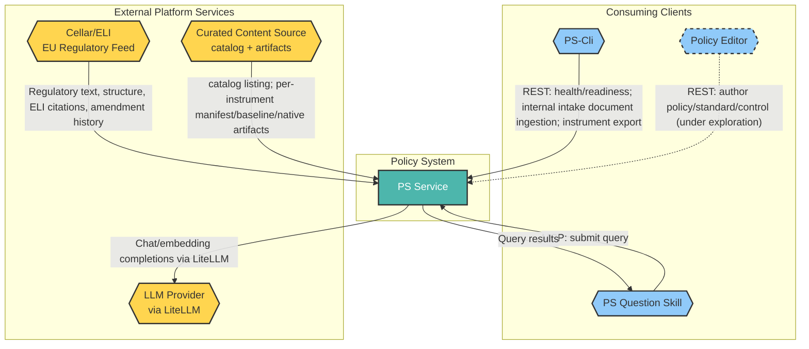
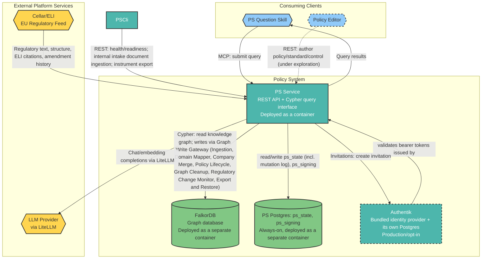

<!-- © 2026 Cartman ApS. All rights reserved. -->
# Policy System Solution Architecture

**Status:** Draft  
**Project Name:** Policy System  
**Last Updated:** August 21st 2026

---

## Table of Contents

1. [Overview](#overview)
2. [C4 System Context Level](#c4-system-context-level)
   - [Diagram Legend & Conventions](#diagram-legend--conventions)
   - [C4 System Context Diagram](#c4-system-context-diagram)
   - [System Context Breakdown](#system-context-breakdown)
3. [C4 Container Level](#c4-container-level)
   - [C4 Container Diagram](#c4-container-diagram)
   - [Container Breakdown](#container-breakdown)
   - [User Role Mapping](#user-role-mapping)
4. [C4 Component Level](#c4-component-level)
   - [Component Breakdown](#component-breakdown)
5. [Use Case Coverage Mapping](#use-case-coverage-mapping)
   - [Query/Read-Only Roles Use Cases](#queryread-only-roles-use-cases)
   - [Regulation Ingestion Use Cases](#regulation-ingestion-use-cases)
   - [Regulatory Change Monitoring Use Cases](#regulatory-change-monitoring-use-cases)
   - [Policy Managers Use Cases](#policy-managers-use-cases)
   - [System Admin Use Cases](#system-admin-use-cases)
6. [NFR Realization](#nfr-realization)
7. [Architectural Considerations](#architectural-considerations)
   - [Risks & Concerns](#risks--concerns)

---

## Overview

**System Purpose & Scope**
The purpose of the Policy System is to provide a backend service that ingests, stores, and monitors EU regulations in a compliance knowledge graph, unifying a select set of EU regulations with a company's internal business regulations and policies. The service will expose a REST API for lifecycle/config and authoring clients (PS-Cli, Policy Editor), and an MCP interface exposing a Cypher query mechanism for PS Question Skill to query the knowledge graph.

**Key Capabilities**

- Ingest EU Regulations via Cellar/ELI
- Map raw EU regulation into the PS Conceptual Model (`ps-domain-concepts.md`) knowledge graph
- Monitor ingested EU regulations for amendments and trigger re-ingestion of affected content
- Ingest Business regulation and policies — the entire compliance spine (Role through Control) is authored directly in the intake document and minted (canonical id only) by Ingestion's internal-seed adapter, converging on shared Capability/Policy nodes via Company Merge the same way external regulations do
- Cypher Query interface

**Consuming clients**

- PS-Cli a distributed command-line client (installed independently of PS Service, like `gh`/`az`) that drives PS Service's REST API — checking health and readiness, ingesting internal business regulations/policies from a local JSON intake document, exporting an ingested instrument's artifact, and managing named service targets (a PDF ingestion pipeline is not designed). Individual operators authenticate through the OIDC device-authorization flow before PS-Cli can reach a non-local PS Service instance. A provider whose `resource` handling conflicts with the MCP authorization spec has no direct Claude path and must be federated into Authentik.
- PS Question Skill a skill that allows agents in VSCode or Claude Desktop ask questions, send Cypher queries to the PS Service and articulate answers to the users question. Reaches PS Service's MCP interface against Authentik directly through a remote connector using the pre-registered `ps-cli` client (authorization code + PKCE, provisioned by the chart); no Dynamic Client Registration is used. It must be the existing `ps-cli` client: the token `aud` is the client ID and PS Service accepts it only when `PS_AUTH_AUDIENCE` equals it. Which Claude surfaces can reach a deployment: [Which Claude surfaces reach your deployment](../artifacts/installation-guide.md#which-claude-surfaces-reach-your-deployment); other identity providers: [Other identity providers](../artifacts/idp-configuration-contract.md#other-identity-providers)
- Policy Editor a client for authoring a Policy/Standard/Control from scratch and linking it to an existing Capability (under exploration — client not yet designed)

**Deployment Architecture**

- The PS Service is deployed as a Container and can be run in Podman, Kubernetes etc.
- The PS Service depends on FalkorDB which should be deployed in a separate container. This allows for patching FalkorDB without rebuilding and deploying the PS Service.
- PS Service is single-tenant
- **Local Test** deploys both containers via the same Helm chart onto a local `kind` cluster running under Podman, with `scripts/deploy-llm.sh` provisioning just the Azure LLM backend and `scripts/sync-llm-secrets-to-kind.sh` syncing its credentials into the cluster, then `scripts/deploy-ps-eval.sh` deploying the chart with the bundled Authentik. Login is required: Authentik is served over HTTPS with a locally issued certificate authority (passkeys need a secure browser context, and `ps-cli` accepts only `https` or loopback issuers), the script creates the first user as the `SystemOwner` and Authentik administrator with a passkey-enrolment link (no password), and browsers must trust that authority, and so must the operating system trust store that `ps-cli` verifies against (`truststore`; `--apply-host-setup` adds it). Authentik's HTTPS port is reachable from the local network by design, admin UI included — shipped; see `docs/architecture/customer-azure-llm-bootstrap.md` and `docs/architecture/customer-azure-deployment.md`
- **Production/customer-tenant** targets a real Azure AKS cluster (AAD + Azure RBAC hardened) in the customer's own subscription — `scripts/deploy-ps-prod.sh` provisions the full stack end to end (LLM backend, the AKS cluster with the bundled Authentik identity provider, the same Helm chart, and public HTTPS exposure via a Let's Encrypt certificate, with only the end-user Authentik paths on the public Ingress and the Authentik admin UI reached by `kubectl port-forward`) and creates the first user the same way — shipped; see `docs/architecture/customer-azure-deployment.md`. Both paths deploy the same chart; only the target cluster, provisioning tooling and Authentik exposure differ.
- PS-Cli runs on the same machine as both containers during Local Test; in Production it is a separately-installed client reaching PS Service over the network

**Regulatory Compliance (if applicable)**

- EU GDPR
- EU NIS2

---

## C4 System Context Level

### Diagram Legend & Conventions

**Shape Conventions:**

- **Hexagon shapes:** External systems and actors — consuming clients and external platform dependencies outside the Policy System boundary
- **Rectangle shapes:** Internal containers within the Policy System
- **Cylinder shapes:** Data stores

**Color Coding:**

- **Yellow (`#FFD54F`) fill:** External platform/data service dependency (e.g., Cellar/ELI)
- **Blue (`#90CAF9`) fill:** External consuming client application (e.g., PS-Cli, PS Question Skill)
- **Teal (`#4DB6AC`) fill:** Core Policy System service (PS Service)
- **Green (`#81C784`) fill:** Internal data store container (e.g., FalkorDB)

**Architectural Significance:**

- External system interactions (Cellar/ELI) represent integration boundaries with third-party data platforms outside the team's control
- Consuming clients (PS-Cli, PS Question Skill) interact with PS Service exclusively through its REST/Cypher API — no direct data-store access
- FalkorDB is deployed as a separate container from PS Service specifically so it can be patched independently without rebuilding or redeploying PS Service

### C4 System Context Diagram

*(See Diagram Legend & Conventions above for shape and color interpretations. Dashed border = under exploration, not yet designed.)*

### System Context Breakdown

| Actor | Interaction | System | Actor/System Type | Objective |
| :--- | :--- | :--- | :--- | :--- |
| Cellar/ELI | PS Service fetches EU regulatory document structure (TITLE/CHAPTER/SECTION/ARTICLE/PARAGRAPH), verbatim text per element, ELI citation identity, and amendment history | Policy System | External platform service (EU Publications Office) | Ingest authoritative, structurally-addressable EU regulatory text to keep the compliance knowledge graph current, replacing non-deterministic PDF extraction as the source of truth |
| LLM Provider | PS Service sends prompts/text for chat and embedding completions (provider-agnostic via LiteLLM: Ollama, Azure Foundry, AWS Bedrock, Anthropic, OpenAI, …) and receives generated text/embeddings back | Policy System | External platform service (LLM provider, swappable) | Enable LLM-assisted curation of regulatory/business content into the PS Conceptual Model, without coupling the system to a single LLM vendor |
| Curated Content Source | PS Service fetches the curated catalog listing (`catalog.json`) and, on demand, one instrument's artifact (manifest/baseline/native) at runtime from a configurable HTTP(S) base URL — default: the public Policy System GitHub repo's `curated-content` tree, overridable per deployment | Policy System | External platform service (HTTP(S) content host, swappable via config) | Let PS Service resolve the curated catalog and any instrument's artifact without a local repo checkout or another machine in the loop, so `GET /catalog` and a curated-instrument restore work from server-side config alone |
| PS-Cli | A distributed client, installed independently of PS Service (like `gh`/`az`), that checks PS Service's health and readiness via its REST API, submits an internal regulation intake document (a local JSON file) for ingestion, exports an ingested instrument's artifact to local files, and keeps named PS Service targets. Individual operators authenticate through the OIDC device-authorization flow before reaching a non-local PS Service instance. A PDF ingestion pipeline is not designed | Policy System | External client application (command-line interface) | Enable operators to check PS Service health and readiness, ingest internal business regulation/policy documents into the governance layer, and export ingested instruments |
| PS Question Skill | Sends Cypher queries to PS Service's MCP Interface and receives results, used to articulate answers to user questions | Policy System | External client application (Claude Desktop / VS Code skill) | Enable users in their agentic coding/chat environment to ask natural-language questions about regulations and policies, answered against the compliance knowledge graph |
| Policy Editor | Enables a user to author a Policy/Standard/Control from scratch and link it via an edge to an existing Capability — **client and interaction design are under exploration, not yet specified** | Policy System | External client application (not yet designed) | Enable manual authoring of governance-layer content as an alternative to PDF-based ingestion |

---

## C4 Container Level

### C4 Container Diagram

*(See Diagram Legend & Conventions above for shape and color interpretations. Dashed border = under exploration, not yet designed, or — for Authentik only — production/opt-in rather than always-on.)*

### Container Breakdown

**Important:** Diagrams must accurately reflect the containers listed in this table. The table is the source of truth; diagrams are visual representations of this data.

| Container/Service | Description | Key Responsibilities | Domain path |
|-----|---|---|---|
| PS Service | Backend REST API service, deployed as a single-tenant container (Podman/Kubernetes) | • Expose REST API for consuming clients (PS-Cli, Policy Editor) and an MCP interface for PS Question Skill • Ingest EU regulations via Cellar/ELI • Map raw EU regulation text into the PS Conceptual Model knowledge graph • Ingest business regulations/policies — the entire regulatory spine (Role through Control) is authored directly in the intake document and minted (canonical id only) by the internal-seed Ingestion Adapter, converging on shared Capability/Policy nodes via Company Merge the same way external regulations do • Expose a Cypher query interface to consuming services • Persist and query the compliance knowledge graph via FalkorDB • Access an LLM Provider via LiteLLM for content curation • Restore pre-curated instrument graphs (baseline + native) from an uploaded artifact or the configured curated content source into a target deployment, requiring no LLM provider or extraction run • Fetch the curated catalog listing and, on demand, one instrument's artifact at runtime from a configurable HTTP(S) source (default: the public Policy System GitHub repo), with a FalkorDB-persisted runtime override settable/resettable/readable via MCP, no restart required | ps.service |
| PS-Cli | Distributed command-line client, installed independently of PS Service (like `gh`/`az`) and reaching it only through its REST API and the OIDC endpoints of the identity provider; it never accesses the graph, the state database or the container runtime | • Report PS Service health and readiness • Validate and submit an internal regulation intake document for ingestion • Export an ingested instrument's artifact to local files • Keep named PS Service targets and select the current one • Authenticate the operator through the OIDC device-authorization flow, holding a per-context refresh token in an operating-system-protected store | ps.cli |
| FalkorDB | Graph database storing the compliance knowledge graph, deployed as a separate container from PS Service to allow independent patching without rebuilding/redeploying PS Service | • Store the regulatory and organizational layers of the compliance knowledge graph; a projection rebuilt from the mutation log in PS Postgres • Execute Cypher queries issued by PS Service | ps.falkordb |
| PS Postgres | Relational database server holding PS Service's own state, deployed as a separate container; always deployed, the same "always-on" posture as FalkorDB (unlike Authentik, which is opt-in) | • Host two databases on one server: `ps_state` (audit, authz, runtime config, and the graph mutation log, the authoritative record of graph content) and `ps_signing` (Passkey Signing enrolled credentials/pending approvals) • Serve per-call connections to PS Service's Persistence component • Apply each component's pending SQL migrations at startup, or earlier through the admin-credential provisioning step, which runs them as the application role • Hold the non-login owner role that owns the insert-only graph log tables, so the application role cannot alter or drop them | ps.postgres *(no prior convention found in the Container Architecture doc or code; chosen for consistency with `ps.falkordb`)* |
| Authentik | Bundled third-party identity provider (with its own dedicated Postgres, per the Helm chart's `authentik` dependency), production/opt-in rather than always-on — off by default in local test, enabled for production/customer-tenant deployments | • Issue OIDC bearer tokens that PS Service's Authentication component validates • Serve PS Service's Invitations component's calls to its invitation-stage API for invite-only account signup • Optionally federate to an upstream customer IdP | — |

### Units without a Container Architecture

Container Architecture documents exist for PS Service ([`ps-service-container-architecture.md`](ps-service-container-architecture.md)) and PS-Cli ([`ps-cli-container-architecture.md`](ps-cli-container-architecture.md)). The other deployable or shipped units have no components of their own to decompose, and each states its contract elsewhere:

| Unit | Kind | Why it has no Container Architecture | Where its contract is specified |
| :--- | :--- | :--- | :--- |
| FalkorDB | Third-party datastore, deployed as its own workload | No code of its own; the contract is Cypher over the Redis protocol plus a persistent volume | Container Breakdown above; [`helm-chart-values-reference.md`](../artifacts/helm-chart-values-reference.md) |
| PS Postgres | Third-party datastore with chart-owned initialisation SQL | The schema and migrations belong to PS Service's Persistence component | [PS Service Persistence](ps-service-container-architecture.md#persistence) |
| Authentik and its Postgres | Third-party identity provider with a chart-owned blueprint | Configuration of a third-party product | [`idp-configuration-contract.md`](../artifacts/idp-configuration-contract.md) |
| Policy System Plugin (`ps-skills/ps-plugin`) and the root `.claude-plugin/marketplace.json` | Declarative package of 14 skills, rubrics and one MCP connector declaration; no executable code | Its contract is the MCP tool surface of PS Service; each `SKILL.md` specifies its own skill | [PS Service MCP Interface](ps-service-container-architecture.md#mcp-interface); [`ps-skills/readme.md`](../../ps-skills/readme.md) |
| `curated-content/` | Data artefact fetched by PS Service at runtime | A versioned data format, not a unit with components | [PS Service Curated Source](ps-service-container-architecture.md#curated-source) and [`curated-content/README.md`](../../curated-content/README.md) |
| Helm chart `policy-system` | Packaging unit | Deploys the units above; adds no components | [`helm-chart-values-reference.md`](../artifacts/helm-chart-values-reference.md) |
| `tools/*`, `scripts/*`, `.github/` actions and scripts, `.claude/skills`, `.agents/skills` | Maintainer, operator and CI tooling | Not deployed | The installation and operations guides for operator-facing scripts |
| `ps-test-support`, `ps-test-plugin` | Test-only packages | Not shipped | None |
| `docs/architecture/ps-client-mockup/` | Static design mockup | Not deployable | [`ps-client-ux-design.md`](ps-client-ux-design.md) |

### User Role Mapping

| User Role | Accessible Containers/Services |
|-----------|-------------------------------|
| Compliance Officers | PS Service via PS Question Skill (read-only query), ps-cli (ingest internal regulations from a local intake document), the `ps-ingest-regulation` skill over MCP (select and ingest external regulations) and the `ps-graph-cleanup` skill over MCP (merge duplicate graph nodes) |
| Policy Managers | Policy Editor (create/edit/approve policies/standards — under exploration) |
| Legal Counsel | PS Service via PS Question Skill (read-only query) |
| Security Architects | PS Service via PS Question Skill (read-only query) |
| Risk Managers | PS Service via PS Question Skill (read-only query) |
| DevOps/Engineering | PS Service via PS Question Skill (VS Code) |
| Auditors | PS Service via PS Question Skill (read-only query) |
| Software Engineers | PS Service via PS Question Skill (read-only query) |
| Security Engineers | PS Service via PS Question Skill (read-only query) |
| Engineering Managers | PS Service via PS Question Skill (read-only query) |
| System Admin | PS Service via PS-Cli (health/readiness; named targets/contexts and OIDC login, mostly relevant in production deployment) |

**Purpose:** Maps user roles to the containers/services they can access, clarifying access control boundaries.

---

## C4 Component Level

### Component Breakdown

| Component | Description | Key Responsibilities | Domain path |
| :--- | :--- | :--- | :--- |
| Ingestion | Ingests regulation content from a source (Cellar/ELI for EU regulations) instead of PDF, persisting it as a native structural graph | Fetch a regulation's structure/text via a source-specific Ingestion Adapter; persist that source's native structural graph to FalkorDB as-is — see Container Architecture for the adapter pattern; an EU Directive is ingested as an EU-level framework node plus a separate node per member-state transposition (see [`ps-domain-concepts.md`](../artifacts/ps-domain-concepts.md#directives-and-national-transposition)) | ps.service.ingestion |
| Domain Mapper | Maps an *external* regulation's native structural graph into the curated, PS-domain-shaped baseline graph (Role/Requirement/Obligation/Capability) via LLM-driven extraction, through a Domain Mapping Adapter paired to that source's Ingestion Adapter | Curate/derive PS Conceptual Model entities from an external regulation's native structural graph into a per-regulation baseline. Internal sources bypass Domain Mapper entirely — see Ingestion's internal-seed adapter, which authors and mints the full compliance spine (Role through Control) directly from the customer's intake document in one step | ps.service.domainmapper |
| Company Merge | Dedupes and merges a company's selected regulation baseline graphs into one single-tenant graph | Merge selected baseline graphs per company — operates only on the per-regulation baseline graph already populated upstream (by Domain Mapper for external sources, by Ingestion's internal-seed adapter for internal sources), resolving it into the company graph with cross-regulation dedup at Capability (and Policy for internal sources); Role/Requirement/Obligation are source-scoped and passed through; unaffected by source-specific (Cellar/ELI) adapter changes; backfills a freshly-computed incoming Capability embedding onto its own baseline graph too, so a later merge run against a re-ingested, mostly-unchanged amendment (Regulatory Change Monitor) doesn't repeat that embedding cost | ps.service.companymerge |
| Export | Serializes an already-ingested instrument's baseline and native graphs into a checksummed, schema-versioned curated artifact for the curated content source | Backfill Capability/Policy embeddings onto the source baseline graph so restore never needs a live LLM call; serialize both graphs generically (label/relationship-type agnostic); write the manifest and regenerate the aggregate catalog listing. Reached through `POST /exports` (`ComplianceOfficer` access role; `ps-cli export instrument`) and the maintainer shim `tools/curated-export/export_instrument.py` | ps.service.export |
| Restore | Loads a curated instrument's artifact, uploaded by the caller or fetched from the configured curated content source, into a target deployment, with no LLM provider or extraction run | Verify the artifact's checksum and `schema_version` before any write; merge the baseline leg into the single-tenant graph via an offline replay of Company Merge's own Capability dedup/convergence, using the artifact's own pre-computed embeddings; import an internal instrument's Policy/Standard/Control tree as `draft`, owned by the restoring caller, never converged onto an existing Policy; load the native leg into its own per-instrument graph space, no dedup; submit the native, baseline and single-tenant legs as one gateway group applied by swap, so restore is all-or-nothing per instrument and a reader sees none or all of it | ps.service.restore |
| Curated Source | Fetches the curated catalog listing and, on demand, one instrument's artifact from a configurable HTTP(S) source at runtime, and keeps a runtime override of that source as a Runtime Config value | Fetch `catalog.json` and, on demand, one instrument's manifest/baseline/native from the effective source (the persisted override, else the env-var/default), failing hard on an unreachable or malformed source rather than falling back to stale data; persist/resolve/clear the runtime override via MCP (`set-catalog-source`/`get-catalog-source`/`reset-catalog-source`), failing closed with a named error when the override cannot be read rather than serving the env-var/default; resolves a requested `instrument_id` case-insensitively against the catalog before fetching, rejecting an ambiguous match and naming the closest candidates when none match | ps.service.curatedsource |
| Invitations | Creates Authentik invitations on behalf of the `invite-user` MCP tool, using PS Service's own configured service credential — no other responsibility | Call Authentik's invitation-stage API (`POST /api/v3/stages/invitation/invitations/`) with the target email and PS Service's own `PS_AUTHENTIK_API_TOKEN`/`PS_AUTHENTIK_BASE_URL` service credential, never a caller-supplied token, and build the invitee's link on the optional `PS_AUTHENTIK_PUBLIC_URL` when set, else on the base URL; the credential's presence is enforced unconditionally at startup, with no local-test-bypass exemption | ps.service.invitations |
| Query Engine | Executes Cypher queries against the compliance knowledge graph on behalf of PS Question Skill and returns results | Receive Cypher queries via PS Service's query interface; execute against FalkorDB; return results with provenance; return an explicit "graph is unseeded" error, distinguishable from a legitimate empty result, when the target graph has no seeded content at all | ps.service.queryengine |
| Domain Schema | Holds the PS domain schema (node labels, properties, edges, cardinality) as code, the single source of the vocabulary served to clients | Define `DOMAIN_SCHEMA`; render the slim schema returned by the `domain_concepts` tool; generate the property, relationship and edge-catalog tables in `ps-domain-concepts.md` and the intake JSON schema; fail a freshness check when any generated copy drifts | ps.service.domainschema |
| MCP Interface | Exposes the compliance knowledge graph's Cypher query capability to PS Question Skill via the Model Context Protocol (MCP) | Accept MCP tool calls from PS Question Skill; delegate query execution to Query Engine; return results over MCP | ps.service.mcpinterface |
| Authentication | Validates OIDC bearer tokens for both PS Service's REST API and MCP Interface via one shared verifier, backed by the bundled Authentik identity provider | Verify bearer tokens presented by REST/MCP callers against the configured OIDC issuer; fail closed at startup when neither auth config nor the local-test bypass is present | ps.service.auth |
| Authorization | Enforces role- and attribute-based access checks for both PS Service's REST API and MCP Interface | Enforce RBAC (`AccessRole`) and ABAC (`AccessRule`) checks; own the role-assignment table in the PS state Postgres; record every grant/revoke through Audit; fail closed if the store is unavailable | ps.service.authz |
| Policy Lifecycle | Governs the draft → proposed → approved → deprecated workflow for human-authored Policy/Standard/Control content | Enforce lifecycle transitions and their cascading effect on a Policy's Standard/Control tree; block self-approval; apply versioning/`SUPERSEDED_BY` on approval; record every transition through Audit | ps.service.policylifecycle |
| Graph Cleanup | Lets a Compliance Officer merge duplicate Capabilities and duplicate Obligations (same Role) in the compliance graph, release a Capability from a draft governing Policy, and reverse a merge, as an accountable, reversible graph edit | Discover near-duplicate Capabilities and same-Role duplicate Obligations; preview each edit and require a passkey approval bound to the exact pair and state; tombstone an absorbed Capability (`merged` status, `MERGED_INTO` redirect that Company Merge follows) and delete an absorbed Obligation (leaving a `MergedObligation` marker); record every edit through Audit before applying it, with a snapshot that lets it be reversed; gated by an explicit `ComplianceOfficer` grant | ps.service.graphcleanup |
| Regulatory Change Monitor | Detects when an EU regulation or Directive framework text is amended by polling Cellar/ELI, and triggers re-ingestion of the affected instrument | Poll Cellar/ELI for regulatory amendments; trigger the full re-ingestion cycle (Ingestion → Domain Mapper → Company Merge) for the amended consolidated text, then record `SUPERSEDED_BY` and the prior's `superseded` status as the last write, in both the native and the merged graph; surface a delta report of affected content — **delta report shape/mechanism is under exploration**. Both poll and trigger are manually invoked today — **no scheduler yet**. Polling covers directly-applicable regulations and Directive framework texts on one identical Cellar-lineage path; monitoring a Directive's member-state transposing statutes is a separate concern **under exploration** — there is no common EU-level source to poll | ps.service.changemonitor |
| LLM Interface | Shared internal component wrapping LiteLLM, giving other components a single point of access to the configured LLM Provider | Route chat/embedding requests to the configured LLM Provider via LiteLLM; abstract provider-specific credentials/config away from consuming components (Domain Mapper, Company Merge, and potentially Query Engine/Regulatory Change Monitor) | ps.service.llminterface |
| Logging | Shared internal component providing structured, semantic logging for every other PS Service component, giving detailed debug data during pipeline/query runs | Accept structured log entries from other components; write JSON-structured entries to the configured log sink; bind a correlation (run) ID at each primary-use-case entry point so a full pipeline/query run can be traced end to end | ps.service.logging |
| Dependency Health | Process-wide registry of whether FalkorDB, the state Postgres, the graph replay, the passkey-signing Postgres, LLM Interface and Cellar/ELI succeeded on their most recent call | Fed by those components' own exception handling on every real call; read by Process Harness to answer `/ready`, where FalkorDB, the state Postgres and the graph replay gate readiness and the other three are reported by name only, and only to a caller with a valid bearer token (an unauthenticated `/ready` carries the status alone); a subsequent successful call marks a dependency healthy again | ps.service.dependencyhealth |
| Passkey Signing | Owns a WebAuthn relying party for transaction-signing, independent of the OIDC login IdP | Store enrolled signing credentials and pending-approval records in the separate `ps_signing` database on the PS Postgres server; construct/verify dynamically-bound challenges; serve companion-browser enrollment/signing ceremony pages | ps.service.passkeysigning |
| Audit | Shared, insert-only, tamper-evident (hash-chained) audit trail for every PS Service component that needs to record who did what to what, and when | Validate an action's `details` payload against its registered typed model before insert; persist one `audit_log.audit_events` row per audited action/denial in the PS state Postgres, in the same transaction as the state change when the caller supplies one; serve filtered, paginated, newest-first reads, optionally narrowed by an allow-listed `details` key (`celex`, `regulatory_instrument_id`, `instrument_id`) so "who ingested or restored X" is answerable; record, for ingestion, restore, near-miss resolution, user invitation and `check_regulations` re-ingests, a fail-closed opening row before the effect and a best-effort terminal row; expose no update/delete method; the database refuses update, delete and truncate and chains every row, and an on-demand check recomputes the chain (tamper-evident only: a superuser who consistently rewrites the whole chain is not detected) | ps.service.audit |
| Graph Write Gateway | The single path through which PS Service components write to the compliance graphs, recording every write in an append-only mutation log before applying it | Accept graph writes from Ingestion, Domain Mapper, Company Merge, Restore, Policy Lifecycle, Graph Cleanup and Regulatory Change Monitor as transaction groups; record each group in the mutation log (in the PS state Postgres) before it is applied; apply it to FalkorDB, which is a rebuildable projection of the log; replay the log and verify a rebuilt graph by canonical digest; reject node labels and relationship types outside the label allow-list; fail closed when the log cannot accept a group; report a group as "committed, apply pending" (not an error) when FalkorDB is unavailable after the commit | ps.service.graphgateway |
| Persistence | Shared internal component owning PS Service's state Postgres access, so other components need not each carry their own connection or migration machinery | Open per-call connections to the PS state Postgres from `PS_STATE_POSTGRES_*` and fail closed when it is unconfigured; probe its connectivity; apply each component's pending SQL migrations at startup, tracked per component, serialized by a migration advisory lock with a bounded wait; run a privileged, admin-credential provisioning step that also applies the ordinary migrations as the application role and creates the owner-protected tables, and verify at startup (read-only, application credentials) that it ran | ps.service.persistence |
| Runtime Config | Shared internal component owning PS Service's runtime-mutable configuration values, so a second such value needs a registry entry rather than a new storage pattern | Declare each key in a typed registry (name, value type, validator); reject an unregistered key or invalid value before any write; persist values in the `runtime_config` table of the PS state Postgres; write one `audit_events` row per set/reset in the same transaction through the Audit component's public interface; fail closed when the store cannot be read | ps.service.runtimeconfig |
| Ingestion Runs | Tracks catalog ingestion runs submitted asynchronously over MCP, so a caller can poll a long run instead of blocking on it | Persist each submitted run's status and terminal result/error in the ingestion_runs table of the PS state Postgres; run each submission on a background thread under a configured cap on concurrently in-flight runs; record submission and completion through Audit | ps.service.ingestionruns |
| Process Harness | The process composition root that starts PS Service and exposes its liveness/readiness surface | Expose `/health` (liveness) and `/ready` (readiness); probe every tracked dependency once at startup, of which FalkorDB, the state Postgres and the graph replay gate readiness; confirm every ingestion-required configuration field resolved; own `load_config()`/`uvicorn.run()` | ps.service.main |
| Command Interface | The PS-Cli command surface: parser, dispatch, output and exit-status mapping | Define the commands `get health`, `ingest document`, `export instrument`, `config` and `auth`; dispatch each to its handler; map every failure to an exit status | ps.cli.commandinterface |
| Context Configuration | PS-Cli named targets and service URL resolution | Resolve the PS Service URL from environment, flag, `targets.toml`, project override and packaged default; create, select and list contexts | ps.cli.contextconfiguration |
| Operator Authentication | PS-Cli OIDC device-flow login and credential storage | Discover the authorization server, run the device-authorization flow, hold a per-context refresh token in an operating-system-protected store, produce an in-memory access token per invocation | ps.cli.operatorauthentication |
| Service Client | PS-Cli REST client for PS Service | Call `/health`, `/ready`, `/ingestions` and `/exports` with bounded timeouts, bearer token and operating-system TLS trust; translate failures into operator-facing errors | ps.cli.serviceclient |
| Intake Validation | PS-Cli local validation of an internal regulation intake document | Validate the document against the packaged intake schema before any request is sent | ps.cli.intakevalidation |

*Graph Write Gateway rows: Ingestion, Domain Mapper, Company Merge, Policy Lifecycle, Graph Cleanup, the Regulatory Change Monitor (the re-ingest succession), Export (the embedding backfill) and Restore (the three legs of a restore as one group) write through the gateway.*

---

## Use Case Coverage Mapping

Use cases reference `ps-primary-use-cases.md`'s URS IDs (UC-1 through UC-4).
Roles are grouped where they share the same use case and implementing
component(s), rather than listed individually.

### Query/Read-Only Roles Use Cases

Compliance Officers, Legal Counsel, Security Architects, Risk Managers,
DevOps/Engineering, Auditors, Software Engineers, Security Engineers,
Engineering Managers.

| Use Case | API Entry Point | Implementing Container/Component | URS Requirement |
| :--- | :--- | :--- | :--- |
| Query regulations and policies | PS Question Skill → PS Service MCP Interface | MCP Interface (delegates to Query Engine). Alternate flow: a target with zero seeded content returns an explicit "graph is unseeded" error, distinguishable from a legitimate empty result — implemented once in Query Engine, so every client (MCP Interface today) observes the identical signal | UC-3 |

### Regulation Ingestion Use Cases

| Use Case | API Entry Point | Implementing Container/Component | URS Requirement |
| :--- | :--- | :--- | :--- |
| Select and add a regulation | Policy System Plugin skill `ps-ingest-regulation` → PS Service MCP Interface | Ingestion → Domain Mapper → Company Merge. Alternative, LLM-free path for a curated instrument: the `ps-restore-instrument` skill has PS Service fetch the pre-curated artifact from the configured curated content source and Restore replays the same additive, merge-only outcome via a data load — no LLM provider or extraction run (the artifact itself is produced ahead of time by Export) | UC-1 |
| Govern internal regulations | PS-Cli `ingest document` → PS Service REST | Ingestion → Company Merge (`source_type: internal`; Domain Mapper is not invoked for internal sources — Ingestion's internal-seed adapter authors and mints the full compliance spine, Role through Control, directly from the customer's intake document; Company Merge then resolves cross-source convergence at Capability and Policy exactly as for external sources) | UC-2 |

### Regulatory Change Monitoring Use Cases

Not user-triggered — Regulatory Change Monitor drives this use case by polling Cellar/ELI. Poll and trigger are manually invoked today (no scheduler yet); autonomous scheduling is the intended end state.

| Use Case | API Entry Point | Implementing Container/Component | URS Requirement |
| :--- | :--- | :--- | :--- |
| Detect and absorb a regulatory amendment | Regulatory Change Monitor → Cellar/ELI (poll) | Regulatory Change Monitor (poll + trigger) → Ingestion → Domain Mapper → Company Merge, succession written last | UC-4 |

### Policy Managers Use Cases

| Use Case | API Entry Point | Implementing Container/Component | URS Requirement |
| :--- | :--- | :--- | :--- |
| Govern policy/standard/control content | Policy Editor → PS Service (under exploration) | Policy Editor backend (not yet defined) | — (not yet defined in `ps-primary-use-cases.md`) |

### System Admin Use Cases

| Use Case | API Entry Point | Implementing Container/Component | URS Requirement |
| :--- | :--- | :--- | :--- |
| Govern policy/standard/control content (bulk PDF path) | PS-Cli → PS Service (under exploration) | PDF ingestion pipeline (not yet defined) | — (not yet defined in `ps-primary-use-cases.md`) |

**Purpose:** Provides traceability from user requirements (URS) to architectural implementation, ensuring all use cases are covered by the architecture.

---

## NFR Realization

This section maps non-functional requirements (from URS) to architectural decisions that satisfy them.

| NFR ID | Requirement Summary | Architectural Decision | Containers Affected | Rationale |
|--------|--------------------|-----------------------|---------------------|-----------|
| [NFR-PERF-001] | [e.g., P95 latency < 200ms] | [e.g., Redis caching layer for read-heavy endpoints] | [e.g., API, Cache] | [Why this decision satisfies the NFR] |

**Guidelines:**

- Every NFR from the URS should appear here — if an NFR has no architectural decision, document why (e.g., "deferred to component-level implementation")
- Multiple NFRs may share an architectural decision
- Decisions here drive Container Architecture strategies (CA documents the component-level details)

---

## Architectural Considerations

### Risks & Concerns

| Risk Category | Description | Mitigation Strategy |
|---------------|-------------|---------------------|
| Design Gap | Two business/policy ingestion paths (PS-Cli's PDF ingestion pipeline; the Policy Editor client) are named in the System Context but their design is under exploration — pipeline mechanics and the Policy Editor client itself remain unspecified. The proposal/review workflow gating Policy/Standard/Control authorship is specified and implemented: `create-policy-draft`/`propose-policy`/`approve-policy`/`reject-policy`/`revert-policy-to-draft` MCP tools, gated by `ps.service.authz`'s `AccessRole`/`AccessRule` framework. | To be resolved through further design exploration before Container/Component-level detail is added for either remaining path |
| Security | The raw `cypher` MCP tool remains open to all authenticated users and can read `draft`/`proposed` Policy/Standard/Control trees — the visibility gate is enforced only on the dedicated lifecycle tools (`create-policy-draft`/`propose-policy`/`approve-policy`/`reject-policy`/`revert-policy-to-draft`) and the dedicated Policy read tool, not on `cypher` itself | Accepted risk: hiding drafts from `cypher` is out of scope |
| Security | Authentication/authorization for PS Service's REST API and MCP Interface is implemented as generic OIDC bearer-token validation (any OIDC-compliant IdP; the production and evaluator deployments use the bundled Authentik as the fixed default IdP, which can optionally federate to an upstream IdP — see the [IdP configuration contract](../artifacts/idp-configuration-contract.md)). Token validation checks audience; authorization is role-based, not scope-based | Bearer-token validation and role-based authorization are in place: a closed `AccessRole` set (`SystemOwner`/`SystemAdmin`/`PolicyManager`/`ComplianceOfficer`, RBAC) plus an `AccessRule` (ABAC) extension point, enforced by one shared component, `ps.service.authz`, callable identically from both MCP tools and REST. Rate limiting and TLS termination remain open, tracked separately |
| Security | The three curated-content source MCP tools (`set-catalog-source`/`reset-catalog-source`/`get-catalog-source`) require the shared OIDC bearer-token check every other MCP tool requires; without a role gate any authenticated caller could repoint where PS Service fetches its curated catalog and artifacts from | Mitigated: all three tools additionally require the caller hold `SystemAdmin` (or `SystemOwner`) via `ps.service.authz` |
| Design Gap | Resolved: the curated-content source override lives in the PS state Postgres and its read fails closed — `GET /catalog`, the on-demand artifact fetch and `get-catalog-source` return a named error when the override cannot be read, never the env-var/default source | Closed; the PS state Postgres is a hard startup and readiness dependency |
| Security | LLM-driven extraction (Domain Mapper, external sources only) treats an ingested Cellar/ELI regulation's source text as trusted input to the extraction prompt — adversarial content in a Cellar/ELI response could attempt to manipulate extraction into minting misleading Requirement/Obligation/Capability content, which the add/merge-only design would then retain | Not yet addressed; requires design exploration |
| Security | Internal-source ingestion (Ingestion's internal-seed adapter) is not LLM-driven, but it treats an internal intake document's asserted content as trusted and persists it largely as submitted — a misleading or malicious intake document could assert inaccurate Role/Requirement/Obligation/Capability/Policy/Standard/Control content directly, which the add/merge-only design would then retain | Not yet addressed; requires design exploration, particularly before internal-source (Business SoP) ingestion is treated as production-ready |
| Security | Credential/secrets management for LLM Provider API keys and FalkorDB access is undecided — no storage, rotation, or handling mechanism is specified anywhere in the architecture | To be decided at L2/implementation; must be confirmed before any non-local deployment |
| Security | No encryption at rest or in transit is specified for FalkorDB, which stores the full compliance knowledge graph — a company's regulatory gaps and control posture in one place | Deferred; should be decided before any non-local/production deployment, alongside the REST/MCP auth decision above |
| Security | Logging is operational/pipeline tracing (`run_id` correlation), not a tamper-evident security audit trail of who accessed or mutated what — relevant once REST/MCP auth introduces distinct callers to track | Deferred; revisit alongside the auth decision above |
| Scalability Bottleneck | No action in the architecture has a load-tested SLA — Query Engine's one stated target ("< 2s") is explicitly draft/not load-tested, and every other action's Processing Time is unset or best-effort | Load-test the read path and establish real SLOs before relying on any stated number to drive timeout/capacity decisions |
| Technical Debt | LLM extraction (Domain Mapper) is explicitly non-deterministic, yet Role/Requirement/Obligation/Capability identity is content-hash-derived — a retried run after a partial failure could reword the same source text differently and mint a duplicate instead of matching the existing node | Not yet addressed; requires design exploration into retry-safe extraction or a within-regulation semantic-match fallback, not just Company Merge's cross-regulation convergence |
| Design Gap | Company Merge surfaces (rather than resolves) a low-confidence semantic-match candidate, aborting the merge — no review/resolution workflow is defined for that surfaced state. Reached only via a manual PS-Cli ingestion today; once the Regulatory Change Monitor trigger is chained through to Company Merge (UC-4 end-to-end wiring) and a scheduler is added, it can be hit unattended | To be resolved through further design exploration — needs an owner, a queue/notification mechanism, and a decision on whether ingestion stays blocked pending review |
| Technical Debt | No schema/data migration strategy exists for the graph itself — RegulatoryInstrument instances version explicitly, but nothing addresses what happens to already-minted nodes when `ps-domain-concepts.md`'s own shape changes (a property renamed or added) | Deferred for the general case (a property rename, or any change that forces re-minting existing nodes). The `instrument_type` addition for Directive modelling is the first live instance and is handled as a purely additive backfill — no node re-identified, existing baselines untouched |

**Common Risk Categories:**

- **Single Points of Failure:** Components or systems whose failure would cause system-wide issues
- **Scalability Bottlenecks:** Areas that may not scale under increased load
- **Security Considerations:** Authentication, authorization, data protection, and compliance concerns
- **Integration Complexity:** Challenges with external system dependencies and data synchronization
- **Technical Debt:** Known limitations, legacy patterns, or areas requiring future refactoring

---

**End of Document**

---
